<div align="center">

# MimirBot

**A workspace of AI agents: a team that talks, hands off work, and gets things done.**

[Download](https://github.com/Oliveir4Matheus/mimirbot/releases/latest) &nbsp;·&nbsp; [All releases](https://github.com/Oliveir4Matheus/mimirbot/releases) &nbsp;·&nbsp; [How it works](#how-it-works) &nbsp;·&nbsp; [Features](#features)

Every bot in the sidebar is a real agent — Claude, Codex or another CLI running on your machine — with its own
model, instructions, memory, skills, routines and computer. Talk to them like contacts. Put them in rooms.
Watch the team hand work to each other, and approve what matters.


[](https://github.com/Oliveir4Matheus/mimirbot/releases/latest)


<br>

<a href="https://github.com/Oliveir4Matheus/mimirbot/releases/latest">
  
</a>
&nbsp;
<a href="https://github.com/Oliveir4Matheus/mimirbot/releases/latest">
  
</a>
&nbsp;
<a href="https://github.com/Oliveir4Matheus/mimirbot/releases/latest">
  
</a>

<sub>Windows x64 installer · Ubuntu 24.04 x64 `.deb` or AppImage · macOS builds from source · [all releases](https://github.com/Oliveir4Matheus/mimirbot/releases)</sub>

<br>
<br>

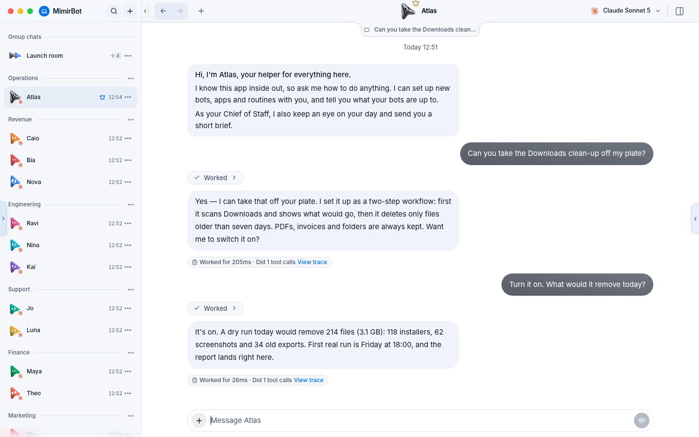

</div>

---

> **MimirBot is local-first and open source (Apache 2.0).** By default, agent processes, transcripts, memory and
> keys stay on your computer, under `~/.mimirbot`; local bots need no MimirBot account.
> MimirBot has no token or cryptocurrency. Any coin using the name is not affiliated with this project.

## Why you need MimirBot

A company does not run on one generalist with one chat box. It runs on roles, rituals, handoffs, approvals and a
shared memory of what was decided. A single assistant can answer a question; it cannot run the shape of the work.

MimirBot is that shape, built for agents. It is a chat app where every contact is an agent and every room is a
team: departments, direct messages, group chats, a Chief of Staff, recurring routines, shared memory, and a
computer for each bot. The agents work **separately** when the job is theirs, and **together** when the job crosses
a boundary.

<table>
<tr>
<td width="33%" valign="top">

### Alone, with its own everything

Each bot has its own model, instructions, memory, skills, routines, permissions and computer. Nova does not
inherit Kai's context; she gets the sales context she needs and nothing else.

</td>
<td width="33%" valign="top">

### Together, in rooms and handoffs

Mention a bot, a department or `@everyone`. The Chief of Staff routes an unaddressed request, and one bot can hand
work to another with the thread, the files and the reason attached.

</td>
<td width="33%" valign="top">

### Accountable by default

Approvals, permissions, run history and a usage ledger belong to the workspace, not to a prompt. You can see what
ran, what it cost, what failed, and who asked for it.

</td>
</tr>
<tr>
<td width="33%" valign="top">

### Your models, your machine

Keep the Claude, Codex or Grok login you already pay for. Point a bot at a local model or an
OpenAI-compatible endpoint. Nothing is proxied through a vendor account you do not control.

</td>
<td width="33%" valign="top">

### Memory that belongs to the department

People, places, decisions and terms live in department memory and load into every bot in that department. The
knowledge stays when a thread is archived or a bot is replaced.

</td>
<td width="33%" valign="top">

### Start with one team, not a migration

Import a team from one Markdown file, or build one department by hand. Connections stay off until you approve
them, routines arrive paused, and no package carries credentials or conversations.

</td>
</tr>
</table>

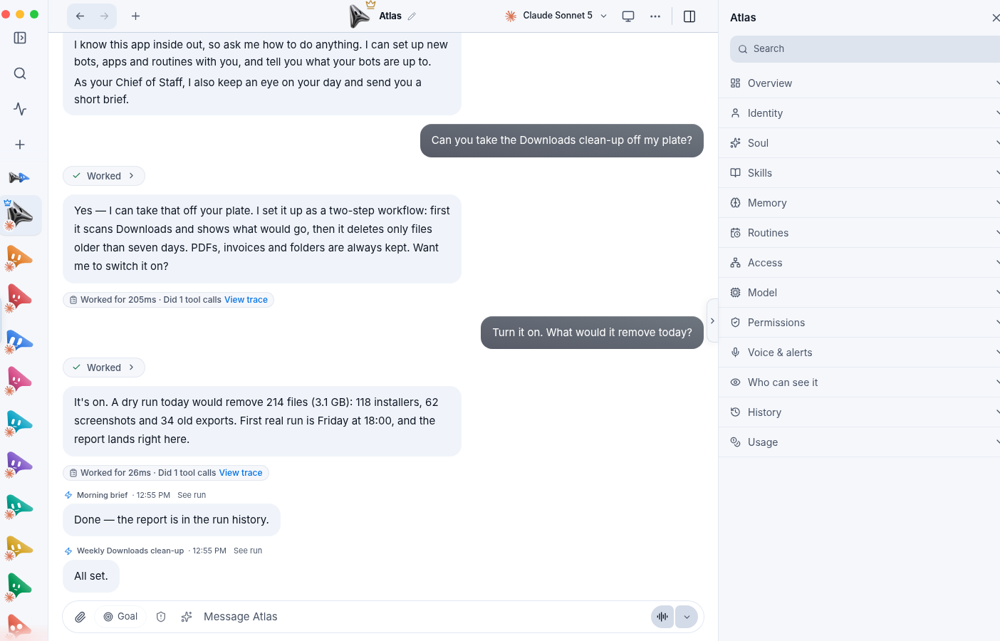

<sub>One bot, one workspace: the conversation, the work it produced, and the settings that make it a teammate —
skills, memory, routines, model, permissions and usage.</sub>

### What this looks like in a company

| Team | The agent owns | The workspace keeps |
|---|---|---|
| **Support** | Inbox triage, routine replies, escalation digests | Refund policy and P1 rules in department memory; every escalation in a run log |
| **Sales** | Lead triage, pipeline review, meeting briefs | Account facts, pricing decisions and the Friday review routine |
| **Engineering** | Nightly build checks, release notes, incident follow-ups | The release train and canary rules; approvals before a deploy |
| **Operations** | The weekly Downloads clean-up, morning briefs, vendor follow-ups | The two-step workflow, its run files, and who approved the change |
| **Finance** | Invoice sweeps and the close checklist | The close calendar, reconciliation rules, and a usage ledger by bot |

The point is not to replace the team. It is to give every role a tireless operator that follows the rules you
already wrote down, asks when a decision is yours, and leaves a receipt.

## Features

Nine primitives, one workspace. Every screenshot below is the running app, not a mockup.

<table>
<tr>
<td width="50%" valign="top">

### Automations

Every trigger in one place: schedules, webhooks and app events, with the next run, the last result and the
history. Turn one off without deleting it.

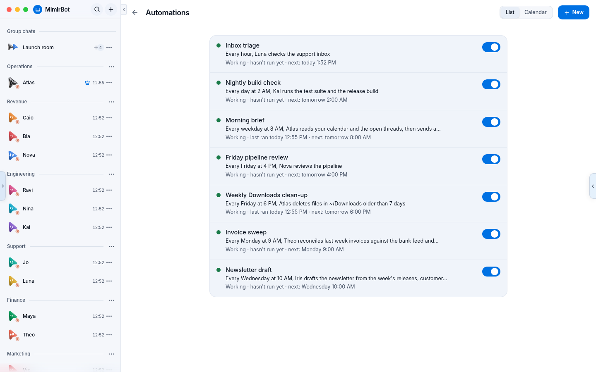

<sub>Friday, 18:00 — the Downloads folder cleans itself and reports what it removed.</sub>

</td>
<td width="50%" valign="top">

### Workflows

A deterministic sequence of steps, each with declared inputs and outputs. The engine verifies the files before
the next step starts, so a run cannot skip a check or invent what comes next.

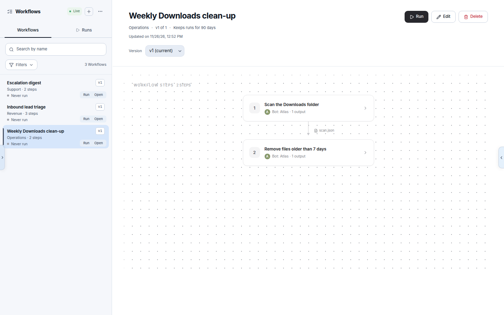

<sub>Scan, then delete only what is older than seven days; keep PDFs, invoices and folders. The report is a run artifact.</sub>

</td>
</tr>
<tr>
<td width="50%" valign="top">

### Schedule

The week at a glance. Routines, calls and the bots that own them on one calendar. Drag a bot onto a time to
schedule it.

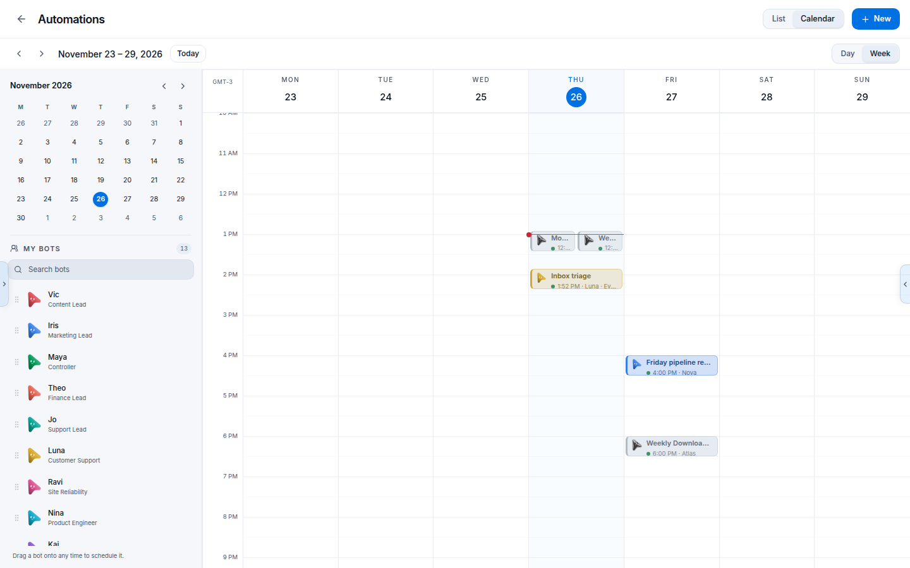

<sub>Thursday's inbox triage, Friday's pipeline review and the 18:00 clean-up, side by side.</sub>

</td>
<td width="50%" valign="top">

### Team map

Departments, bots and the lines between them. Every card carries its model, and every department has its own
memory, shared instructions and rooms.

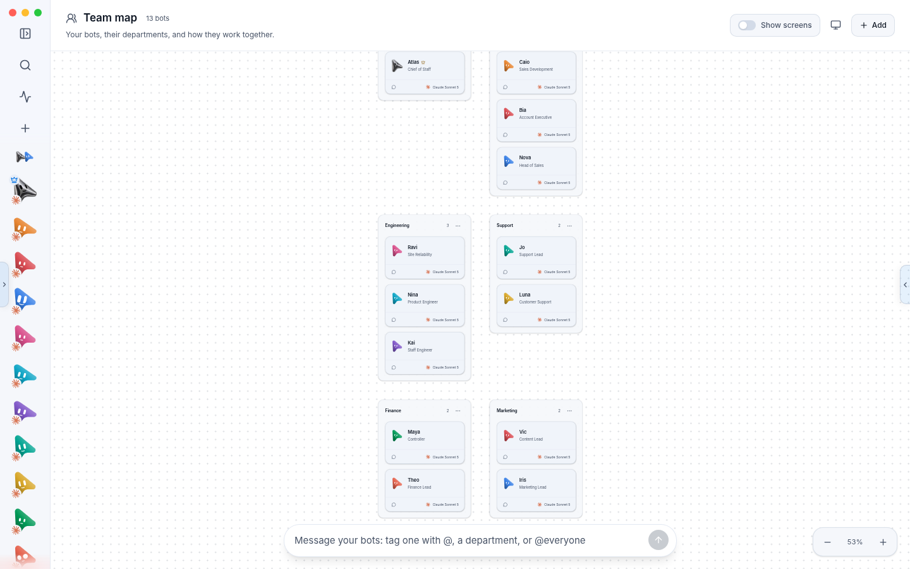

<sub>Thirteen bots, six departments, one map. Open a card to talk, or move a bot when the team changes.</sub>

</td>
</tr>
<tr>
<td width="50%" valign="top">

### Usage

Cost, tokens, runs and failures for any period, by bot and by model. Click a number to chart it; export the
ledger when finance asks.

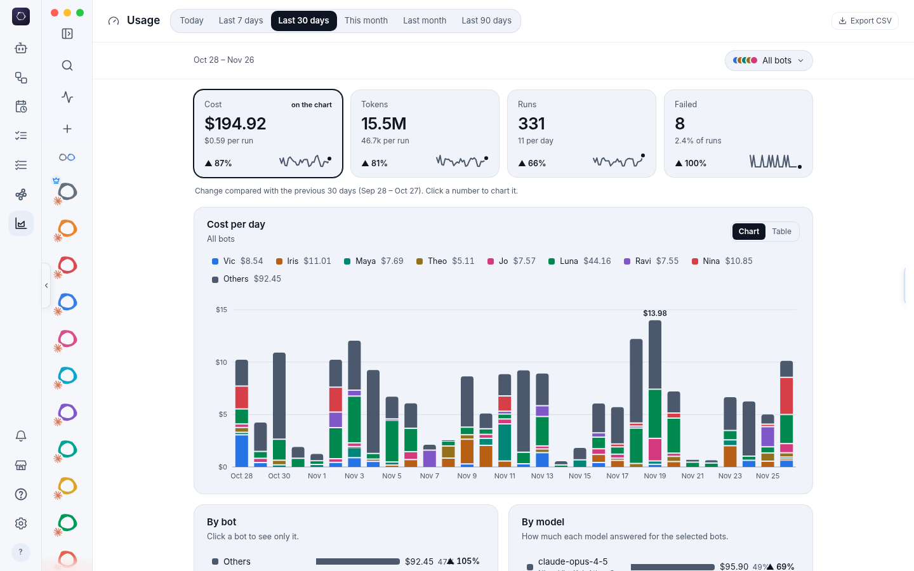

<sub>Thirty days, $194.92 across the team, with the runs that failed and the model that answered.</sub>

</td>
<td width="50%" valign="top">

### Skills

Teach a skill once, then assign it to the bot that needs it. Skills stay in a local library, with tags, versions
and an owner; nothing is fetched from the network.

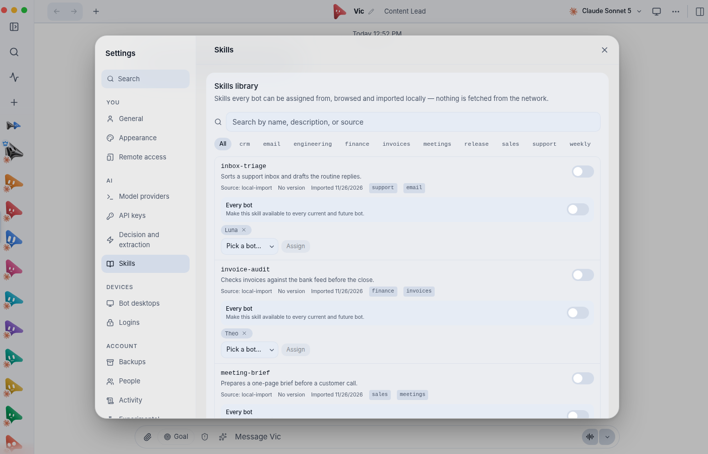

<sub>Inbox triage belongs to Luna; invoice audit to Theo; meeting brief to Nova. The library is shared, the assignment is not.</sub>

</td>
</tr>
<tr>
<td width="50%" valign="top">

### Routines

A routine is a prompt, a schedule and an owner. Edit the words the bot runs, pick the time, choose the bot, and
the next runs appear on the calendar.

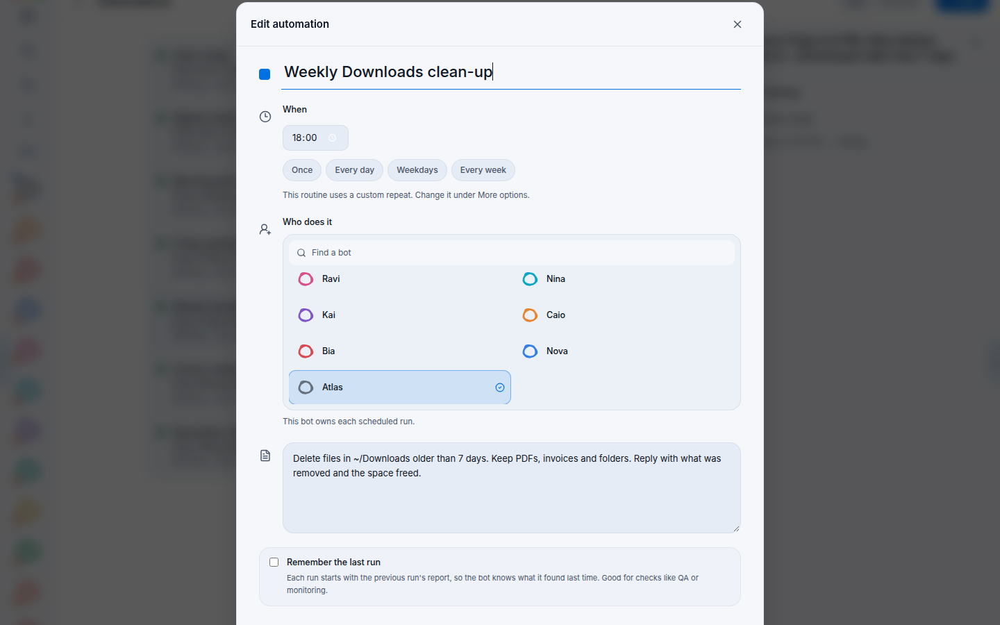

<sub>The exact prompt, the time, and the bot that owns each run. Nothing hidden in a config file.</sub>

</td>
<td width="50%" valign="top">

### Memory

Department memory holds people, places, decisions and terms. Every bot in the department gets the accepted notes
in its context; proposals wait for an admin before they are shared.

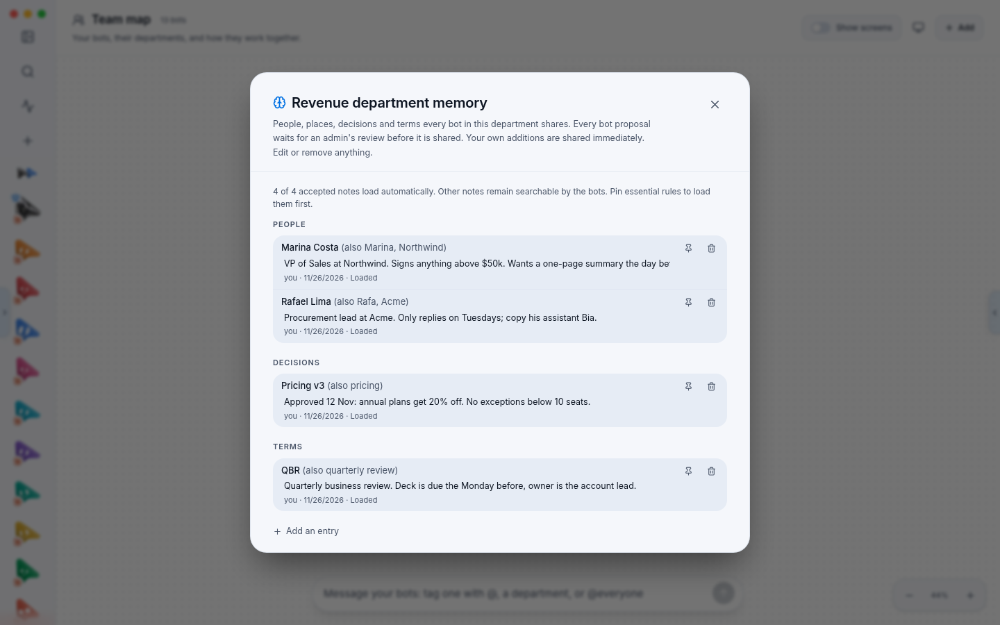

<sub>Marina signs above $50k. Pricing v3 has no exceptions below ten seats. Every Revenue bot knows both.</sub>

</td>
</tr>
<tr>
<td width="50%" valign="top">

### Computer

Every bot gets a place to work: auto, a cloud desktop, an isolated local VM, this computer, or off. The panel
shows the live screen, the browser, the data and the files for that bot.

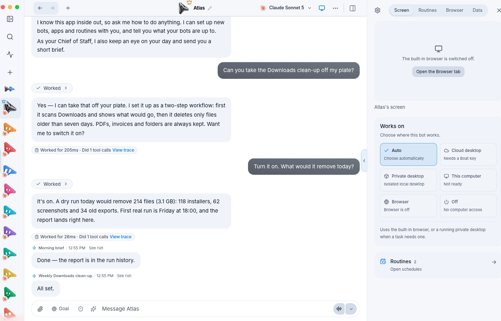

<sub>Auto by default. Cloud desktop with a Boat key. An isolated local VM, this computer after opt-in, or no access at all.</sub>

</td>
<td width="50%" valign="top">

### Everything else in the box

Approval cards for shell commands, file edits and questions. Connected apps through Composio. Pin, unread,
duplicate and hide bots like contacts. Import a whole team from Markdown, share a department as one file, and
keep every secret write-only.

**Streaming replies** with tool-run activity chips · **channels** for each project · **Chief of Staff** routing ·
**MCP** control from Claude Desktop and Cursor · **voice** replies and calls · **workspace backups**.

</td>
</tr>
</table>

## How it works

Two processes. The app holds no transports of its own — it sends typed commands over HTTP and folds one SSE
event stream into state. The harness server owns every agent process and normalizes each provider's native
protocol into one canonical runtime event stream.

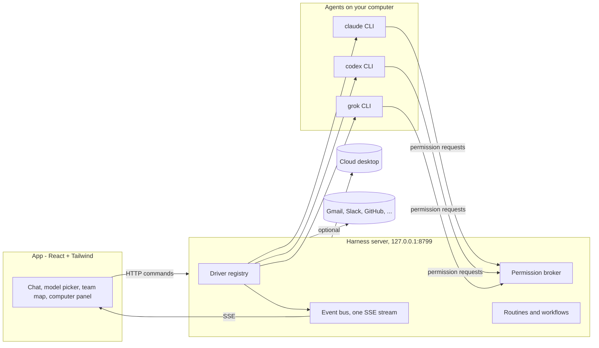

| Layer | Where | What it does |
|---|---|---|
| Drivers | `server/drivers/` | One per provider: Claude, Codex and Grok Build over their local CLIs, plus a cloud-computer agent. Unknown drivers degrade to "unavailable" instead of crashing the fleet. |
| Harness | `server/harness/` | Registry (configs to live instances) and the fan-in event bus every client folds. |
| API | `server/index.ts` | Bots, turns, approvals, model catalog, computer lifecycle, connectors, routines, workflows and config over HTTP and SSE. |
| App | `src/` | The chat shell. Server-backed store, one reducer, no client-side transports. |
| Desktop | `electron/` | Windows, Linux and macOS shells with an embedded harness; platform capabilities are opt-in and fail closed where the safety boundary is not certified. |

### Orchestrate MimirBot over MCP

MimirBot ships a stdio MCP server for external clients such as Claude Desktop and Cursor. It exposes a bounded
team control plane: inspect bots and channels, read and search compact transcripts, create and configure
bots/channels/tasks, send work, wait for completion, switch models, and interrupt turns. It does **not** expose
approval grants, deletion, arbitrary settings, credentials or computer lifecycle.

See [MCP server setup and tool reference](docs/mcp-server.md).

### Run it from scripts and CI

The headless CLI in this repository drives a running workspace without a screen: set up a team from a file,
give a bot one job, wait until it and every teammate it asked are done, and export what they made. One JSON
document with `--json`, and exit codes a script can branch on.

```sh
pnpm omb team apply team.yaml
pnpm omb run "Room Lead" "Rehearse the launch of https://example.com" --export ./out
```

See [Run MimirBot from scripts and CI](docs/headless-cli.md).

## Quick start

**Released builds:** start at [the latest release](https://github.com/Oliveir4Matheus/mimirbot/releases/latest).
The harness server is embedded, so there is no separate server setup.

| | Download | Install |
|---|---|---|
| **Windows** (x64) | `MimirBot-<version>-setup.exe` | Run it. One-click, per-user, no admin rights. The installer is not code-signed yet, so SmartScreen shows "unknown publisher": **More info -> Run anyway**. |
| **Ubuntu 24.04** (x64) | `MimirBot-<version>-amd64.deb` or `MimirBot-<version>-x86_64.AppImage` | Install the `.deb` with APT (recommended), or make the AppImage executable and run it. Beta; GNOME is the supported desktop. |
| **macOS** | Build from source | No signed `.dmg` is published yet. Follow **From source** below and run `pnpm dev:desktop`. |

See the [Ubuntu Desktop guide](docs/linux-desktop.md) for installation, capabilities and troubleshooting.
Any desktop build can also pair as a client to another Windows, Linux or macOS host over Tailscale; see
[desktop-to-desktop companion mode](docs/desktop-companion.md).

**From source:**

```sh
git clone https://github.com/Oliveir4Matheus/mimirbot && cd mimirbot
pnpm install

pnpm dev:server    # harness server -> 127.0.0.1:8799
pnpm dev           # app -> http://127.0.0.1:5173
pnpm dev:desktop   # Electron shell; keep the two commands above running
```

Requirements: **Windows, Linux or macOS**, **Node 24+**, **pnpm**, and at least one agent CLI —
[`claude`](https://claude.com/claude-code), [`codex`](https://github.com/openai/codex) or
[`grok`](https://x.ai/cli) — installed and logged in. They appear in the model picker automatically.

Package the desktop application:

```sh
pnpm package:win      # Windows: installer + ZIP
pnpm package:linux    # Ubuntu x64: .deb + AppImage
pnpm package:mac      # macOS: DMG + ZIP; requires Swift/Xcode tools
```

### Desktop capability status

| Capability | macOS | Ubuntu 24.04 Xorg | Ubuntu 24.04 Wayland | Windows |
|---|---|---|---|---|
| Packaged app, embedded harness, local agent CLIs | Supported | Beta | Beta | Supported |
| Composio and cloud computers | Supported | Beta | Beta | Supported |
| Explicit preview-only local screen capture | Supported | Beta | Beta | Supported |
| Bot control of this computer | Supported | Beta, explicit opt-in | Disabled: Wayland safety gate | Supported |
| Native on-device dictation | Supported | Planned | Planned | Not yet |

The Linux preview is user-initiated and never enables local bot control or Auto routing. On Xorg, the reviewed
Cua Driver runtime starts only after explicit opt-in and without its full-screen cursor overlay. On Wayland the
app never starts it and clears legacy opt-ins while the real-seat safety gate remains unresolved. Chat, preview,
cloud computers and Local VM remain available on both sessions. See the
[Ubuntu Desktop guide](docs/linux-desktop.md).

### Triggers: schedules and webhooks

A trigger is "when something happens, a bot does something". Tell a bot "every weekday at 9, send me a summary of
my inbox" or "whenever our form calls, draft a reply" and it sets the trigger up in that turn with its `trigger`
tool. **Automations** lists every schedule and webhook, with a calendar and the run history. Bots manage them with
`trigger_info`, `trigger` and `delete_trigger`; a webhook a bot creates never shows the bot its secret: the person
copies the link from the card or the Automations page.

Schedules can run once, on selected weekdays, or every 5-1,440 minutes, using either a bot's configured
model/computer or the cloud VM runner. Interval schedules stay aligned to their chosen start time and skip an
occurrence when the previous run is still active, so slow work cannot build an unbounded queue. An optional
advanced run limit can safely stop stuck work; no timeout is imposed unless one is chosen.

**App events** start a bot when something happens in a connected app ("whenever I get an email from Acme, draft a
reply"). Composio sends each event to MimirBot's connected-apps service, which queues it; the app collects the
queue with a long poll, so a desktop needs no public address and events wait while it is closed. Gmail is checked
every 15 minutes; Slack, GitHub and other push apps arrive at once. Details:
[docs/composio.md](docs/composio.md#app-events).

MimirBot starts a webhook-only receiver on `127.0.0.1:8800` by default (or one port above `OMB_PORT`). Set
`OMB_WEBHOOK_PORT` to choose another port. A webhook secret is shown once when the trigger is created or rotated.
Bearer authentication is recommended so the secret stays out of request URLs and most access logs; a single
capability URL remains available for senders that cannot configure headers. The receiver exposes only `/health`
and secret `/hooks/...` endpoints; it never exposes the app's broader API. MimirBot must remain running to accept
a delivery. For public internet delivery, proxy only this dedicated receiver through a hosted relay or a tool such
as Tailscale Funnel.

## Status

MimirBot is in beta. The loop works end to end: message -> agent -> streamed reply -> tools -> approvals ->
computer use, and the team primitives (routines, workflows, memory, skills, usage) are in daily use. Windows and
Ubuntu 24.04 x64 have published builds; Ubuntu remains a beta with the capability limits above. macOS builds from
source. Rough edges to expect: hosted/mobile connectivity is still being built, and webhook triggers use the local
receiver rather than an always-on hosted relay.

The app's **Update channel** setting follows **Main** (stable) or **Beta** (prereleases); an installed app only
offers a version greater than its own. The notes for each version ship in `src/releases/<version>.ts` and open in
the What's new dialog after an update.

Contributions are welcome. The driver SPI in [`server/contracts.ts`](server/contracts.ts) is deliberately small:
adding a provider is one file in [`server/drivers/`](server/drivers/) plus a one-line registration. Any
ACP-speaking CLI or OpenAI-compatible endpoint plugs in through config, with no code:
[`docs/custom-engines.md`](docs/custom-engines.md). Users can add MCP tool servers with no code:
[`docs/custom-mcp-servers.md`](docs/custom-mcp-servers.md).

## Privacy

Usage analytics are optional and anonymous: product events and a once-a-day count of what is set up, never keys,
names, addresses or conversations. Turn them off in **Settings -> General -> Usage analytics**;
[`docs/analytics.md`](docs/analytics.md) lists every event and property.

Agent transcripts, memory, keys and routine history live under `~/.mimirbot` on the machine that runs the
harness. Secrets are write-only in the UI. Cloud computers and connected apps are optional third-party services
with their own accounts and terms.

## Powered by

<div align="center">


</div>

| Service | Purpose |
|---|---|
| **Claude, Codex, Grok** | The agents behind every bot, run through their local CLIs |
| **Electron** | Desktop shells for Windows, Linux and macOS |
| **React, Vite, Tailwind CSS** | The chat app UI and its build |
| **Composio** | Connected apps: Gmail, Slack, GitHub and more |
| **Cua Driver** | Native computer use on your own machine |
| **ElevenLabs, Fish Audio** | Hosted voices for bots that talk back |
| **Boat** ([boat.dev](https://boat.dev)) | Optional cloud Linux desktops for bots |

## License

[Apache License 2.0](LICENSE) (c) 2026 Milind Soni and MimirBot contributors. Details, including how
contributions are signed off, are in [LICENSING.md](LICENSING.md). MimirBot is based on OpenMausBot, also
Apache-2.0; the original notices are kept in [NOTICE](NOTICE).

Packaged Cua Driver components retain their upstream MIT, SIL OFL 1.1, MPL-2.0 and other dependency terms. The
corresponding notices, license texts, source locations and SBOM are in [`third_party/cua-driver/`](third_party/cua-driver/)
and ship beside the native runtime.

MimirBot is an independent, open-source project inspired by Grok Bot. It is not affiliated with, endorsed by or
associated with xAI; "Grok" is a trademark of its respective owner.
