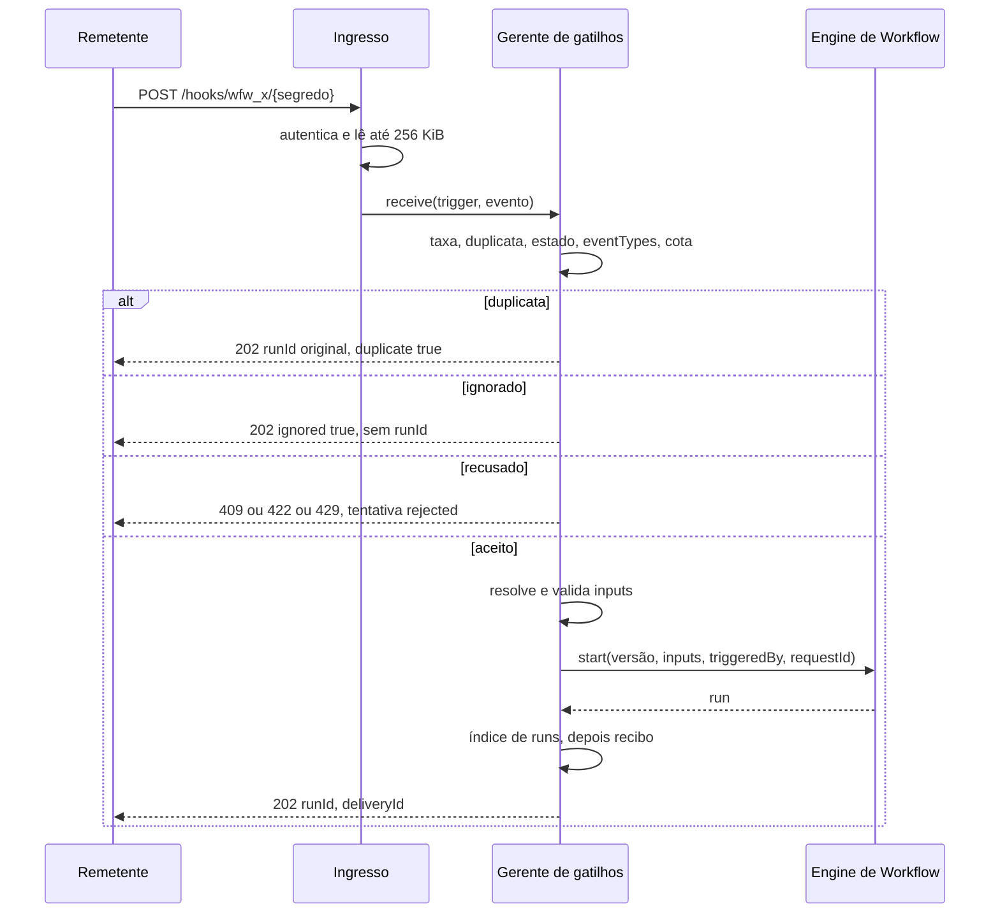
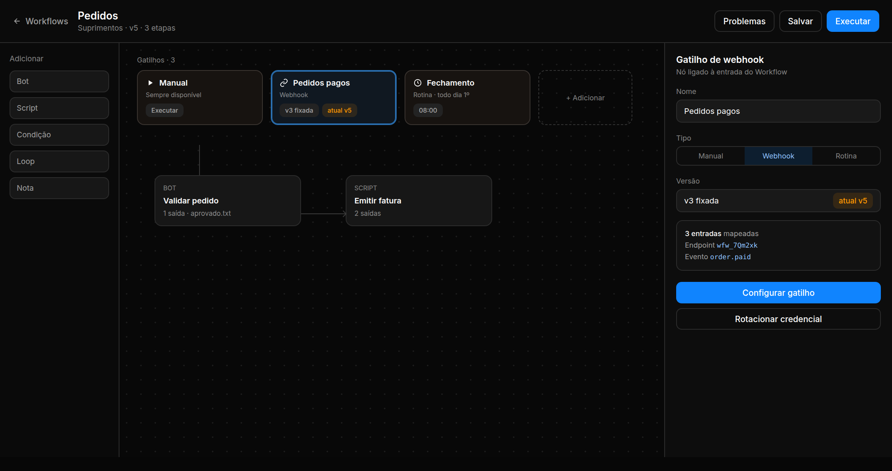
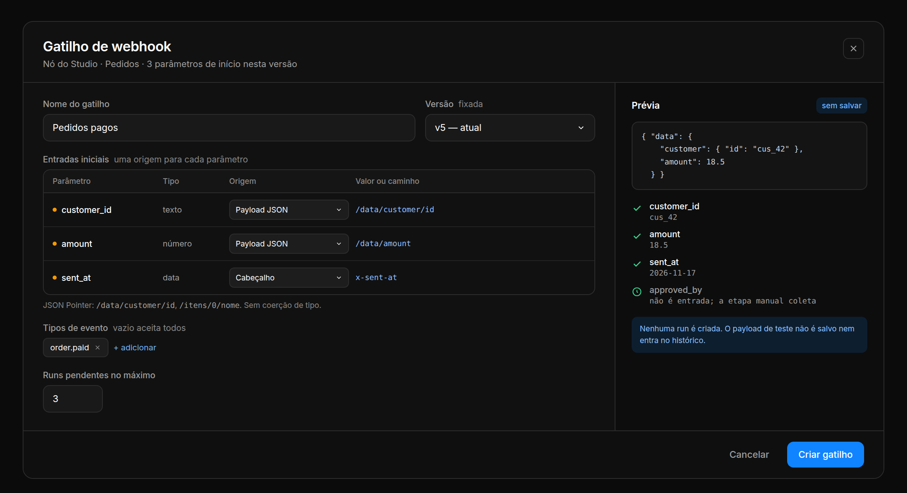
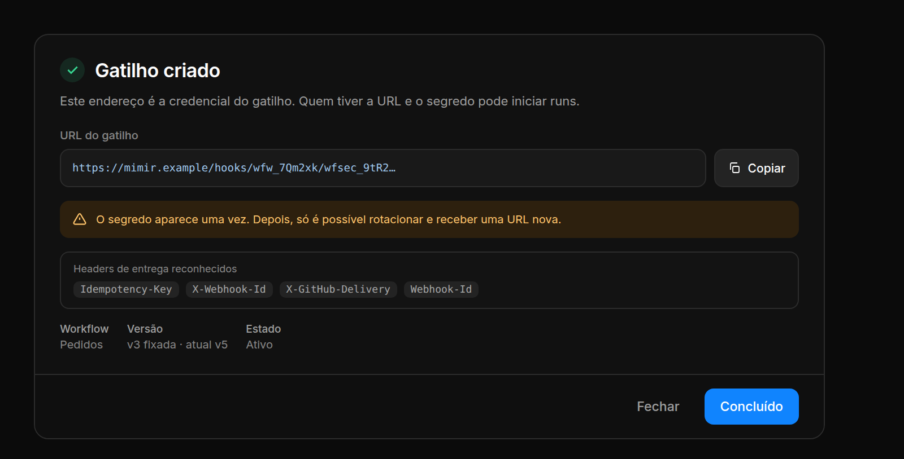
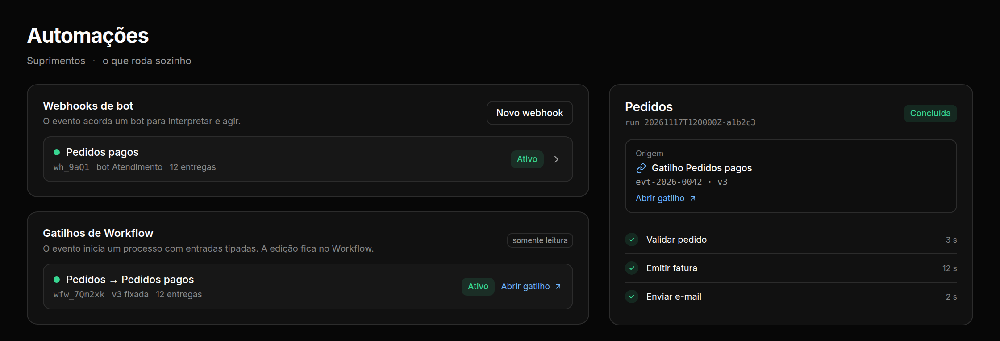

# Spec: gatilhos de Workflow no Studio

> **Status:** pronta para implementação  
> **Data:** 2026-11-17

**Resumo.** Cada Workflow passa a ter **gatilhos** próprios, autorais no Studio: todo Workflow nasce com um gatilho manual e pode receber mais de um, dos tipos **manual, webhook ou rotina**. O gatilho de webhook tem endereço e segredo exclusivos, versão fixada e um mapa declarado de parâmetros de início; o servidor resolve, valida e chama o motor do Workflow. O modelo sai do caminho. Webhooks de bot ficam intocados.

## Nome da feature

Gatilhos de Workflow: manual, webhook e rotina.

## Objetivo / problema a ser resolvido

**Objetivo.** Permitir que um Workflow declare suas origens de disparo no Studio — manual, webhook ou rotina — e que o webhook inicie a run com parâmetros de início determinísticos, sem um turno de bot no meio.

**Contexto em quatro linhas.** Hoje todo webhook cria uma `RoutineRun` de bot com o payload no prompt. Workflow só começa por tela/API, ferramenta do bot ou rotina agendada, e rotina não fornece `inputs`. Logo, um evento já estruturado — pedido pago, formulário enviado, commit — não tem caminho direto até os parâmetros do Workflow.

**Não objetivos do v1:** evento de app como origem; seguir automaticamente a última versão; editar agenda de rotina fora do Studio; verificação de propriedade do endpoint; criar gatilho fora do Studio.

## Impacto

| Área | Impacto |
|---|---|
| Workflows | Zero ou mais gatilhos por Workflow; runs com `inputs` e origem própria |
| Webhooks de bot | Nenhuma mudança de contrato, arquivo ou comportamento |
| Rotinas | Nenhuma mudança; continuam sem fornecer entradas ao Workflow |
| UI | Studio com nós de gatilho obrigatórios; nenhuma criação de gatilho fora dele |
| Ferramentas | `trigger` aceita `when=webhook` com alvo Workflow; `trigger_info` por departamento |
| Dados | Nós de gatilho na definição do Workflow; runtime do webhook em `workflow-triggers.json` |
| Manutenção | Freeze/move, auditoria, exclusão de bot e backups passam a conhecer o dono novo |
| Compatibilidade | Rotas e arquivo aditivos; app anterior recusa `wfw_` com `401` |

## Histórias de usuário

- Como pessoa que recebe eventos estruturados, quero mapear campos do payload para parâmetros e iniciar o Workflow com esses valores exatos.
- Como pessoa que configura a integração, quero ver no salvamento qual parâmetro falta ou está incompatível, com o caminho do erro.
- Como pessoa que depura, quero ver na prévia os valores resolvidos e, no histórico, o `runId` ou o motivo da recusa.
- Como remetente, quero `202` com o mesmo `runId` ao reenviar o mesmo evento e `422` quando um valor obrigatório não puder ser resolvido.
- Como pessoa que agenda uma rotina, quero configurá-la no Studio do Workflow e continuar vendo a rotina no calendário de Rotinas.

## Requisitos funcionais

### Decisão de arquitetura

Entidade separada, dona do Workflow, com transporte compartilhado. Não usar `target` no webhook de bot.

| Alternativa | Problema |
|---|---|
| `target: "workflow"` no webhook atual | Mistura interpretação por bot com integração determinística, exige `botId` artificial e cria estados híbridos |
| Segundo `WebhookManager` independente | Duplica autenticação, taxa, fila, recibos e tentativas; os dois lados divergem |
| **Entidade `WorkflowTrigger` + núcleo compartilhado** | **Escolhida:** dono correto, zero migração e falha fechada no downgrade |

O que muda abaixo da superfície:

- Núcleo extraído do `WebhookManager`: credenciais, admissão, recibos e tentativas.
- `WorkflowTriggerManager` novo, com store, resolução de mapa e commit idempotente.
- Ingresso único com registro de endpoints por prefixo (`wh_`, `wfw_`).
- `WorkflowRunTrigger` e `workflowRunSchema` aceitam a origem webhook (interface **e** zod; sem isso o `run.json` não lê).
- Estas superfícies passam a incluir o gerente novo: freeze/move (`server/move-freeze.ts:39,48`), auditoria (`server/index.ts:1368-1383`), exclusão de bot, backup de workspace (`server/workspace-backup.ts:384-391,758-770`), backup de time e ferramentas.

### Modelo de dados

```ts
export type WorkflowInputBinding =
  | { source: "payload"; pointer: string; onMissing?: "reject" | "omit" }
  | { source: "header"; name: string; onMissing?: "reject" | "omit" }
  | { source: "query"; name: string; onMissing?: "reject" | "omit" }
  | { source: "constant"; value: string | number | boolean | Array<string | number | boolean> }
  | null;

export interface WorkflowTrigger {
  id: string;
  workflowId: string;
  workflowVersion: number;
  workflowName: string;
  department: string;
  name: string;
  endpointId: string;
  inputs: Record<string, WorkflowInputBinding>;
  eventTypes?: string[];
  enabled: boolean;
  maxPendingRuns?: number;
  createdAt: number;
  updatedAt: number;
  createdBy?: { person?: string; botId?: string };
  lastReceivedAt?: number;
  lastRunId?: string;
  deliveryCount: number;
  credentialResetAt?: number;
  pausedReason?: "missing-bot" | "missing-workflow" | "restored" | "frozen" | "moved";
}

export interface WorkflowTriggerInput {
  name: string;
  workflowVersion?: number;
  inputs: Record<string, WorkflowInputBinding>;
  eventTypes?: string[];
  enabled?: boolean;
  maxPendingRuns?: number | null;
}

export type WorkflowTriggerPatch = Partial<WorkflowTriggerInput>;

export type WorkflowRunTrigger =
  | { routineId: string; routineName: string }
  | { triggerId: string; triggerName: string; deliveryId: string };

export type WorkflowTriggerKind = "manual" | "webhook" | "routine";

/** Nó visual e obrigatório do Studio; liga o desenho à entidade de runtime quando houver. */
export interface WorkflowTriggerNode {
  id: string;
  kind: WorkflowTriggerKind;
  name: string;
  /** Webhook: liga ao WorkflowTrigger depois do primeiro save. */
  triggerId?: string;
  /** Rotina: liga ao RoutineManager depois do primeiro save. */
  routineId?: string;
}
```

`WorkflowDefinition` ganha `triggers: WorkflowTriggerNode[]`. Workflow antigo sem o campo é lido com um gatilho manual padrão; nenhum arquivo é reescrito. Os nós ficam na definição versionada do Workflow; o runtime do webhook fica em `workflow-triggers.json`.

| Campo | Regra |
|---|---|
| `triggers` | Pelo menos um; ids únicos; nome 1–80; qualquer combinação de tipos; o último não pode ser removido |
| `kind: "webhook"` | Só é aceito se o Workflow recebe parâmetro no início **ou** em alguma etapa (`collectedBy`); sem isso, o save recusa com `triggers[i]` |
| `kind: "routine"` | O nó existe antes da agenda; a agenda é configurada no inspector e vive no `RoutineManager` |
| `triggerId` / `routineId` | Preenchidos após o primeiro save; ausentes enquanto o nó não foi configurado |

Campos do `WorkflowTrigger` (runtime do webhook):

| Campo | Regra |
|---|---|
| `workflowId` / `workflowVersion` | Workflow e versão existentes, no departamento do chamador. `null` não é aceito |
| `workflowName` / `department` | Snapshot no create; autoriza leitura e limpeza mesmo se o Workflow sumir |
| `inputs` | Só parâmetros **sem origem**: nada de `from` ou `collectedBy` |
| `eventTypes` | 1–20, comparação exata após `trim`; ausente aceita todos |
| `maxPendingRuns` | 1–50; ausente = 3; `null` no PATCH volta ao default |
| `endpointId` | `wfw_` + 16 caracteres; namespace distinto de `wh_` |
| `credentialResetAt` | Gravado quando a restauração rotaciona a credencial |
| `pausedReason` | Interno; a entrega responde `409` enquanto existir |

Persistência em `workflow-triggers.json` (um arquivo por workspace):

```json
{
  "version": 1,
  "triggers": [{ "id": "…", "workflowId": "…", "workflowVersion": 3, "workflowName": "Pedidos", "department": "Suprimentos", "endpointId": "wfw_7Qm2xk", "secretHash": "…", "inputs": {}, "enabled": true, "deliveryCount": 12 }],
  "receipts": [{ "triggerId": "…", "deliveryId": "evt-1", "runId": "…", "acceptedAt": 0 }],
  "attempts": [{ "id": "…", "triggerId": "…", "receivedAt": 0, "outcome": "rejected", "statusCode": 422, "deliveryId": "evt-1", "eventName": "order.paid", "reason": "…" }],
  "deleted": [{ "deletedAt": 0, "trigger": { "…": "…" } }]
}
```

Regras de persistência:

- Apenas `secretHash` (SHA-256). Nenhum segredo em claro, selo reversível ou amostra de payload.
- `receipts`: teto de 20.000, janela de 7 dias. `attempts`: 200 por gatilho. `deleted`: 7 dias para Undo.
- Escrita atômica, modo `0600`, e o guard de arquivo ilegível do store atual.
- `attempts` guardam só metadados: sem payload, sem valores resolvidos, sem headers.
- O backup portátil remove `secretHash`, `receipts`, `attempts` e `deleted`.

### Versionamento

- A versão é fixada no create e mantida no PATCH. Trocar a versão exige revalidar o mapa inteiro.
- A UI mostra “fixado em v3; atual v5” e um botão **Revisar e atualizar** com prévia da versão atual. Nunca atualiza sozinho.
- A versão fixada e a atual precisam pertencer ao mesmo departamento do Workflow, em toda operação.
- Se a versão não puder ser lida, o gatilho é pausado com `pausedReason: "missing-workflow"` e a entrega responde `409`. Não há repin automático.
- “Seguir a última” fica fora do v1.

### Gatilhos no Studio

O gatilho é um **componente visual obrigatório** do Workflow no Studio, não uma tela separada.

- Todo Workflow nasce com um **gatilho manual** e um Workflow não pode ser salvo sem pelo menos um gatilho.
- O tipo é escolhido dentro do nó: **manual**, **webhook** ou **rotina**. É possível adicionar quantos gatilhos quiser; o último não pode ser removido.
- Os nós aparecem numa trilha acima do primeiro passo, ligados à entrada do fluxo. Cada nó abre um inspector com nome, tipo e, quando aplicável, a configuração específica.
- **Manual** não tem entidade: é o mesmo caminho do botão Executar, da API e da ferramenta do bot.
- **Webhook** liga ao `WorkflowTrigger` (`triggerId`) depois do primeiro save; a configuração do mapa, versão, segredo e prévia vive no inspector do nó.
- **Rotina** liga ao `RoutineManager` (`routineId`) depois do primeiro save; a agenda é editada no inspector e o calendário de Rotinas continua sendo a visão geral.
- **Regra do webhook:** só é aceito se o Workflow recebe parâmetro no início da run ou em alguma etapa (`collectedBy`). Sem nenhum parâmetro, o save recusa o nó de webhook com `triggers[i]`.
- Nenhuma outra tela cria gatilho: Automações e Rotinas mostram referências somente leitura e apontam para o Studio.
- **Transição:** na mesma entrega, o editor de Rotinas deixa de oferecer “Tarefa de Workflow” para criação; rotinas existentes viram nós ligados (`routineId`) no Studio.
- Workflow antigo, sem `triggers`, é lido com um gatilho manual padrão. O arquivo não é reescrito até o próximo save.

### Mapa de parâmetros

**Nomes:** parâmetros seguem `^[a-z][a-z0-9_]*$` (ex.: `customer_id`, `approved_by`); camelCase é recusado.

**Notação:** JSON Pointer RFC 6901. Um pointer seleciona um valor só; sem filtro, curinga, script ou avaliação. `""` é o payload inteiro; `~0` e `~1` escapam `~` e `/`.

| Fonte | Produz | Exigência no save |
|---|---|---|
| `payload` | Valor JSON como está | Estrutura desconhecida; valida o tipo na entrega |
| `header` | Texto; nome case-insensitive | Só `string`, `date` ou `enum`; exatamente um valor |
| `query` | Texto decodificado | Só `string`, `date` ou `enum`; exatamente uma ocorrência |
| `constant` | Escalar ou lista de escalares | Validado com `parameterReason`; sem `null`, objeto ou número não finito |
| `null` | Nenhum valor | Só parâmetro opcional; aplica a ausência do Workflow |

Regras:

1. Todo parâmetro de início tem binding ou `null` explícito. `from` e `collectedBy` são recusados.
2. Chave desconhecida, duplicada após normalização ou apontando para `collectedBy` gera `400` com `path`.
3. Sem coerção: `"12"` não vira `12`, `"true"` não vira booleano, vírgulas não viram lista.
4. `parameterReason` (`server/workflows/parameters.ts:87-121`) e `validateWorkflowInputs` (`:126-160`) continuam sendo a autoridade de tipo.
5. Pointer: no máximo 512 caracteres e 32 segmentos. Segmentos `__proto__`, `prototype` e `constructor` são proibidos; só propriedades próprias e índices canônicos de array.
6. Header ou query repetido no mesmo binding é ambiguidade: `422`, nunca “primeiro valor”.
7. Header de autenticação (`authorization`, `cookie`, `set-cookie`, `proxy-authorization`) não pode ser fonte.
8. Limites: texto 32 KiB, lista 1.000 itens, mapa serializado 64 KiB, corpo 256 KiB.
9. `onMissing: "omit"` só vale para parâmetro opcional; em `constant` e `null` não tem efeito.
10. A prévia usa o mesmo resolver e validação, sem efeito.

### HTTP

Rotas administrativas (autenticação existente + departamento):

| Método e rota | Uso | Sucesso |
|---|---|---|
| `GET /api/workflows/:workflowId/triggers` | Listar | `200` |
| `POST /api/workflows/:workflowId/triggers` | Criar; credencial uma vez | `201` |
| `GET /api/workflows/:workflowId/triggers/:triggerId` | Detalhe | `200` |
| `PATCH /api/workflows/:workflowId/triggers/:triggerId` | Editar; `enabled` pausa/retoma; conjunto validado | `200` |
| `DELETE /api/workflows/:workflowId/triggers/:triggerId` | Lixeira | `200` |
| `POST /api/workflows/:workflowId/triggers/:triggerId/preview` | Resolver sem efeito | `200` |
| `POST /api/workflows/:workflowId/triggers/:triggerId/rotate-secret` | Rotacionar | `200` |
| `GET /api/workflows/:workflowId/triggers/:triggerId/attempts?limit=50` | Tentativas (metadados) | `200` |
| `GET /api/workflows/:workflowId/routines` | Projeção de rotinas | `200` |
| `GET /api/workflow-triggers` | Lista do departamento | `200` |

Rota pública:

```http
POST /hooks/wfw_<endpointId>/<segredo>
Authorization: Bearer <segredo>
Idempotency-Key: evt-2026-0042
Content-Type: application/json
```

O segredo pode vir no caminho ou em Bearer. O ingresso autentica antes do corpo. Endpoint desconhecido e segredo errado respondem o mesmo `401`.

**Criar — request e `201`**

```json
{
  "name": "Pedidos pagos",
  "workflowVersion": 3,
  "inputs": {
    "customer_id": { "source": "payload", "pointer": "/data/customer/id" },
    "amount": { "source": "payload", "pointer": "/data/amount" },
    "sent_at": { "source": "header", "name": "x-sent-at" }
  },
  "eventTypes": ["order.paid"]
}
```

```json
{
  "trigger": { "id": "0c9f…", "endpointId": "wfw_7Qm2xk", "workflowVersion": 3, "enabled": true, "deliveryCount": 0 },
  "credential": { "secret": "wfsec_…", "url": "https://…/hooks/wfw_7Qm2xk/wfsec_…" }
}
```

**Salvar inválido — `400`**

```json
{
  "code": "workflowTriggerConfiguration",
  "error": "inputs.amount: parâmetro obrigatório sem origem",
  "issues": [{ "path": "inputs.amount", "message": "parâmetro obrigatório sem binding" }]
}
```

**Prévia — request e `200`**

```json
{ "payload": { "data": { "customer": { "id": "cus_42" }, "amount": 18.5 } }, "headers": { "x-sent-at": "2026-11-17" }, "query": {} }
```

```json
{ "preview": { "workflowVersion": 3, "resolvedInputs": { "customer_id": "cus_42", "amount": 18.5, "sent_at": "2026-11-17" }, "omitted": [] } }
```

Prévia com falha responde `422` no mesmo formato de issues do save, sem criar run ou tentativa.

**Entrega**

| Situação | Resposta |
|---|---|
| Run criada | `202 { "accepted": true, "runId": "…", "deliveryId": "evt-1", "duplicate": false }` |
| Mesmo `deliveryId` | `202 { "accepted": true, "runId": "…", "deliveryId": "evt-1", "duplicate": true }` |
| Evento fora de `eventTypes` | `202 { "accepted": true, "ignored": true, "deliveryId": "evt-1" }` |
| Recusa | `4xx { "error": "…" }` e tentativa `rejected` |

**Outras respostas**

| Rota | `200` |
|---|---|
| `rotate-secret` | `{ "credential": { "secret": "…", "url": "…" } }` |
| `DELETE` | `{ "deleted": true, "undoUntil": 0 }` |
| `attempts` | `{ "attempts": [ … ], "truncated": false }` |
| `routines` | `{ "routines": [{ "id": "…", "name": "…", "enabled": true, "schedule": {}, "nextRunAt": 0, "lastRunAt": 0, "lastStatus": "completed" }], "truncated": false }` |
| `GET /api/workflow-triggers` | `{ "triggers": [ … ] }`, máximo 100, sem segredo e sem constante |

Projeção de rotinas: só `target: "workflow"` com este `workflowId` e o mesmo departamento; ordem `nextRunAt` ascendente, nulos por último; limite 100; inclui desabilitadas com `enabled: false`; nunca inclui `prompt` nem runs.

Erros (tabela única):

| Status | Quando | Efeito |
|---|---|---|
| `400` | JSON inválido, configuração inválida, campo desconhecido | Nenhum |
| `401` | Endpoint desconhecido ou segredo errado | Burst por IP; nenhum |
| `403` | Departamento ou ator sem permissão | Nenhum |
| `404` | Workflow, versão ou gatilho inexistente em rota administrativa | Nenhum |
| `409` | Gatilho pausado/precisa de reparo; Workflow com gatilhos ao mover/excluir | Nenhum |
| `413` | Corpo acima de 256 KiB | Nenhum |
| `422` | Resolução ou tipo de entrada inválido | Tentativa `rejected` |
| `429` | Taxa ou cota de runs pendentes | Tentativa `rejected` |
| `500` | Falha inesperada **antes** do commit | Nenhum |

### Admissão, idempotência e concorrência



Ordem da admissão:

1. Autenticação do endpoint, antes do corpo.
2. Taxa por endpoint (10/min) e por workspace (600/min), contando **toda** requisição autenticada, inclusive duplicata e ignorada.
3. Duplicata por `(triggerId, deliveryId)` no recibo ou no índice de runs; responde `202` e não consome cota.
4. Estado: habilitado, sem `pausedReason`, Workflow e versão legíveis, bots das etapas existentes. Falha: `409`.
5. `eventTypes`: nome fora da lista é ignorado (`202`), sem cota.
6. Cota: runs não terminais do gatilho (`queued`, `running`, `waiting_manual`, `waiting_approval`) contra `maxPendingRuns`; soma do Workflow contra 10. Falha: `429` com contagem e estados.
7. Resolução do mapa e validação de tipos.
8. Commit.

Commit e recuperação:

- Trava por `(triggerId, deliveryId)`. A segunda requisição aguarda a primeira e recebe o mesmo resultado ou o mesmo erro.
- `engine.start` é o ponto de commit. Depois dele, o índice recebe a run e o recibo é gravado; a resposta é sempre `202`, mesmo se a gravação do recibo falhar.
- Se `engine.start` falhar antes de criar run, nada existe: a trava é liberada e a resposta é o erro tipado. Nenhum diretório, thread ou turno é criado.
- No boot, o índice é reconstruído a partir das runs com `triggeredBy.triggerId`, e recibos ausentes são recriados. Queda entre run e recibo não gera duplicata.
- `requestId`: `wfw:<triggerId>:<sha256(deliveryId)>`, até 200 caracteres. É rastreio; a deduplicação é do gerente.
- `deliveryId`: `trim`, máximo 200; sem header estável, UUID e sem deduplicação possível.
- Recibos vivem 7 dias ou 20.000 entradas; o índice cobre a retenção de runs. Depois dos dois, a garantia cai para **pelo menos uma vez**, documentado.
- Retry de run que falhou devolve o mesmo `runId`; não reinicia a run.

Concorrência de ciclo de vida:

- Cada gatilho tem uma época (`updatedAt`). A entrega captura a época na admissão e revalida imediatamente antes do commit: se pausou, moveu, congelou ou foi excluído, responde `409`/`401`.
- Rotação de segredo vale para novas autenticações; uma entrega já autenticada pode concluir.
- Depois do `202`, pausar **não** cancela runs existentes; o cancelamento é explícito pela rota de runs.

### Ciclo de vida, permissões e auditoria

| Ação | Rota administrativa | Ferramenta do bot | Público |
|---|---|---|---|
| Listar, detalhe, prévia | Admin do departamento | Bot do departamento | — |
| Criar, editar, pausar, retomar, excluir | Admin do departamento | Bot do departamento, com cartão e Undo | — |
| Rotacionar segredo | Admin do departamento | Não | — |
| Entregar | — | — | Segredo do endpoint |

- Guest/outside não leem nem escrevem; a checagem é no servidor, não na UI.
- O departamento gravado no gatilho autoriza leitura e limpeza mesmo se o Workflow sumir.
- **Excluir o Workflow:** `409` enquanto houver gatilhos. Com `?withTriggers=true`, apaga os dois na mesma operação; os gatilhos vão para a lixeira, mas o Undo só vale se o Workflow existir. A UI avisa.
- **Mudar o departamento do Workflow:** `409` enquanto houver gatilhos. Nada é repinado ou transferido em silêncio.
- **Apagar um bot de etapa:** pausa os gatilhos afetados com `missing-bot`; não apaga o Workflow. A entrega responde `409` até o reparo.
- **Congelar ou mover:** pausa com `frozen`/`moved`; retomada explícita.
- **Excluir gatilho:** lixeira de 7 dias; endpoint deixa de autenticar na hora; Undo restaura configuração e rotaciona o segredo.
- **Remover o nó no Studio:** com confirmação, webhook vai para a lixeira e rotina é pausada, nunca apagada em silêncio; o último nó de gatilho não pode ser removido.
- **Segredo:** só hash. Criar e rotacionar mostram a URL uma vez; não há como recuperar depois.
- **Auditoria:** create, update, pause, resume, delete, restore, rotate, auto-pause e restore de backup, com ator, departamento, alvo e diff redigido. Nunca segredo, constante, `inputs` ou payload.

### UI

Os gatilhos vivem **somente no Studio**. O detalhe do Workflow não tem aba de gatilhos: mostra Executar e o histórico.



*Figura 1 — Trilha de gatilhos acima do primeiro passo, com nós de manual, webhook e rotina.*

- Todo Workflow abre com um nó **Manual** já ligado à entrada. O botão **+ Adicionar gatilho** cria outro nó; o último não pode ser excluído.
- O tipo é escolhido dentro do nó: **Manual**, **Webhook** ou **Rotina**. Vários gatilhos do mesmo tipo ou de tipos diferentes são permitidos.
- Os nós ficam numa trilha horizontal acima do primeiro passo e se conectam à entrada do fluxo. O inspector do nó concentra nome, tipo e configuração.
- **Manual** não tem formulário; o nó só explica que vale para a tela, a API e a ferramenta do bot.
- **Webhook** abre o inspector com versão fixada, mapa de entradas, prévia e credencial. O nó mostra `v3 fixada` e `atual v5` quando há defasagem.
- **Rotina** abre o inspector de agenda; o calendário de Rotinas continua sendo a visão geral.
- **Webhook sem parâmetro é recusado no save.** O Workflow precisa receber parâmetro no início ou em uma etapa `collectedBy`; o problema aparece em `triggers[i]` no painel de problemas.
- Estados: carregando (esqueleto), permissão negada (ações desabilitadas com explicação), erro de save inline por `path`, nó sem configuração (“Configurar”), nó pausado ou com reparo.
- Fora do Studio, **Automações** e **Rotinas** mostram referências somente leitura e apontam para o Studio.



*Figura 2 — Inspector do nó de webhook, aberto sobre o Studio: versão fixada, uma linha por parâmetro de início e prévia sem salvar.*

- O ponto âmbar marca parâmetro obrigatório; a origem pode ser payload, cabeçalho, query, constante ou “omitir se ausente” (só opcional).
- O campo de caminho valida o pointer ao sair do foco e mostra a dica de sintaxe; erros do save aparecem na linha correspondente.
- A prévia mostra resolvidos, omitidos e problemas, e lembra que parâmetros `collectedBy` serão pedidos na etapa manual. Nada é salvo nem vira run.
- O inspector não tem `prompt`, `runOn` nem `delivery`.



*Figura 3 — Credencial exibida uma vez, com os headers que garantem idempotência.*

- URL completa e **Copiar**.
- Headers reconhecidos: `Idempotency-Key`, `X-Webhook-Id`, `X-GitHub-Delivery`, `Webhook-Id`.
- O aviso deixa claro: depois só rotacionar, e a URL antiga deixa de funcionar.



*Figura 4 — Duas telas: Automações à esquerda e detalhe da Execução à direita.*

- **Automações** lista webhooks de bot e, em seção separada e somente leitura, **Gatilhos de Workflow** com link para o Studio.
- A Execução mostra **Origem: Gatilho Pedidos pagos · evt-2026-0042 · v3**; **Abrir gatilho** leva ao nó no Studio.
- Nenhum segredo, constante ou payload aparece nessas telas.

### Ferramentas do bot

- `trigger` aceita `when=webhook` com `target=workflow` e `workflow_id`; `workflow_inputs` é obrigatório quando há parâmetros de início.
- A validação é a mesma do gerente; o cartão mostra alvo, versão e mapa, sem segredo, e o Undo segue o padrão dos webhooks.
- `trigger_info` lista por departamento e Workflow: id, nome, versão, estado, `endpointId`, contador, última entrega. Nunca segredo, constante ou payload.
- Rotação de segredo não é exposta à ferramenta.
- Criar, editar, pausar e excluir exigem bot e Workflow no mesmo departamento; guest/outside são recusados em leitura e escrita.

### Backup e restauração

- **Workspace:** `workflow-triggers.json` é incluído sem `secretHash`, recibos, tentativas e lixeira. Runs continuam no backup e podem conter `inputs` resolvidos; isso é declarado.
- **Restauração:** todo gatilho entra desabilitado com `pausedReason: "restored"` e credencial rotacionada. A restauração devolve um relatório único com as URLs novas; se a pessoa perder, rotaciona de novo.
- **Backup de time:** exclui gatilhos de Workflow com aviso, como já faz com rotinas de Workflow.
- **Manifesto:** registra a versão mínima do app; app anterior recusa o backup em vez de ignorar o arquivo.
- **Downgrade:** o ingresso antigo só aceita `wh_`; `wfw_` responde `401` sem executar.

## Requisitos não funcionais

- **Determinismo:** mesmo payload + mesma configuração + mesma versão = mesmos `inputs`; sem coerção e sem modelo.
- **Idempotência:** exatamente uma run por `(triggerId, deliveryId)` enquanto recibo ou run existirem; depois, pelo menos uma vez, documentado.
- **Falha fechada:** qualquer recurso ausente ou pausado recusa sem criar run, thread ou turno.
- **Desempenho:** admissão + resolução em `p95 < 50 ms` local, sem contar `engine.start`; nenhuma varredura de disco por entrega.
- **Durabilidade:** gatilhos, recibos e índice sobrevivem a reinício; recuperação reconstrói recibos a partir das runs.
- **Limites:** 256 KiB de corpo; 10 gatilhos por Workflow; 10 runs não terminais agregadas; 50 parâmetros; 20 `eventTypes`; 10 entregas/min por endpoint; 600/min por workspace.
- **Observabilidade:** frames `webhook`/`webhook.attempt` ganham `kind: "workflow"` e `workflowId` de forma aditiva; tentativa com `runId` ou motivo, sem payload.
- **Acessibilidade:** editor, prévia e lista navegáveis por teclado, foco visível e rótulos para leitor de tela.

### Segurança

- **Autorização:** admin do departamento nas rotas; bot do mesmo departamento na ferramenta; `sameDepartment` na versão fixada e na atual; `createdBy` só auditoria.
- **Sem fallback:** `wfw_` nunca resolve como webhook de bot; endpoint desconhecido responde `401`.
- **Segredo:** 256 bits, SHA-256 com `timingSafeEqual`, sem cópia reversível, rotação atômica.
- **Resolver:** somente propriedades próprias, sem protótipo, wildcard ou avaliação; limites de tamanho, profundidade e quantidade.
- **Ambiguação:** header/query repetido no binding é `422`.
- **Privacidade:** tentativas só com metadados; prévia autenticada e sem persistência; constantes fora de `trigger_info`, logs e cartões; sem URL completa ou query em log.
- **Backup:** hash removido do portátil; restauração sempre rotaciona; manifesto impede downgrade silencioso.
- **Abuso:** taxa vale para toda requisição autenticada; cota por gatilho e por Workflow; duplicata não consome cota; 401 tem burst por IP.
- **IDOR:** todo id é conferido contra departamento e vínculo com o Workflow.
- **SSRF:** não se aplica; a resolução não faz requisição de rede.

## Plano de implementação

Cada fase tem um gate; o ingresso público só entra depois do caminho vertical protegido.

| Fase | Entrega | Gate |
|---|---|---|
| 0 | `WorkflowRunTrigger` (união + zod), `WorkflowTriggerNode` e `triggers` na definição | `run.json` antigo e novo leem; testes de schema |
| 1 | Núcleo compartilhado: credenciais, admissão, recibos, tentativas | Testes atuais de webhook de bot passam sem mudança |
| 2 | `WorkflowTriggerManager`: resolução, commit, índice e recuperação | Concorrência, crash e cota verdes |
| 3 | Rotas administrativas, prévia, tentativas e projeção de rotinas | CRUD + 400/403/404/409/422/429; nenhum vazamento |
| 4 | Ingresso `wfw_`, taxa e frames ao vivo | Fixture ponta a ponta; só agora publicável |
| 5 | Ferramenta, cartão, Undo e `trigger_info` | Matriz de autorização e redaction |
| 6 | Freeze/move, auditoria, bot removido, backups | Nenhum gatilho dispara após freeze; restore seguro |
| 7 | Studio: nó de gatilho, inspector, credencial e referências | Figuras 1–4; nó obrigatório, último não removível, webhook exige parâmetro |
| 8 | Docs e fixture | Receita abaixo reproduz os caminhos críticos |

## Plano de testes e verificação

**Unidade**

- `triggers`: definição sem o campo lê com manual; save sem nenhum gatilho recusa; último nó não é removível; ids únicos; múltiplos tipos aceitos.
- Webhook: nó recusado sem parâmetro de início ou `collectedBy`; aceito quando só há `collectedBy`; mapa vazio é válido nesse caso.
- Pointer: raiz, objetos, arrays, `~0`/`~1`, ausente, `null`, escape inválido, profundidade, protótipo.
- Mapa: completo, incompleto, extra, `from`/`collectedBy`, constante, enum, data, lista, `onMissing`, header/query repetido.
- Versão: fixada, defasada, inexistente, departamento diferente.
- Autorização: outro departamento, guest/outside, IDOR.
- Idempotência: sequencial, simultânea, após reinício, após falha da run, após expiração.
- Recibos: teto, janela, reconstrução; cota por gatilho e agregada.

**Rota**

- CRUD e `400/403/404/409/422/429`; PATCH atômico; `enabled` pausa/retoma; `null` de `maxPendingRuns`.
- Prévia sem run/tentativa; `attempts` sem payload; projeção de rotinas sem `prompt`/runs e com `nextRunAt` ordenado.
- Credencial uma vez; rotação invalida a antiga; lista sem segredo/constante.

**Concorrência**

- N entregas iguais simultâneas → uma run e um `runId`.
- Pausa, exclusão, freeze ou rotação entre autenticação e commit → nada novo é criado.
- Queda entre `engine.start` e recibo (hook `OMB_WORKFLOW_TRIGGER_FAULT=after-start`, só no fixture) → reinício e retry devolvem o mesmo `runId`.
- Run falha após `202` → retry devolve o mesmo `runId`.

**Receita de verificação**

Criar `docs/verification/workflow-trigger-webhook.md`, seguir `docs/verification/README.md:9-40` e usar `node --experimental-strip-types scripts/control-omb.ts launch`. Nunca usar o app instalado.

1. Crie um Workflow com `customer_id:string`, `amount:number`, uma etapa manual que coleta `approved_by` e uma etapa posterior com `from`.
2. Crie o gatilho com pointers `/data/customer/id`, `/data/amount` e header `x-sent-at`; espere `201` e credencial.
3. Salve com chave extra, parâmetro faltando, `approved_by` no mapa e constante inválida; espere `400` com `path`.
4. Prévia válida resolve os três valores; string no lugar de número e pointer inexistente dão `422`, sem run nem tentativa.
5. `POST /hooks/wfw_...` com `Idempotency-Key: evt-1`; espere `202`, `runId` e `triggeredBy:{triggerId,triggerName,deliveryId}`.
6. Reenvie; espere `duplicate:true` e o mesmo `runId`; uma única run no histórico.
7. Ative a falha `after-start`, envie `evt-2`, reinicie o fixture e reenvie; mesmo `runId`, sem segunda run.
8. Payload sem `amount` → `422`, tentativa `rejected` sem payload e sem turno de bot.
9. Exclua o Workflow → `409`; com `?withTriggers=true`, ambos somem e o gatilho vai para a lixeira.
10. Backup/restauração em fixture limpo → gatilho desabilitado, `credentialResetAt`, relatório de URL nova e nenhum hash no arquivo portátil.
11. Crie uma rotina com `target: "workflow"` e `runOnStartup: true`; a projeção mostra a rotina e o startup não persiste. Confirme que webhook de bot antigo continua criando `RoutineRun` e que app anterior recusa `wfw_` com `401`.

## Riscos e decisões em aberto

| Risco / decisão | Encaminhamento |
|---|---|
| Run em `waiting_manual` consome cota e pode bloquear entregas | `429` explica a espera, mostra a contagem e sugere elevar o limite ou cancelar a run |
| Remetente sem `deliveryId` estável | Sem deduplicação; headers aceitos aparecem na tela da credencial |
| Restauração gera URLs novas em lote | Relatório único; se perdido, rotacionar individualmente |
| “Seguir a última versão” | Fora do v1; selo de defasagem + rebind explícito |
| Evento de app como origem | Evolução do mesmo `WorkflowTrigger` com `source`, fora do v1 |
| Rotinas em dois lugares | Studio configura a agenda; o calendário de Rotinas mostra a referência; nenhuma criação fora do Studio |
