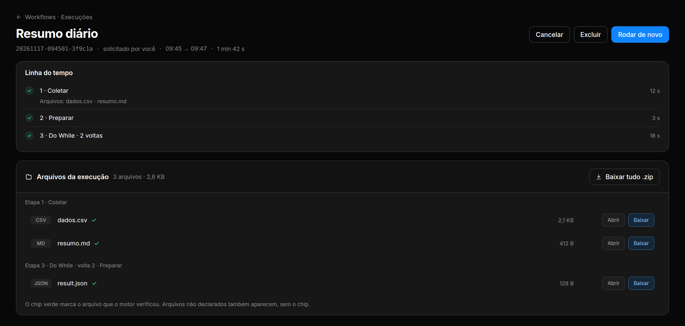
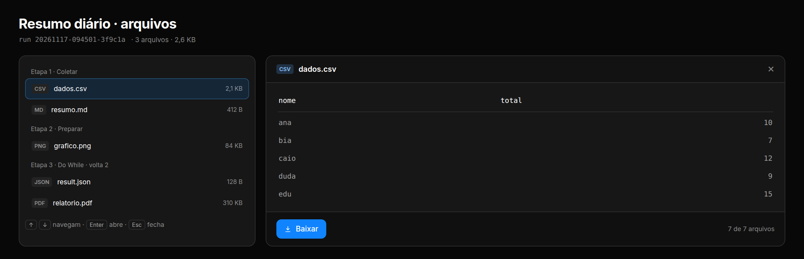
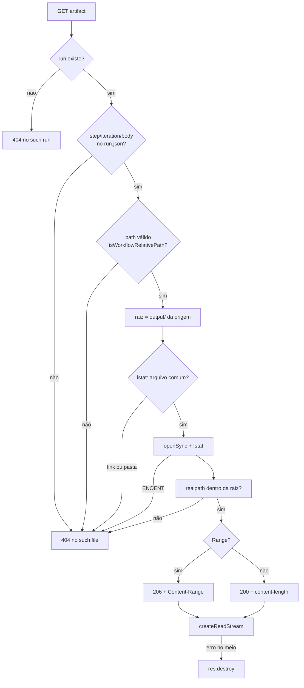

# Spec: arquivos da execução de um Workflow

> **Status:** pronta para implementação
> **Data:** 2026-11-17
> **Escopo:** leitura. Nada do motor, do contrato de definição ou do `run.json` muda.

## Nome da feature

Arquivos da execução: listar, pré-visualizar e baixar.

## Objetivo / problema a ser resolvido

**Objetivo.** Mostrar na tela de uma run os arquivos que as etapas produziram, com prévia no navegador para os formatos que fazem sentido e download de um arquivo ou de todos.

**Contexto em quatro linhas.** Cada etapa escreve em `runs/<runId>/step-N/output` (`server/workflows/paths.ts:96-113`); um Do While escreve em `iterations/iter-N/step-<bodyId>/output` (`server/workflows/paths.ts:115-135`). O motor verifica só as saídas *declaradas* e grava os nomes em `run.json` (`server/workflows/engine.ts:311,373,470`; `shared/workflow.ts:1136-1137`). A tela mostra esses nomes como etiquetas sem link (`src/components/workflows/RunDetail.tsx:352-361,505-529`). Não existe rota que sirva um arquivo de run: `/api/workflows` só devolve JSON (`server/routes/workflows.ts:154-198`) e o servidor estático serve apenas o bundle (`server/index.ts:13099`, `server/static-files.ts:23`). Logo, hoje o arquivo só é acessível abrindo a pasta no disco.

**Não objetivos do v1:** editar, apagar ou enviar arquivo pela tela; expor arquivos para um membro `client`; rota interna para bot; zip seletivo por busca; versionar o conteúdo; lixo automático.

## Impacto

| Área | Impacto |
|---|---|
| Motor | Nenhum; continua sendo o único escritor (`server/workflows/paths.ts:1-3`) |
| `run.json` | Nenhum campo novo; a lista vem do disco a cada pedido |
| Rotas | Três rotas `GET`/`HEAD` novas sob `/api/workflows/runs/:runId/` |
| Disco | Só leitura; nenhum arquivo temporário persistente |
| UI | Seção "Arquivos" vira lista navegável + painel de prévia |
| Permissão | Rotas novas continuam `admin` por padrão (`server/request-auth.ts:402-409`) |
| Dependências | Nenhuma; zip escrito com `node:zlib` (`zlib.crc32`, Node ≥ 22.2) |
| Compatibilidade | Runs antigas listam vazio; app anterior ignora as rotas novas |

## Histórias de usuário

- Como pessoa que roda um Workflow, quero ver os arquivos de cada etapa e de cada volta do Do While, com tamanho e tipo, sem abrir o Finder.
- Como pessoa que revisa um resultado, quero abrir o CSV, o JSON, o Markdown ou o PDF na própria tela e conferir antes de baixar.
- Como pessoa que entrega o resultado, quero baixar tudo em um `.zip` com as pastas das etapas já organizadas.
- Como pessoa que depura uma etapa que falhou, quero ver o que ela chegou a escrever, mesmo com a run marcada como falha.
- Como pessoa que voltou depois de uma semana, quero saber que o arquivo existia mas foi removido pela retenção, em vez de ver um erro genérico.
- Como responsável pela segurança da instalação, quero que nenhuma rota consiga ler fora da pasta `output/` da etapa, inclusive por link simbólico ou `..`.

## Requisitos funcionais

### F1 · O que é um "arquivo da run"

Fonte única: as pastas `output/` das etapas. Ficam de fora, por decisão explícita:

| Pasta | Motivo |
|---|---|
| `step-N/input/` | contém cópia de saídas anteriores e `params.json` com valores (`server/workflows/files.ts:115-127`) |
| `step-N/` (raiz) | é o `cwd` do bot (`server/workflows/engine.ts:1018`); pode ter rascunho, `.env`, cache |
| `iterations/iter-N/` (fora de `step-*`) | idem |
| `run.json` | estado interno, não é artefato |
| `scripts/` | código do Workflow, não resultado |

Consequência aceita: um arquivo que a etapa escreveu mas não declarou em `outputs` aparece se estiver em `output/`, e **não** aparece se estiver na raiz da etapa. O bot precisa declarar e escrever em `output/`; a UI diz isso no estado vazio.

Um Do While tem duas origens: a pasta da etapa, com a saída projetada da última volta (`server/workflows/files.ts:220-263`), e cada volta do corpo em separado. As duas aparecem na lista, e a projetada é a que uma etapa seguinte lê. Etapa de condição não escreve nada: a pasta existe e fica vazia, então não vira linha.

### F2 · Contrato de dados

```ts
export type WorkflowArtifactOrigin =
  | { kind: "step"; step: number }                                    // 1-based, 1..40
  | { kind: "iteration"; step: number; iteration: number; body: string };

export type WorkflowArtifactPreview = "text" | "markdown" | "json" | "csv" | "image" | "pdf" | "audio" | "video" | "none";

export interface WorkflowArtifact {
  origin: WorkflowArtifactOrigin;
  /** Relative to the origin's output/, NFC, no leading dot, no control character. */
  path: string;
  name: string;
  bytes: number;
  modifiedAt: number;
  contentType: string;
  preview: WorkflowArtifactPreview;
  /** Whether the engine recorded this path in run.json for that step. */
  verified: boolean;
}

export interface WorkflowArtifactSource {
  origin: WorkflowArtifactOrigin;
  stepId: string;
  /** Step name from the definition, else run.snapshot, else "Etapa N". */
  name: string;
  status: WorkflowStepStatus;
  files: WorkflowArtifact[];
  bytes: number;
}

export interface WorkflowArtifactList {
  runId: string;
  generatedAt: number;
  /** finishedAt + retentionDays; advisory, may move when the Workflow's retention changes. */
  expiresAt?: number;
  runStatus: WorkflowRunStatus;
  sources: WorkflowArtifactSource[];
  totals: { files: number; bytes: number; truncated: boolean };
}
```

Regras de varredura:

- `sources` inclui só origem com pelo menos um arquivo; origem vazia não vira linha.
- `iteration` só é aceito se existir em `run.steps[step-1].iterations[]` com `index === iteration` e `body` em `iteration.steps[].id`; nada de adivinhar pasta.
- `verified` compara `path` com `run.steps[..].verified` (ou `iterations[..].steps[..].verified`).
- Ignorar arquivos e pastas iniciados por `.`, `node_modules`, `__pycache__`, `.git`, `.venv`.
- Ordem: etapa crescente, volta crescente, `path` com `localeCompare`.
- Tetos: 8 níveis de pasta, 2.000 arquivos por origem, 200 caracteres de path (`WORKFLOW_PATH_MAX`), 4.000 no total. Passar disso marca `truncated: true` e para.
- `contentType` e `preview` saem **só da extensão** (tabela F4). Nunca ler o conteúdo para decidir.

Exemplo de `GET /api/workflows/runs/20261117-094501-3f9c1a/artifacts`:

```json
{
  "runId": "20261117-094501-3f9c1a",
  "generatedAt": 1763370000000,
  "expiresAt": 1771146000000,
  "runStatus": "succeeded",
  "sources": [
    {
      "origin": { "kind": "step", "step": 1 },
      "stepId": "coletar",
      "name": "Coletar",
      "status": "succeeded",
      "bytes": 2560,
      "files": [
        { "origin": { "kind": "step", "step": 1 }, "path": "dados.csv", "name": "dados.csv", "bytes": 2148, "modifiedAt": 1763369994211, "contentType": "text/csv; charset=utf-8", "preview": "csv", "verified": true },
        { "origin": { "kind": "step", "step": 1 }, "path": "resumo.md", "name": "resumo.md", "bytes": 412, "modifiedAt": 1763369994233, "contentType": "text/markdown; charset=utf-8", "preview": "markdown", "verified": true }
      ]
    },
    {
      "origin": { "kind": "iteration", "step": 3, "iteration": 2, "body": "preparar" },
      "stepId": "laco",
      "name": "Do While · volta 2 · Preparar",
      "status": "succeeded",
      "bytes": 128,
      "files": [
        { "origin": { "kind": "iteration", "step": 3, "iteration": 2, "body": "preparar" }, "path": "result.json", "name": "result.json", "bytes": 128, "modifiedAt": 1763369998450, "contentType": "application/json", "preview": "json", "verified": true }
      ]
    }
  ],
  "totals": { "files": 3, "bytes": 2688, "truncated": false }
}
```

### F3 · Rotas HTTP

Todas dentro do bloco existente de `runs` (`server/routes/workflows.ts:154-198`), para reaproveitar `readRun` e o mesmo 404.

| Método | Rota | Resposta |
|---|---|---|
| `GET` | `/api/workflows/runs/:runId/artifacts` | `200` `WorkflowArtifactList` |
| `GET` | `/api/workflows/runs/:runId/artifact?step=&path=&disposition=` | bytes |
| `HEAD` | a mesma | só cabeçalhos |
| `GET` | `/api/workflows/runs/:runId/artifacts.zip` (`?step=`) | `application/zip` |

Parâmetros de `artifact`:

| Nome | Obrigatório | Regra |
|---|---|---|
| `step` | sim | inteiro 1..40 |
| `path` | sim | `isWorkflowRelativePath` (`shared/workflow.ts:121-126`), ≤ 200, sem `.`/`..`/`\`/controle; 400 se inválido |
| `iteration` | com `body` | inteiro ≥ 1, existente no `run.json` |
| `body` | com `iteration` | slug de etapa do corpo |
| `disposition` | não | `inline` (padrão) ou `download` |

`artifacts.zip` usa `?step=` opcional; nome do arquivo `run-<runId>.zip` ou `run-<runId>-step-3.zip`.

Cabeçalhos de `artifact`:

```
content-type: <da tabela F4>
content-length: <bytes>
content-disposition: inline | attachment; filename="..."; filename*=UTF-8''...
accept-ranges: bytes
cache-control: private, no-store
x-content-type-options: nosniff
content-security-policy: sandbox
referrer-policy: no-referrer
cross-origin-resource-policy: same-origin
x-artifact-truncated: 1        (só texto acima de 256 KB)
```

`Content-Disposition` reaproveita `messageFileDisposition` (`server/message-file.ts:547-558`): fallback ASCII + `filename*=UTF-8''`, então `relatório final.pdf` baixa com o nome certo.

Matriz de erro:

| Status | Quando | Corpo |
|---|---|---|
| `400` | `step`, `iteration`, `body` ou `path` fora da regra; `disposition` desconhecida | `{ "error": "step must be 1-40" }` |
| `401`/`403` | gate de autenticação antes da rota (`server/request-auth.ts:534`) | já existente |
| `404` | run inexistente, origem inexistente, arquivo inexistente, link, path fora de `output/` | `{ "error": "no such file" }` |
| `405` | método diferente de `GET`/`HEAD` | `{ "error": "method not allowed" }` |
| `413` | prévia binária > 100 MB, zip acima do teto | `{ "error": "…", "limit": 536870912 }` |
| `416` | `Range` com início ≥ tamanho | `Content-Range: bytes */<bytes>` |
| `500` | erro de leitura não `ENOENT` | `{ "error": "could not read the file" }` |

### F4 · Segurança de arquivos

| Risco | Controle |
|---|---|
| `..`, path absoluto, `\`, `%2e%2e` | `isWorkflowRelativePath` antes de tocar no disco; `resolve` + `relative` como em `safeWorkflowPath` (`server/workflows/files.ts:28-34`) |
| Link simbólico no arquivo | `lstat` recusa link; depois `openSync` + `fstatSync(fd)` confirma arquivo comum |
| Link em pasta intermediária | varredura não segue link (`readdir` + `lstat`); na leitura, `realpathSync` do alvo tem de continuar dentro de `output/` |
| Arquivo de outra run | a raiz é calculada do `run.json` (`store.runDir(run)`, `server/workflows/store.ts:357-359`), nunca da query |
| HTML/SVG inline (XSS) | nunca `text/html` nem `image/svg+xml`; `.html`/`.svg` só baixam ou abrem como fonte `text/plain` |
| MIME sniffing | `content-type` só por extensão + `nosniff` |
| Vazamento de `input/` | raiz fixa em `output/`, sem exceção |
| Zip bomb | zip é **store-only**; teto de 2.000 entradas e 512 MiB somados antes de escrever o primeiro byte |
| Corrida com retenção | `open` antes dos cabeçalhos; `ENOENT` → 404; erro no meio do stream → `res.destroy()` |
| Nome Unicode | NFC na exibição; casamento pelo nome literal da entrada; controle e `\` recusados |
| Path gigante na tela | truncar no meio com `title` completo |
| Força bruta de IDs | nenhum efeito: sem run válida, 404 antes de qualquer I/O |

Tabela de tipos e prévia:

| Extensões | `contentType` | `preview` | Disposição |
|---|---|---|---|
| `.txt .log` | `text/plain; charset=utf-8` | `text` | inline |
| `.md .markdown` | `text/markdown; charset=utf-8` | `markdown` | inline |
| `.json` | `application/json` | `json` | inline |
| `.csv .tsv` | `text/csv; charset=utf-8` | `csv` | inline |
| `.yaml .yml .xml .toml .ini .sql .mjs .ts .py .sh` | `text/plain; charset=utf-8` | `text` | inline |
| `.png .jpg .jpeg .gif .webp .avif` | `image/*` | `image` | inline |
| `.pdf` | `application/pdf` | `pdf` | inline |
| `.mp3 .wav .m4a .ogg` | `audio/*` | `audio` | inline |
| `.mp4 .webm .mov` | `video/*` | `video` | inline |
| `.html .htm .svg` | `text/plain; charset=utf-8` (fonte) | `text` | **attachment** |
| qualquer outra, ou sem extensão | `application/octet-stream` | `none` | attachment |

`Range`: reaproveitar `parseAudioRange` de `server/attachments.ts:672-692` (é byte-range genérico). Um `Range` malformado ou múltiplo é respondido com o arquivo inteiro; um início ≥ tamanho é `416`. Com `Range`, a resposta vem do arquivo inteiro: o corte de 256 KB vale só para o `200` de texto.

Zip (`server/workflows/archive.ts`): ZIP clássico, método 0 (sem compressão), `zlib.crc32`, cabeçalho local + diretório central, sem ZIP64. Nomes internos: `step-1/dados.csv`, `step-3/iter-2/preparar/result.json`; colisão ganha `-2`, `-3`. Sem compressão o custo é cópia de bytes e a soma já é conhecida antes do primeiro byte — é o que permite recusar com `413` em vez de falhar no meio.

### F5 · Autorização

- As rotas novas **não entram** em `CLIENT_ALLOW` (`server/request-auth.ts:277-400`); `requiredScope` devolve `admin` por padrão (`:402-409`). Um teste fixa isso.
- Hoje a rota de detalhe não filtra departamento (`server/routes/workflows.ts:167-170`): uma sessão admin vê todas as runs da instalação. As rotas de arquivo mantêm essa paridade; não introduzem um filtro que a tela não tem.
- Só a rota interna de bot filtra departamento (`:280`) e autoria (`:291`), e ela continua sem arquivos no v1. Motivo: o bot já lê a própria pasta `step-N/output`; um leitor HTTP para bot amplia a superfície sem resolver nada da tela.
- Se um dia a tela chegar a um membro, a regra é: departamento da run **e** `requestedBy`/visibilidade do bot; **404** para run de outro departamento e para run de outra conversa, nunca 403 — não vazar existência.
- Em `artifact`, toda negativa de caminho é `404`, mesmo quando o motivo é link ou `..`: o cliente não distingue "não existe" de "não pode".

### F6 · Interface

A seção "Arquivos" atual (`RunDetail.tsx:505-529`) é substituída por `ArtifactsPanel`, depois da linha do tempo e antes de "Resultado". A lista chega de `artifacts`, não de `verified`; o chip de `verified` continua na linha do tempo.



*Figura 1 — Seção “Arquivos da execução” abaixo da linha do tempo: arquivos por etapa e por volta do Do While, com tamanho, tipo, abrir e baixar.*

Prévia em painel lateral (≥ 1101 px) e folha inteira no celular:



*Figura 2 — Lista à esquerda e prévia à direita; no celular a prévia ocupa a tela inteira.*

Estados:

| Estado | O que aparece |
|---|---|
| Carregando | 3 linhas fantasma; sem "vazio" antes da resposta |
| Vazio | "Esta execução não deixou arquivos" + dica de declarar `outputs` e escrever em `output/` |
| Erro | mensagem + "Tentar de novo"; mantém o que já estava na tela |
| Run em andamento | selo "atualiza sozinho"; recarrega a cada frame `workflow.run` da mesma run (`src/hooks/useWorkflowFeed.ts:76`) |
| Arquivo removido | `404` na prévia → aviso "removido pela retenção ou pela exclusão da run" + recarregar a lista |
| Prévia grande | acima do teto: "Grande demais para pré-visualizar" + baixar (a lista já traz `bytes`, então o botão nem chama a rota) |
| Zip preparando | botão em espera com `aria-busy`, sem bloquear a lista |
| Zip recusado | `413` com o total e o motivo |

Interação:

- Linha focável (`tabIndex=0`), `Enter` abre, `↑`/`↓` movem, `Esc` fecha a prévia e devolve o foco à linha.
- `role="dialog" aria-modal="true"` na prévia, com título = nome do arquivo.
- "Baixar" é `<a href download>` para o mesmo host (o cookie de sessão vai junto; `api()` não usa header de autorização, `src/state/api.ts:18-43`).
- Markdown renderizado com `react-markdown` já usado no app, sem HTML cru; CSV com `papaparse` (primeiras 200 linhas); JSON em `<pre>` com 500 linhas; PDF em `<embed>`; áudio/vídeo com `controls`.
- No celular a linha inteira abre a prévia; o botão de baixar fica no rodapé da folha.
- Textos novos em `src/locales/en.json` e nos 15 pacotes; `pnpm i18n:check` exige a chave em todos (`scripts/generate-locale.mjs:91`).

### F7 · Fluxo de leitura



Retenção roda no upkeep (`server/index.ts:16155`) e apaga a pasta inteira (`server/workflows/retention.ts:22-33`, `server/workflows/store.ts:350-355`). A lista nunca é cacheada, então o pior caso é um `404` entre listar e abrir, tratado acima.

### F8 · Compatibilidade

| Caso | Comportamento |
|---|---|
| Run anterior a esta feature | pastas `output/` já existem e estão vazias (`server/workflows/files.ts:277-285`) → `200` com `sources: []` |
| Workflow apagado | a run e o `snapshot` ficam; a lista usa `snapshot` para nomes e continua funcionando |
| Etapa que falhou | arquivos gravados antes da falha aparecem; `status: "failed"` |
| Etapa pulada | pasta vazia; não vira linha |
| Arquivo sem extensão | `application/octet-stream`, só download |
| Nome com acento ou espaço | NFC na tela, nome literal no disco, `filename*` no download |
| Retenção encurtada | `expiresAt` recalculado a cada lista; arquivo pode sumir antes do previsto |
| Run excluída pelo botão | pasta removida; lista e arquivo respondem `404` |
| App anterior abrindo o mesmo dado | ignora as rotas; nada no `run.json` mudou |
| Versão | subir `version` + `src/releases/<version>.ts` no mesmo commit (AGENTS.md) |

### F9 · Plano de implementação

| Fase | Entrega | Gate |
|---|---|---|
| F0 | `server/workflows/artifacts.ts`: varredura, origem validada, classificação por extensão, `verified` | testes de unidade verdes; nenhuma leitura de conteúdo |
| F1 | Rotas `artifacts` e `artifact`: path seguro, `lstat`+`fstat`+`realpath`, `Range`, cabeçalhos | testes de rota e de segurança, incluindo symlink e `..` |
| F2 | `server/workflows/archive.ts` + `artifacts.zip`: store-only, tetos, colisão de nome | `unzip -t` e Explorer do Windows abrem o zip; teste de teto retorna 413 |
| F3 | `ArtifactsPanel` + `ArtifactPreview` + `workflows-api.ts` + i18n nos 15 pacotes | prévia por tipo, teclado, celular, estados vazio/erro/removido |
| F4 | `docs/verification/workflow-artifacts.md`, release notes, bump | fixture isolado da receita abaixo, sem tocar no app instalado |

Ordem de merge: F0–F2 no servidor primeiro (a UI pode entrar depois sem rota quebrada).

### F10 · Testes

**Unidade** (`server/workflows/artifacts.test.ts`)

- lista topo e iterações, ignora `input/`, raiz da etapa, dotfiles, `node_modules` e `__pycache__`;
- `verified` bate com `run.json`; saída não declarada aparece com `verified: false`;
- 2.001 arquivos → `truncated: true` e corte em 2.000;
- nome Unicode, espaço e sem extensão; `path` de 200 e de 201 caracteres;
- iteração que não existe no `run.json` não é listada;
- `expiresAt` segue `retentionDays` e muda quando a retenção muda.

**Rota** (`server/routes/workflows.test.ts`)

- `200` com o JSON do exemplo; `404` para run, etapa, iteração e arquivo;
- `400` para `step=0`, `step=41`, `path=../x`, `path=/etc/passwd`, `path=a\b`, `body` sem `iteration`;
- `405` em `POST`; `HEAD` devolve os mesmos cabeçalhos e nenhum byte;
- `206`/`416` com `Range`; `Content-Disposition` com acento gera `filename*`;
- `200` com `x-artifact-truncated: 1` na prévia de texto de 300 KB e `413` na prévia binária acima do teto e no zip acima do teto;
- `requiredScope("GET", "/api/workflows/runs/<id>/artifacts") === "admin"`.

**Segurança**

- link simbólico para `/etc/passwd` dentro de `output/` → 404 e nenhum byte lido;
- pasta `output/sub` que é link para fora → varredura não entra, download 404;
- `.html` e `.svg` nunca saem com `text/html`/`image/svg+xml`; sempre `nosniff`;
- `input/params.json` não é listado nem servido;
- remover a pasta da run entre a lista e o `open` → 404, sem stack e sem 500;
- zip com 2.001 entradas → 413 antes do primeiro byte.

**Componente** (`src/components/workflows/ArtifactsPanel.test.tsx`)

- vazio, erro com retry, removido, em andamento;
- `Enter`/`↑`/`↓`/`Esc` e retorno de foco;
- prévia por tipo (texto, markdown, json, csv, imagem, pdf, áudio, vídeo) e o aviso de "grande demais";
- `href` de download com `step`/`path`/`iteration`/`body` codificados.

**Receita de verificação** (`docs/verification/workflow-artifacts.md`, seguindo `docs/verification/README.md`)

1. `node --experimental-strip-types scripts/control-omb.ts launch`; anote `url` e `dataDir`. Nunca use o app instalado.
2. Crie um Workflow com script que escreve `dados.csv`, `resumo.md`, `result.json`, `grafico.png`, `relatorio.pdf`, `pagina.html` e um Do While cujo corpo escreve `result.json` por volta.
3. Rode duas vezes: uma até o fim, outra que falhe na etapa 2 depois de escrever um arquivo.
4. `GET /api/workflows/runs/<id>/artifacts` → confira origens, `bytes`, `preview` e `verified`.
5. `curl -sD- '…/artifact?step=1&path=dados.csv'` → `200`, `text/csv`, `nosniff`, `sandbox`; `-H 'Range: bytes=0-9'` → `206` com `Content-Range`.
6. `…/artifact?step=1&path=pagina.html&disposition=download` → `attachment`; `…?path=../run.json` → `404`.
7. Crie um link `output/link.txt -> /etc/passwd` no fixture → `404`.
8. `…/artifacts.zip` → `unzip -t` ok, pastas `step-1/` e `step-3/iter-1/preparar/`; abra no Explorer se estiver no Windows.
9. Na UI: abra a run, veja a lista, navegue por teclado, abra cada tipo de prévia, baixe um e o zip; teste em 390 px de largura.
10. Retenção: com a run parada, edite `createdAt` no `run.json` para 3 dias atrás, use `retentionDays: 1` e reinicie o fixture; a lista volta vazia e o zip responde `404`.

## Requisitos não funcionais

| Área | Requisito |
|---|---|
| Desempenho | Listar 40 etapas com 50 arquivos cada em < 150 ms local; nenhuma leitura de conteúdo na listagem |
| Memória | Prévia de texto para em 256 KB; zip streama com buffer de 64 KB (store-only) |
| Cotas | 2.000 arquivos ou 512 MiB por zip; 100 MB por prévia binária; 2.000 arquivos por origem na lista |
| Streaming | `createReadStream` com `fd` já aberto e `destroy` no `close` da resposta, como em `server/routes/browser-evidence.ts:58-64` |
| Cache | `private, no-store` em tudo; nada de CDN |
| Observabilidade | uma linha `workflows: artifact <runId> <origin> <motivo>` em falha; nunca o conteúdo |
| Acessibilidade | foco visível, `aria-busy`, `aria-live` nos erros, contraste do texto secundário igual ao da linha do tempo |
| Mobile | lista e prévia em uma coluna abaixo de 900 px; alvos de toque ≥ 32 px |
| i18n | 15 pacotes com as chaves novas; `pnpm i18n:check` verde |
| Dependências | nenhuma nova; zip com `node:zlib` (`zlib.crc32`, exige Node ≥ 22.2; o app pede ≥ 24 em `package.json`) |
| Compatibilidade | `run.json`, `workflows.json` e o motor intocados; rotas aditivas |
| Segurança | nenhuma rota lê fora de `output/`; link simbólico, `..` e HTML inline cobertos por teste |
