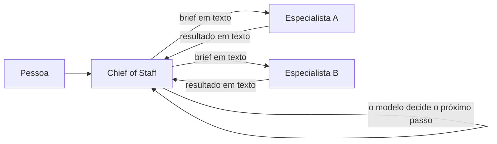
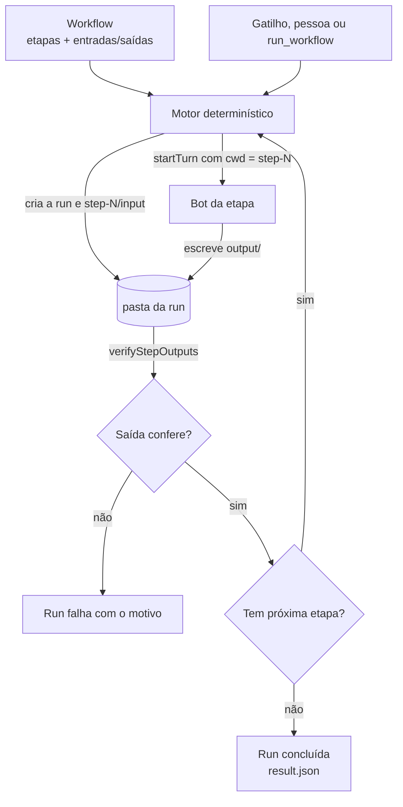
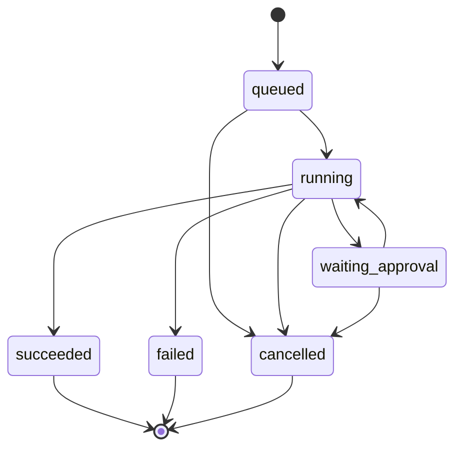
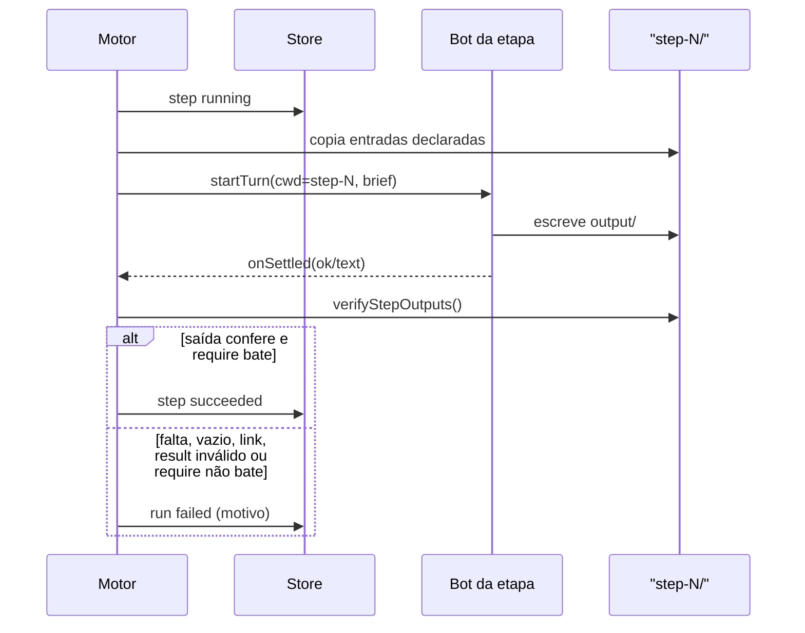
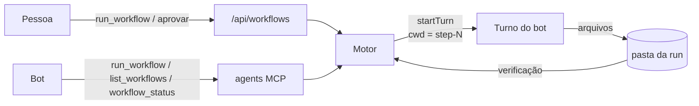

# Workflow: análise da implementação

Data: 2026-11-03 · Revisado em 2026-11-08 (contratos do motor, F1, F2 e etapa de script) · Base: `tmp/spec-workflow.md` (D1–D18) · Código: `shared/workflow.ts`, `server/workflows/` (F0: `paths.ts`, `files.ts`; F1: `state.ts`, `brief.ts`, `engine.ts`, `store.ts`, `retention.ts`; F2: `flow.ts`, `script.ts`)

Este documento fecha a linha de raciocínio: o problema de hoje, o impacto, a
solução, como ela será construída, o que já existe para reaproveitar e como o
núcleo criado vira a camada de tools que os agentes chamam dentro do Workflow.

## 1. O problema que temos hoje

A ordem de um trabalho entre bots vive no texto. O Chief recebe a demanda,
escolhe os colegas, escreve um brief para cada um e, a cada turno, decide quem
chama em seguida. O harness executa ferramentas muito bem; ele não governa a
sequência.



O que é verdade hoje, verificado no código e no mapa da delegação:

- O brief e o resultado viajam como texto. A mensagem de `coordinate_bots` tem
  no máximo 4 000 caracteres; o brief guardado e o resultado têm teto de
  12 000 (`server/runtime-coordinator.ts`, `server/runtime/runtime.ts`). Não há
  contrato de entrada/saída nem verificação de entrega.
- `coordinate_bots` não tem dependência entre atribuições: irmãos rodam em
  paralelo. A ordem só existe se o Chief encerrar um turno e chamar o próximo.
- O mesmo brief para o mesmo especialista vira `duplicate`; quem já completou
  recusa nova tarefa sem `rework=true`.
- Não há retentativa automática de uma etapa que falhou.
- `evidence.filesChanged` existe no tipo, mas nenhum código o preenche: "disse
  que fez" não é verificável. O host preenche `toolCalls`, `okToolCalls`,
  `errors` e `outward` (quando há ação externa) em `server/turn-outcome.ts`.
- `cwd` é por bot/thread, mas o turno aceita `cwd` próprio
  (`SendTurnInput.cwd`); departamento é só um rótulo (`section`), sem pasta.
- Limites por raiz: 64 requests e 96 execuções (constantes de
  `server/runtime-coordinator.ts`, acima dos padrões 24/48), 48 wakes,
  profundidade 4, 5 threads novas por turno. Espera pela pessoa: 30 min,
  exceto com cartões abertos. `stallMs`: 4 h, e não derruba árvore com
  `needs_input`.

## 2. Os impactos

- **Ordem imprevisível.** O Chief pode pular etapa, inverter duas ou rodar em
  paralelo o que deveria ser sequencial — e variar entre execuções.
- **Entrega não comprovada.** O resultado é prosa; arquivos citados no brief
  podem não existir, estar vazios ou no lugar errado.
- **Handoff frágil.** Caminhos viajam como texto; um erro de nome só aparece
  quando alguém abre a pasta.
- **Sem auditoria da run.** O runtime guarda assignments, não "etapa 2 de 5",
  entradas, saídas e aprovações de um workflow.
- **Falha silenciosa.** Sem retry nem política, depende de o Chief perceber e
  agir; a pessoa descobre depois.
- **Aprovação sem contexto.** Os cartões existem, mas não pausam uma run nem
  mostram em que etapa ela está.
- **Custo desnecessário.** Cada execução paga tokens por decisões que já eram
  conhecidas.

## 3. A solução proposta

Duas camadas, uma autoridade:

1. **Workflow (dado):** uma sequência de etapas. Cada etapa declara o bot, a
   instrução, os arquivos que recebe e os que precisa deixar.
2. **Motor (código):** executa a sequência, copia entradas, verifica saídas e
   só então avança. O bot da etapa não escolhe o que roda depois.

O contrato entre as etapas é o **sistema de arquivos**, não a conversa.



Invariantes que dão a garantia:

- O motor é o único que decide a ordem e o único que escreve fora de
  `step-N/output/` (D15).
- O bot da etapa roda com `cwd` em `step-N` e escreve apenas em `output/`
  (D14). O `cwd` é convenção, não sandbox: o engine ainda pode ler outros
  caminhos conforme o modo de permissão (P15).
- Avançar exige arquivo plano, não vazio e não-link nas saídas obrigatórias;
  saídas opcionais podem faltar. O `result.json` declarado precisa existir e
  ser um objeto JSON válido (D2/D3). Quando a etapa declara `require`, os
  campos desse objeto precisam bater por igualdade; senão a etapa falha.
- O motor copia para `input/` apenas o que a etapa declarou, e apenas de
  etapas anteriores (D15).
- Nenhuma aprovação é pulada: o turno da etapa usa o mesmo gate e os mesmos
  cartões do fluxo normal.

## 4. Como será implementada

### Fases

| Fase | Entrega | Estado |
|---|---|---|
| F0 | Contrato, layout de pastas, verificação de saída e cópia de entrada | **feito** (58 testes) |
| F1 | Máquina de estados, brief da etapa, executor, store, retenção, rotas e tools | **feito** (108 testes no motor + 8 nas rotas) |
| F2 | Destino "Workflow" nos gatilhos, aprovação longa, UI simples, etapa de script, condição e repetição (**feitos**); retry adiado; record→promote pendente | parcial |
| F3 | Editor visual, Team Cloud/VM | parcial: F3.1 feita (08/11/2026), F3.2 e Team Cloud pendentes |

### Lacunas conhecidas

- Aprovação: resolvida (P16). A etapa que termina com cartão aberto deixa a run
  `waiting_approval`; o turno de continuação (`cardContinuation`) chega por
  `engine.turnSettled`, que re-verifica a etapa. Recusa cancela a run.
- Histórico de versões: todas as versões ficam em `workflows.json`, sem nota,
  autor, hash ou retenção do histórico. A F1 já permite escolher a versão de
  uma nova run; metadados e GC do histórico ficam para a F2.
- `run.json` guarda o id da etapa, não o nome: o snapshot (`snapshot.name` e
  `snapshot.steps`) foi implementado na F2; runs antigas sem snapshot continuam
  mostrando o aviso de definição indisponível.
- Script: Node apenas, sem bloqueio real de rede, sem sandbox (roda como o
  usuário do app) e sem editor na tela; o arquivo entra pela rota admin.

### Layout

O Workflow vive em `workflows.json`, no data dir do app (entra no backup); a
pasta do Workflow guarda as runs e os scripts.

```
~/MimirBot/
└── Financeiro/
    └── workflows/
        └── 8a5b1c2d-.../
            └── runs/
                └── 20261103-123456-abcdef/
                    ├── run.json
                    ├── step-1/
                    │   ├── input/
                    │   └── output/
                    └── step-2/
                        ├── input/
                        └── output/
```

### Ciclo de vida da run



### Uma etapa, em sequência



### Contratos do motor

#### Instrução da etapa

O motor não escreve prompt novo. Ele usa o prompt que todo turno já monta em
`buildSystemPrompt` (`server/system-prompt.ts`):

| Camada | Origem | Muda por etapa? |
|---|---|---|
| Identidade | `botPersona` do bot da etapa | não |
| Instruções permanentes | `SOUL.md` do bot | não |
| Skills | seleção declarada pela etapa (`bot`, `bundled`, `imported`); vazio ou ausente = nenhuma | sim |
| Regras fixas da etapa | parte volátil `workflow-step` (nova) | sim |
| Tarefa | `instructions`, entradas e saídas na mensagem do usuário | sim |

A parte `workflow-step` entra em `VOLATILE_SECTIONS` e diz só o que vale para
toda etapa: leia `input/`, escreva apenas em `output/`, não peça resposta em
texto, encerre o turno, o motor copia as saídas. Para confirmação, a etapa abre
um cartão de requisição; isso é detalhado no brief abaixo.

O corpo da tarefa viaja na mensagem do usuário, como o brief de um colega
delegado (`composeRootTurn`). Motivo: o Claude reusa o primeiro system prompt
em `--resume` (`server/index.ts:3843`), então uma parte de sistema alterada
pode não chegar quando a etapa retoma a mesma thread.

O agente recebe a instrução como texto. A etapa `bot` declara o bloco
`skills` (`bot`, `bundled`, `imported`); sem o bloco, ou com todos os grupos
vazios, nenhuma skill carrega. O motor valida a seleção antes de abrir o turno
e falha a etapa se alguma skill declarada não estiver mais disponível.

#### Brief da etapa

`server/workflows/brief.ts` monta o texto enviado como mensagem do turno no
início de toda etapa de bot, inclusive dentro de um Do While. Não é campo do
JSON nem fica persistido: é derivado da definição.

O texto carrega o nome do Workflow e a posição (`Step N of M`), as
`instructions`, os `inputs[].as`, os `parameters`, os `outputs[].path`, o
`result` marcado e um fecho fixo para escrever os arquivos e encerrar o turno.

O fecho também diz como pedir uma pessoa:

> If you need the person's answer or confirmation before finishing, open a
> request card with `request_credential` (or the approval tool) and end your
> turn. `show_widget` only displays information; it does not pause the step or
> wait for an answer.

O motor só considera “cartão esperando a pessoa” quando o cartão tem
`requestId` e não foi respondido, dispensado ou expirado. Um `show_widget` não
tem `requestId`: ele exibe informação e não pausa. Se a etapa precisa de
confirmação, o cartão de requisição é o que grava `waiting_approval` e permite
retomar a mesma run.

Etapas de `script` não recebem brief; recebem `cwd`, `input/`, `output/` e
`input/params.json`.

#### Memória da etapa

Decidido: a etapa de Workflow roda com **memória vazia por padrão**. Ficam
desligados na conversa da etapa:

- `MEMORY.md` do bot e a memória da equipe;
- trabalho recente (`recent`) e o recall automático de conversas;
- as ferramentas de memória (`memory_update`, `memory_log`, `session_search`);
- o journal de memória do turno.

Ficam: persona, `SOUL.md`, as skills declaradas, o departamento e os arquivos
de `input/`. A etapa já roda numa conversa nova, e a lista de ferramentas é por
conversa, então a mudança é local: guardas no prompt, `beginMemoryTurn`
ignorado e um override de memória no env da conversa da etapa. Turnos normais
não mudam.

**Status:** decidido em 12/11/2026; implementação pendente. Hoje a etapa herda
a memória do bot.

#### Parâmetros da etapa

Cada etapa declara os próprios parâmetros, no mesmo bloco em que declara
`inputs`, `outputs` e `result`:

```json
{
  "id": "consultar",
  "kind": "script",
  "parameters": [
    { "name": "inicio", "type": "date", "required": true },
    { "name": "regime", "type": "enum", "values": ["escala", "mesa", "todos"], "required": true }
  ]
}
```

Não existe bloco `parameters` no topo da definição. `run_workflow` recebe um
mapa plano de valores (`inputs`); um nome declarado por mais de uma etapa é o
mesmo valor, e cada etapa recebe em `params.json` só o subconjunto que
declarou. O motor valida a união antes de criar a run e devolve
`missing`/`invalid`/`unknown` com a etapa e o nome do campo. Parâmetro
opcional declara `whenAbsent`; sem isso, é inválido.

**Status:** decidido em 12/11/2026; implementação pendente.

#### Aprovação

A aprovação é **uma por etapa**, feita pelo **dono designado** do Workflow.
Não existe segunda aprovação. A etapa manual (`mode: "manual"`) e o cartão que
espera resposta são essa aprovação.

**Status:** decidido em 12/11/2026. O portão manual já existe; o registro do
dono designado entra com o record→promote. A aprovação longa P16 existente
(qualquer membro do departamento pode responder um cartão) não muda nesta
spec; esta regra vale para Workflows criados por este caminho.

#### Ids

| Id | O que identifica | Formato | Onde vive |
|---|---|---|---|
| `WorkflowDefinition.id` | o Workflow | UUID | `workflows.json` |
| `WorkflowDefinition.version` | a versão do Workflow | inteiro ≥ 1 | `workflows.json` |
| `WorkflowRun.id` | uma execução | `AAAAMMDD-HHMMSS-hex6` | pasta e `run.json` |
| `WorkflowRun.workflowId` + `workflowVersion` | qual Workflow e versão | UUID + inteiro | `run.json` |
| `WorkflowStep.id` | a etapa dentro do Workflow | slug | Workflow e `run.json` |
| `WorkflowRunStep.assignmentId` + `threadId` | o turno que executou a etapa | ids do runtime | `run.json` |

A etapa aponta para um **bot** (`botId`), não para um agente nem para um
modelo. O bot já carrega modelo, ferramentas, permissões, SOUL e skills. Um
campo `model` na etapa furaria o modelo de acesso: o motor escolheria um
modelo sem as permissões do bot. Um revisor mais barato é um bot revisor.

Agentes interagindo já acontecem dentro do turno da etapa: o bot chama
`coordinate_bots` e os resultados retomam o turno. O motor vê um turno que
termina; ele não modela a conversa.

`WorkflowRun.department` é um **retrato** do departamento no momento da
criação, não uma cópia que precisa acompanhar o Workflow. Ele existe porque o
caminho da run precisa dele (`workflowRunPaths`) e porque a run deve ser
legível sem carregar o Workflow. Se o Workflow mudar de departamento, a run
antiga continua na pasta onde nasceu.

#### Aceite

O aceite do MVP é estrutural, em código (`verifyStepOutputs`):

- saída obrigatória existe, é arquivo comum e não está vazia;
- saída opcional pode faltar;
- `result.json` declarado é objeto JSON, até 64 KB.

Isso responde "o arquivo veio", não "a entrega está correta". O motor não lê o
conteúdo do resultado por conta própria.

No ensaio de um Workflow gerado, **só a saída esperada é critério**. O caminho
que o bot usou — ferramentas, raciocínio, ordem interna — não entra no aceite:
Workflow existe para rodar de forma determinística, e a entrega confere ou não
confere. Etapa de bot é comparada pela saída declarada, não pela reprodução do
raciocínio.

Para uma condição determinística sem gastar token, a etapa declara o campo
`require`:

```json
{
  "id": "revisar",
  "botId": "bot_revisor",
  "instructions": "Leia input/mensagens.json. Escreva result.json com ok e reason.",
  "inputs": [{ "as": "mensagens.json", "from": { "step": "cobrar", "output": "mensagens.json" } }],
  "outputs": [{ "path": "result.json", "required": true }],
  "result": "result.json",
  "require": { "ok": true }
}
```

O motor compara os campos de `require` com o `result.json` por igualdade. Se
não bater, a etapa fica `failed`, `error` recebe `result.reason` e a run para.
Se bater, segue para a próxima etapa na ordem. É declarativo: o motor não
executa código do Workflow.

Uma etapa só pode consumir uma saída que a origem marcou `required: true`. Se
a origem disser `required: false` e a etapa seguinte declarar essa saída como
entrada, o schema recusa o Workflow. Motivo: se a etapa precisa do arquivo, a
origem tem que garantir o arquivo; o erro aparece ao montar o Workflow, não no
meio da run. "Arquivo opcional que a próxima etapa usa se existir" fica para a
F2.

O motor não é uma etapa. Ele orquestra: despacha o turno, espera, verifica,
copia e avança. Quem julga o conteúdo é uma etapa revisora (um bot) ou, na F2,
um script.

### Módulos

| Arquivo | Papel | Estado |
|---|---|---|
| `shared/workflow.ts` | Contrato, validações e tipos da run | feito |
| `server/workflows/paths.ts` | Raiz, departamento, run id, `step-N` | feito |
| `server/workflows/files.ts` | Verificação de saída e cópia de entrada | feito |
| `server/workflows/state.ts` | Transições puras da run | feito |
| `server/workflows/brief.ts` | Brief determinístico da etapa | feito |
| `server/workflows/flow.ts` | Escolha do próximo passo e do caminho de falha | feito |
| `server/workflows/script.ts` | Executor de etapa de script | feito |
| `server/workflows/engine.ts` | Scheduler sobre `startTurn`/`onSettled` | feito |
| `server/workflows/store.ts` | Workflows e runs, escrita atômica | feito |
| `server/workflows/retention.ts` | Limpeza por idade, sem tocar pausadas | feito |
| `server/routes/workflows.ts` | HTTP + SSE | feito |
| `server/host/workflows.ts` | Factory de composição | feito |

O executor não reimplementa turno: ele **cria a thread com o `cwd` exato**
(`store.createTask(..., cwd)`), chama `startTurn` com `onSettled` e recebe
`HostTurnResult`. O estado durável da atribuição pode usar
`RuntimeCoordinator.beginTurn`/`endTurn` quando quisermos retomada e orçamento
do runtime; o mínimo é a run persistida pelo motor.

### Falha, retomada e limites

- Falha de etapa: a run para em `failed` com o motivo verificado; a pessoa
  reexecuta (sem retry automático por padrão — P14).
- Reinício do app: runs `queued` e runs paradas entre etapas continuam; uma
  etapa `running` vira `failed` ("the app restarted while this step was
  running") em vez de repetir e duplicar efeitos externos. Passos `succeeded`
  não rodam de novo.
- Aprovação: a run fica `waiting_approval`; o motor não usa os 30 min de
  `inputWaitMs`, uma run pausada nunca é apagada (D10/P12) e o `stallMs` não
  derruba árvore com `needs_input`. Falta o sinal de retomada (P16).
- Limites: um passo por vez por run, sem timer próprio de etapa (quem corta um
  turno travado é o watchdog do host), máximo de etapas do contrato e admissão
  normal por bot (3 threads).

### Cancelamento, remoção e versionamento

**Cancelar uma run.** `cancel_workflow` / `POST /api/workflows/runs/:id/cancel`
grava a run como `cancelled`, marca a etapa corrente como `skipped` com o
motivo e chama o mesmo caminho do Stop da pessoa (`interruptDirectThread` →
`adapter.interruptTurn`). O motor não espera um segundo `onSettled`: quando o
turno assentar, `settle` vê a run fora de `running` e ignora; nenhuma etapa
seguinte começa. Não há rollback: arquivos já escritos em `output/` e efeitos
externos permanecem. O interrupt é cooperativo; se o engine ignorar, o turno
pode terminar, mas a run não avança. Se a run estiver `queued` ou entre etapas,
não há turno para interromper; a próxima `advance` vê `cancelled` e para.

**Apagar.** `DELETE /api/workflows/:id` responde 409 enquanto houver run
`queued`, `running` ou `waiting_approval` daquele Workflow, listando os ids; a
pessoa cancela e tenta de novo. `DELETE /api/workflows/runs/:runId` responde
409 enquanto a run estiver ativa e só apaga depois de terminal. A retenção
também só remove runs terminais. Apagar o Workflow não apaga as runs: elas
continuam no disco, mas `run.json` guarda o id da etapa, não o nome; um
snapshot mínimo do Workflow na run fica para a F2.

**Versionamento.** Cada save com conteúdo diferente acrescenta um snapshot
imutável em `workflows.json` (`version = max + 1`); conteúdo idêntico não cria
versão. A run grava `workflowId` + `workflowVersion` e o motor carrega
exatamente aquela versão, então uma run antiga não muda quando o Workflow
evolui. `POST /api/workflows/:id/run` aceita `{ "version": N }` para rodar uma
versão anterior. Não há commit metadata (autor, nota, hash, parent) nem GC do
histórico na F1; snapshots completos são baratos porque o Workflow é pequeno.

### F2: script, condição e repetição (implementado em 08/11/2026)

O contrato completo, decisões e limitações estão na Parte 1 de
`tmp/Workflows_Spec_Completa.md`. Resumo do que está no código:

- `WorkflowStep` é união por `kind` (`"bot"` padrão, `"script"`). Script tem
  `run` (nome plano `.mjs`/`.js` em `scripts/`), `timeoutMs` (60 s padrão, teto
  300 s), e o mesmo `inputs`/`outputs`/`result`/`require`.
- O motor roda o script com `cwd` = pasta da etapa, `WORKFLOW_STEP_INPUT`,
  `WORKFLOW_STEP_OUTPUT`, `WORKFLOW_RUN_ID` e `WORKFLOW_STEP_ID`, ambiente
  mínimo, sem shell, com kill no timeout e no cancelamento. Em Electron
  empacotado usa `ELECTRON_RUN_AS_NODE=1`.
- `next`, `when` (caminho pontuado no `result.json`) e `onFailure` escolhem o
  destino. Repetição é caminho de volta, com teto de 25 visitas (`attempts`).
  Ao revisitar, `input/`/`output/` são limpos; ao concluir, etapas não
  percorridas ficam `skipped`.
- Scripts entram por `PUT /api/workflows/:id/scripts/:name` (admin, 256 KB,
  409 com run ativa). `saveWorkflow` recusa etapa de script sem arquivo.
- Verificação: `docs/verification/workflow-script.md`.

Limitação declarada: o script roda com o usuário do app; não é sandbox e a rede
não é bloqueada no v1.

**Ideia futura:** o `require` compara igualdade. Se o caso pedir, ele cresce
para um schema pequeno, com os mesmos recursos do contrato de tool
(`fullInputSchema`/`compileToolSchema`): tipo, obrigatório, faixa, enum.
Continua declarativo; o motor não executa código do Workflow.

## 5. O que conseguimos reaproveitar

| Recurso | Onde | Uso no Workflow |
|---|---|---|
| `store.createTask(..., cwd)` | `server/store.ts` | Cria a thread da etapa já com `cwd = step-N` |
| `startTurn` + `onSettled` | `server/index.ts` | Executa a etapa e devolve o `HostTurnResult` uma vez. `startTurn` é privado ao módulo; a factory do host do Workflow precisa recebê-lo como dependência |
| `beginTurn`/`endTurn` | `server/runtime-coordinator.ts` | Estado durável, retomada e orçamento da atribuição; não há histórico de "etapa 2 de 5" |
| Cartões e `HostTurnResult.cards` | `server/coordinator.ts` | Pausa humana sem inventar aprovação |
| Gate/capability do turno | `server/mcp-gate.ts` | Nenhuma permissão é contornada |
| `fullInputSchema` + `compileToolSchema` | `server/drivers/agents-catalog.ts`, `server/mcp-schema-validator.ts` | Valida argumentos de tools e do `run_workflow` |
| `writeFileAtomic` | `server/atomic.ts` | `run.json`, Workflows e transições |
| `broadcast` | `server/index.ts` | Frames SSE `workflow.*` |
| `RoutineTarget` | `server/routines.ts` | Novo destino `"workflow"` ao lado de `"bot"`/`"room-goal"` |
| `sections` | `server/section-context.ts`, `server/store.ts` | Departamento como rótulo; pasta vem do motor |
| `sharedProjectFolder` | `server/bot-cwd.ts` | Regra de segurança do `in_my_folder`; `~/MimirBot` fica fora do data dir (D6). O motor do Workflow cria a pasta e passa `cwd` direto, sem chamar `sharedProjectFolder` |
| `server/routes/` + `RouteHandler` | `server/routes/README.md` | Rotas novas sem crescer `server/index.ts` |
| `playbooks` do package format | `server/installed-playbooks.ts`, `shared/package-format.ts` | Playbooks são instruções empacotadas; não distribuem Workflow. O formato tem `playbooks`, não `flows` |
| Saved Steps | `server/saved-steps/` | Inspiração para record→promote; o replay cobre passos de computador, não etapas de Workflow. Não há record→promote hoje |
| `agents` MCP | `server/drivers/agents-proxy.ts`, `agents-catalog.ts`, `agents-call.ts` | Transporte das tools novas, com capability |

## 6. O que teríamos que fazer do zero

| Item | Por que não existe | Fase |
|---|---|---|
| Máquina de estados da run | O runtime não tem "etapa 2 de 5" com entradas/saídas | F1 |
| Brief determinístico | Hoje o brief é texto do Chief; o motor precisa listar `input/`, saídas e `result.json` | F1 |
| Ordem e dependência entre etapas | `coordinate_bots` roda irmãos em paralelo | F1 |
| Store de Workflows + CRUD | Não há modelo de Workflow | F1 |
| Rotas + SSE do Workflow | Não há contrato para a UI | F1 |
| Tools `run_workflow`/`list_workflows`/`workflow_status`/`cancel_workflow` | Não existem no catálogo | F1 |
| Destino "Workflow" no gatilho | `RoutineTarget` só tem `bot` e `room-goal` | F2 |
| Aprovação longa | Cartões não expiram em 30 min e o `stallMs` ignora `needs_input`; falta o sinal de retomada (P16) | F2 |
| Política de retry | Não há retentativa automática | F2 |
| Retenção por Workflow | Não há limpeza por pasta/idade | F1 |
| Editor/visualização | O canvas não é editor de fluxo | F2 (UI simples) / F3 (editor) |
| Etapa de script | Executor `.mjs` com env, timeout, kill e validação igual à de bot | F2 (feito) |
| Condição e repetição | `when`/`next`/`onFailure`, caminho de volta com teto de 25 visitas | F2 (feito) |
| Confirmar `cwd` por thread em cada engine | `SendTurnInput.cwd` é por turno e Claude, Codex e Antigravity usam `turn.cwd`; `--add-dir` do Claude é só para skills, e Codex lê `writableRoots` do config | F1 (confirmar, sem acesso extra) |

## 7. Como isso vira as tools que os agentes chamam

O ponto central: **a tool inicia um Workflow; ela não deixa o modelo escolher os
passos.** Quem decide a ordem é o motor. O bot recebe a etapa já montada.



| Tool | Quem chama | O que faz | Módulo nosso por trás |
|---|---|---|---|
| `list_workflows` | Bot | Lista Workflows que o bot alcança | `shared/workflow.ts` (parse) |
| `run_workflow` | Bot, pessoa ou gatilho | Valida a entrada, cria a run e prepara as pastas | `workflow.ts`, `paths.ts`, `files.ts` |
| `workflow_status` | Bot, pessoa | Mostra etapa atual, saídas verificadas e motivo de falha | `paths.ts`, `files.ts` |
| `cancel_workflow` | Pessoa; bot só na própria run | Para a run, interrompe o turno corrente e preserva os arquivos | `paths.ts`, `state.ts`, `interruptDirectThread` |
| aprovar/recusar | **Só pessoa** | Retoma ou encerra uma run pausada | `state.ts` |

O que o bot **não** ganha: tool para marcar etapa como concluída, editar o
Workflow, aprovar a própria pausa ou rodar um Workflow fora do departamento
que alcança. A conclusão é sempre a verificação do arquivo.

Por dentro, cada tool só chama o que já existe:

- `run_workflow` valida com o mesmo schema que a UI usa, chama `paths.ts` para
  o id/pasta, `files.ts` para criar `step-N` com `input/` e `output/` e devolve
  `runId`.
- O motor chama `copyStepInputs` antes da etapa e `verifyStepOutputs` depois;
  `workflow_status` lê o `run.json` e mostra o que foi verificado e o motivo da
  falha, sem repetir a verificação.
- O turno da etapa é um turno normal: as tools que o bot já tem continuam
  valendo, com o gate de sempre. Ele escreve em `output/` com as ferramentas de
  arquivo/computer que já usa — não precisa de uma tool nova para "entregar".

## 8. Como isso casa com a proposta do Workflow

| Decisão | Onde ela vive na implementação |
|---|---|
| D1 motor determinístico | `engine.ts` decide a ordem; o bot só executa a etapa |
| D2 entradas/saídas verificadas | `files.ts` (`verifyStepOutputs`, `copyStepInputs`) |
| D3 `result.json` curto | `verifyStepOutputs` valida JSON objeto até 64 KB |
| D4 arquivos na pasta da run | `paths.ts` |
| D5/D6 pasta por departamento em `~/MimirBot` | `paths.ts` (`workflowsRoot`, `departmentFolder`) |
| D8 "General" como departamento | Não é automático: vem do campo `department` do Workflow |
| D7 acesso por run | `cwd` da thread da etapa; nada de pasta do departamento. Não há confinamento: D7 depende de limpar ou arquivar a pasta ao fim da run |
| D9 ambiente do bot não muda | turno normal + `cwd` da etapa |
| D10 retenção por Workflow | `retention.ts`, pausadas protegidas |
| D11 arquivos sempre em disco | pasta da run (F0) + `run.json` (F1), com a retenção (F1) |
| D12 ramificação/aprovação | `require` no MVP; condição, repetição e aprovação longa na F2 |
| D13 individual e equipes | mesma run; alcance por departamento |
| D14 `step-N` com `input/` e `output/` | `paths.ts` + `store.createTask(cwd)` |
| D15 só o motor escreve | `files.ts`; o bot só escreve em `output/` |

Implementado no núcleo (F0): D2, D3, D4, D5, D6, D14 e D15. O motor acrescenta
na F1: D1, D9, D10 e a retenção de D11. D8 não é automático: o Workflow usa o
campo `department` do Workflow, e "General" só existe se o Workflow disser isso.
D7 depende do motor limpar ou arquivar a pasta ao fim da run; hoje a pasta
continua no disco. D12 começa no MVP com `require`; condição, repetição e
aprovação longa ficam para F2. D13 na nuvem fica para F3.

## 9. O que ainda depende do dono

1. **Exemplo real de Workflow** (seção 1 da spec) — valida o formato da etapa e
   a tela.
2. **Aprovação longa** — cartões abertos não expiram em 30 min e o `stallMs`
   não derruba árvore com `needs_input`, então a run pausada pode esperar.
   Falta decidir como o motor recebe a resposta e retoma a etapa (P16).
3. **Histórico de versões** — metadados (nota, autor, hash, parent) e GC das
   versões que nenhuma run referencia. A F1 guarda todos os snapshots em
   `workflows.json`.
4. **Snapshot da run** — guardar o nome do Workflow e das etapas no `run.json`
   para a run continuar legível depois de apagar o Workflow ou o histórico.

Decidido: o Workflow vive em `workflows.json`, no data dir (entra no backup).

## 10. Decidido nesta revisão

| Ponto | Decisão | Fase |
|---|---|---|
| Instrução da etapa | texto em `instructions`; corpo na mensagem do usuário; regras fixas na parte volátil `workflow-step` | F1 |
| Skills | a etapa `bot` declara `skills` (`bot`, `bundled`, `imported`); vazio ou ausente = nenhuma | F3.2 |
| Agente e modelo | a etapa aponta só para `botId` | F1 |
| Id da run | separado do Workflow: `AAAAMMDD-HHMMSS-hex6` | F1 |
| Departamento na run | retrato do momento da criação; não acompanha o Workflow | F1 |
| Aceite | estrutural (`verifyStepOutputs`) + `require` por igualdade no `result.json` | F1 |
| Entrada opcional | uma etapa só consome saída `required: true`; o Workflow é recusado | F1 |
| Onde guardar o Workflow | `workflows.json` no data dir (entra no backup) | F1 |
| Versionamento | snapshots imutáveis; a run fixa `workflowVersion`; `POST /run` aceita `{version}` | F1 |
| Cancelamento | run `cancelled`, etapa `skipped`, interrompe o turno pelo caminho do Stop; sem rollback | F1 |
| Remoção | `DELETE` do Workflow ou da run recusa com 409 enquanto houver run ativa | F1 |
| Terminologia | o produto diz "Workflow"; no código ficam `WorkflowDefinition`/`WorkflowRun`, `/api/workflows` e as tools `run_workflow`/`list_workflows` | F1 |
| Retenção | por idade, no boot; `queued`/`running`/`waiting_approval` nunca são apagadas | F1 |
| Retry | adiado; sem retry automático, `attempts` registrado | F2 |
| Memória da etapa | vazia por padrão: sem MEMORY.md, memória da equipe, recentes, recall e ferramentas de memória; persona, SOUL e skills ficam | record→promote (decidido, pendente) |
| Parâmetros | cada etapa declara os seus; `run_workflow` recebe um mapa plano; sem bloco no topo | record→promote (decidido, pendente) |
| Aprovação | uma por etapa, feita pelo dono designado; sem segunda aprovação (no record→promote) | record→promote (decidido, pendente) |
| Custo e limite | custo por etapa e limite mensal fora de escopo | — |
| Aceite do ensaio | só a saída esperada; o caminho do bot não é critério | record→promote (decidido, pendente) |
| Script, condição e repetição | uma feature só, com os riscos da seção 4 | F2 |
| Snapshot da run | `run.json` guarda ids; nome/instruções para auditoria ficam para a F2 | F2 |
| Correção | `workflowId` UUID vs slug em `workflowRunPaths` | F1 |
