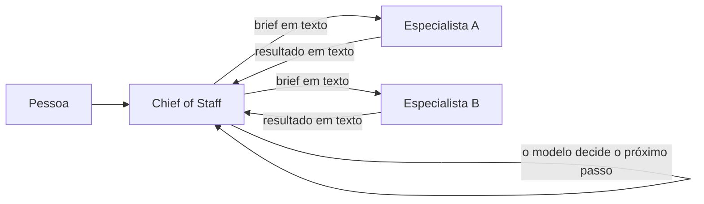
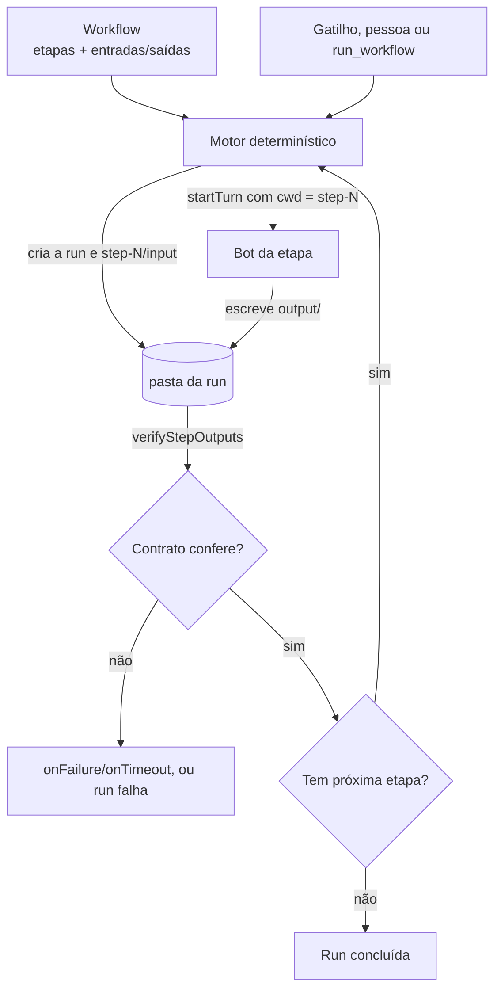
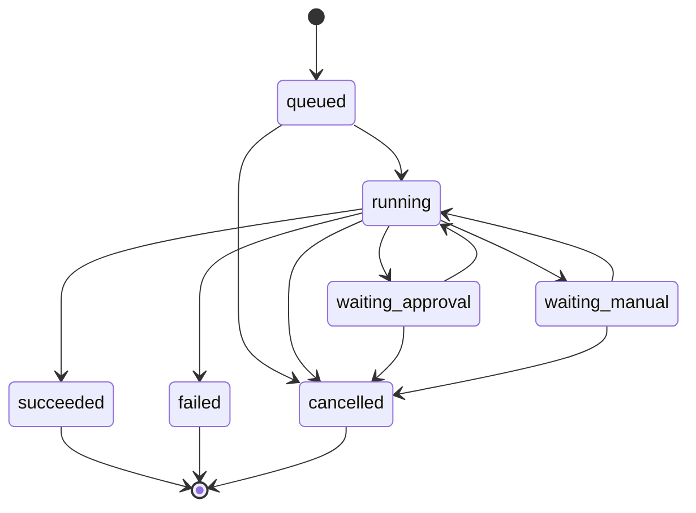
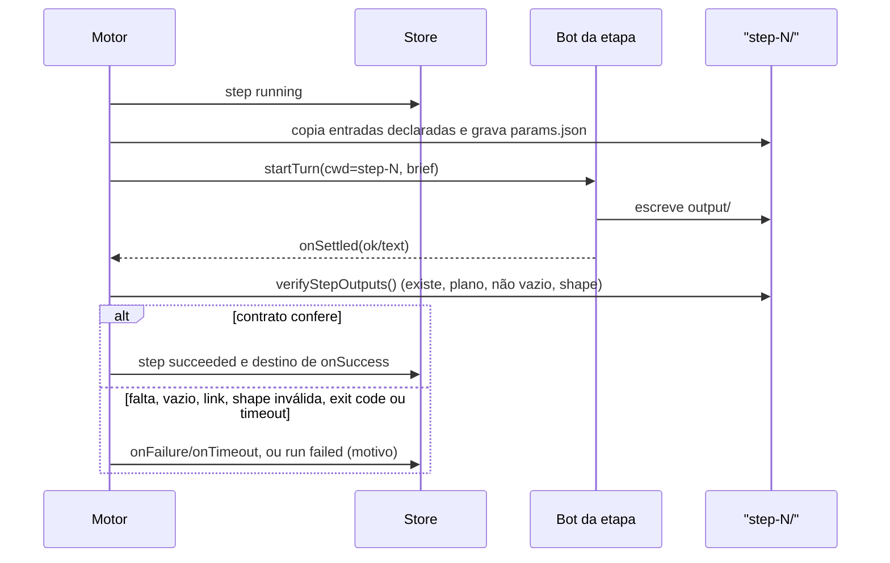
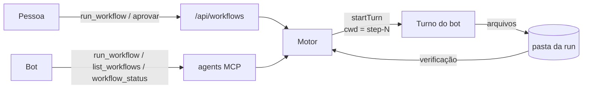

# Workflow: análise da implementação

Data: 2026-11-03 · Revisado em 2026-11-16 (contrato verificável, parâmetros com origem, etapa manual, Do While e ambiente por instalação) · Base: `tmp/spec-workflow.md` (D1–D18) · Código: `shared/workflow.ts`, `shared/workflow-authoring.ts`, `shared/workflow-refusal.ts`, `server/workflows/`

Este documento fecha a linha de raciocínio: o problema de hoje, o impacto, a
solução, como ela será construída, o que já existe para reaproveitar e como o
núcleo criado vira a camada de tools que os agentes chamam dentro do Workflow.

## 1. O problema que temos hoje

A ordem de um trabalho entre bots vive no texto. O Chief recebe a demanda,
escolhe os colegas, escreve um brief para cada um e, a cada turno, decide quem
chama em seguida. O harness executa ferramentas muito bem; ele não governa a
sequência.



O que é verdade hoje, verificado no código e no mapa da delegação:

- O brief e o resultado viajam como texto. A mensagem de `coordinate_bots` tem
  no máximo 4 000 caracteres; o brief guardado e o resultado têm teto de
  12 000 (`server/runtime-coordinator.ts`, `server/runtime/runtime.ts`). Não há
  contrato de entrada/saída nem verificação de entrega.
- `coordinate_bots` não tem dependência entre atribuições: irmãos rodam em
  paralelo. A ordem só existe se o Chief encerrar um turno e chamar o próximo.
- O mesmo brief para o mesmo especialista vira `duplicate`; quem já completou
  recusa nova tarefa sem `rework=true`.
- Não há retentativa automática de uma etapa que falhou.
- `evidence.filesChanged` existe no tipo, mas nenhum código o preenche: "disse
  que fez" não é verificável. O host preenche `toolCalls`, `okToolCalls`,
  `errors` e `outward` (quando há ação externa) em `server/turn-outcome.ts`.
- `cwd` é por bot/thread, mas o turno aceita `cwd` próprio
  (`SendTurnInput.cwd`); departamento é só um rótulo (`section`), sem pasta.
- Limites por raiz: 64 requests e 96 execuções (constantes de
  `server/runtime-coordinator.ts`, acima dos padrões 24/48), 48 wakes,
  profundidade 4, 5 threads novas por turno. Espera pela pessoa: 30 min,
  exceto com cartões abertos. `stallMs`: 4 h, e não derruba árvore com
  `needs_input`.

## 2. Os impactos

- **Ordem imprevisível.** O Chief pode pular etapa, inverter duas ou rodar em
  paralelo o que deveria ser sequencial — e variar entre execuções.
- **Entrega não comprovada.** O resultado é prosa; arquivos citados no brief
  podem não existir, estar vazios ou no lugar errado.
- **Handoff frágil.** Caminhos viajam como texto; um erro de nome só aparece
  quando alguém abre a pasta.
- **Sem auditoria da run.** O runtime guarda assignments, não "etapa 2 de 5",
  entradas, saídas e aprovações de um workflow.
- **Falha silenciosa.** Sem retry nem política, depende de o Chief perceber e
  agir; a pessoa descobre depois.
- **Aprovação sem contexto.** Os cartões existem, mas não pausam uma run nem
  mostram em que etapa ela está.
- **Custo desnecessário.** Cada execução paga tokens por decisões que já eram
  conhecidas.

## 3. A solução proposta

Duas camadas, uma autoridade:

1. **Workflow (dado):** uma sequência de etapas. Cada etapa declara o bot (ou o
   script), a instrução, os arquivos que recebe e os que precisa deixar.
2. **Motor (código):** executa a sequência, copia entradas, verifica saídas e
   só então avança. O bot da etapa não escolhe o que roda depois.

O contrato entre as etapas é o **sistema de arquivos**, não a conversa.



Invariantes que dão a garantia:

- O motor é o único que decide a ordem e o único que escreve fora de
  `step-N/output/` (D15).
- O bot da etapa roda com `cwd` em `step-N` e escreve apenas em `output/`
  (D14). O `cwd` é convenção, não sandbox: o engine ainda pode ler outros
  caminhos conforme o modo de permissão (P15).
- Avançar exige arquivo plano, não vazio e não-link nas saídas obrigatórias;
  saídas opcionais podem faltar. Toda saída declara um nome com extensão e toda
  saída que declara `shape` precisa ser JSON que passe nesse schema.
- O motor não julga opinião. Uma etapa falha por contrato: saída ausente, vazia,
  link, `shape` inválida, exit code diferente de zero ou timeout. O desvio por
  conteúdo é uma etapa `condition` (ou a condição de um Do While).
- O motor copia para `input/` apenas o que a etapa declarou, e apenas de
  etapas anteriores (D15). Um parâmetro nunca chega pelos dois canais.
- Nenhuma aprovação é pulada: o turno da etapa usa o mesmo gate e os mesmos
  cartões do fluxo normal.

## 4. Como está implementada

### Fases

| Fase | Entrega | Estado |
|---|---|---|
| F0 | Contrato, layout de pastas, verificação de saída e cópia de entrada | **feito** |
| F1 | Máquina de estados, brief da etapa, executor, store, retenção, rotas e tools | **feito** |
| F2 | Destino "Workflow" nos gatilhos, aprovação longa, UI compacta, script e condição | **feito**; o contrato do F2 foi substituído em 16/11/2026 |
| F3.1/F3.1.1 | Editor visual, `onSuccess`/`onFailure`/`onTimeout`, timeout por etapa, fim explícito | **feito** (09/11/2026) |
| F3.2 | Modo Manual, condição E/OU, skills por etapa | **feito**; Python/TypeScript foi substituído por `.mjs` + `modules` |
| F3.3 | Do While (`kind: "loop"`) | **feito** (12/11/2026) |
| F3.4 | Proposta, prévia, ensaio obrigatório e criação | **feito** (13/11/2026) |
| F3.5 | Contrato verificável: extensão, `shape`, `from` em par, parâmetros com origem, ambiente por instalação | **feito** (16/11/2026) |
| F3 | Team Cloud/VM | pendente |

### Lacunas conhecidas

- Aprovação: resolvida. A etapa que termina com cartão aberto deixa a run
  `waiting_approval`; o turno de continuação (`cardContinuation`) chega por
  `engine.turnSettled`, que re-verifica a etapa. Recusa cancela a run. Não há
  prazo (`approvalTimeoutMs` não existe) nem fallback.
- Histórico de versões: todas as versões ficam em `workflows.json`, sem nota,
  autor, hash ou retenção do histórico. Uma run pode escolher a versão; GC e
  metadados continuam pendentes.
- `run.json` guarda o snapshot (`snapshot.name` e `snapshot.steps`) desde a F2.
  O campo `result` da run continua no tipo, mas o motor não o preenche: a tela
  só mostra **Resultado** em runs antigas que já o traziam.
- Script: Node apenas, sem bloqueio real de rede, sem sandbox (roda como o
  usuário do app) e sem editor na tela; o arquivo entra pela rota admin.
- Python não é runtime de etapa; ver “módulos e ambiente”. A poda do ambiente
  preparado não existe.
- `server/workflows/modules.ts` (instalação por run) ficou sem uso.

### Layout

O Workflow vive em `workflows.json`, no data dir do app (entra no backup); a
pasta do Workflow guarda as runs e os scripts, e a instalação guarda um ambiente
de script para todos os Workflows.

```
~/MimirBot/
├── package.json                 ← gerado por "Prepare environment"
├── node_modules/                ← pacotes node da instalação
├── .workflow-env/
│   ├── python/                  ← venv
│   ├── requirements.txt
│   └── state.json               ← hash, versões, quando preparou
└── Financeiro/
    └── workflows/
        └── 8a5b1c2d-.../
            ├── scripts/
            │   └── validar.mjs
            └── runs/
                └── 20261103-123456-abcdef/
                    ├── run.json
                    ├── step-1/
                    │   ├── input/
                    │   └── output/
                    └── step-2/
                        ├── input/
                        └── output/
```

Uma etapa dentro de um Do While troca `step-N` por
`iterations/<n>/step-<id>`, com o mesmo par `input/`/`output/`.

### Ciclo de vida da run



### Uma etapa, em sequência



### Contratos do motor

#### Contrato de saída

Toda saída é um arquivo nomeado, com extensão: `relatorio.md`, `dados.json`,
`video.mp4`. O nome é o contrato; não existe segundo campo de formato.

| Regra | Onde é imposta |
|---|---|
| `path` é relativo, sem `..`, sem absoluto, sem `\` e sem control character | `isWorkflowRelativePath`, no schema e em `safeWorkflowPath` |
| `path` tem extensão de até 12 caracteres alfanuméricos | `workflowFileExtension`, no validador de autoria |
| `path` não pode conter `*` | validador de autoria: o motor procura o nome exato |
| saída consumida é `.json` | validador de autoria (`isWorkflowJsonPath`) |
| saída consumida tem `shape` | validador de autoria; o schema de leitura só transporta |
| `shape` cabe em 16 KB e compila | validador de autoria, com o compilador de tools do MCP |
| saída obrigatória existe, é arquivo plano e não está vazia | `verifyStepOutputs`, na run |
| saída com `shape` é JSON e passa no schema | `verifyStepOutputs`, na run |

O motor faz `JSON.parse` de uma saída em dois momentos: quando uma `condition`,
um Do While ou um parâmetro `from` a consome (`readStepJson`, objeto JSON de até
64 KB), e quando a própria saída declara `shape` (`shapeMismatch`). Fora isso, o
arquivo é opaco.

Uma etapa pode consumir uma saída `.json` sem `shape` se ninguém a lê — por
exemplo, a última etapa que só entrega um JSON a uma pessoa. No instante em que
uma condição, um loop ou um `from` a consome, o save passa a exigi-lo.

#### Instrução da etapa

O motor não escreve prompt novo. Ele usa o prompt que todo turno já monta em
`buildSystemPrompt` (`server/system-prompt.ts`):

| Camada | Origem | Muda por etapa? |
|---|---|---|
| Identidade | `botPersona` do bot da etapa | não |
| Instruções permanentes | `SOUL.md` do bot | não |
| Skills | seleção declarada pela etapa (`bot`, `bundled`, `imported`); vazio ou ausente = nenhuma | sim |
| Regras fixas da etapa | parte volátil `workflow-step` | sim |
| Tarefa | `instructions`, entradas, parâmetros e saídas na mensagem do usuário | sim |

A parte `workflow-step` entra em `VOLATILE_SECTIONS` e diz só o que vale para
toda etapa: leia `input/`, escreva apenas em `output/`, não peça resposta em
texto, encerre o turno, o motor copia as saídas. Para confirmação, a etapa abre
um cartão de requisição.

O corpo da tarefa viaja na mensagem do usuário, como o brief de um colega
delegado (`composeRootTurn`). Motivo: o Claude reusa o primeiro system prompt
em `--resume` (`server/index.ts`), então uma parte de sistema alterada pode não
chegar quando a etapa retoma a mesma thread.

#### Brief da etapa

`server/workflows/brief.ts` monta o texto enviado como mensagem do turno no
início de toda etapa de bot, inclusive dentro de um Do While. Não é campo do
JSON nem fica persistido: é derivado da definição.

```text
WORKFLOW "Cobrança mensal" · STEP 2/3 "Revisar cobrança"

TASK
Leia input/dados.json. Escreva output/mensagem.md e output/result.json.

CONTRACT v1
INPUT dados.json
PARAMS competencia:date!, regime:enum[escala|mesa|todos]!
COLLECT link:string
OUTPUT mensagem.md (texto), result.json (JSON)
RULES read input/, write only output/, end turn; approval=request card(request_credential), show_widget does not pause; engine verifies outputs.
```

- `INPUT`: `inputs[].as`, ou `none`;
- `PARAMS`: `name:type`, `list[type]`, `enum[a|b]`, `!` obrigatório e
  `?whenAbsent=rule:<name>` opcional; some quando não há parâmetro;
- `COLLECT`: os parâmetros com `collectedBy` daquela etapa;
- `OUTPUT`: `path`, o formato derivado da extensão (`JSON`, `texto`, `arquivo`)
  e `(optional)`;
- `RULES`: a regra única de aprovação
  (`shared/workflow-approval.ts`), `show_widget` que não pausa e, na etapa
  manual que não coleta, o aviso de que a pessoa só libera a etapa.

Etapas de `script` não recebem brief; recebem `cwd`, `input/`, `output/`,
`input/params.json` e o ambiente da instalação.

#### Memória da etapa

A etapa de Workflow roda com **memória vazia por padrão**: sem `MEMORY.md` e
memória da equipe, sem recentes e recall, sem as ferramentas de memória e sem o
journal do turno. Ficam persona, `SOUL.md`, skills declaradas, departamento e
`input/`.

**Status:** implementado em 13/11/2026 (`server/index.ts`,
`server/agents-turn.ts`), com `OMB_MEMORY_ENABLED=0` na conversa da etapa.

#### Parâmetros da etapa

Cada etapa declara os próprios parâmetros, no mesmo bloco em que declara
`inputs` e `outputs`. Não existe bloco `parameters` no topo da definição.

```json
{
  "id": "consultar",
  "kind": "script",
  "parameters": [
    { "name": "inicio", "type": "date" },
    { "name": "regime", "type": "enum", "values": ["escala", "mesa", "todos"] },
    { "name": "total", "type": "number", "from": { "step": "somar", "output": "soma.json", "field": "total" } },
    { "name": "link", "type": "string", "collectedBy": "pedir-link" },
    { "name": "trechos", "type": "string", "list": true, "from": { "step": "escolher", "output": "trechos.json", "field": "clips" } }
  ]
}
```

Cada parâmetro tem **uma** origem:

| Origem | Declaração | Quem fornece | Validação |
|---|---|---|---|
| largada | nada | pessoa no diálogo, ou `run_workflow(inputs)` | `validateWorkflowInputs` |
| etapa anterior | `from: { step, output, field }` | campo pontuado de uma `.json` obrigatória anterior | `resolveStepParameters` na hora da etapa |
| pessoa | `collectedBy: "<step-id>"` | etapa manual, ao continuar | `validateCollectedInputs` |

Regras:

- parâmetro com origem é sempre `required: true`; opcional só na largada;
- opcional declara `whenAbsent: rule:<name>`; `enum` declara `values`;
- `list: true` recebe uma lista de escalares do `type`, nunca objetos;
- `from.output` precisa ser `.json`, obrigatória e ter `shape`; `from.field`
  precisa existir nesse shape e o tipo precisa concordar (inclusive
  `list` → `array`);
- o mesmo `output` não pode chegar também por `inputs`: “um dado, um canal”;
- `validateWorkflowInputs` só exige o que a largada fornece — parâmetros com
  `from`/`collectedBy` não aparecem em `needs_input`;
- `params.json` leva só o subconjunto declarado pela etapa. Etapa sem
  parâmetros não ganha o arquivo.

**Status:** implementado em 13/11/2026 e refeito em 16/11/2026 com origem,
`list` e validação de shape (`shared/workflow.ts`,
`server/workflows/parameters.ts`, `files.ts`, `engine.ts`).

#### Etapa manual

`mode: "manual"` significa receber um valor da pessoa antes de rodar, não
“pausar”. O save exige um parâmetro com `collectedBy` igual ao id da etapa; sem
ele, a etapa não tem motivo para ser manual e o validador recusa. O schema de
leitura não recusa: um Workflow antigo continua abrindo, e o motor, se essa
etapa falhar, acrescenta que continuar não entrega valor nenhum.

A run para em `waiting_manual` antes de copiar entradas ou abrir thread.
**Continuar** (`POST /api/workflows/runs/:id/continue`) valida os campos dessa
etapa e libera a mesma run; a liberação é memória do processo, então um reinício
deixa a run parada. A espera manual não consome `timeoutMs`.

#### Aprovação

Uma regra, uma constante (`shared/workflow-approval.ts`): a etapa abre um cartão
de requisição (`request_credential`) e encerra o turno; a run fica
`waiting_approval` e espera **indefinidamente**; não há timeout nem fallback; um
cartão recusado cancela a run com o motivo "aprovação negada". A mesma regra
aparece no prompt da etapa, no brief e nas descrições das tools; um aviso de
autoria aponta instrução que prometa prazo ou fallback.

`show_widget` não tem `requestId` e não pausa. A decisão acontece na conversa da
etapa, nunca na tela de Runs.

#### Condição

```json
{
  "id": "decidir",
  "kind": "condition",
  "name": "Decidir",
  "from": { "step": "revisar", "output": "revisao.json" },
  "match": "all",
  "conditions": [{ "field": "ok", "op": "equals", "value": true }],
  "whenTrue": "publicar",
  "whenFalse": null,
  "onFailure": "avisar"
}
```

`from` é sempre um par `{ step, output }`; `output` é uma `.json` obrigatória de
uma etapa anterior, com `shape`. `match` combina as linhas com `all` (padrão) ou
`any`, com curto-circuito. Operadores: `equals`, `not_equals`, `exists`,
`contains`, `gt`, `gte`, `lt`, `lte`; `value` é exigido em todos menos `exists`.
Limites: 20 linhas, 4 KB por valor, 64 KB no grupo. A condição é síncrona e não
tem `timeoutMs`.

O motor grava na run a rota (`branch`), a linha que decidiu (`condition`) e a
fonte (`source: { step, output }`).

#### Do While

`kind: "loop"` tem `body` (1..20 etapas `bot`/`script`/`condition`, sem loop
dentro), `from: { step, output }` de uma etapa do corpo, `match`, `conditions`,
`maxIterations` (inteiro ≥ 1, padrão 1) e `outputs` projetados da última volta.
`from.output` é uma `.json` obrigatória com `shape` de uma etapa do corpo.

A condição é **until**: verdadeira encerra, falsa faz outra volta; a primeira
volta sempre acontece. Estourar `maxIterations` falha o loop com
`step "x" reached the iteration limit of N`, com `failureKind: "limit"`.
Cada volta tem pastas próprias; nada é compartilhado entre voltas. Cada `output`
do loop é declarado por exatamente uma etapa do corpo e copiado da última volta
para `output/` do loop.

#### Ids

| Id | O que identifica | Formato | Onde vive |
|---|---|---|---|
| `WorkflowDefinition.id` | o Workflow | UUID | `workflows.json` |
| `WorkflowDefinition.version` | a versão do Workflow | inteiro ≥ 1 | `workflows.json` |
| `WorkflowRun.id` | uma execução | `AAAAMMDD-HHMMSS-hex6` | pasta e `run.json` |
| `WorkflowRun.workflowId` + `workflowVersion` | qual Workflow e versão | UUID + inteiro | `run.json` |
| `WorkflowStep.id` | a etapa dentro do Workflow | slug único, inclusive entre topo e corpo | Workflow e `run.json` |
| `WorkflowRunStep.assignmentId` + `threadId` | o turno que executou a etapa | ids do runtime | `run.json` |

A etapa aponta para um **bot** (`botId`), não para um agente nem para um
modelo. O bot já carrega modelo, ferramentas, permissões, SOUL e skills.

`WorkflowRun.department` é um **retrato** do departamento no momento da
criação, não uma cópia que precisa acompanhar o Workflow.

#### Aceite

O aceite é estrutural, em `verifyStepOutputs`:

- saída obrigatória existe, é arquivo comum e não está vazia;
- saída opcional pode faltar;
- saída com `shape` é JSON válido e passa no schema;
- a etapa falha por contrato: ausente, vazio, link, `shape`, exit code,
  timeout.

Isso responde “o arquivo veio e tem a forma declarada”, não “a entrega está
correta”. No ensaio de uma proposta, **só a saída esperada é critério**; o
caminho do bot (ferramentas, raciocínio, ordem interna) não entra.

O motor não é uma etapa. Ele orquestra: despacha o turno, espera, verifica,
copia e avança. Quem julga o conteúdo é uma `condition`.

#### Autoria e recusa

O schema de leitura (`workflowDefinitionSchema`) normaliza e nunca recusa: um
Workflow existente não desaparece da lista. `result`, `require` e `when` são
aceitos ali para leitura de definições antigas; `next` vira `onSuccess` e uma
condição de uma linha vira `conditions`. A recusa fica em
`validateWorkflowAuthoring` (`shared/workflow-authoring.ts`):

| Modo | Onde | Efeito |
|---|---|---|
| `preview` | prévia da proposta, Studio | erros + avisos de instrução e de fallback |
| `save` | salvar Workflow, criar proposta | erros bloqueiam; `require`/`when` recusados, `result` de etapa de topo só avisa |
| `preflight` | ensaio | soma módulos ausentes da máquina |

O que ele recusa além do schema:

- saída sem extensão, com `*`, ou `.json` consumida sem `shape`;
- `shape` acima de 16 KB ou que não compila;
- condição/loop que lê saída não `.json`, opcional ou sem `shape`;
- etapa manual sem parâmetro com `collectedBy` dela;
- `from` que aponta para etapa não anterior, saída opcional, `.json` sem
  `shape`, ou campo que não existe no shape / tipo divergente;
- `output` já entregue em `inputs` e também lido por parâmetro;
- `require` e `when` presentes.

O corpo de uma recusa é um `WorkflowRefusal`
(`shared/workflow-refusal.ts`):

```json
{
  "code": "authoringErrors",
  "error": "steps.2.outputs.0.path: ...",
  "authoring": {
    "errors": [{ "path": "steps.2.outputs.0.path", "message": "..." }],
    "warnings": [],
    "truncated": 3
  }
}
```

Códigos: `authoringErrors`, `needsConfirmation`, `needsRehearsal`. No máximo 50
erros em `authoring.errors`; `truncated` diz quantos ficaram de fora e o
`error` legível repete a contagem. Uma tool de bot lê esse corpo e devolve os
problemas ao modelo; não repassa JSON cru.

#### Proposta, ensaio e criação

Uma proposta (`workflow-proposals.json`) carrega a definição que o motor
rodaria, os scripts e as respostas da entrevista. Ela só vira Workflow com:

1. entrevista confirmada **pela pessoa** no cartão (`interview.confirmedAt`);
2. `approvalHash` igual ao hash atual de definição + scripts + respostas;
3. ensaio `passed`.

Sem (1) ou (2), a rota responde `needsConfirmation`; sem (3),
`needsRehearsal`. O ensaio roda scripts em pasta descartável e compara bytes;
bot, condição e loop ficam não testados. Um ensaio sem nenhuma etapa de script
resulta `passed`; com script, precisa de ao menos um `passed` e nenhum
`diverged`. Sem ensaio registrado, a criação continua recusada.

A criação aplica o portão: a primeira etapa executável nasce
`mode: "manual"`, então toda run criada por conversa espera uma pessoa. A
rotina só pode apontar para o Workflow depois de ele existir e nunca fornece
valor inicial: se o Workflow exige um parâmetro de largada, a run da rotina
falha com `needs_input`; se a primeira etapa é manual e coleta, ela para em
`waiting_manual`.

#### Módulos e ambiente por instalação

`modules` de uma etapa de script declara o que a máquina precisa:

```json
"modules": [
  "ffmpeg",
  "gpu",
  { "name": "faster-whisper", "runtime": "python", "version": "1.2.1" },
  { "name": "sharp", "runtime": "node" }
]
```

- string = binário no `PATH`; objeto sem `runtime` também é binário;
- `bin`: verificado no `PATH`; não aceita `version`; `gpu` é o único nome
  especial e checa a GPU;
- `python`: instalado no venv `~/.workflow-env/python`;
- `node`: instalado em `node_modules` na raiz de `~/MimirBot`, que é ancestral
  da pasta de scripts e por isso o resolvedor ESM o encontra;
- `version` opcional instala exatamente e o preflight compara;
- nome e versão validados: sem URL, caminho, flag ou espaço.

Nada é instalado durante a run. `POST /api/workflows/environment/prepare`
(admin; **Preparar ambiente**) une os módulos de todos os Workflows salvos e das
propostas em rascunho, escreve `requirements.txt` e `package.json`, cria o venv,
roda `pip`/`npm` sem shell e grava `state.json` com `preparedAt`, hash, versões e
interpretador.

O preflight da run (`environmentPreflightIssue`) não importa nem toca a rede:
confere hash do conjunto declarado contra o preparado, existência do
interpretador/`node_modules` e cada binário no `PATH`. Falha → a run não começa
(ou a etapa falha) com a mensagem que manda preparar o ambiente.

O executor exporta `WORKFLOW_PYTHON` e `WORKFLOW_NODE_MODULES`, prefixa o `PATH`
com o `bin` do venv e mantém o ambiente mínimo, sem shell. O detalhe está em
`docs/superpowers/specs/2026-11-16-workflow-environment.md`.

### Módulos

| Arquivo | Papel | Estado |
|---|---|---|
| `shared/workflow.ts` | Contrato, validações e tipos da run | feito |
| `shared/workflow-authoring.ts` | Regras de autoria em preview/save/preflight | feito |
| `shared/workflow-refusal.ts` | Corpo 4xx tipado | feito |
| `server/workflows/paths.ts` | Raiz, departamento, run id, `step-N`, iteração | feito |
| `server/workflows/files.ts` | Verificação (com `shape`), cópia de entrada, `params.json`, projeção | feito |
| `server/workflows/state.ts` | Transições puras da run | feito |
| `server/workflows/brief.ts` | Brief determinístico da etapa | feito |
| `server/workflows/flow.ts` | Próximo passo, `onFailure`/`onTimeout` | feito |
| `server/workflows/condition.ts` | Grupo `all`/`any` | feito |
| `server/workflows/script.ts` | Executor de `.mjs` | feito |
| `server/workflows/environment.ts` | Ambiente por instalação e hash | feito |
| `server/workflows/preflight.ts` | Binários no `PATH`; nada é instalado na run | feito |
| `server/workflows/parameters.ts` | Largada, `collectedBy`, `from` | feito |
| `server/workflows/engine.ts` | Scheduler sobre `startTurn`/`onSettled` | feito |
| `server/workflows/store.ts` | Workflows e runs, escrita atômica | feito |
| `server/workflows/retention.ts` | Limpeza por idade, sem tocar pausadas | feito |
| `server/routes/workflows.ts` | HTTP + SSE | feito |
| `server/host/workflows.ts` | Factory de composição | feito |
| `server/workflows/modules.ts` | Instalação por run (substituída pelo ambiente) | **sem uso** |

O executor não reimplementa turno: ele **cria a thread com o `cwd` exato**
(`store.createTask(..., cwd)`), chama `startTurn` com `onSettled` e recebe
`HostTurnResult`.

### Falha, retomada e limites

- Falha de etapa: a etapa fica `failed` com o motivo verificado e a run segue
  `onFailure`, ou para em `failed` se não houver destino. Sem retry automático.
- Timeout: etapa de bot com `timeoutMs > 0` e etapa de script têm relógio
  próprio. Regra: `onTimeout` → `onFailure` → run para. A pausa de aprovação
  para o relógio e ele não reinicia. Script: padrão de 5 min, teto de 1 h.
- Reinício do app: runs `queued` e runs paradas entre etapas continuam; uma
  etapa `running` vira `failed` ("the app restarted while this step was
  running"). Passos `succeeded` não rodam de novo.
- Aprovação: `waiting_approval`, sem timeout, pausada nunca é apagada e o
  `stallMs` não derruba árvore com `needs_input`.
- Limites: um passo por vez por run, 40 etapas contando corpos, 20 por corpo e
  admissão normal por bot (3 threads).

### Cancelamento, remoção e versionamento

**Cancelar uma run.** `cancel_workflow` / `POST /api/workflows/runs/:id/cancel`
grava a run como `cancelled`, marca a etapa corrente como `skipped` com o motivo
e chama o mesmo caminho do Stop (`interruptDirectThread` →
`adapter.interruptTurn`); um script em execução é morto. O motor não espera um
segundo `onSettled`. Não há rollback: arquivos e efeitos externos permanecem.

**Apagar.** `DELETE /api/workflows/:id` responde 409 enquanto houver run
`queued`, `running`, `waiting_manual` ou `waiting_approval`, listando os ids.
`DELETE /api/workflows/runs/:runId` responde 409 enquanto a run estiver ativa. A
retenção só remove runs terminais. Apagar o Workflow não apaga as runs, e o
snapshot mantém os nomes legíveis.

**Versionamento.** Cada save com conteúdo diferente acrescenta um snapshot
imutável (`version = max + 1`); conteúdo idêntico não cria versão. A run grava
`workflowId` + `workflowVersion` e o motor carrega exatamente aquela versão.
`POST /api/workflows/:id/run` aceita `{ "version": N }`.

## 5. O que conseguimos reaproveitar

| Recurso | Onde | Uso no Workflow |
|---|---|---|
| `store.createTask(..., cwd)` | `server/store.ts` | Cria a thread da etapa já com `cwd = step-N` |
| `startTurn` + `onSettled` | `server/index.ts` | Executa a etapa e devolve o `HostTurnResult` uma vez. `startTurn` é privado ao módulo; a factory do host do Workflow precisa recebê-lo como dependência |
| `beginTurn`/`endTurn` | `server/runtime-coordinator.ts` | Estado durável, retomada e orçamento da atribuição; não há histórico de "etapa 2 de 5" |
| Cartões e `HostTurnResult.cards` | `server/coordinator.ts` | Pausa humana sem inventar aprovação |
| Gate/capability do turno | `server/mcp-gate.ts` | Nenhuma permissão é contornada |
| `fullInputSchema` + `compileToolSchema` | `server/drivers/agents-catalog.ts`, `server/mcp-schema-validator.ts` | Valida argumentos de tools e do `run_workflow` |
| `writeFileAtomic` | `server/atomic.ts` | `run.json`, Workflows e transições |
| `broadcast` | `server/index.ts` | Frames SSE `workflow.*` |
| `RoutineTarget` | `server/routines.ts` | Novo destino `"workflow"` ao lado de `"bot"`/`"room-goal"` |
| `sections` | `server/section-context.ts`, `server/store.ts` | Departamento como rótulo; pasta vem do motor |
| `sharedProjectFolder` | `server/bot-cwd.ts` | Regra de segurança do `in_my_folder`; `~/MimirBot` fica fora do data dir (D6). O motor do Workflow cria a pasta e passa `cwd` direto, sem chamar `sharedProjectFolder` |
| `server/routes/` + `RouteHandler` | `server/routes/README.md` | Rotas novas sem crescer `server/index.ts` |
| `playbooks` do package format | `server/installed-playbooks.ts`, `shared/package-format.ts` | Playbooks são instruções empacotadas; não distribuem Workflow. O formato tem `playbooks`, não `flows` |
| Saved Steps | `server/saved-steps/` | Inspiração para record→promote; o replay cobre passos de computador, não etapas de Workflow. Não há record→promote hoje |
| `agents` MCP | `server/drivers/agents-proxy.ts`, `agents-catalog.ts`, `agents-call.ts` | Transporte das tools novas, com capability |

## 6. O que teríamos que fazer do zero

| Item | Por que não existe | Fase |
|---|---|---|
| Máquina de estados da run | O runtime não tem "etapa 2 de 5" com entradas/saídas | F1 |
| Brief determinístico | Hoje o brief é texto do Chief; o motor precisa listar `input/`, parâmetros, campos coletados e saídas | F1 |
| Ordem e dependência entre etapas | `coordinate_bots` roda irmãos em paralelo | F1 |
| Store de Workflows + CRUD | Não há modelo de Workflow | F1 |
| Rotas + SSE do Workflow | Não há contrato para a UI | F1 |
| Tools `run_workflow`/`list_workflows`/`workflow_status`/`cancel_workflow` | Não existem no catálogo | F1 |
| Destino "Workflow" no gatilho | `RoutineTarget` ganhou `"workflow"` com `workflowId` | F2 (feito) |
| Aprovação longa | Cartões não expiram em 30 min e o `stallMs` ignora `needs_input`; a retomada veio com `engine.turnSettled` | F2 (feito) |
| Política de retry | Não há retentativa automática | F2 |
| Retenção por Workflow | Não há limpeza por pasta/idade | F1 |
| Editor/visualização | O canvas não é editor de fluxo | F2 (UI simples) / F3 (editor) |
| Etapa de script | Executor `.mjs` com env, timeout, kill e validação igual à de bot | F2 (feito) |
| Condição e repetição | `condition` com `from` em par e `match`; Do While com corpo, condição e `maxIterations` | F2/F3.3 (feito) |
| Contrato verificável | Extensão, `shape`, parâmetros com origem, etapa manual com `collectedBy`, ambiente por instalação | F3.5 (feito) |
| Confirmar `cwd` por thread em cada engine | `SendTurnInput.cwd` é por turno e Claude, Codex e Antigravity usam `turn.cwd`; `--add-dir` do Claude é só para skills, e Codex lê `writableRoots` do config | F1 (confirmar, sem acesso extra) |

## 7. Como isso vira as tools que os agentes chamam

O ponto central: **a tool inicia um Workflow; ela não deixa o modelo escolher os
passos.** Quem decide a ordem é o motor. O bot recebe a etapa já montada.



| Tool | Quem chama | O que faz | Módulo nosso por trás |
|---|---|---|---|
| `list_workflows` | Bot | Lista Workflows que o bot alcança | `shared/workflow.ts` (parse) |
| `run_workflow` | Bot, pessoa ou gatilho | Valida a entrada, cria a run e prepara as pastas | `workflow.ts`, `paths.ts`, `files.ts` |
| `workflow_status` | Bot, pessoa | Mostra etapa atual, saídas verificadas e motivo de falha | `paths.ts`, `files.ts` |
| `cancel_workflow` | Pessoa; bot só na própria run | Para a run, interrompe o turno corrente e preserva os arquivos | `paths.ts`, `state.ts`, `interruptDirectThread` |
| aprovar/recusar | **Só pessoa** | Retoma ou encerra uma run pausada | `state.ts` |

O que o bot **não** ganha: tool para marcar etapa como concluída, editar o
Workflow, aprovar a própria pausa ou rodar um Workflow fora do departamento
que alcança. A conclusão é sempre a verificação do arquivo.

Por dentro, cada tool só chama o que já existe:

- `run_workflow` valida com o mesmo schema que a UI usa, chama `paths.ts` para
  o id/pasta, `files.ts` para criar `step-N` com `input/` e `output/` e devolve
  `runId`.
- O motor chama `copyStepInputs` antes da etapa e `verifyStepOutputs` depois;
  `workflow_status` lê o `run.json` e mostra o que foi verificado e o motivo da
  falha, sem repetir a verificação.
- O turno da etapa é um turno normal: as tools que o bot já tem continuam
  valendo, com o gate de sempre. Ele escreve em `output/` com as ferramentas de
  arquivo/computer que já usa — não precisa de uma tool nova para "entregar".

## 8. Como isso casa com a proposta do Workflow

| Decisão | Onde ela vive na implementação |
|---|---|
| D1 motor determinístico | `engine.ts` decide a ordem; o bot só executa a etapa |
| D2 entradas/saídas verificadas | `files.ts` (`verifyStepOutputs`, `copyStepInputs`) |
| D3 JSON curto | `readStepJson` lê uma saída `.json` de até 64 KB; `verifyStepOutputs` valida o `shape` |
| D4 arquivos na pasta da run | `paths.ts` |
| D5/D6 pasta por departamento em `~/MimirBot` | `paths.ts` (`workflowsRoot`, `departmentFolder`) |
| D8 "General" como departamento | Não é automático: vem do campo `department` do Workflow |
| D7 acesso por run | `cwd` da thread da etapa; nada de pasta do departamento. Não há confinamento: D7 depende de limpar ou arquivar a pasta ao fim da run |
| D9 ambiente do bot não muda | turno normal + `cwd` da etapa |
| D10 retenção por Workflow | `retention.ts`, pausadas protegidas |
| D11 arquivos sempre em disco | pasta da run (F0) + `run.json` (F1), com a retenção (F1) |
| D12 ramificação/aprovação | etapa `condition` escolhe a rota; aprovação longa e `onFailure`/`onTimeout` no motor |
| D13 individual e equipes | mesma run; alcance por departamento |
| D14 `step-N` com `input/` e `output/` | `paths.ts` + `store.createTask(cwd)` |
| D15 só o motor escreve | `files.ts`; o bot só escreve em `output/` |

Implementado no núcleo (F0): D2, D3, D4, D5, D6, D14 e D15. O motor acrescenta
na F1: D1, D9, D10 e a retenção de D11. D8 não é automático: o Workflow usa o
campo `department` do Workflow, e "General" só existe se o Workflow disser isso.
D7 depende do motor limpar ou arquivar a pasta ao fim da run; hoje a pasta
continua no disco. D12 é a etapa `condition` e o Do While; aprovação longa,
`onFailure` e `onTimeout` fecham o desvio. D13 na nuvem fica para F3.

## 9. O que ainda depende do dono

1. **Exemplo real de Workflow** (seção 1 da spec) — valida o formato da etapa e
   a tela.
2. **Aprovação longa — resolvida em 07/11/2026.** O cartão de requisição grava
   `waiting_approval`; a resposta chega por `engine.turnSettled`, que
   re-verifica a etapa. Espera indefinida, sem fallback; recusa cancela.
3. **Histórico de versões** — metadados (nota, autor, hash, parent) e GC das
   versões que nenhuma run referencia. Todos os snapshots ficam em
   `workflows.json`.
4. **Snapshot da run — resolvido em 08/11/2026.** O `run.json` guarda
   `snapshot: { name, steps }`.
5. **Python de primeira classe** — hoje Python é dependência (`modules` com
   `runtime: "python"`) chamada por um `.mjs`; uma etapa `.py` exige contrato,
   timeout e verificação próprios.
6. **Poda do ambiente** — **Preparar ambiente** não remove pacotes que ninguém
   mais declara; o `state.json` só passa a listar o conjunto novo.
7. **`approvalTimeoutMs`** — não existe: uma aprovação espera para sempre.

Decidido: o Workflow vive em `workflows.json`, no data dir (entra no backup).

## 10. Decidido nesta revisão

| Ponto | Decisão | Fase |
|---|---|---|
| Instrução da etapa | texto em `instructions`; corpo na mensagem do usuário; regras fixas na parte volátil `workflow-step` | F1 |
| Skills | a etapa `bot` declara `skills` (`bot`, `bundled`, `imported`); vazio ou ausente = nenhuma | F3.2 |
| Agente e modelo | a etapa aponta só para `botId` | F1 |
| Id da run | separado do Workflow: `AAAAMMDD-HHMMSS-hex6` | F1 |
| Departamento na run | retrato do momento da criação; não acompanha o Workflow | F1 |
| Aceite | estrutural: existe, plano, não vazio, `shape` válida, exit code, timeout | F3.5 (feito) |
| Entrada opcional | uma etapa só consome saída `required: true`; o Workflow é recusado | F1 |
| Onde guardar o Workflow | `workflows.json` no data dir (entra no backup) | F1 |
| Versionamento | snapshots imutáveis; a run fixa `workflowVersion`; `POST /run` aceita `{version}` | F1 |
| Cancelamento | run `cancelled`, etapa `skipped`, interrompe o turno pelo caminho do Stop; sem rollback | F1 |
| Remoção | `DELETE` do Workflow ou da run recusa com 409 enquanto houver run ativa | F1 |
| Terminologia | o produto diz "Workflow"; no código ficam `WorkflowDefinition`/`WorkflowRun`, `/api/workflows` e as tools `run_workflow`/`list_workflows` | F1 |
| Retenção | por idade, no boot; `queued`/`running`/`waiting_manual`/`waiting_approval` nunca são apagadas | F1 |
| Retry | adiado; sem retry automático e sem `attempts` | F2 |
| Memória da etapa | vazia por padrão: sem MEMORY.md, memória da equipe, recentes, recall e ferramentas de memória; persona, SOUL e skills ficam | record→promote (decidido, pendente) |
| Parâmetros | cada etapa declara os seus, com origem (largada, `from`, `collectedBy`); `run_workflow` recebe só os da largada; `params.json` leva o subconjunto | F3.5 (feito) |
| Aprovação | uma regra só: cartão de requisição, espera indefinida, sem fallback; recusa cancela | F2 (feito) |
| Custo e limite | custo por etapa e limite mensal fora de escopo | — |
| Aceite do ensaio | só a saída esperada; o caminho do bot não é critério | F3.4 (feito) |
| Script, condição e repetição | uma feature só; a repetição por caminho de volta foi substituída pelo Do While | F2 (histórico) |
| Etapa manual | `mode: "manual"` coleta um valor (`collectedBy`); run para em `waiting_manual` | F3.2/F3.5 (feito) |
| Ambiente | venv e `node_modules` por instalação; preparação humana; preflight por hash; a run nunca instala | F3.5 (feito) |
| Snapshot da run | `run.json` guarda `snapshot` com os nomes; instruções ficam fora | F2 (feito) |
| Correção | `workflowId` UUID vs slug em `workflowRunPaths` | F1 |
