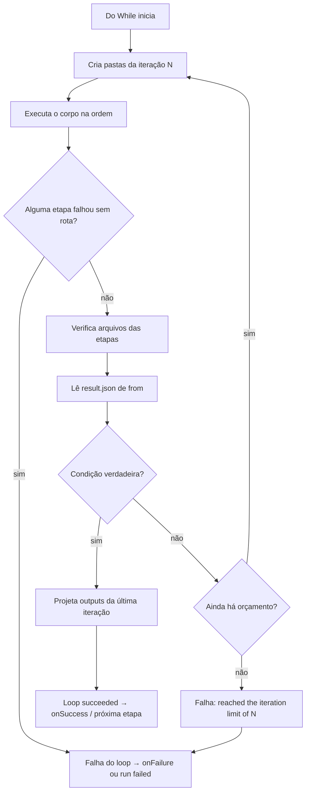

# Spec — F3.3: componente Do While (`kind: "loop"`)

**Data:** 12/11/2026  
**Branch:** `feat/workflow-f1`  
**Status:** escopo e formato visual aprovados pelo dono; implementado e verificado em 12/11/2026 (registro no §15).  
**Fonte visual:** `tmp/workflow-loop-explained.html`  
**Preview do formato:** `tmp/do-while-visual.png`  
**Preview do exemplo com banco:** `tmp/do-while-db-preview.png`  
**Base contratual:** `shared/workflow.ts`, `server/workflows/*`, `src/components/studio/*`

> Este documento é a fonte de verdade da F3.3. O HTML explica a feature em
> linguagem informal e serve de referência visual; onde os dois divergirem,
> vale este documento. O §9 de
> `docs/superpowers/specs/2026-11-09-workflow-f31-fixes.md` registra a decisão
> original de não reintroduzir arestas de retorno; esta spec detalha o
> componente que substitui a repetição antiga.

---

## 1. Resumo

O Do While é um componente de repetição estruturada. Ele executa um **corpo**
de etapas comuns pelo menos uma vez e avalia uma **condição de parada** depois
de cada volta. Enquanto a condição não for satisfeita, começa outra volta, até
o teto de `maxIterations`.

O grafo do Workflow continua **só para frente**. O corpo vive dentro do
componente; não há `goto`, aresta de retorno, `attempts` nem visita de etapa
anterior. A repetição é um estado interno do Do While, não um ciclo no canvas.

Nome visível no produto: **Do While**. Discriminante no contrato:
`kind: "loop"`.

O componente é:

- **determinístico**: a ordem do corpo é a do array; a condição é uma
  comparação fechada sobre um `result.json` já verificado;
- **auditável**: cada iteração fica registrada no `run.json`, com as etapas do
  corpo, arquivos verificados, condição e erro;
- **previsível**: o corpo roda pelo menos uma vez; a condição é avaliada depois;
  verdadeiro para o loop; falso começa outra volta; o teto falha em vez de girar
  para sempre.

---

## 2. Decisões aprovadas (12/11/2026)

| # | Decisão | Resposta |
|---|---|---|
| 1 | Semântica e nome | **do-while/until**: o corpo executa pelo menos uma vez; a condição é avaliada depois de cada volta; **verdadeiro = parar**. Nome visível **Do While**; código `kind: "loop"` |
| 2 | Avaliação | Depois de cada volta, com pelo menos uma execução |
| 3 | `maxIterations` | Inteiro ≥ 1; **padrão 1**; **sem máximo de produto** — o usuário decide. Estouro = falha roteável por `onFailure` |
| 4 | Formato visual | Card de **prévia** no canvas + botão de expandir/editar que abre um **substudio em modal** de **80% da largura por 70% da altura**, com fundo escurecido, botão de fechar e o mesmo design do Studio. Aprovado em 12/11/2026 |
| 5 | Corpo | Corpo aninhado. Prévia na caixa; edição no substudio; o corpo tem layout próprio; mover a caixa move a prévia, não o layout interno |
| 6 | F2 | Linha do Do While **expansível por iteração**, com contador de voltas; etapas internas sob demanda |
| 7 | Saídas | O Do While declara **`outputs` próprios**, preenchidos a partir da **última iteração**; etapas seguintes referenciam o Do While, não as etapas internas |
| 8 | Aninhamento | **Sem Do While dentro de Do While** no v1 |
| 9 | Nome | **Do While** no produto; `kind: "loop"` no contrato |

Decisões técnicas fechadas nesta spec:

- corpo aninhado, não range de etapas soltas;
- condição reutiliza o grupo E/OU do IF/Else;
- `from` é uma etapa do corpo que declara `result`;
- condições e arestas do corpo só apontam para dentro do corpo;
- sem timeout nem modo manual no componente; as etapas do corpo mantêm os seus;
- `outputs` do loop são uma projeção da última iteração;
- pasta por iteração; a pasta `step-N` do loop guarda as saídas projetadas;
- sem estado de arquivo entre iterações: o estado persistente é externo
  (banco, API, etc.) ou um arquivo que a própria etapa grava e lê.

---

## 3. Escopo e não escopo

### 3.1 Entra nesta entrega

- Contrato `kind: "loop"` com `body`, `from`, grupo de condições,
  `maxIterations`, `outputs`, `result`/`require` opcionais, `onSuccess` e
  `onFailure`.
- Validação do corpo, das arestas, da condição e da projeção de saídas.
- Motor do-while com iterações, condição após a volta, teto, falhas e rotas.
- Pastas por iteração e projeção das saídas da última iteração.
- `run.json` com iterações, snapshot do corpo e caminho de espera manual/aprovação.
- Studio: sexto item na paleta, card de prévia, botão de expandir, substudio
  modal 80% × 70%, paleta sem Do While, balão de condição e persistência do
  sub-canvas.
- F2: desenho somente leitura do Do While, timeline com linha expansível por
  iteração e arquivos agrupados.
- Testes de contrato, motor, arquivos, store, rotas, UI e fixture isolado.

### 3.2 Não entra nesta entrega

- Loop dentro de loop.
- Timeout próprio do componente.
- Modo manual no componente (etapas do corpo podem ser manuais).
- Corpo paralelo, dinâmico ou com lista de etapas variável.
- Retry automático.
- Expressão livre, aritmética ou funções na condição.
- `onSkipped` como aresta.
- Ferramentas por etapa (fatia 2 da F3.2, adiada).
- Team Cloud/VM.
- Sandbox ou bloqueio de rede para scripts.
- Notificação de espera manual para etapa de script (pendência separada).

---

## 4. Contrato

### 4.1 Forma

```ts
type WorkflowStep =
  | BotWorkflowStep
  | ScriptWorkflowStep
  | ConditionWorkflowStep
  | LoopWorkflowStep;

interface LoopWorkflowStep {
  id: string;                 // slug único no Workflow inteiro
  kind: "loop";
  name: string;               // 1..120
  body: WorkflowBodyStep[];   // 1..20, sem loop dentro
  from: string;               // id de etapa do body, com result
  match: "all" | "any";       // default "all"
  conditions: ConditionLine[];// 1..20 linhas { field, op, value? }
  maxIterations: number;      // inteiro >= 1, default 1, sem máximo de produto
  outputs: StepOutput[];      // 1..50, projeção da última iteração
  result?: string;            // opcional; precisa estar em outputs
  require?: Record<string, unknown>; // opcional; exige result
  onSuccess?: string | null;  // ausente = próxima do array; null = fim
  onFailure?: string;         // falha do corpo, condição, teto ou projeção
}
```

O corpo usa a união **sem** `loop`:

```ts
type WorkflowBodyStep =
  | BotWorkflowStep
  | ScriptWorkflowStep
  | ConditionWorkflowStep;
```

Isso é proposital: o schema não permite aninhar um loop, nem por engano de
edição manual do `workflows.json`.

### 4.2 Campos

| Campo | Regra |
|---|---|
| `id` | Slug `^[a-z0-9]+(?:-[a-z0-9]+)*$`, até 64; único no Workflow inteiro, incluindo o corpo |
| `name` | 1..120; rótulo visível |
| `body` | 1..20 etapas; cada uma é `bot`, `script` ou `condition`; ids globalmente únicos |
| `from` | Id de uma etapa **do body**; essa etapa precisa declarar `result` |
| `match` | `"all"` (padrão) ou `"any"`; mesmo grupo do IF/Else |
| `conditions` | 1..20 linhas `{ field, op, value? }`; `value` obrigatório exceto em `exists`; 4 KB por valor; 64 KB no grupo |
| `maxIterations` | Inteiro ≥ 1; padrão 1; sem máximo de produto; não é timeout. Com o padrão 1, a primeira volta que não satisfizer a condição já estoura o teto e falha; quem precisa repetir aumenta o número |
| `outputs` | 1..50; cada path precisa ser declarado por **exatamente uma** etapa do body |
| `result` | Opcional; precisa ser um dos `outputs`; objeto JSON de até 64 KB |
| `require` | Opcional; exige `result`; comparação por igualdade, como nas outras etapas |
| `onSuccess` | Ausente = próxima etapa do array; `null` = fim explícito; string = etapa posterior do topo |
| `onFailure` | Destino em falha do corpo, erro de condição, teto ou projeção; sem ele a run para |

O componente **não** tem `inputs`, `when`, `onTimeout`, `timeoutMs` nem `mode`.
Quem declara entradas são as etapas do corpo; quem tem timeout e modo manual são
as etapas do corpo.

`result`/`require` no loop são um acréscimo desta spec ao JSON Schema didático
do HTML: eles permitem que uma etapa seguinte use o loop como fonte de
`result.json` e que o save imponha uma última checagem. Sem eles, o loop
continua funcionando normalmente.

### 4.3 A condição

O Do While reutiliza a semântica do IF/Else:

- `from` escolhe a etapa-fonte;
- `match` combina as linhas com `all` ou `any` e curto-circuito;
- cada linha tem `field` (caminho pontuado no `result.json`), `op` (lista
  fechada de 8) e `value` (literal JSON, quando o operador exige);
- **verdadeiro = parar** (until); falso = outra volta;
- não há `eval`, expressão livre, função ou aritmética;
- campo ausente não é erro: cada operador decide o resultado (na maioria,
  falso; em `not_equals`, verdadeiro);
- erro de tipo/caminho falha a condição e segue a rota de falha.

Operadores: `equals`, `not_equals`, `exists`, `contains`, `gt`, `gte`, `lt`,
`lte`.

> O esboço do §9 tinha `field`, `op` e `value` soltos no loop. A spec usa o
> grupo E/OU do IF/Else; esses três campos vivem dentro de cada linha de
> `conditions`. A explicação em `tmp/workflow-loop-explained.html` cobre os
> campos na linguagem do usuário.

### 4.4 O corpo

- A ordem do array é a ordem de execução da volta.
- A primeira volta sempre acontece.
- A última etapa executada da volta encerra a volta; ela não cai na etapa
  seguinte do Workflow.
- `onSuccess` ausente no fim do corpo = fim da volta; `onSuccess: null` = fim
  explícito da volta.
- Etapas do corpo podem ser `bot`, `script` ou `condition`.
- Etapas do corpo podem ter `mode: "manual"`, `timeoutMs` e `skills`; valem as
  mesmas regras das etapas de topo.
- O limite de **40 etapas** do Workflow conta **todas** as etapas, inclusive as
  do corpo. O save recusa quando a soma de topo + todos os corpos passa de 40.
- Uma `condition` do corpo pode encerrar a volta em um dos ramos com
  `whenTrue`/`whenFalse` ausente ou `null`.
- Etapas do corpo não podem apontar para fora do corpo, para o próprio loop ou
  para uma etapa anterior (sem arestas de retorno).
- `from`, `onSuccess`, `onFailure`, `onTimeout`, `when[].next`, `whenTrue` e
  `whenFalse` de uma etapa do corpo precisam resolver para uma etapa **do
  mesmo corpo**, ou para `null`/ausente quando a regra permitir.
- `inputs` de uma etapa do corpo só podem vir de uma etapa anterior **do mesmo
  corpo** (na mesma volta) ou de uma etapa de topo **antes** do Do While.
- Não há estado de arquivo entre voltas: `input/` e `output/` são da volta.
  Estado persistente é externo (banco, API) ou um arquivo que a etapa grava e
  lê por conta própria.

### 4.5 Saídas projetadas

- Cada `output` do Do While tem o **mesmo path** de um output declarado por uma
  etapa do corpo; não há renomeação no v1.
- O path precisa ser declarado por **exatamente uma** etapa do corpo. Zero ou
  mais de uma → save recusado.
- Se o output do Do While é `required: true`, o output correspondente da etapa
  do corpo também precisa ser `required: true`. Caso contrário o save recusa:
  o loop não pode prometer um arquivo que a etapa pode omitir.
- Ao terminar a última volta, o motor copia cada output do Do While da pasta da
  etapa declarante naquela volta para a pasta de saída do loop.
- Se a etapa declarante não executou na última volta, ou o arquivo não existe:
  output obrigatório → loop falha; output opcional → ausente.
- `result` do Do While, quando declarado, precisa estar entre os `outputs`; o
  motor lê o arquivo projetado e valida como objeto JSON de até 64 KB.
- `require` do Do While, quando declarado, é conferido sobre esse `result`.

### 4.6 Canvas e sub-canvas

O canvas atual guarda posições, notas e containers e é ignorado pelo motor. O
Do While acrescenta um **sub-canvas por loop** para o layout do corpo:

```ts
interface WorkflowSubcanvas {
  nodes: Record<string, { x: number; y: number }>;
  notes: CanvasNote[];
  containers: CanvasContainer[];
}

interface WorkflowCanvas {
  nodes: Record<string, { x: number; y: number }>;
  notes: CanvasNote[];
  containers: CanvasContainer[];
  loops: Record<string, WorkflowSubcanvas>; // chave = id do loop
}
```

- `canvas.loops[loopId]` guarda o layout do corpo daquele loop.
- `canvas.nodes[loopId]` guarda a posição do card no canvas principal.
- O sub-canvas não tem `loops`; aninhamento é proibido.
- Notas/containers do sub-canvas são visuais; seus ids são locais ao
  sub-canvas; links só podem apontar para etapas/containers do mesmo
  sub-canvas.
- Notas do canvas principal não podem apontar para etapas dentro de um loop.
- Mover cards/notas no canvas principal ou no sub-canvas **não cria versão**;
  o `canvas` já fica fora do hash de versão.
- Alterar o corpo (adicionar/remover/editar etapa, condição ou outputs) **cria
  versão**, porque faz parte da definição.

### 4.7 Validação no save

O save recusa, com 400 e mensagem específica:

- `body` vazio, com mais de 20 etapas ou com um `loop` dentro;
- soma de etapas de topo + todos os corpos acima de 40;
- `id` repetido, inclusive entre corpo e topo;
- `from` que não existe, não está no body ou não declara `result`;
- `conditions` vazio, com mais de 20 linhas ou linha sem `value` quando o
  operador exige;
- `maxIterations` não inteiro ou menor que 1;
- `outputs` vazio, path repetido, path sem etapa declarante ou com mais de uma
  etapa declarante;
- output do loop obrigatório vindo de output opcional do corpo;
- `result` fora dos `outputs` ou `require` sem `result`;
- aresta do corpo apontando para fora do corpo, para o loop ou para trás;
- ciclo no corpo ou no topo;
- etapa de script do corpo sem o arquivo correspondente em `scripts/`;
- skill do corpo indisponível para o bot daquela etapa;
- `timeoutMs`/`mode`/`when`/`onTimeout` no componente (campos não permitidos).

O erro precisa nomear a etapa e o campo, como as validações atuais fazem.

---

## 5. Motor

### 5.1 Ciclo de uma volta



### 5.2 Execução

1. O loop começa; a iteração 1 sempre é criada.
2. Para cada iteração:
   - cria as pastas da iteração;
   - executa as etapas do corpo em ordem, com as regras normais de verificação,
     `require`, timeout, modo manual e aprovação;
   - resolve as arestas do corpo dentro do corpo; `onSuccess: null` ou ausência
     no fim encerra a volta;
   - ao encerrar a volta, verifica se `from` executou e se o `result.json`
     existe e é um objeto JSON válido;
   - avalia o grupo de condições; verdadeiro para o loop; falso começa outra
     volta;
   - se `maxIterations` foi atingido sem condição verdadeira, falha com
     `failureKind: "limit"` e a mensagem
     `step "<id>" reached the iteration limit of <N>`.
3. No sucesso, copia os outputs projetados da última iteração e verifica
   `result`/`require`.
4. Aplica `onSuccess`/`onFailure` do loop como qualquer etapa de topo.

### 5.3 Condição

- A condição é avaliada **depois** da volta inteira, inclusive quando uma
  etapa do corpo encerra a volta mais cedo por `onSuccess: null` ou por um ramo
  de `condition`.
- `from` precisa ter produzido `result.json` naquela volta. Se a etapa foi
  pulada, falhou sem rota ou não deixou o arquivo, o loop falha com
  `could not read step "<from>": <motivo>`; a condição não é avaliada.
- Erro de avaliação (tipo, caminho inválido, `contains` em tipo errado, `gt`
  com texto) falha o loop; `onFailure` do loop decide o destino.
- Campo ausente não é erro; o operador decide (falso na maioria,
  verdadeiro em `not_equals`).

### 5.4 Falhas e rotas

- Etapa do corpo falha **sem** `onFailure`/`onTimeout`: o loop falha; a rota
  `onFailure` do loop é aplicada; sem ela, a run para.
- Etapa do corpo falha **com** `onFailure` ou `onTimeout` para outra etapa do
  corpo: a etapa fica `failed` na iteração; a execução continua no destino. Se
  a volta terminar e a condição parar, o loop pode fechar `succeeded`, com a
  etapa falhada visível no histórico — a mesma semântica das etapas de topo.
- `condition` do corpo com erro: segue o `onFailure` da própria condição; sem
  ele, o loop falha.
- Falha de projeção, `result` ausente, `require` falso ou teto: o loop fica
  `failed`; `onFailure` do loop decide.
- `onSuccess: null` no loop encerra a run; ausente segue a próxima etapa do
  topo.
- `onFailure` do loop não cria retry automático; só desvia.

### 5.5 Manual e aprovação

- Etapa `bot`/`script` do corpo com `mode: "manual"`: a run fica
  `waiting_manual` antes de iniciar aquela etapa; nenhum turno/script abre até
  `Continuar`.
- Etapa `bot` do corpo que termina com cartão aberto: a run fica
  `waiting_approval`; a resposta do cartão retoma a verificação daquela etapa e
  depois o loop.
- O `hold`/`pause` precisa apontar para o caminho da etapa dentro do loop
  (ver §6.3).
- A espera manual não consome `timeoutMs` da etapa nem `maxIterations`; o
  relógio da etapa só começa quando ela inicia.
- A notificação de espera manual segue a regra atual: uma por `runId + step`,
  somente in-app, para etapas de bot. Etapa de script manual continua sem
  notificação até a pendência separada.
- Uma rotina com `target: "workflow"` pode iniciar um Workflow cujo primeiro
  passo de topo é um Do While. O bloqueio de rotina com primeira etapa manual
  continua olhando só a primeira etapa de topo; um Do While não tem `mode` e
  não é bloqueado. Se o corpo tiver etapa manual, a run da rotina espelha
  `waiting` e espera a pessoa, como qualquer etapa manual.

### 5.6 Cancelamento, remoção e reinício

- Cancelar a run durante a volta: interrompe o turno/script corrente, marca a
  etapa corrente do corpo como `skipped` com o motivo, marca o loop como
  `skipped` e a run como `cancelled`. As iterações já concluídas e os arquivos
  ficam no disco; não há rollback.
- Cancelar em espera manual/aprovação: limpa `hold`/`pause`, a etapa fica
  `skipped`, o loop `skipped`, a run `cancelled`.
- `DELETE` de Workflow/run e a retenção continuam usando `isActiveRun`; uma run
  com loop `queued`, `running`, `waiting_manual` ou `waiting_approval` é ativa e
  não é apagada.
- Reinício do app:
  - loop `queued` continua;
  - loop entre voltas continua a partir da iteração pendente;
  - etapa do corpo `running` vira `failed` com
    `the app restarted while this step was running`; a iteração falha; o loop
    aplica `onFailure` ou a run para;
  - loop `waiting_manual`/`waiting_approval` permanece parado; não retoma
    sozinho.
- O `recover()` precisa percorrer o loop e não duplicar efeitos externos de uma
  etapa `running`: a regra é a mesma das etapas de topo.

### 5.7 Timeout

- O Do While não tem `timeoutMs`; o tempo é limitado pelos `timeoutMs` das
  etapas do corpo e por `maxIterations`.
- Timeout de etapa do corpo segue a regra atual: `onTimeout` → `onFailure` →
  loop falha.
- O relógio da etapa cobre o turno/script ativo e para na pausa de aprovação ou
  espera manual.

---

## 6. Execução, run.json e F2

### 6.1 Pastas

Proposta de layout:

```text
~/MimirBot/Financeiro/workflows/<workflowId>/runs/<runId>/
├─ run.json
├─ step-1/                         # o Do While no topo
│  ├─ input/                       # vazio; o loop não declara inputs
│  ├─ output/                      # outputs projetados da última iteração
│  └─ iterations/
│     ├─ iter-1/
│     │  └─ step-atualiza/
│     │     ├─ input/
│     │     └─ output/
│     │        └─ result.json
│     ├─ iter-2/
│     └─ iter-3/
└─ step-2/                         # etapa seguinte do topo
   ├─ input/                       # copia de step-1/output/...
   └─ output/
```

- `runs/<runId>/step-<loopIndex>/` é a pasta de topo do loop; as saídas
  projetadas ficam em `output/`, para que a cópia de entradas das etapas
  seguintes continue funcionando como hoje.
- `iterations/iter-<n>/step-<bodyId>/` é a pasta de cada etapa do corpo na
  volta `n`; o `cwd` do script e as variáveis `WORKFLOW_STEP_INPUT`/
  `WORKFLOW_STEP_OUTPUT` apontam para ela.
- `iter-<n>` é 1-based.
- O `run.json` é a fonte de verdade da execução; as pastas são o contrato de
  arquivos.

### 6.2 `run.json`

O `WorkflowRunStep` ganha campos opcionais; runs antigas continuam válidas:

```ts
interface WorkflowRunStep {
  id: string;
  status: "pending" | "running" | "succeeded" | "failed" | "skipped";
  // ...campos atuais...
  kind?: "loop";
  iterations?: WorkflowRunIteration[];
  failureKind?: "failure" | "timeout" | "limit";
}

interface WorkflowRunIteration {
  index: number;             // 1-based
  status: "running" | "succeeded" | "failed" | "skipped";
  startedAt?: number;
  finishedAt?: number;
  steps: WorkflowRunStep[];  // etapas do corpo naquela volta
  conditionMatched?: boolean;
  result?: unknown;
  error?: string;
  failureKind?: "failure" | "timeout" | "limit";
}
```

- O loop é **uma** etapa de topo em `run.steps`; o corpo não é achatado no
  topo.
- `currentStep` continua sendo o índice de topo do loop enquanto ele roda.
- `run.steps[loopIndex].status` fica `running` durante as voltas, inclusive
  enquanto uma etapa do corpo espera pessoa/aprovação.
- A iteração corrente fica `running`; as anteriores ficam `succeeded`/`failed`;
  a última que satisfizer a condição fica `succeeded`.
- `verified` do loop recebe os paths dos `outputs` projetados.
- `result` do loop, quando declarado, recebe o objeto lido da última iteração.
  Se o loop encerra a run (`onSuccess: null`), `run.result` recebe esse objeto;
  se ele segue para outra etapa, o `run.result` final é o da última etapa
  concluída, como hoje.
- `failureKind: "limit"` identifica o estouro de `maxIterations`.
- `step-N` do topo continua existindo; as pastas por iteração são adicionais.

### 6.3 Snapshot

O snapshot da run continua guardando nomes para sobreviver à exclusão do
Workflow. Para o loop, cada etapa de topo ganha `body` opcional:

```ts
interface WorkflowRunSnapshot {
  name: string;
  steps: Array<{
    id: string;
    name: string;
    body?: Array<{ id: string; name: string }>;
  }>;
}
```

- O snapshot do loop guarda os nomes das etapas do corpo.
- Runs antigas sem `body` continuam mostrando o que têm.
- O F2 usa o snapshot quando a definição não está mais disponível.

### 6.4 `hold` e `pause` com caminho

O loop exige que a espera manual/aprovação saiba **onde** está a etapa:

```ts
interface WorkflowRunHold {
  path: number[];   // [stepIndex] ou [loopIndex, iterationArrayIndex, bodyIndex]
  since: number;
}

interface WorkflowRunPause {
  stepId: string;   // id único da etapa (inclusive do corpo)
  question: string;
  cardIds: string[];
  askedAt: number;
  path?: number[];  // caminho da etapa no run
}
```

- `path` usa **índices 0-based** na estrutura do run, como `currentStep` e os
  arrays de `steps`: `[stepIndex]` para uma etapa de topo,
  `[loopIndex, iterationArrayIndex, bodyIndex]` para uma etapa do corpo. O
  `WorkflowRunIteration.index` exibido é 1-based e não é o valor do path.
- Runs antigas podem ter `hold.step` (número); o parser aceita as duas formas e
  a UI lê `path` quando existe, senão `step`.
- `hold.path`/`pause.path` são a forma nova; `step` fica como legado de
  leitura.
- O `engine.resume` e o `turnSettled` resolvem o caminho até a etapa do corpo.
- O F2 mostra a etapa e a iteração corretas no bloco de espera.

### 6.5 F2 — Workflow (somente leitura)

- O desenho vertical mostra o Do While como uma caixa com prévia do corpo
  (ordem e nomes), condição resumida e portas Run/Falha.
- Clicar na caixa abre o painel da etapa com: instruções do corpo, condição
  (`from`, E/OU, linhas), `maxIterations`, outputs, `result`/`require` e arestas.
- O painel é somente leitura; editar abre o Studio.
- Não há substudio na F2; o substudio é ferramenta de edição do Studio.

### 6.6 F2 — Run

- A timeline tem uma linha do Do While com ícone de repetição, nome, status,
  duração e contador de iterações.
- A linha expande por iteração; cada iteração mostra as etapas do corpo, status,
  duração, arquivos verificados, `result.json` e erro.
- A iteração que parou mostra a condição: “Parou porque `restantes` = 0”.
- Falha por teto mostra `reached the iteration limit of N` e o `failureKind`
  correspondente.
- Espera manual/aprovação dentro do corpo usa o bloco existente, com a etapa e
  a iteração corretas; `Continuar` e `Abrir conversa` continuam funcionando.
- Arquivos: os outputs do loop e os arquivos de cada iteração são agrupados por
  etapa/iteração; a pasta de topo do loop continua aparecendo.
- A lista de runs não ganha rótulo redundante de status; o ícone continua
  comunicando o estado.

---

## 7. Studio

### 7.1 Paleta

A paleta passa de cinco para **seis** itens, na ordem:

1. Agente
2. Script
3. IF / Else
4. **Do While**
5. Nota
6. Container

O item Do While usa ícone de repetição, cor âmbar e a descrição “Repete um corpo
de etapas pelo menos uma vez, até a condição de parada.” A regra de “exatamente
cinco” da Parte 3 fica substituída por esta.

### 7.2 Card no canvas

- Card de prévia, nas medidas dos cards funcionais, com acento âmbar.
- Cabeçalho: ícone de repetição, nome “Do While”, menu de três pontos e
  **botão de expandir/editar** (`⤢` ou lápis), com rótulo acessível
  “Editar corpo do Do While”.
- Subtítulo: “executa pelo menos 1 vez”.
- Prévia do corpo: até 3 etapas na ordem, com “+N” quando houver mais;
  “corpo · N etapas”.
- Resumo da condição: “Parar quando `campo` `op` `valor` · máx. N”.
- Portas: entrada, **Run** (`onSuccess`), **Falha** (`onFailure`) e a
  ramificação **Condição** que abre o balão.
- Mover o card move a prévia e o card inteiro; o layout do corpo no substudio
  é independente.
- Duplicar o card copia o corpo e o sub-canvas, com ids novos e sem copiar as
  conexões externas, como o Studio já faz com etapas.
- Excluir o card remove o sub-canvas e as notas/containers do corpo.

### 7.3 Substúdio (modal)

- Abre pelo botão de expandir/editar do card, por clique e por teclado.
- **80% da largura e 70% da altura** da viewport, centralizado, com fundo
  escurecido. Em telas até 650 px, ocupa a viewport com margem de 12 px para o
  canvas continuar utilizável.
- Cabeçalho: “Do While · corpo” (ou o nome do loop) e **X de fechar**.
- Rodapé: **Concluir** / **Voltar ao Workflow**.
- Mesmo design do Studio:
  - canvas branco pontilhado de 24 px, pan/zoom 35–200%;
  - cards Agente/Script/IF-Else com as mesmas ramificações;
  - conexões por arraste e por clique, com as mesmas recusas de ciclo,
    auto-conexão e porta ocupada;
  - notas e containers visuais com as mesmas regras do canvas principal;
  - marcador **Entrada do Do While** no topo e **Fim da volta** no fim; a
    última etapa do corpo aponta para o fim da volta.
- Paleta do substudio: **Agente, Script, IF/Else, Nota, Container**. **Do While
  não aparece**, porque aninhar é proibido no v1.
- O balão de condição **não** fica no substudio; ele continua no card principal,
  na ramificação Condição.
- O X e o Esc fecham o modal; o foco fica preso no modal enquanto ele estiver
  aberto; as alterações permanecem no rascunho do Workflow. O **Salvar** do
  Workflow é que grava; fechar o Workflow sem salvar descarta o rascunho, como
  hoje.
- O card principal atualiza a prévia em tempo real quando o corpo muda.

### 7.4 Balão de condição

- Abre pela ramificação **Condição** do card.
- Campos:
  - **Etapa de origem (`from`)**: select apenas com etapas do corpo que
    declaram `result`; sem opções, mostra “Adicione uma etapa com `result` ao
    corpo”.
  - **Condições**: `Todas (E)` / `Qualquer (OU)`, linhas com Campo, Operador,
    Valor e remover; “Adicionar condição” até 20.
  - **Máximo de voltas**: número inteiro, mínimo 1, padrão 1, **sem máximo de
    produto**; ajuda “o padrão 1 faz uma volta; aumente se precisar repetir”.
- Sem expressão livre; os operadores são os oito do IF/Else.
- O rodapé mantém o padrão “Rascunho local”.

### 7.5 Validação no Studio

Antes de salvar, o `draftProblem`/validação do Studio recusa:

- corpo vazio ou com loop dentro;
- `from` ausente, fora do corpo ou sem `result`;
- condição vazia, linha sem valor quando o operador exige, ou mais de 20;
- `maxIterations` não inteiro/menor que 1;
- output do loop sem etapa declarante, com mais de uma declarante ou
  obrigatório vindo de output opcional;
- `result` fora dos outputs; `require` sem `result`;
- aresta do corpo para fora/para trás/para o loop;
- ciclo no corpo;
- script do corpo inexistente;
- skill do corpo indisponível.

A mensagem precisa dizer o nome da etapa e o campo, como nas validações atuais.

### 7.6 Persistência

- O save do Workflow inclui `steps` com o loop e `canvas.loops` com o layout do
  corpo.
- Os scripts do corpo entram em `scripts` no corpo do save, como os scripts de
  topo, ou pela rota `PUT /api/workflows/:id/scripts/:name`.
- O `canvas` (incluindo `loops`) fica fora do hash de versão: mover cards não
  cria versão; mudar o corpo cria.
- O save recusa com 409 enquanto houver run ativa do Workflow, como hoje.

---

## 8. Rotas e API

**Nenhuma rota nova é necessária.** O Do While é uma definição; o Studio salva
pelo caminho existente e o motor inicia pelo caminho existente.

| Ação | Rota | Observação |
|---|---|---|
| Salvar definição | `POST /api/workflows` ou `PUT /api/workflows/:id` | O corpo inclui o loop e `canvas.loops`; a validação recursa no corpo |
| Salvar script do corpo | `PUT /api/workflows/:id/scripts/:name` | Mesma regra, 409 com run ativa |
| Ler definição | `GET /api/workflows/:id` | Devolve o loop e o sub-canvas |
| Iniciar run | `POST /api/workflows/:id/run` | Corpo `{ "version": N }` opcional; 202 com `{ run }` |
| Iniciar pelo bot | tool `run_workflow` → `POST /api/internal/workflows/:id/run` | Mesmo corpo; 403 fora do departamento |
| Acompanhar | `GET /api/workflows/runs/:runId` + SSE `workflow.run` | A run carrega as iterações do Do While |
| Continuar manual | `POST /api/workflows/runs/:id/continue` | Resolve o `hold.path` até a etapa do corpo |
| Cancelar | `POST /api/workflows/runs/:id/cancel` | Marca etapa do corpo/loop como `skipped` |

O frame SSE `workflow.run` continua com a run completa; o F2 já atualiza a
partir dele.

---

## 9. Compatibilidade e migração

- `kind: "loop"` é aditivo; Workflows antigos (sem loop) não migram.
- Runs antigas não têm `iterations`, `snapshot.body` nem `hold.path`; o parser
  aceita a ausência e a UI cai no comportamento atual.
- `hold.step` antigo continua legível; novas runs usam `hold.path`.
- `failureKind: "limit"` é novo; runs antigas não o têm.
- `canvas.loops` é opcional/default `{}`; definições antigas abrem normalmente.
- O schema do loop é fechado: campos de etapa que não se aplicam ao componente
  (`inputs`, `when`, `onTimeout`, `timeoutMs`, `mode`) são recusados.
- Nenhuma migração de `workflows.json` ou de pastas de runs é necessária.

---

## 10. Testes e verificação

### 10.1 Contrato (`shared/workflow.test.ts`)

- Aceita loop mínimo válido; aplica defaults (`match: "all"`,
  `maxIterations: 1`).
- Recusa `body` vazio, > 20, com loop dentro.
- Recusa quando a soma de etapas de topo + corpos passa de 40.
- Recusa `from` fora do body/sem `result`.
- Recusa condição vazia/> 20/linha sem valor.
- Recusa `maxIterations` 0, negativo, fracionário.
- Recusa output sem etapa declarante, com duas declarantes ou obrigatório
  vindo de opcional.
- Recusa `result` fora dos outputs e `require` sem `result`.
- Recusa aresta do corpo para fora/para trás/para o loop e ciclo.
- Aceita `canvas.loops` e recusa nota/container com link para fora do
  sub-canvas.
- Aceita `onSuccess: null`, ausente e string; recusa string para etapa
  inexistente/anterior.

### 10.2 Motor (`server/workflows/engine.test.ts`)

- Executa o corpo pelo menos uma vez, mesmo com a condição já verdadeira.
- 3 iterações com contador; condição verdadeira na 3ª para.
- Condição falsa na última volta com `maxIterations` → `failureKind: "limit"`
  e `onFailure`.
- `from` pulado/sem `result.json` → loop falha.
- Erro de tipo na condição → loop falha/`onFailure`.
- Etapa do corpo falha sem rota → loop falha/`onFailure`.
- Etapa do corpo falha com `onFailure` interno → iteração continua; condição
  decide; histórico mantém a falha.
- Etapa do corpo com timeout → `onTimeout`/`onFailure`/loop falha.
- `condition` do corpo com ramo `null` encerra a volta.
- Manual no corpo: `waiting_manual`, sem thread/script antes do Continuar;
  `Continuar` retoma a etapa e o loop.
- Aprovação no corpo: `waiting_approval`, resposta retoma a etapa/loop.
- Cancelamento no meio do corpo/espera; etapa/loop `skipped`; run `cancelled`.
- Reinício: etapa `running` vira `failed`; espera continua parada; loop
  `queued`/entre voltas continua.
- Outputs projetados da última iteração; downstream copia do loop.
- Input de etapa do corpo vindo de topo anterior e de etapa anterior do corpo;
  recusa fonte posterior/fora.
- Sem estado de arquivo entre voltas.
- `onSuccess`/`onFailure` do loop no topo; `onSuccess: null` encerra a run.

### 10.3 Arquivos e pastas (`files.test.ts`, `paths.test.ts`)

- Cria `iterations/iter-N/step-<id>/input|output`.
- Projeta outputs da última iteração para `step-<loopIndex>/output`.
- Verifica required/optional, vazio, link, 64 KB, JSON objeto.
- Output obrigatório do loop vindo de output opcional é recusado no save.
- Reinício/cancelamento não apagam iterações concluídas.

### 10.4 Store (`store.test.ts`)

- `canvas.loops` é gravado/lido; mover sub-canvas não cria versão; mudar corpo
  cria.
- `run.json` com `iterations`, `snapshot.body`, `hold.path` é lido/escrito.
- Runs antigas sem esses campos continuam válidas.
- `deleteWorkflow` remove o sub-canvas; run antiga mantém snapshot.
- Retenção não apaga loop ativo/esperando.

### 10.5 Rotas (`server/routes/workflows.test.ts`)

- Save 400 para cada regra do §4.7.
- Save 409 com run ativa ao mudar script do corpo.
- Save 200 grava loop + scripts + canvas.loops.
- `POST /run` 202 devolve run com o loop.
- `GET /runs/:id` devolve iterações.
- `POST /runs/:id/continue` resolve `hold.path` do corpo.
- `POST /runs/:id/cancel` marca etapa/loop `skipped`.
- Tool `run_workflow` continua funcionando.

### 10.6 UI

- **Studio**: card Do While na paleta (sexto), card de prévia, botão de
  expandir, modal 80% × 70%, X/Esc, foco preso, paleta sem Do While, canvas
  pontilhado, cards/conexões, notas/containers, balão de condição, salvar e
  reabrir.
- **Validação**: erros de corpo/from/outputs/arestas/scripts/skills no Studio.
- **F2**: desenho somente leitura do loop; timeline com linha expansível por
  iteração; condição/erro/teto; espera manual/aprovação; arquivos por iteração;
  snapshot após apagar o Workflow.
- **Acessibilidade**: botão de expandir com rótulo, modal com foco preso,
  Esc/X, paleta por teclado, contraste.

### 10.7 Fixture isolado

Criar `docs/verification/workflow-loop.md` com:

- servidor isolado (`OMB_PORT`, `OMB_DATA_DIR`, `HOME` temporários);
- Workflow com Do While + script SQLite que atualiza 100 linhas por volta;
- 3 iterações (100/150, 100/50, 50/0), run `succeeded`, outputs projetados;
- `run.json` com `iterations`, `conditionMatched`, `snapshot.body`;
- falha por teto, `result.json` ausente, `require` falso e banco bloqueado;
- manual no corpo e aprovação no corpo;
- reinício no meio da volta;
- save recusando loop aninhado, aresta para fora e output ambíguo;
- UI do Studio: abrir/fechar substudio, editar corpo, salvar, reabrir;
- F2: expandir a linha do loop e ver as iterações.

---

## 11. Critérios de aceite

1. O contrato aceita um Do While válido e recusa corpo vazio, loop aninhado,
   `from` inválido, condição inválida, `maxIterations` < 1, output ambíguo e
   aresta para fora.
2. O corpo executa **pelo menos uma vez**, mesmo com a condição já verdadeira.
3. A condição é avaliada **depois** de cada volta; verdadeiro para; falso
   começa outra volta.
4. `maxIterations` tem padrão 1, mínimo 1 e nenhum máximo de produto; estourar
   falha com mensagem clara e pode seguir `onFailure`.
5. O exemplo de 250 clientes/100 por lote termina em 3 iterações e run
   `succeeded`, com outputs da última iteração.
6. O `run.json` guarda as iterações, o corpo, a condição, os arquivos
   verificados e o snapshot do corpo.
7. O F2 mostra a linha do Do While expansível por iteração, com condição,
   duração, arquivos e erro.
8. O Studio mostra o Do While como sexto item da paleta e o card de prévia.
9. O botão de expandir/editar abre o substudio 80% × 70%, com X/Esc, o mesmo
   design do Studio e a paleta sem Do While.
10. Editar o corpo no substudio, fechar e salvar persiste o corpo e o
    sub-canvas; reabrir mostra o mesmo layout e a prévia atualizada.
11. Mover o card no canvas principal move a prévia; o layout do corpo no
    substudio não muda; mover no substudio não cria versão.
12. Mudar o corpo cria versão; mudar só o canvas não cria.
13. Manual e aprovação no corpo param a run na etapa/iteração correta e
    retomam pelo `Continuar`/cartão.
14. Cancelar no corpo/espera marca a etapa e o loop como `skipped` e a run como
    `cancelled`, sem rollback.
15. Reiniciar preserva espera e não repete etapa `running`; etapa `running`
    vira `failed`.
16. Workflows e runs antigos continuam abrindo e rodando.
17. `pnpm typecheck`, `pnpm lint`, `pnpm i18n:check` e as suítes focadas passam.
18. O fixture isolado reproduz o exemplo do banco e os casos de falha.

---

## 12. Fora de escopo e limitações conhecidas

- **Nested loops**: proibido no v1; a paleta do substudio não oferece Do While.
- **Timeout do loop**: não existe; use `timeoutMs` nas etapas e
  `maxIterations`.
- **Modo manual do loop**: não existe; etapas do corpo podem ser manuais.
- **Paralelismo**: o corpo é sequencial, na ordem do array.
- **Retry**: não há retry automático; falha segue `onFailure`/para.
- **Expressão livre**: a condição é o grupo E/OU fechado; sem `eval`.
- **Estado entre voltas**: não há arquivos compartilhados entre iterações; o
  banco/API é o estado persistente.
- **Script**: roda como o usuário do app, sem sandbox e sem bloqueio de rede;
  limitação já declarada na F2.
- **Ferramentas por etapa**: continua adiada (F3.2 fatia 2); o corpo usa as
  ferramentas do bot.
- **Notificação de script manual**: etapa de script manual continua sem
  notificação; a notificação atual cobre etapa de bot.
- **Team Cloud/VM**: a execução do Do While na nuvem fica para a F3.
- **Tamanho do `run.json`**: cresce com as iterações; o teto é escolha do
  usuário e a retenção limpa runs terminais.

---

## 13. Mapa de código

| Área | Arquivo | Mudança |
|---|---|---|
| Contrato | `shared/workflow.ts` | `LoopWorkflowStep`, `WorkflowBodyStep`, `conditions` do loop, `canvas.loops`, `failureKind: "limit"`, snapshot `body`, `hold.path` |
| Motor | `server/workflows/engine.ts` | `runLoopStep`, iterações, condição, projeção, `onFailure`, manual/aprovação, cancelamento/reinício |
| Estado | `server/workflows/state.ts` | `WorkflowRunIteration`, `hold.path`, `pause.path`, transições do loop |
| Pastas | `server/workflows/paths.ts` | `iterations/iter-N/step-<bodyId>`, pasta de topo do loop |
| Arquivos | `server/workflows/files.ts` | projeção de outputs da última iteração, verificação do corpo |
| Desvios | `server/workflows/flow.ts` | resolução de arestas dentro do corpo, `onSuccess: null` = fim da volta |
| Condição | `server/workflows/condition.ts` | reutilizar `evaluateConditionGroup` para o loop |
| Store | `server/workflows/store.ts` | schema do run, snapshot, sub-canvas, validação do save |
| Rotas | `server/routes/workflows.ts` | validação recursiva do corpo, scripts, save |
| Studio — card | `src/components/studio/StudioCard.tsx` | card Do While, prévia, botão de expandir, portas |
| Studio — balão | `src/components/studio/StudioBalloon.tsx` | condição do loop, `maxIterations`, `from` |
| Studio — substudio | `src/components/studio/WorkflowStudioPage.tsx` | modal 80% × 70%, canvas/paleta do corpo, X/Esc |
| Studio — modelo | `src/components/studio/studio-model.ts` | loop no draft, sub-canvas, validação, duplicar/excluir |
| Studio — geometria | `src/components/studio/studio-geometry.ts` | portas/medidas do card e do substudio |
| F2 — desenho | `src/components/workflows/WorkflowSteps.tsx` | loop como caixa com prévia |
| F2 — painel | `src/components/workflows/StepPanel.tsx` | condição, max, outputs, corpo |
| F2 — run | `src/components/workflows/RunDetail.tsx` | linha expansível por iteração, condição, arquivos |
| F2 — tipos | `src/components/workflows/types.ts` | iterações no run |
| Textos | `src/locales/en.json`, `pt-br.json` | textos do Do While/substudio |
| API | `src/lib/workflows-api.ts` | tipos do loop/sub-canvas; sem rota nova |
| Testes | `server/workflows/*.test.ts`, `server/routes/workflows.test.ts`, `shared/workflow.test.ts`, `src/components/studio/*.test.ts`, `src/components/workflows/*.test.ts` | casos do §10 |
| Verificação | `docs/verification/workflow-loop.md` | fixture e evidências |

---

## 14. Referências

- `tmp/workflow-loop-explained.html` — explicação informal, campos, operadores,
  exemplo com banco, mockup do card e do substudio.
- `tmp/do-while-visual.png` — preview do formato do card/balão.
- `tmp/do-while-db-preview.png` — preview do passo a passo com banco.
- `docs/superpowers/specs/2026-11-09-workflow-f31-fixes.md` §9 — decisão
  original sobre `kind: "loop"` e remoção da aresta de retorno.
- `docs/superpowers/specs/2026-11-07-workflows-f2-compact-uiux.md` — tela F2.
- `docs/superpowers/specs/2026-11-09-workflow-f32.md` — manual, condições E/OU,
  Python/TypeScript e skills por etapa.
- `shared/workflow.ts` — contrato atual de etapa, condição, `result`/`require`,
  canvas e run.
- `server/workflows/engine.ts`, `state.ts`, `files.ts`, `paths.ts`, `flow.ts`,
  `condition.ts`, `store.ts` — motor e persistência atuais.
- `server/routes/workflows.ts` — rotas de save/run e validação.
- `src/components/studio/` — canvas, cards, balões, modelo e geometria.
- `src/components/workflows/` — tela F2.

---

## 15. Registro de implementação e verificação (12/11/2026)

**Estado:** implementado e verificado; sem pendência dentro do escopo desta
spec. O que ficou de fora é exatamente o §12.

**Entregue**

- Contrato `kind: "loop"` com `body`, `from`, grupo E/OU, `maxIterations`
  (default 1), `outputs`, `result`/`require`, `onSuccess`/`onFailure`,
  `canvas.loops`, `failureKind: "limit"`, `hold.path`/`pause.path` e
  `snapshot.body`.
- Motor do-while com pastas por volta, projeção da última volta, manual e
  aprovação no corpo, cancelamento, reinício e rotas internas.
- Save/GET/run/continue/cancel com validação recursiva do corpo, 409 de script
  com run ativa e notificação de espera manual resolvendo o caminho do corpo.
- Studio com o sexto item da paleta, card de prévia, substudio 80% × 70%,
  paleta sem Do While, balão de condição/máximo/saídas e duplicação/exclusão
  com sub-canvas.
- F2 com linha expansível por volta, condição, teto, arquivos, espera
  manual/aprovação e nomes do snapshot.

**Compatibilidade**

- Workflows antigos sem loop abrem e rodam; `canvas.loops` ausente vira `{}`.
- Runs antigas sem `iterations`/`snapshot.body`/`hold.path` continuam válidas;
  `hold.step` legado continua legível.
- Nenhuma migração de `workflows.json` ou de pasta de run.
- O contrato de `condition` passou a aceitar `whenTrue`/`whenFalse: null`
  também no topo (o corpo já precisava disso); é aditivo.

**Verificação**

- `pnpm typecheck`, `pnpm lint`, `pnpm i18n:check` e `pnpm build` passaram.
- Suíte focada: **272** testes de workflow/rotas + **47** testes de Studio.
- E2E de criação do zero em Chromium: Workflows vazio → Studio → Script,
  Agente, IF/Else e Do While → scripts e conexões → substudio → balão →
  Salvar → Executar. Workflow
  `51916e22-f9fa-49aa-ba36-b1e68ce2d597`, run
  `20261112-224321-e17e49`, 4 etapas e 3 voltas (`restantes` 2/1/0).
- Vídeo: `QA/qa-do-zero.mp4` (45,12 s) e `QA/qa-do-zero.webm`; screenshots em
  `/tmp/opencode/loop-qa2/evidence/01…10`.
- Receita reproduzível: `docs/verification/workflow-loop.md`.

**Correção encontrada pelo E2E**

- O substudio podia criar uma etapa de corpo com o mesmo id de uma etapa de
  topo (`script-1`). `createStep` passou a receber os ids globais do rascunho;
  teste novo em `studio-model.test.ts` cobre o caso.

**Nota do fixture**

- O fake engine não escreve arquivos. No E2E, o primeiro script grava também o
  `result.json` declarado pela etapa de bot seguinte; a etapa de bot roda de
  verdade e o motor verifica o contrato. Isso é detalhe do fixture, não do
  produto.

---

**Fim da spec da F3.3 — componente Do While.**
