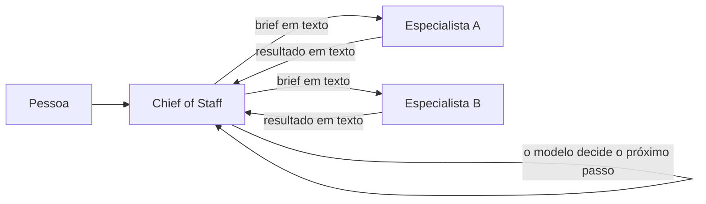
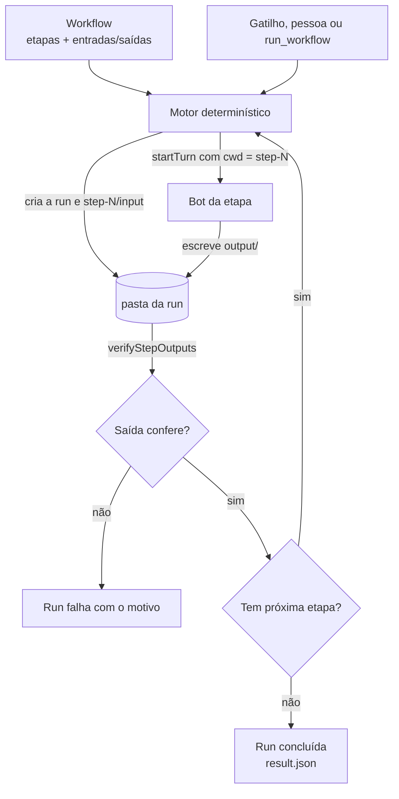
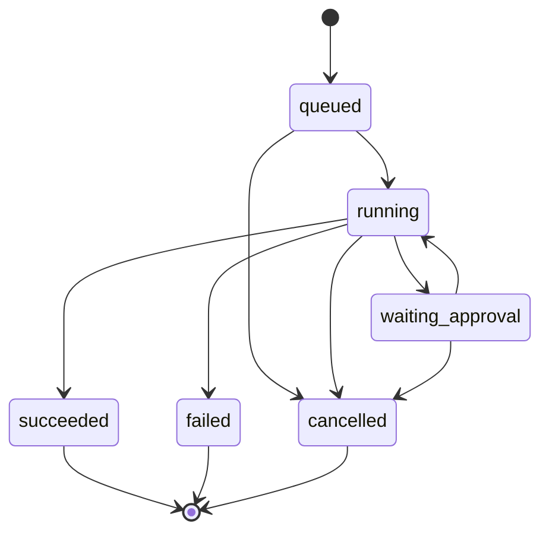
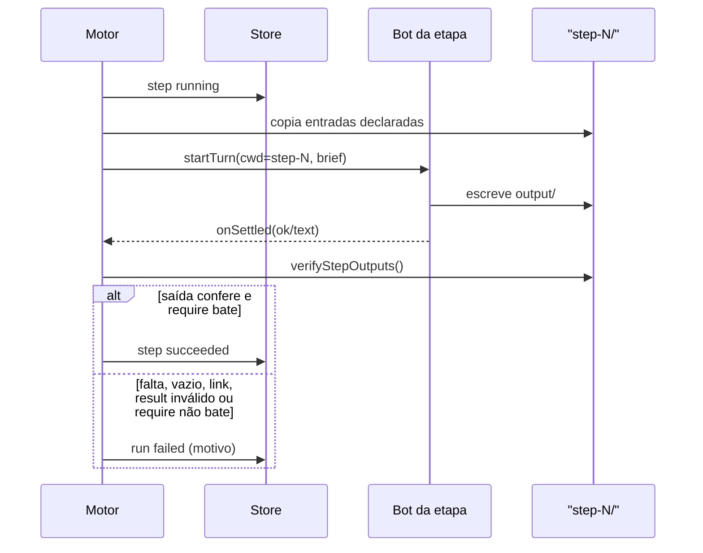
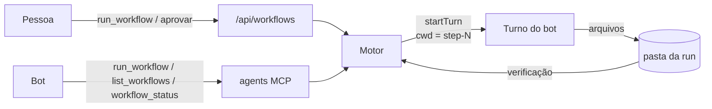

# MimirBot — Workflows: especificação completa

> [!IMPORTANT]
> **Nota da F3.1.1 (09/11/2026):** a repetição por caminho de volta, o teto de
> 25 visitas, o reset de revisita e o campo `attempts` foram **removidos**. Onde
> este documento descreve repetição (F2 e seções históricas), leia como
> histórico. O estado atual do contrato está em
> `docs/superpowers/specs/2026-11-09-workflow-f31-fixes.md`.

**Documento único** que reúne as três especificações do projeto Workflows:

| Parte | Assunto | Fonte original |
|---|---|---|
| 1 | Motor determinístico, rotas, arquivos, retenção e roadmap (F1/F2/F3) | `docs/superpowers/specs/2026-11-03-workflow-engine-design.md` |
| 2 | Tela administrativa Workflows/Runs (F2) | `docs/superpowers/specs/2026-11-07-workflows-f2-compact-uiux.md` |
| 3 | Editor visual Workflow Studio v0.5 (F3) | `Workflow_Studio_UI_UX_Spec_v05.md` |

**Precedência:** cada parte governa a sua superfície. A Parte 1 governa o motor e as regras de execução; a Parte 2 governa a tela de administração; a Parte 3 governa o editor visual. Quando houver dúvida visual, o protótipo HTML da respectiva parte é a referência.

**Referências visuais:**

- F2: `MimirBot_Workflows_F2_Compacto.html` e os PNGs do pacote `MimirBot_Workflows_F2_Compacto_UIUX_Pacote`.
- F3: `Workflow_Studio_v05.html` e os PNGs `Workflow_Studio_v05_preview.png` e `Workflow_Studio_v05_vinculos.png`.

## Status atual e Ponto de Partida da Implementação (07/11/2026)

> [!IMPORTANT]
> **Situação das fases:**
> - **F0 e F1 (Concluídas):** Motor determinístico, verificação de arquivos, rotas e catálogo de tools.
> - **F2 UI compacta (Concluída):** Tela de administração Workflows/Runs implementada e mergeada na branch `feat/workflow-f1`.
> - **F2 Aprovação Longa (P16, Concluída):** run pausa em `waiting_approval` quando a etapa termina com cartão aberto e retoma quando a pessoa responde.
> - **F2 Gatilho "Workflow" e snapshot da run (Concluídos):** rotina `target: "workflow"` inicia a run, grava a origem `triggeredBy` e o `run.json` guarda nomes do Workflow e das etapas.
> - **F2 Etapa de Script + Condição (Concluída em 08/11/2026):** etapa `kind: "script"`, desvios por `next`/`when`/`onFailure`. A repetição por caminho de volta e o teto de 25 visitas que entraram junto foram **removidos na F3.1.1**.
> - **F3.1 Editor visual Workflow Studio v0.5 (Concluída em 08/11/2026):** canvas com pan/zoom, paleta de cinco elementos, cards Agente/Script/IF-Else, conexões, notas Markdown, containers, salvamento versionado e a etapa `kind: "condition"` no motor. Detalhes e desvios deliberados na seção “Status da implementação (F3.1)” da Parte 3.
> - **F3.1.1 Correções do Studio (Planejada em 09/11/2026):** renomear `next` para `onSuccess`, separar `onTimeout` de falha, permitir `timeoutMs` por etapa, fim explícito com `onSuccess: null`, expor `onFailure`/`onTimeout` na UI e desconectar arestas. Repetição é removida (caminho de volta, teto e `attempts`); o `kind: "loop"` entra na F3.3. Plano em `docs/superpowers/specs/2026-11-09-workflow-f31-fixes.md`.
> - **Próximo passo imediato de código:** F3.1.1, depois F3.2 (modo Manual, ferramentas por etapa, Python/TypeScript), a F3.3 (`kind: "loop"`) e o Team Cloud/VM.
>
> **Decisões aprovadas para o P16 (Aprovação Longa) — implementadas:**
> 1. Resposta continua no cartão do chat (`cardContinuation`);
> 2. Qualquer pessoa da equipe do departamento pode responder;
> 3. Espera por tempo indefinido (sem expirar);
> 4. Se a aprovação for recusada, a run vai para situação `cancelled` com motivo "aprovação negada".
>
> **Ordem das próximas entregas (F2):**
> 1. ~~Gatilho "Workflow" (`RoutineTarget` aceitando `"workflow"`);~~ concluído;
> 2. ~~Snapshot da run (gravar nomes do Workflow e etapas em `run.json`);~~ concluído;
> 3. ~~Etapa de Script + Condição (True/False via `result.json`) e Repetição;~~ concluído;
> 4. *Nota:* Retentativas (*retry*) automáticas foram adiadas — qualquer erro falha a execução de imediato, salvo quando a etapa declara `onFailure`.

## Documentos relacionados

### Specs canônicas (fonte de cada parte)

| Documento | Papel |
|---|---|
| `docs/superpowers/specs/2026-11-03-workflow-engine-design.md` | Motor determinístico, rotas, arquivos, retenção e roadmap (Parte 1) |
| `docs/superpowers/specs/2026-11-07-workflows-f2-compact-uiux.md` | Tela administrativa Workflows/Runs (Parte 2) |
| `Workflow_Studio_UI_UX_Spec_v05.md` | Editor visual Workflow Studio v0.5 (Parte 3) |
| `Workflow_Studio_Spec_UI_UX_v05_Com_Referencias.zip` | Pacote original da spec do Studio, com HTML e PNGs |

### Documentos de apoio

| Documento | Papel |
|---|---|
| `tmp/progress.md` | O que já foi feito no F1, F2 e F3.1, verificação e próximos passos |
| `docs/verification/workflow-approval.md` | Receita do fixture para a aprovação longa (P16) |
| `/tmp/opencode/next-decisions.md` | Ordem das próximas entregas e decisões abertas (gatilho, snapshot, retry etc.) |
| `/tmp/opencode/2026-11-07-workflow-screen-interface.md` | Primeira versão da interface F2; **substituída** pela spec compacta da Parte 2 |
| `/tmp/opencode/workflow-studio-v05/Workflow_Studio_UI_UX_Spec_v05.md` | Cópia extraída do zip para consulta rápida |

### Referências visuais

| Arquivo | O que conferir |
|---|---|
| `MimirBot_Workflows_F2_Compacto.html` | Protótipo interativo da tela F2 |
| `MimirBot_Workflows_F2_Compacto_workflows.png` | Lista compacta, cabeçalho e desenho pontilhado |
| `MimirBot_Workflows_F2_Compacto_runs.png` | Lista de Runs com ícones, timeline e aprovação |
| `MimirBot_Workflows_F2_Compacto_mobile.png` | Layout estreito da tela F2 |
| `Workflow_Studio_v05.html` | Protótipo interativo do editor F3 |
| `Workflow_Studio_v05_preview.png` | Visão geral do editor |
| `Workflow_Studio_v05_vinculos.png` | Vínculos de notas e containers |

### Fora do escopo

Os demais arquivos de `docs/superpowers/specs/` tratam de outros assuntos do app
(pré-visualização de arquivos, esperas, passos salvos, apps de chat, Cloud etc.) e
não fazem parte da especificação de Workflows.

## Mapa de código

Referência do commit `6c9f98fdc` (07/11/2026). Os números de linha podem mudar;
o nome do arquivo é a referência estável. Abra direto o arquivo da área que for
mexer.

### Motor e servidor

| Área | Arquivo | O que está lá |
|---|---|---|
| Contrato | `shared/workflow.ts` | Schemas Zod, `WorkflowDefinition`, `WorkflowStep`, `WorkflowRun`, `require` |
| Frame SSE | `shared/wire.ts` (linha 948) | `{ kind: "workflow.run"; run }` |
| Motor | `server/workflows/engine.ts` | `start`, laço das etapas, pausa, retomada, cancelamento, desvios |
| Transições | `server/workflows/state.ts` | `isActiveRun`, `pauseRun`, `resumeRun`, falha, etapa pulada, `completeStep` com destino |
| Desvios | `server/workflows/flow.ts` | `nextStepIndex` (`when`/`next`), `failureStepIndex` (`onFailure`) |
| Script | `server/workflows/script.ts` | Execução do `.mjs` com env, timeout, kill e saída capturada |
| Persistência | `server/workflows/store.ts` | `workflows.json`, `versions`, `listRuns`, `readRun`, `deleteRun`, scripts |
| Arquivos | `server/workflows/files.ts` | `copyStepInputs`, `verifyStepOutputs`, `result.json`, `resetStepFolders` |
| Pastas | `server/workflows/paths.ts` | `~/MimirBot/<departamento>/workflows/<id>/runs/<runId>` |
| Retenção | `server/workflows/retention.ts` | Limpeza de runs antigas |
| Brief da etapa | `server/workflows/brief.ts` | Texto enviado ao bot em cada etapa |
| Rotas | `server/routes/workflows.ts` | Rotas da pessoa e rotas internas dos bots |
| Composição | `server/host/workflows.ts` | `createWorkflowHost`: store + engine + rotas |
| Ligação no servidor | `server/index.ts` (191, 2884, 2892, 13411, 16042) | Import, criação, rotas, rota interna, `recover()` e `retention()` |

### Ferramentas dos bots

| Área | Arquivo | O que está lá |
|---|---|---|
| Catálogo | `server/drivers/agents-catalog.ts` (858–900) | `list_workflows`, `run_workflow`, `workflow_status`, `cancel_workflow` |
| Execução | `server/drivers/agents-call.ts` (221–260) | Chamadas HTTP às rotas internas |
| Prompt | `server/system-prompt.ts` (30, 37) | Bloco `workflow-step` |
| Texto do passo | `server/workflows/brief.ts` (14) | Instrução enviada ao bot da etapa |

### Tela

| Área | Arquivo |
|---|---|
| Contêiner, abas, filtros, seleção e diálogos | `src/components/WorkflowsPage.tsx` |
| Lista de Workflows | `src/components/workflows/WorkflowList.tsx` |
| Cabeçalho e versões do Workflow | `src/components/workflows/WorkflowDetail.tsx` |
| Desenho vertical pontilhado | `src/components/workflows/WorkflowSteps.tsx` |
| Painel somente leitura da etapa | `src/components/workflows/StepPanel.tsx` |
| Lista de runs | `src/components/workflows/RunList.tsx` |
| Detalhe da run, timeline, aprovação, resultado e arquivos | `src/components/workflows/RunDetail.tsx` |
| Ícone circular animado | `src/components/workflows/RunGlyph.tsx` |
| Etiqueta de situação | `src/components/workflows/StatusChip.tsx` |
| Diálogo de execução | `src/components/workflows/RunDialog.tsx` |
| Diálogo de confirmação | `src/components/workflows/ConfirmDialog.tsx` |
| Filtros | `src/components/workflows/FilterPopover.tsx` |
| Menu de reticências | `src/components/workflows/PanelMenu.tsx` |
| Avatar do bot | `src/components/workflows/BotAvatar.tsx` |
| Tipos da tela | `src/components/workflows/types.ts` |
| Chamadas às rotas | `src/lib/workflows-api.ts` |
| Duração, datas e rótulos | `src/lib/workflow-format.ts` |
| Carga, evento e reserva | `src/hooks/useWorkflowFeed.ts` |
| Console de teste | `src/components/WorkflowConsolePage.tsx` |

### Studio (F3.1)

| Área | Arquivo |
|---|---|
| Contêiner, canvas, pan/zoom, conexões, salvar | `src/components/studio/WorkflowStudioPage.tsx` |
| Card Agente/Script/IF-Else e ramificações | `src/components/studio/StudioCard.tsx` |
| Balões de configuração | `src/components/studio/StudioBalloon.tsx` |
| Nota Markdown e vínculo | `src/components/studio/StudioNote.tsx` |
| Container visual | `src/components/studio/StudioContainer.tsx` |
| Paleta inferior | `src/components/studio/StudioPalette.tsx` |
| Modelo (conexão, ciclo, validação) | `src/components/studio/studio-model.ts` |
| Geometria dos cards e portas | `src/components/studio/studio-geometry.ts` |
| Condição no motor | `server/workflows/condition.ts` |

### Shell e ligação da tela

| Área | Arquivo | O que está lá |
|---|---|---|
| Rota da tela | `src/App.tsx` (67, 143, 339) | Import, `fullWidthView`, `<WorkflowsPage />` |
| Barra lateral | `src/mimir/MimirRail.tsx` (114, 185) | Ícone e botão Workflows |
| Estado da view | `src/state/store.tsx` (587, 671, 1019, 2334) | `activeView`, ação `showWorkflowConsole`, reducer |
| Eventos ao vivo | `src/lib/live-events.ts` (70, 77) | `listenLiveFrames`, `publishLiveFrame` |
| Frame do servidor | `shared/wire.ts` (948) | `workflow.run` |

### Textos e estilo

| Área | Arquivo |
|---|---|
| Textos em inglês | `src/locales/en.json` (chaves `workflows.*`) |
| Textos em português | `src/locales/pt-br.json` |
| Hashes das traduções | `src/locales/source-hashes.json` |
| CSS da tela | `src/styles.css` (`.wf-canvas`, `.wf-skeleton`, `.wf-run-glyph`, `.wf-ring-spin`) |

### Testes

| Área | Arquivo |
|---|---|
| Motor | `server/workflows/engine.test.ts` |
| Estado | `server/workflows/state.test.ts` |
| Desvios | `server/workflows/flow.test.ts` |
| Script | `server/workflows/script.test.ts` |
| Store | `server/workflows/store.test.ts` |
| Arquivos | `server/workflows/files.test.ts` |
| Pastas | `server/workflows/paths.test.ts` |
| Retenção | `server/workflows/retention.test.ts` |
| Brief | `server/workflows/brief.test.ts` |
| Rotas | `server/routes/workflows.test.ts` |

### Onde mexer para cada mudança

| Mudança | Arquivos |
|---|---|
| Novo campo na definição ou na etapa | `shared/workflow.ts` → `server/workflows/store.ts` → `StepPanel.tsx` / `WorkflowSteps.tsx` |
| Nova rota | `server/routes/workflows.ts` → `server/host/workflows.ts` → `src/lib/workflows-api.ts` |
| Novo tipo de etapa (script, etc.) | `shared/workflow.ts` → `server/workflows/script.ts` → `server/workflows/engine.ts` → `StepPanel.tsx` / `WorkflowSteps.tsx` |
| Mudar desvio, condição ou repetição | `server/workflows/flow.ts` + `state.ts` + `engine.ts` |
| Mudar script (timeout, env, kill) | `server/workflows/script.ts` + `docs/verification/workflow-script.md` |
| Nova ferramenta de bot | `server/drivers/agents-catalog.ts` + `server/drivers/agents-call.ts` |
| Mudar o desenho das etapas | `src/components/workflows/WorkflowSteps.tsx` + `.wf-canvas` em `src/styles.css` |
| Mudar o ícone de run | `src/components/workflows/RunGlyph.tsx` + `.wf-run-glyph` em `src/styles.css` |
| Mudar textos | `src/locales/en.json` + `pt-br.json` + `source-hashes.json` |
| Mudar abas, busca, filtros ou diálogos | `src/components/WorkflowsPage.tsx` |
| Mudar a aprovação longa (P16) | `server/workflows/engine.ts` + `server/workflows/state.ts` + `server/index.ts` + `RunDetail.tsx` |
| Mudar retenção | `server/workflows/retention.ts` + `store.ts` |

---

# Parte 1 — Motor, rotas e roadmap (F1/F2/F3)

# Workflow: análise da implementação

Data: 2026-11-03 · Revisado em 2026-11-07 (contratos do motor e F1) · Base: `tmp/spec-workflow.md` (D1–D18) · Código: `shared/workflow.ts`, `server/workflows/` (F0: `paths.ts`, `files.ts`; F1: `state.ts`, `brief.ts`, `engine.ts`, `store.ts`, `retention.ts`; 108 testes no motor + 8 nas rotas)

Este documento fecha a linha de raciocínio: o problema de hoje, o impacto, a
solução, como ela será construída, o que já existe para reaproveitar e como o
núcleo criado vira a camada de tools que os agentes chamam dentro do Workflow.

## 1. O problema que temos hoje

A ordem de um trabalho entre bots vive no texto. O Chief recebe a demanda,
escolhe os colegas, escreve um brief para cada um e, a cada turno, decide quem
chama em seguida. O harness executa ferramentas muito bem; ele não governa a
sequência.



O que é verdade hoje, verificado no código e no mapa da delegação:

- O brief e o resultado viajam como texto. A mensagem de `coordinate_bots` tem
  no máximo 4 000 caracteres; o brief guardado e o resultado têm teto de
  12 000 (`server/runtime-coordinator.ts`, `server/runtime/runtime.ts`). Não há
  contrato de entrada/saída nem verificação de entrega.
- `coordinate_bots` não tem dependência entre atribuições: irmãos rodam em
  paralelo. A ordem só existe se o Chief encerrar um turno e chamar o próximo.
- O mesmo brief para o mesmo especialista vira `duplicate`; quem já completou
  recusa nova tarefa sem `rework=true`.
- Não há retentativa automática de uma etapa que falhou.
- `evidence.filesChanged` existe no tipo, mas nenhum código o preenche: "disse
  que fez" não é verificável. O host preenche `toolCalls`, `okToolCalls`,
  `errors` e `outward` (quando há ação externa) em `server/turn-outcome.ts`.
- `cwd` é por bot/thread, mas o turno aceita `cwd` próprio
  (`SendTurnInput.cwd`); departamento é só um rótulo (`section`), sem pasta.
- Limites por raiz: 64 requests e 96 execuções (constantes de
  `server/runtime-coordinator.ts`, acima dos padrões 24/48), 48 wakes,
  profundidade 4, 5 threads novas por turno. Espera pela pessoa: 30 min,
  exceto com cartões abertos. `stallMs`: 4 h, e não derruba árvore com
  `needs_input`.

## 2. Os impactos

- **Ordem imprevisível.** O Chief pode pular etapa, inverter duas ou rodar em
  paralelo o que deveria ser sequencial — e variar entre execuções.
- **Entrega não comprovada.** O resultado é prosa; arquivos citados no brief
  podem não existir, estar vazios ou no lugar errado.
- **Handoff frágil.** Caminhos viajam como texto; um erro de nome só aparece
  quando alguém abre a pasta.
- **Sem auditoria da run.** O runtime guarda assignments, não "etapa 2 de 5",
  entradas, saídas e aprovações de um workflow.
- **Falha silenciosa.** Sem retry nem política, depende de o Chief perceber e
  agir; a pessoa descobre depois.
- **Aprovação sem contexto.** Os cartões existem, mas não pausam uma run nem
  mostram em que etapa ela está.
- **Custo desnecessário.** Cada execução paga tokens por decisões que já eram
  conhecidas.

## 3. A solução proposta

Duas camadas, uma autoridade:

1. **Workflow (dado):** uma sequência de etapas. Cada etapa declara o bot, a
   instrução, os arquivos que recebe e os que precisa deixar.
2. **Motor (código):** executa a sequência, copia entradas, verifica saídas e
   só então avança. O bot da etapa não escolhe o que roda depois.

O contrato entre as etapas é o **sistema de arquivos**, não a conversa.



Invariantes que dão a garantia:

- O motor é o único que decide a ordem e o único que escreve fora de
  `step-N/output/` (D15).
- O bot da etapa roda com `cwd` em `step-N` e escreve apenas em `output/`
  (D14). O `cwd` é convenção, não sandbox: o engine ainda pode ler outros
  caminhos conforme o modo de permissão (P15).
- Avançar exige arquivo plano, não vazio e não-link nas saídas obrigatórias;
  saídas opcionais podem faltar. O `result.json` declarado precisa existir e
  ser um objeto JSON válido (D2/D3). Quando a etapa declara `require`, os
  campos desse objeto precisam bater por igualdade; senão a etapa falha.
- O motor copia para `input/` apenas o que a etapa declarou, e apenas de
  etapas anteriores (D15).
- Nenhuma aprovação é pulada: o turno da etapa usa o mesmo gate e os mesmos
  cartões do fluxo normal.

## 4. Como será implementada

### Fases

| Fase | Entrega | Estado |
|---|---|---|
| F0 | Contrato, layout de pastas, verificação de saída e cópia de entrada | **feito** (58 testes) |
| F1 | Máquina de estados, brief da etapa, executor, store, retenção, rotas e tools | **feito** (108 testes no motor + 8 nas rotas) |
| F2 | Tela administrativa de Workflows e Runs (UI compacta) | **feito** (mergeada na branch `feat/workflow-f1`) |
| F2 | Aprovação longa (P16) | **feito** |
| F2 | Gatilho "Workflow" e snapshot da run | **feito** |
| F2 | Etapa de script, condição e repetição | **feito** (08/11/2026) |
| F3.1 | Editor visual (Workflow Studio v0.5): canvas, cards, conexões, notas, containers e etapa `condition` | **feito** (08/11/2026) |
| F3.1.1 | Correções: `onSuccess`, `onFailure`/`onTimeout` na UI, timeout por etapa, fim explícito e desconectar | planejado (09/11/2026) |
| F3.2 | Modo Manual, ferramentas por etapa, Python/TypeScript e polimento | futuro |
| F3.3 | Repetição estruturada: componente `kind: "loop"` (corpo, condição de parada e `maxIterations`) | futuro |
| F3 | Team Cloud/VM | futuro |

### Lacunas conhecidas

- Aprovação longa (P16): resolvida. A etapa que termina com um cartão aberto deixa a run
  `waiting_approval`; o turno de continuação do host (`cardContinuation`) chega ao motor por
  `engine.turnSettled`, que re-verifica a etapa. Recusar o cartão cancela a run com o motivo
  "aprovação negada".
- Histórico de versões: todas as versões ficam em `workflows.json`, sem nota,
  autor, hash ou retenção do histórico. A F1 já permite escolher a versão de
  uma nova run; metadados e GC do histórico ficam para a F2.
- `run.json` guarda o id da etapa, não o nome: o snapshot da run (nome do Workflow
  e das etapas) foi implementado; runs antigas sem snapshot continuam mostrando
  o aviso de definição indisponível.
- Script: interpretador Node apenas, sem bloqueio real de rede e sem sandbox
  (roda como o usuário do app). Não há editor de script na tela; o arquivo entra
  pela rota admin. Editar um script exige cancelar runs ativas do Workflow.

### Layout

O Workflow vive em `workflows.json`, no data dir do app (entra no backup); a
pasta do Workflow guarda as runs e os scripts.

```
~/MimirBot/
└── Financeiro/
    └── workflows/
        └── 8a5b1c2d-.../
            ├── scripts/
            │   └── validar.mjs
            └── runs/
                └── 20261103-123456-abcdef/
                    ├── run.json
                    ├── step-1/
                    │   ├── input/
                    │   └── output/
                    └── step-2/
                        ├── input/
                        └── output/
```

### Ciclo de vida da run



### Uma etapa, em sequência



### Contratos do motor

#### Instrução da etapa

O motor não escreve prompt novo. Ele usa o prompt que todo turno já monta em
`buildSystemPrompt` (`server/system-prompt.ts`):

| Camada | Origem | Muda por etapa? |
|---|---|---|
| Identidade | `botPersona` do bot da etapa | não |
| Instruções permanentes | `SOUL.md` do bot | não |
| Skills | seleção declarada pela etapa (`bot`, `bundled`, `imported`); vazio ou ausente = nenhuma | sim |
| Regras fixas da etapa | parte volátil `workflow-step` (nova) | sim |
| Tarefa | `instructions`, entradas e saídas na mensagem do usuário | sim |

A parte `workflow-step` entra em `VOLATILE_SECTIONS` e diz só o que vale para
toda etapa: leia `input/`, escreva apenas em `output/`, não peça resposta em
texto, encerre o turno, o motor copia as saídas. Para confirmação, a etapa abre
um cartão de requisição; isso é detalhado no brief abaixo.

O corpo da tarefa viaja na mensagem do usuário, como o brief de um colega
delegado (`composeRootTurn`). Motivo: o Claude reusa o primeiro system prompt
em `--resume` (`server/index.ts:3843`), então uma parte de sistema alterada
pode não chegar quando a etapa retoma a mesma thread.

O agente recebe a instrução como texto. A etapa `bot` declara o bloco
`skills` (`bot`, `bundled`, `imported`); sem o bloco, ou com todos os grupos
vazios, nenhuma skill carrega. O motor valida a seleção antes de abrir o turno
e falha a etapa se alguma skill declarada não estiver mais disponível.

#### Brief da etapa

`server/workflows/brief.ts` monta o texto que o motor envia como mensagem do
turno no início de toda etapa de bot, inclusive dentro de um Do While. Ele não
é um campo do JSON nem fica persistido: é derivado da definição.

O texto é em inglês e usa um formato compacto e estável, para gastar poucos
tokens e não variar entre etapas. Exemplo:

```text
WORKFLOW "Cobrança mensal" · STEP 2/3 "Revisar cobrança"

TASK
Leia input/dados.json. Escreva output/mensagem.md com o texto da cobrança e output/result.json com {ok:true}.

CONTRACT v1
INPUT dados.json
PARAMS competencia:date!
OUTPUT mensagem.md, result.json=result(JSON)
RULES read input/, write only output/, end turn; approval=request card(request_credential), show_widget does not pause; engine verifies outputs.
```

O contrato codifica:

- `INPUT`: `inputs[].as`, ou `none`;
- `PARAMS`: `name:type`, `enum[a|b]`, `!` para obrigatório e
  `?whenAbsent=rule:<name>` para opcional; a linha some quando não há parâmetro;
- `OUTPUT`: `outputs[].path`, `?` para opcional e `=result(JSON)` no `result`;
- `RULES`: o fecho fixo, incluindo a regra de aprovação.

O fecho em inglês diz para ler `input/`, escrever só em `output/`, encerrar o
turno e, se precisar de resposta ou confirmação, abrir um cartão de requisição
com `request_credential`; `show_widget` só exibe e não pausa.

O motor só considera “cartão esperando a pessoa” quando o cartão tem
`requestId` e não foi respondido, dispensado ou expirado. Um `show_widget` não
tem `requestId`: ele exibe informação e não pausa. Se a etapa precisa de
confirmação, o cartão de requisição é o que grava `waiting_approval` e permite
retomar a mesma run.

Etapas de `script` não recebem brief; recebem `cwd`, `input/`, `output/` e
`input/params.json`.

#### Ids

| Id | O que identifica | Formato | Onde vive |
|---|---|---|---|
| `WorkflowDefinition.id` | o Workflow | UUID | `workflows.json` |
| `WorkflowDefinition.version` | a versão do Workflow | inteiro ≥ 1 | `workflows.json` |
| `WorkflowRun.id` | uma execução | `AAAAMMDD-HHMMSS-hex6` | pasta e `run.json` |
| `WorkflowRun.workflowId` + `workflowVersion` | qual Workflow e versão | UUID + inteiro | `run.json` |
| `WorkflowStep.id` | a etapa dentro do Workflow | slug | Workflow e `run.json` |
| `WorkflowRunStep.assignmentId` + `threadId` | o turno que executou a etapa | ids do runtime | `run.json` |

A etapa aponta para um **bot** (`botId`), não para um agente nem para um
modelo. O bot já carrega modelo, ferramentas, permissões, SOUL e skills. Um
campo `model` na etapa furaria o modelo de acesso: o motor escolheria um
modelo sem as permissões do bot. Um revisor mais barato é um bot revisor.

Agentes interagindo já acontecem dentro do turno da etapa: o bot chama
`coordinate_bots` e os resultados retomam o turno. O motor vê um turno que
termina; ele não modela a conversa.

`WorkflowRun.department` é um **retrato** do departamento no momento da
criação, não uma cópia que precisa acompanhar o Workflow. Ele existe porque o
caminho da run precisa dele (`workflowRunPaths`) e porque a run deve ser
legível sem carregar o Workflow. Se o Workflow mudar de departamento, a run
antiga continua na pasta onde nasceu.

#### Aceite

O aceite do MVP é estrutural, em código (`verifyStepOutputs`):

- saída obrigatória existe, é arquivo comum e não está vazia;
- saída opcional pode faltar;
- `result.json` declarado é objeto JSON, até 64 KB.

Isso responde "o arquivo veio", não "a entrega está correta". O motor não lê o
conteúdo do resultado por conta própria.

Para uma condição determinística sem gastar token, a etapa declara o campo
`require`:

```json
{
  "id": "revisar",
  "botId": "bot_revisor",
  "instructions": "Leia input/mensagens.json. Escreva result.json com ok e reason.",
  "inputs": [{ "as": "mensagens.json", "from": { "step": "cobrar", "output": "mensagens.json" } }],
  "outputs": [{ "path": "result.json", "required": true }],
  "result": "result.json",
  "require": { "ok": true }
}
```

O motor compara os campos de `require` com o `result.json` por igualdade. Se
não bater, a etapa fica `failed`, `error` recebe `result.reason` e a run para.
Se bater, segue para a próxima etapa na ordem. É declarativo: o motor não
executa código do Workflow.

Uma etapa só pode consumir uma saída que a origem marcou `required: true`. Se
a origem disser `required: false` e a etapa seguinte declarar essa saída como
entrada, o schema recusa o Workflow. Motivo: se a etapa precisa do arquivo, a
origem tem que garantir o arquivo; o erro aparece ao montar o Workflow, não no
meio da run. "Arquivo opcional que a próxima etapa usa se existir" fica para a
F2.

O motor não é uma etapa. Ele orquestra: despacha o turno, espera, verifica,
copia e avança. Quem julga o conteúdo é uma etapa revisora (um bot) ou, na F2,
um script.

### Módulos

| Arquivo | Papel | Estado |
|---|---|---|
| `shared/workflow.ts` | Contrato, validações e tipos da run | feito |
| `server/workflows/paths.ts` | Raiz, departamento, run id, `step-N` | feito |
| `server/workflows/files.ts` | Verificação de saída e cópia de entrada | feito |
| `server/workflows/state.ts` | Transições puras da run | feito |
| `server/workflows/brief.ts` | Brief determinístico da etapa | feito |
| `server/workflows/flow.ts` | Escolha do próximo passo e do caminho de falha | feito |
| `server/workflows/script.ts` | Executor de etapa de script | feito |
| `server/workflows/engine.ts` | Scheduler sobre `startTurn`/`onSettled` | feito |
| `server/workflows/store.ts` | Workflows e runs, escrita atômica | feito |
| `server/workflows/retention.ts` | Limpeza por idade, sem tocar pausadas | feito |
| `server/routes/workflows.ts` | HTTP + SSE | feito |
| `server/host/workflows.ts` | Factory de composição | feito |

O executor não reimplementa turno: ele **cria a thread com o `cwd` exato**
(`store.createTask(..., cwd)`), chama `startTurn` com `onSettled` e recebe
`HostTurnResult`. O estado durável da atribuição pode usar
`RuntimeCoordinator.beginTurn`/`endTurn` quando quisermos retomada e orçamento
do runtime; o mínimo é a run persistida pelo motor.

### Falha, retomada e limites

- Falha de etapa: a run para em `failed` com o motivo verificado; a pessoa
  reexecuta (sem retry automático por padrão — P14).
- Reinício do app: runs `queued` e runs paradas entre etapas continuam; uma
  etapa `running` vira `failed` ("the app restarted while this step was
  running") em vez de repetir e duplicar efeitos externos. Passos `succeeded`
  não rodam de novo.
- Aprovação: a run fica `waiting_approval`; o motor não usa os 30 min de
  `inputWaitMs`, uma run pausada nunca é apagada (D10/P12) e o `stallMs` não
  derruba árvore com `needs_input`. O turno de continuação depois da resposta
  chega ao motor por `engine.turnSettled`, que re-verifica a etapa; recusar o
  cartão cancela a run com "aprovação negada" (P16).
- Limites: um passo por vez por run, sem timer próprio de etapa (quem corta um
  turno travado é o watchdog do host), máximo de etapas do contrato e admissão
  normal por bot (3 threads).

### Cancelamento, remoção e versionamento

**Cancelar uma run.** `cancel_workflow` / `POST /api/workflows/runs/:id/cancel`
grava a run como `cancelled`, marca a etapa corrente como `skipped` com o
motivo e chama o mesmo caminho do Stop da pessoa (`interruptDirectThread` →
`adapter.interruptTurn`). O motor não espera um segundo `onSettled`: quando o
turno assentar, `settle` vê a run fora de `running` e ignora; nenhuma etapa
seguinte começa. Não há rollback: arquivos já escritos em `output/` e efeitos
externos permanecem. O interrupt é cooperativo; se o engine ignorar, o turno
pode terminar, mas a run não avança. Se a run estiver `queued` ou entre etapas,
não há turno para interromper; a próxima `advance` vê `cancelled` e para.

**Apagar.** `DELETE /api/workflows/:id` responde 409 enquanto houver run
`queued`, `running` ou `waiting_approval` daquele Workflow, listando os ids; a
pessoa cancela e tenta de novo. `DELETE /api/workflows/runs/:runId` responde
409 enquanto a run estiver ativa e só apaga depois de terminal. A retenção
também só remove runs terminais. Apagar o Workflow não apaga as runs: elas
continuam no disco, mas `run.json` guarda o id da etapa, não o nome; um
snapshot mínimo do Workflow na run fica para a F2.

**Versionamento.** Cada save com conteúdo diferente acrescenta um snapshot
imutável em `workflows.json` (`version = max + 1`); conteúdo idêntico não cria
versão. A run grava `workflowId` + `workflowVersion` e o motor carrega
exatamente aquela versão, então uma run antiga não muda quando o Workflow
evolui. `POST /api/workflows/:id/run` aceita `{ "version": N }` para rodar uma
versão anterior. Não há commit metadata (autor, nota, hash, parent) nem GC do
histórico na F1; snapshots completos são baratos porque o Workflow é pequeno.

### F2: script, condição e repetição (implementado em 08/11/2026)

Etapa de script, condição e repetição entraram juntas, como uma feature só. O
contrato e o motor abaixo são o que está no código; a tela continua somente
leitura.

#### Etapa de script

`WorkflowStep` é uma união discriminada por `kind`. `"bot"` é o padrão de toda
etapa antiga (sem `kind`); `"script"` não tem `botId` nem `instructions`.

```json
{
  "id": "validar",
  "kind": "script",
  "name": "Validar entrega",
  "run": "validar.mjs",
  "timeoutMs": 60000,
  "inputs": [{ "as": "mensagens.json", "from": { "step": "cobrar", "output": "mensagens.json" } }],
  "outputs": [{ "path": "result.json", "required": true }],
  "result": "result.json",
  "require": { "ok": true },
  "when": [{ "field": "ok", "equals": false, "next": "corrigir" }],
  "onFailure": "avisar"
}
```

- `run` é nome plano, `^[a-z0-9][a-z0-9-]*\.(mjs|js)$`, dentro de
  `~/MimirBot/<departamento>/workflows/<id>/scripts/`. Sem `..`, `/`, `\` ou
  link.
- `timeoutMs`: 60 s padrão, mínimo 1 s, teto 300 s.
- O motor passa `cwd` = pasta da etapa, `WORKFLOW_STEP_INPUT`,
  `WORKFLOW_STEP_OUTPUT`, `WORKFLOW_RUN_ID` e `WORKFLOW_STEP_ID`, com ambiente
  mínimo e sem shell. Em Electron empacotado, usa `ELECTRON_RUN_AS_NODE=1` com
  o `process.execPath`.
- stdout/stderr são capturados até 8 KB/2 KB; falha traz código/sinal e a cauda.
- Cancelar a run mata o processo do script (mapa run → handle).
- A validação é a mesma da etapa de bot: saída obrigatória existe e não está
  vazia, `result.json` é objeto JSON até 64 KB, `require` por igualdade.

#### Desvios e repetição

Campos comuns a qualquer etapa:

- `next`: destino depois do sucesso. Ausente = próxima do array; se for a
  última, a run conclui.
- `when`: lista ordenada de `{ field, equals, next }`, lida do `result.json`
  declarado, com caminho pontuado (`check.total`). A primeira que bater vence;
  sem acerto, vale `next`.
- `onFailure`: destino quando a etapa falha (turno, verificação, `require` ou
  script). A etapa fica `failed` no histórico e a run continua; sem ele, a run
  para como antes.

Repetição é caminho de volta: `next`/`when.next` apontando para etapa anterior.
O teto é `WORKFLOW_STEP_VISIT_MAX = 25` visitas por etapa, contadas em
`attempts`; ao estourar, a run falha com
`step "x" reached the visit limit of 25`. Ao revisitar, `input/` e `output/` da
etapa são limpos para nenhum arquivo da visita anterior passar na verificação.
Ao concluir, etapas que o caminho não percorreu ficam `skipped`.

> [!IMPORTANT]
> **Mudança aprovada na F3.1.1:** o contrato acima descreve o estado do F2.
> A F3.1.1 renomeia `next` para `onSuccess`, adiciona `onTimeout` separado de
> falha e `timeoutMs` por etapa, e passa a aceitar `onSuccess: null` como fim
> explícito. A repetição por caminho de volta é removida nesta rodada (teto,
> reset de revisita e `attempts` saem do código); ela volta como o
> `kind: "loop"` na F3.3. Detalhes em
> `docs/superpowers/specs/2026-11-09-workflow-f31-fixes.md`.

#### Persistência dos scripts

- `PUT /api/workflows/:id/scripts/:name` com `{ "content": "..." }` (até
  256 KB) e `GET` do arquivo/lista; rotas admin, mesmas de quem edita Workflow.
- Responde `409` enquanto houver run ativa do Workflow.
- `saveWorkflow` recusa Workflow com etapa de script cujo arquivo não existe na
  pasta — o erro aparece no save. Ordem de criação: salvar v1 só com bots,
  subir o script, salvar v2 com a etapa.
- Mudar o departamento muda a pasta; o save avisa se o script não estiver na
  pasta nova.

#### Limitações declaradas

- O script roda com o usuário do app. Não é sandbox; não há bloqueio real de
  rede no v1 (bloquear `net` em JS seria falsa segurança).
- Nenhum `result.json` é injetado na conversa da etapa seguinte: ele só serve
  para `require`/`when`, então o risco de estourar 12k de contexto não mudou.
- Interpretador: somente Node nesta entrega. Python ou outro runtime exige
  decisão e lista fechada próprias.

**Ideia futura:** o `require` compara igualdade. Se o caso pedir, ele cresce
para um schema pequeno, com os mesmos recursos do contrato de tool
(`fullInputSchema`/`compileToolSchema`): tipo, obrigatório, faixa, enum.
Continua declarativo; o motor não executa código do Workflow.

## 5. O que conseguimos reaproveitar

| Recurso | Onde | Uso no Workflow |
|---|---|---|
| `store.createTask(..., cwd)` | `server/store.ts` | Cria a thread da etapa já com `cwd = step-N` |
| `startTurn` + `onSettled` | `server/index.ts` | Executa a etapa e devolve o `HostTurnResult` uma vez. `startTurn` é privado ao módulo; a factory do host do Workflow precisa recebê-lo como dependência |
| `beginTurn`/`endTurn` | `server/runtime-coordinator.ts` | Estado durável, retomada e orçamento da atribuição; não há histórico de "etapa 2 de 5" |
| Cartões e `HostTurnResult.cards` | `server/coordinator.ts` | Pausa humana sem inventar aprovação |
| Gate/capability do turno | `server/mcp-gate.ts` | Nenhuma permissão é contornada |
| `fullInputSchema` + `compileToolSchema` | `server/drivers/agents-catalog.ts`, `server/mcp-schema-validator.ts` | Valida argumentos de tools e do `run_workflow` |
| `writeFileAtomic` | `server/atomic.ts` | `run.json`, Workflows e transições |
| `broadcast` | `server/index.ts` | Frames SSE `workflow.*` |
| `RoutineTarget` | `server/routines.ts` | Novo destino `"workflow"` ao lado de `"bot"`/`"room-goal"` |
| `sections` | `server/section-context.ts`, `server/store.ts` | Departamento como rótulo; pasta vem do motor |
| `sharedProjectFolder` | `server/bot-cwd.ts` | Regra de segurança do `in_my_folder`; `~/MimirBot` fica fora do data dir (D6). O motor do Workflow cria a pasta e passa `cwd` direto, sem chamar `sharedProjectFolder` |
| `server/routes/` + `RouteHandler` | `server/routes/README.md` | Rotas novas sem crescer `server/index.ts` |
| `playbooks` do package format | `server/installed-playbooks.ts`, `shared/package-format.ts` | Playbooks são instruções empacotadas; não distribuem Workflow. O formato tem `playbooks`, não `flows` |
| Saved Steps | `server/saved-steps/` | Inspiração para record→promote; o replay cobre passos de computador, não etapas de Workflow. Não há record→promote hoje |
| `agents` MCP | `server/drivers/agents-proxy.ts`, `agents-catalog.ts`, `agents-call.ts` | Transporte das tools novas, com capability |

## 6. O que teríamos que fazer do zero

| Item | Por que não existe | Fase |
|---|---|---|
| Máquina de estados da run | O runtime não tem "etapa 2 de 5" com entradas/saídas | F1 |
| Brief determinístico | Hoje o brief é texto do Chief; o motor precisa listar `input/`, saídas e `result.json` | F1 |
| Ordem e dependência entre etapas | `coordinate_bots` roda irmãos em paralelo | F1 |
| Store de Workflows + CRUD | Não há modelo de Workflow | F1 |
| Rotas + SSE do Workflow | Não há contrato para a UI | F1 |
| Tools `run_workflow`/`list_workflows`/`workflow_status`/`cancel_workflow` | Não existem no catálogo | F1 |
| Destino "Workflow" no gatilho | `RoutineTarget` só tem `bot` e `room-goal` | F2 |
| Aprovação longa | O cartão aberto não pausava a run; hoje `pause` + `engine.turnSettled` fecham o ciclo (P16) | F2 (feito) |
| Política de retry | Não há retentativa automática | F2 |
| Retenção por Workflow | Não há limpeza por pasta/idade | F1 |
| Editor/visualização | O canvas não é editor de fluxo | F2 (UI simples) / F3 (editor) |
| Etapa de script | Executor `.mjs` com env, timeout, kill e validação igual à de bot | F2 (feito) |
| Condição e repetição | `when`/`next`/`onFailure`, repetição por caminho de volta com teto de 25 visitas | F2 (feito) |
| Confirmar `cwd` por thread em cada engine | `SendTurnInput.cwd` é por turno e Claude, Codex e Antigravity usam `turn.cwd`; `--add-dir` do Claude é só para skills, e Codex lê `writableRoots` do config | F1 (confirmar, sem acesso extra) |

## 7. Como isso vira as tools que os agentes chamam

O ponto central: **a tool inicia um Workflow; ela não deixa o modelo escolher os
passos.** Quem decide a ordem é o motor. O bot recebe a etapa já montada.



| Tool | Quem chama | O que faz | Módulo nosso por trás |
|---|---|---|---|
| `list_workflows` | Bot | Lista Workflows que o bot alcança | `shared/workflow.ts` (parse) |
| `run_workflow` | Bot, pessoa ou gatilho | Valida a entrada, cria a run e prepara as pastas | `workflow.ts`, `paths.ts`, `files.ts` |
| `workflow_status` | Bot, pessoa | Mostra etapa atual, saídas verificadas e motivo de falha | `paths.ts`, `files.ts` |
| `cancel_workflow` | Pessoa; bot só na própria run | Para a run, interrompe o turno corrente e preserva os arquivos | `paths.ts`, `state.ts`, `interruptDirectThread` |
| aprovar/recusar | **Só pessoa** | Retoma ou encerra uma run pausada | `state.ts` |

O que o bot **não** ganha: tool para marcar etapa como concluída, editar o
Workflow, aprovar a própria pausa ou rodar um Workflow fora do departamento
que alcança. A conclusão é sempre a verificação do arquivo.

Por dentro, cada tool só chama o que já existe:

- `run_workflow` valida com o mesmo schema que a UI usa, chama `paths.ts` para
  o id/pasta, `files.ts` para criar `step-N` com `input/` e `output/` e devolve
  `runId`.
- O motor chama `copyStepInputs` antes da etapa e `verifyStepOutputs` depois;
  `workflow_status` lê o `run.json` e mostra o que foi verificado e o motivo da
  falha, sem repetir a verificação.
- O turno da etapa é um turno normal: as tools que o bot já tem continuam
  valendo, com o gate de sempre. Ele escreve em `output/` com as ferramentas de
  arquivo/computer que já usa — não precisa de uma tool nova para "entregar".

## 8. Como isso casa com a proposta do Workflow

| Decisão | Onde ela vive na implementação |
|---|---|
| D1 motor determinístico | `engine.ts` decide a ordem; o bot só executa a etapa |
| D2 entradas/saídas verificadas | `files.ts` (`verifyStepOutputs`, `copyStepInputs`) |
| D3 `result.json` curto | `verifyStepOutputs` valida JSON objeto até 64 KB |
| D4 arquivos na pasta da run | `paths.ts` |
| D5/D6 pasta por departamento em `~/MimirBot` | `paths.ts` (`workflowsRoot`, `departmentFolder`) |
| D8 "General" como departamento | Não é automático: vem do campo `department` do Workflow |
| D7 acesso por run | `cwd` da thread da etapa; nada de pasta do departamento. Não há confinamento: D7 depende de limpar ou arquivar a pasta ao fim da run |
| D9 ambiente do bot não muda | turno normal + `cwd` da etapa |
| D10 retenção por Workflow | `retention.ts`, pausadas protegidas |
| D11 arquivos sempre em disco | pasta da run (F0) + `run.json` (F1), com a retenção (F1) |
| D12 ramificação/aprovação | `require` no MVP; aprovação longa e desvios (`when`/`onFailure`) na F2 |
| D13 individual e equipes | mesma run; alcance por departamento |
| D14 `step-N` com `input/` e `output/` | `paths.ts` + `store.createTask(cwd)` |
| D15 só o motor escreve | `files.ts`; o bot só escreve em `output/` |

Implementado no núcleo (F0): D2, D3, D4, D5, D6, D14 e D15. O motor acrescenta
na F1: D1, D9, D10 e a retenção de D11. D8 não é automático: o Workflow usa o
campo `department` do Workflow, e "General" só existe se o Workflow disser isso.
D7 depende do motor limpar ou arquivar a pasta ao fim da run; hoje a pasta
continua no disco. D12 começa no MVP com `require`; a aprovação longa e os
desvios (`when`, `onFailure`, caminho de volta) entraram na F2. D13 na nuvem
fica para F3.

## 9. O que ainda depende do dono

1. **Exemplo real de Workflow** (seção 1 da spec) — valida o formato da etapa e
   a tela.
2. **Aprovação longa (P16 — IMPLEMENTADO em 07/11/2026):**
   - Resposta pelo cartão do chat (`cardContinuation`);
   - Qualquer pessoa da equipe do departamento pode responder;
   - Espera por tempo indefinido (sem expirar);
   - Se a pessoa recusar o cartão, a run vai para situação `cancelled` com o motivo "aprovação negada".
3. **Histórico de versões** — metadados (nota, autor, hash, parent) e GC das
   versões que nenhuma run referencia. A F1 guarda todos os snapshots em
   `workflows.json`.
4. **Snapshot da run (IMPLEMENTADO em 08/11/2026)** — o `run.json` guarda
   `snapshot: { name, steps }` no nascimento da run, para continuar legível
   depois de apagar o Workflow ou o histórico. Instruções da etapa ficam fora
   do snapshot (decisão ainda aberta para auditoria).
5. **Limite de contexto no retorno de script (`result.json`) — RESOLVIDO no desenho:** o
   `result.json` do script não é injetado na conversa da etapa seguinte; ele só
   alimenta `require` e `when`. O risco de 12k de contexto não existe enquanto
   ninguém declarar o resultado como entrada de uma etapa de bot (aí vale a
   cópia normal, limitada a 64 KB pelo contrato).

Decidido: o Workflow vive em `workflows.json`, no data dir (entra no backup).

## 10. Decidido nesta revisão

| Ponto | Decisão | Fase |
|---|---|---|
| Aprovação Longa (P16) | cartão do chat, toda a equipe pode responder, espera indefinida, recusa vira `cancelled` | F2 (feito) |
| Política de Retry | adiado; qualquer erro falha de primeira sem retry automático | F2 |
| Instrução da etapa | texto em `instructions`; corpo na mensagem do usuário; regras fixas na parte volátil `workflow-step` | F1 |
| Skills | a etapa `bot` declara `skills` (`bot`, `bundled`, `imported`); vazio ou ausente = nenhuma | F3.2 |
| Memória da etapa | vazia por padrão: sem MEMORY.md, memória da equipe, trabalho recente, recall e ferramentas de memória; persona, SOUL e skills ficam | record→promote (decidido, pendente) |
| Parâmetros | cada etapa declara os seus; `run_workflow` recebe um mapa plano; sem bloco no topo | record→promote (decidido, pendente) |
| Aprovação | uma por etapa, feita pelo dono designado; sem segunda aprovação (no record→promote) | record→promote (decidido, pendente) |
| Custo e limite | custo por etapa e limite mensal fora de escopo | — |
| Aceite do ensaio | só a saída esperada; o caminho do bot não é critério | record→promote (decidido, pendente) |
| Agente e modelo | a etapa aponta só para `botId` | F1 |
| Id da run | separado do Workflow: `AAAAMMDD-HHMMSS-hex6` | F1 |
| Departamento na run | retrato do momento da criação; não acompanha o Workflow | F1 |
| Aceite | estrutural (`verifyStepOutputs`) + `require` por igualdade no `result.json` | F1 |
| Entrada opcional | uma etapa só consome saída `required: true`; o Workflow é recusado | F1 |
| Onde guardar o Workflow | `workflows.json` no data dir (entra no backup) | F1 |
| Versionamento | snapshots imutáveis; a run fixa `workflowVersion`; `POST /run` aceita `{version}` | F1 |
| Cancelamento | run `cancelled`, etapa `skipped`, interrompe o turno pelo caminho do Stop; sem rollback | F1 |
| Remoção | `DELETE` do Workflow ou da run recusa com 409 enquanto houver run ativa | F1 |
| Terminologia | o produto diz "Workflow"; no código ficam `WorkflowDefinition`/`WorkflowRun`, `/api/workflows` e as tools `run_workflow`/`list_workflows` | F1 |
| Retenção | por idade, no boot; `queued`/`running`/`waiting_approval` nunca são apagadas | F1 |
| Retry | adiado; sem retry automático, `attempts` registrado | F2 |
| Etapa de script | `kind: "script"`, Node apenas, nome plano em `scripts/`, timeout 60 s (teto 300 s), upload por rota admin, save exige o arquivo, 409 com run ativa | F2 (feito) |
| Condição e repetição | `when` (caminho pontuado no `result.json`), `next`, `onFailure`; repetição é caminho de volta com teto de 25 visitas; etapa revisitada limpa `input/`/`output/` | F2 (feito) |
| Falha com `onFailure` | etapa fica `failed` no histórico e a run continua no destino declarado | F2 (feito) |
| Rede do script | não bloqueada no v1; roda com o usuário do app, sem promessa de sandbox | F2 (limitação declarada) |
| Script, condição e repetição | uma feature só, com os riscos da seção 4 | F2 |
| Snapshot da run | `run.json` guarda `snapshot` com o nome do Workflow e das etapas; instruções ficam fora | F2 (feito) |
| Gatilho "Workflow" | rotina `target: "workflow"` inicia a versão atual; a run grava `triggeredBy`; cancelamento e timeout cancelam a run | F2 (feito) |
| Correção | `workflowId` UUID vs slug em `workflowRunPaths` | F1 |


---

# Parte 2 — Tela administrativa Workflows/Runs (F2)

# MimirBot — Workflows (F2)
## Especificação detalhada de interface e experiência — versão compacta aprovada

**Tipo:** especificação visual e comportamental de UI/UX  
**Tela:** Workflows / Runs  
**Referência visual principal:** `MimirBot_Workflows_F2_Compacto.html`  
**Referências auxiliares:** `MimirBot_Workflows_F2_Compacto_workflows.png`, `MimirBot_Workflows_F2_Compacto_runs.png`, `MimirBot_Workflows_F2_Compacto_mobile.png`  
**Estado:** reprodução fiel do protótipo aprovado em 07/11/2026  
**Idioma visível:** português (Brasil)

> **Limite obrigatório desta especificação:** definir **o que a pessoa vê e como a interface reage**. Não prescrever framework, estrutura de componentes, arquivos-fonte, bibliotecas, endpoints, banco de dados, mecanismo de eventos, persistência ou implementação de execução. O código existente do MimirBot é responsável por essas decisões.
>
> **Separação de funcionalidades:** esta é uma tela de **administração, consulta e acompanhamento**. Não criar nem editar Workflows nesta tela. A visualização das etapas é **somente leitura**. O editor visual Workflow Studio é outra interface.

---

## 1. Objetivo e fidelidade

Reproduzir a interface **Workflows** dentro do shell visual existente do MimirBot. A pessoa pode localizar Workflows, ver suas versões e etapas, acompanhar runs, iniciar novas execuções, cancelar e excluir itens nos estados permitidos.

O design deve permanecer coerente com a interface da aplicação mostrada no material de referência: superfície predominantemente branca, navegação de ícones estreita à esquerda, barra superior discreta e composição minimalista com divisórias finas.

**Alterações aprovadas nesta versão em relação ao primeiro protótipo F2:**

1. O desenho **vertical do fluxo** utiliza um fundo branco com **pontos escuros a cada 24 px**, como no Workflow Studio.
2. Cada run na lista lateral possui um **ícone circular próprio** com anel de cor e distintivo visual para representar seu estado.
3. Quando a run está **em execução**, parte do anel azul **gira continuamente**.
4. A lista de Runs **não apresenta rótulos redundantes de status** como “Falhou”, “Concluída”, “Em execução” e “Aguardando aprovação”. O ícone comunica o estado. O nome do estado permanece acessível via tooltip e leitor de tela.
5. Itens das listas de **Workflows e Runs são compactos**, com menor altura e menos espaço entre informações.
6. Todas as demais funções da tela F2 são preservadas.

**Regra de escopo:** o item 4 aplica-se **à lista compacta de Runs**. No cabeçalho de detalhe de uma run, nos avisos e na linha do tempo, os textos de status **continuam necessários** para clareza.

---

## 2. Estrutura principal e hierarquia visual

### 2.1 Composição em desktop

```text
┌─────────┬───────────────────────────────────────────────────────────────────┐
│ Logo    │ This computer       Controles      MimirBot      Modelo           │ ← topo
├─────────┼───────────────────┬───────────────────────────────────────────────┤
│ Ícones  │ Workflows  Ao vivo │                                               │
│ do app  │ Workflows | Runs   │   Cabeçalho do Workflow ou da run            │
│         │───────────────────│───────────────────────────────────────────────│
│         │ Busca             │                                               │
│         │ Filtros + total   │   Workflow: desenho vertical pontilhado        │
│         │───────────────────│             OU                                │
│         │ Lista compacta    │   Run: aprovação, timeline, resultado         │
│         │                   │                                               │
│         │                   │                                               │
└─────────┴───────────────────┴───────────────────────────────────────────────┘
```

- A faixa vertical de navegação global permanece à esquerda; a tela não abre uma janela isolada.
- A barra de topo da aplicação permanece visível e **não** é substituída pelo cabeçalho de Workflows.
- O painel de Workflows fica entre a barra de navegação global e o detalhe.
- A linha divisória entre a lista e o detalhe pode ser arrastada horizontalmente.
- Lista e detalhe têm áreas de rolagem próprias.
- O fundo pontilhado aparece **somente no bloco de desenho do Workflow**. Não se estende à barra lateral, ao cabeçalho de detalhe, às modais nem à timeline de Runs.

### 2.2 Dimensões macro do protótipo

| Elemento | Medida de referência | Observação |
|---|---:|---|
| Altura da barra superior | 39 px | Ocupa toda a largura útil acima do conteúdo |
| Largura do trilho global de ícones | 55 px | Em telas até 900 px: 50 px |
| Painel interno Workflows / Runs | 320 px | Redimensionável; mínimo visual recomendado de 280 px |
| Painel interno em 901–1100 px | 280 px | Valor inicial reduzido |
| Separador arrastável | 5 px de área interativa | Linha fina aparece ao passar o mouse |
| Área de detalhe | Toda a largura restante | Nunca deve causar corte horizontal dos controles essenciais |
| Altura da aplicação | 100% da altura visível | As regiões roláveis devem ficar dentro da tela |
| Base de tipografia | 12 px | Escala com tamanhos específicos abaixo |

A largura ajustada do painel deve continuar a mesma ao navegar entre as abas durante a sessão de uso. A retenção da preferência entre sessões pode seguir o comportamento já existente no app; esta spec não define como fazê-lo.

---

## 3. Paleta de cores e estilo global

### 3.1 Cores exatas de referência

| Uso visual | HEX / valor |
|---|---|
| Fundo geral claro | `#FBFBFB` |
| Superfície principal | `#FFFFFF` |
| Superfície de painéis e topo | `#F8F8F8` |
| Superfície do painel de lista | `#FAFAFA` |
| Texto principal | `#202124` |
| Texto secundário | `#808287` |
| Texto terciário | `#A0A2A7` |
| Divisória principal | `#E8E8E9` |
| Divisória muito sutil | `#EDEDED` |
| Hover neutro | `#F0F0F1` |
| Item selecionado | `#EAEAEC` |
| Acento neutro | `#53536D` |
| Azul contextual | `#4C77D6` |
| Azul claro | `#EDF3FF` |
| Verde contextual | `#279566` |
| Verde claro | `#EBF8F0` |
| Âmbar contextual | `#B98430` |
| Âmbar claro | `#FFF8E7` |
| Vermelho contextual | `#C65356` |
| Vermelho claro | `#FFF0F1` |
| Fundo do botão primário | `#28282D` |
| Texto do botão primário | `#FFFFFF` |
| Borda dos campos | `#E6E6E7` |
| Borda do foco em controles | `#7895C9` |
| Fundo escuro do bloco de JSON | `#24262D` |
| Cor dos pontos do canvas | `#292E32` |

### 3.2 Tipografia

- Família de referência: **Inter**, com aparência de fonte de sistema quando indisponível.
- Texto padrão: 12 px, peso normal.
- Título do painel: 14 px, peso aproximado 650, espaçamento entre letras −0,25 px.
- Título do detalhe: 23 px, peso aproximado 650, espaçamento entre letras −0,65 px.
- Nome de Workflow na lista: 12 px, peso aproximado 620.
- Nome de run na lista: 11,5 px, peso aproximado 635.
- Linhas de metadados: 9–10,5 px conforme o papel.
- Identificadores e versões: fonte **monoespaçada**.
- Não usar títulos extragrandes, cores saturadas fora dos estados ou sombras muito pesadas.

### 3.3 Bordas, raios e sombras

- Divisórias: geralmente 1 px, cinza muito claro.
- Itens de lista: cantos arredondados de aproximadamente 9 px.
- Campos de busca: raio de 10 px.
- Botões principais: raio de 9 px.
- Cards de etapas: raio de 12 px.
- Painéis de detalhe secundários: raio de 13 px.
- Diálogos: raio de 15 px.
- Cards neutros quase sem sombra. Sombras perceptíveis somente em popovers, modais e painéis flutuantes.
- Acentos de foco devem ser discerníveis sem depender da cor de fundo.

---

## 4. Barra global do MimirBot (contexto visual)

Esta seção descreve a moldura necessária para contextualizar a tela. **Não redesenhar o app inteiro** quando essa moldura já existir.

### 4.1 Barra superior

- Superfície cinza muito clara `#F8F8F8`, altura aproximada de 39 px.
- À esquerda, símbolo quadrado da aplicação: 25 × 25 px, cantos de 8 px, fundo escuro em degradê, ícone claro no centro.
- Área “This computer”: cerca de 214 px de largura em desktop; ícone circular azul, texto semibold e indicador de expansão.
- A seguir, pequenos controles de navegação: busca, adicionar, setas e botão adicional, em superfícies discretas.
- Ao centro visual, mascote cinza e texto **MimirBot** em semibold.
- À direita, identificação do modelo selecionado e controles de layout.
- Os botões do topo não devem competir com o conteúdo da tela Workflows.

### 4.2 Navegação global vertical

- Largura de 55 px; fundo `#F8F8F8`; borda direita de 1 px.
- Botões majoritariamente de 36 × 35 px; ícones de cerca de 19 px.
- Espaçamento vertical entre botões em torno de 8 px.
- Ícone ativo de Workflows exibido dentro de retângulo cinza claro de raio ~12 px.
- O item ativo possui um filete vertical de acento à esquerda: cerca de 3 × 15 px.
- Ícones sem seleção usam cinza neutro; hover mostra fundo cinza mais perceptível.
- Os atalhos inferiores (notificações, ajuda, configurações, avatar) permanecem no rodapé do trilho.

---

## 5. Painel esquerdo — estrutura fixa

### 5.1 Cabeçalho “Workflows”

- Faixa superior do painel com aproximadamente 20 px de respiro acima do conteúdo.
- Título **Workflows**, ícone pequeno de lista com etapas à esquerda.
- À direita, etiqueta **Ao vivo** quando a tela está recebendo atualizações: ponto verde de 5 px, fundo `#EAF5ED`, texto verde discreto.
- Botão de reticências, cerca de 25 × 25 px, junto à etiqueta.
- O menu das reticências inclui **Abrir console de teste** (não é uma aba nova).
- Não acrescentar botão **Criar Workflow**.

### 5.2 Abas

Duas abas alinhadas na mesma linha, com larguras iguais:

| Aba | Conteúdo | Estado inicial |
|---|---|---|
| **Workflows** | Lista de definições com versão atual | Selecionada ao abrir a tela |
| **Runs** | Histórico de execuções | Não selecionada |

- Altura visual das abas determinada por cerca de 12 px de padding superior e 13 px inferior.
- Fundo transparente, linha divisória de 1 px embaixo.
- Texto inativo cinza; texto ativo quase preto.
- Aba ativa possui uma barra horizontal inferior escura de 2 px, deixando uma margem lateral de aproximadamente 13 px em cada lado.
- A aba Runs mostra ícone de execução pequeno, com cerca de 12 px, e pode mostrar contador em etiqueta cinza.
- Trocar de aba muda busca, filtros, contagem e lista; mantém a moldura global.

### 5.3 Campo de busca

- Área própria com cerca de 15 px de padding horizontal.
- Campo branco de **36 px** de altura.
- Borda `#E6E6E7` de 1 px; raio **10 px**.
- Ícone de lupa à esquerda, separação horizontal de aproximadamente 9 px.
- Placeholder em cinza claro, tamanho de 11,5 px.
- Placeholder de Workflows: **Buscar por nome**.
- Placeholder de Runs: **Buscar por id da run**.
- Foco: borda azul-acinzentada e halo azul sutil; sem alterar a altura do campo.
- A busca deve atualizar a lista conforme a pessoa digita.

### 5.4 Linha de filtros e contador

- Abaixo da busca, respiro de cerca de 11 px.
- Botão **Filtros**: cerca de 30 px de altura, fundo branco, raio 8 px, ícone de filtro + texto.
- À direita, contador discreto: por exemplo, **12 Workflows** ou **8 runs**.
- Com filtros ativos, mostrar etiquetas removíveis sob a linha de controles.
- Cada etiqueta possui texto curto, borda cinza, fundo neutro e ícone de remoção **×**.
- Os elementos não devem aumentar a largura do painel ao apresentar filtros múltiplos; devem quebrar para a linha seguinte.

### 5.5 Região rolável

- A lista começa abaixo de uma divisória horizontal sutil.
- Scroll vertical independente do conteúdo de detalhe.
- Padding horizontal da lista: aproximadamente **8 px**.
- Padding superior na versão compacta: **6 px**.
- Scrollbar fina, de cor cinza suave, sem ocupar espaço excessivo.
- Em caso de nomes longos, aplicar uma linha com reticências, nunca overflow horizontal.

---

## 6. Aba Workflows — linhas compactas

### 6.1 Estrutura visual de um item

```text
┌─────────────────────────────────────────────┐
│ Contrato mensal                          v4 │
│ Financeiro · 4 etapas                       │
│ ● Aguardando aprovação · há 4 min           │
└─────────────────────────────────────────────┘
```

A apresentação segue **três linhas curtas**, sem avatar grande e sem cartão volumoso:

| Subparte | Estilo visual | Comportamento |
|---|---|---|
| Nome | 12 px, semibold, 1 linha | Truncar com reticências |
| Versão | 10 px, mono, borda fina | Posicionar à direita da primeira linha |
| Departamento e etapas | 10,5 px, cinza claro | Uma linha |
| Última execução | 10 px, cinza contextual | Uma linha com ponto colorido |
| Ações da linha | Botões pequenos | Aparecem em hover ou foco, sem aumentar altura |

### 6.2 Medidas compactas

- Padding do item: **7 px na vertical** e **12 px na horizontal**.
- Espaçamento entre itens: **2 px**.
- Espaço entre nome e sublinha: aproximadamente **3 px**.
- Espaço entre sublinha e última execução: aproximadamente **4 px**.
- Altura de referência de um item comum: **aproximadamente 63 px**; o conteúdo deve permanecer legível se a métrica real da fonte exigir pequena variação.
- Raio: aproximadamente **9 px**.
- Não retornar à altura antiga de ~77 px.
- A linha de ações pode surgir sobre o lado direito da faixa inferior; não deslocar as demais informações nem crescer o cartão.

### 6.3 Estados de item

- **Normal:** fundo transparente sobre `#FAFAFA`.
- **Hover:** fundo `#F1F1F2`.
- **Selecionado:** fundo `#EAEAEC`; filete vertical esquerdo cinza escuro de **3 px**, recuado cerca de 9 px do topo e da base.
- **Foco via teclado:** contorno visível; o item é ativável com Enter.
- **Ações de contexto:** visíveis no hover e no foco; ocultas normalmente.

### 6.4 Estado de execução na terceira linha

Na lista **Workflows**, manter texto de situação da última run junto ao ponto colorido; a remoção de rótulos aprovada é exclusiva da lista de **Runs**.

| Situação | Ponto | Texto exibido quando aplicável |
|---|---|---|
| Nunca executado | Cinza | `Nunca executado` |
| Na fila | Azul | `Na fila` |
| Em execução | Azul; pode pulsar | `Em execução · há 2 min` |
| Aguardando aprovação | Âmbar | `Aguardando aprovação · há 4 min` |
| Concluída | Verde | `Concluída · ontem` |
| Falhou | Vermelho | `Falhou · ontem` |
| Cancelada | Cinza | `Cancelada · há 3 dias` |

- Pontos têm aproximadamente **6 × 6 px**, sempre circulares.
- Se houver execução ativa, pode aparecer um anel pulsante discreto conforme a referência original.
- As duas ações rápidas são **Executar** e **Abrir**; executar abre diálogo, abrir seleciona o detalhe.

---

## 7. Aba Runs — linhas compactas com ícone de estado

Esta é a principal alteração de identidade visual aprovada na revisão final.

### 7.1 Conteúdo de uma run na lista

```text
┌──────────────────────────────────────────────────┐
│ ◉  Contrato mensal                            v4 │
│    20261106-184233-a1b2c3                       │
│    Financeiro · 4 min                  há 4 min   │
│    • Etapa 2 de 4 · Revisar                      │ ← apenas quando ativa
└──────────────────────────────────────────────────┘
```

O círculo à esquerda **não é um ponto simples**. É uma composição com anel colorido, ícone de workflow no centro e distintivo pequeno no canto inferior direito.

### 7.2 Medidas da run compacta

| Elemento | Tamanho / posição |
|---|---|
| Padding do item | 10 px vertical; 12 px horizontal |
| Distância entre itens | 2 px |
| Ícone circular total | **34 × 34 px** |
| Distância do ícone ao texto | **10 px** |
| Linha do nome | 11,5 px, peso ~635 |
| Versão `vN` | 9,5 px, mono, à direita |
| Identificador da run | 9 px, mono, cinza, abaixo do nome |
| Linha departamento/duração/tempo | 10 px, cinza |
| Linha etapa ativa | 9,5 px, abaixo dos metadados |
| Distância entre linhas de metadados | ~4–5 px |
| Altura típica de run encerrada | ~68 px |
| Altura típica de run ativa | ~85 px |

A altura é **orientativa**: deve se adaptar ao conteúdo real, mantendo o visual comprimido. Uma run ativa ocupa mais altura somente porque mostra a etapa atual. Não reservar uma linha vazia para runs finalizadas.

### 7.3 Composição do ícone circular

- Área externa circular de **34 px de diâmetro**.
- Fundo interno pastel, definido pelo estado.
- Anel de **2,5 px** ao redor da circunferência.
- Ícone principal central de aproximadamente **16 × 16 px**, com traço próximo de 2 px.
- Ícone central: um símbolo de **workflow / nós conectados**; não trocar por avatar de pessoa.
- Distintivo circular de cerca de **15 × 15 px** sobreposto no **canto inferior direito** do círculo.
- Distintivo preenchido com a cor forte do estado e ícone interno branco de aproximadamente 9 px.
- Borda externa branca ou com a mesma cor de fundo do item: aproximadamente 2 px, para separar o distintivo do anel.
- Em item selecionado, a borda do distintivo acompanha o cinza do fundo selecionado.
- O círculo nunca diminui ao comprimir a largura do texto.

### 7.4 Estados e cores exatas do ícone

| Situação | Cor forte do anel e distintivo | Fundo pastel do círculo | Símbolo no distintivo | Movimento |
|---|---|---|---|---|
| **Em execução** | `#397EE7` | `#EAF2FF` | execução / play | **Anel giratório** |
| **Na fila** | `#8795AC` | `#F0F3F8` | relógio / espera | Estático |
| **Concluída** | `#2EA574` | `#EAF8EF` | check | Estático |
| **Falhou** | `#D35E68` | `#FFF0F1` | X / erro | Estático |
| **Aguardando aprovação** | `#C5923A` | `#FFF7E5` | ampulheta | Estático |
| **Cancelada** | `#8E9199` | `#F2F3F5` | cancelamento | Estático |

**Não escrever o nome desses estados junto ao ícone na linha compacta de Runs.** Cor, símbolo e animação são o indicador principal. O estado deve existir no **nome acessível** e em **tooltip** no hover, para que a interface não dependa exclusivamente de cor.

### 7.5 Animação da run em execução

- Apenas a run em estado **Em execução** apresenta rotação.
- O centro do ícone e o distintivo permanecem **parados**.
- Somente o anel externo gira.
- A borda da run ativa utiliza azul muito claro `#BBD5FF`, com dois trechos de destaque `#397EE7`.
- Rotação contínua de **360° a cada 1 segundo**.
- Easing **linear**, sem aceleração, pausa ou mudança de escala.
- Ao terminar a execução, o anel **para imediatamente** e passa à cor/ícone do estado final.
- Em ambientes com preferência por movimento reduzido, não girar; usar anel azul estático.
- Não girar todos os ícones azuis: **Na fila** continua estático.
- Evitar brilho, pulso amplo ou animações adicionais não presentes no protótipo.

### 7.6 Conteúdo permitido e proibido na lista

**Mostrar:** nome do Workflow, versão, ID da run, departamento, duração, tempo relativo e (em estados ativos) etapa atual.

**Não mostrar como linha ou etiqueta de status na lista:** `Em execução`, `Falhou`, `Concluída`, `Aguardando aprovação` ou outras palavras repetindo o estado representado pelo ícone.

**Exceções de clareza:** um texto funcional pode existir na etapa ativa quando necessário, mas o padrão aprovado para a linha é `Etapa 2 de 4 · Revisar`, sem repetir “Em execução”.

### 7.7 Seleção e hover

- Seleção de run usa o mesmo fundo `#EAEAEC` e filete esquerdo da lista de Workflows.
- Hover usa `#F1F1F2` e não aumenta a altura do item.
- Ícone mantém cor no hover e na seleção.
- Todo item é clicável, não somente o nome.
- Tooltip de status surge sobre o ícone em hover ou foco; não altera o layout.
- A lista deve continuar permitindo leitura clara de várias runs simultaneamente.

---

## 8. Busca, filtros e ordenação

### 8.1 Workflows

Ao abrir **Filtros**, mostrar um popover ancorado ao botão com:

- **Departamento:** `Todos` e departamentos disponíveis.
- **Situação:** `Todas`, `Com run ativa`, `Sem run ativa`.
- **Ordenar por:** `Nome (A–Z)`, `Última atividade`.
- Seleções confirmadas atualizam a lista e o contador.
- Exibir chips removíveis para filtros ativos.
- A busca procura nomes; a ordenação selecionada não deve ser perdida ao refinar a busca.

### 8.2 Runs

Ao abrir **Filtros** na aba Runs, mostrar:

- **Workflow:** nomes disponíveis.
- **Situação:** opções de múltipla seleção: `Na fila`, `Em execução`, `Aguardando aprovação`, `Concluída`, `Falhou`, `Cancelada`.
- **Departamento**.
- **Período:** `Hoje`, `Últimos 7 dias`, `Últimos 30 dias`, `Tudo`.
- O resultado é ordenado da run mais recente para a mais antiga.
- O status filtrado é identificado internamente pelo estado exibido, mesmo quando o nome do estado não aparece na linha da lista.

### 8.3 Visual do popover

| Propriedade | Referência |
|---|---|
| Largura | **270 px** |
| Fundo | Branco |
| Borda | 1 px `#E4E4E6` |
| Raio | **12 px** |
| Padding | **16 px** |
| Sombra | Elevada, suave, concentrada abaixo |
| Título | 12 px semibold |
| Labels | ~10 px, cinza |
| Selects | Altura ~33 px, raio 7 px |
| Opções de múltipla escolha | Caixa + texto, separação ~6 px |
| Rodapé | Linha superior e botões alinhados à direita |

O popover deve fechar ao clicar fora ou pressionar Esc. Deve abrir sem deslocar ou comprimir a lista.

---

## 9. Workflows — cabeçalho do detalhe

### 9.1 Estrutura

```text
Contrato mensal                                  [Executar] [Apagar]
Financeiro · v4 de 4 · Guarda runs por 90 dias
Atualizado em 06/11/2026 às 18:42

Versão  [v4 (atual) — 06/11/2026 18:42  ▾]
```

### 9.2 Medidas e aparência

- Área com padding aproximado de **31 px no topo**, **46 px nas laterais** e **27 px na base**.
- Título de **23 px**, peso ~650, cor quase preta.
- Metadados de 11 px, cinza, separados por ponto médio `·`.
- Data da última atualização em linha própria, cinza ainda mais claro.
- Alinhar as ações principais à direita e à altura do título.
- Botões com **34 px de altura**, raio ~9 px, fonte 11,5 px.
- **Executar:** preenchimento escuro `#28282D`, texto branco, ícone play.
- **Apagar:** visual de perigo discreto, cor vermelha, normalmente secundário.
- Se houver run ativa, **Apagar desabilitado**, com tooltip explicativo.
- O cabeçalho termina com divisória fina, não com card com sombra.

### 9.3 Seletor de versões

- Aparece abaixo dos metadados, com cerca de 15 px de distância do bloco anterior.
- Label “Versão” à esquerda; select branco à direita, **29 px de altura**, raio 7 px.
- A lista de opções mostra versões da mais recente para a mais antiga.
- Versão ativa: `v4 (atual)`; versões antigas incluem número e data.
- Escolher versão antiga troca o desenho de etapas **somente para visualização**.
- Mostrar faixa amarelo-clara: `Você está vendo a versão 3. A atual é a 4.` e ação **Voltar para a atual**.
- O botão de execução passa a indicar a versão escolhida, por exemplo **Executar v3**.
- Escolher uma versão não altera a definição existente.

---

## 10. Área de desenho do Workflow — fundo pontilhado

### 10.1 Tratamento do fundo

- Aplicar o padrão **apenas** ao espaço que contém o desenho vertical das etapas.
- Fundo branco puro: `#FFFFFF`.
- Ponto escuro: `#292E32`.
- Raio visual do ponto: cerca de **0,85 px**, borda suavizada até aproximadamente 1,05 px.
- Distância entre centros: **24 px na horizontal e 24 px na vertical**.
- Deslocamento do padrão: aproximadamente **12 px** de cada borda.
- Os pontos devem se repetir continuamente em toda a superfície disponível; não desenhar linhas de grade.
- Não utilizar contraste muito forte, textura colorida ou painéis sólidos que cubram a grade.

### 10.2 Tamanho da área

- Largura: acompanha o painel direito.
- Altura mínima de referência: **560 px** no desktop.
- Padding interno aproximado: **22 px superior, 28 px laterais e 66 px inferior**.
- Arredondamento de bordas: **12 px**.
- O bloco do desenho pode crescer verticalmente conforme o número de etapas.
- Até 620 px de largura de viewport, usar altura mínima de **470 px** e padding aproximado de **20 px em cima, 14 px nas laterais e 48 px embaixo**.
- A faixa de título/metadados do Workflow permanece em **fundo branco liso**.

### 10.3 Orientação do fluxo

- O desenho é **vertical e centralizado**.
- Etapas aparecem em ordem de execução, de cima para baixo.
- Entre etapas, uma linha de conexão fina termina em uma pequena seta apontando para baixo.
- Ao lado das conexões de arquivo, mostrar o nome do arquivo em texto discreto com ícone de arquivo.
- Não permitir que a pessoa arraste, reordene, conecte ou edite as etapas nesta tela.
- Se houver muitas etapas, a região principal deve rolar verticalmente sem quebrar a ordem.

### 10.4 Cards de etapas

| Propriedade | Valor de referência |
|---|---|
| Largura máxima do card | **375 px** |
| Altura mínima | **76 px** |
| Fundo | Branco `#FFFFFF` |
| Borda | 1 px `#E5E5E8` |
| Raio | **12 px** |
| Padding interno | ~14 px vertical; ~17 px horizontal |
| Sombra | Quase imperceptível |
| Espaço entre grupos internos | ~13 px |
| Número à esquerda | 31 × 31 px, fundo cinza-claro, raio 9 px |
| Nome da etapa | 12 px, semibold |
| Descrição bot/saídas | 10,5 px, cinza |
| Indicador à direita | Seta fina cinza |

**Composição:** número, nome, avatar/indicador do bot, texto `Bot: Ana · 1 saída` e seta discreta à direita.

### 10.5 Conexões

- Distância vertical reservada entre cards: aproximadamente **51 px**.
- Linha central vertical: aproximadamente **36 px**, espessura 1–1,5 px, cor `#C7C7CC`.
- Ponta da seta fina de cerca de 7 px.
- Labels de arquivos em fonte pequena cinza, centralizados ou levemente deslocados da linha para não encobrir o conector.
- Se houver vínculo de arquivo lateral, desenhar a ligação adicional e identificar o arquivo de origem e destino sem modificar o card principal.

### 10.6 Estados do card

- **Normal:** borda cinza fina.
- **Hover:** borda `#BFBFC6` e sombra um pouco maior.
- **Selecionado:** borda `#888C9E` e halo discreto.
- **Etapa em execução:** borda azul `#77A3E7`, fundo `#FBFDFF`, halo azul-claro.
- A etapa selecionada pode abrir o painel de detalhe, mas não entrar em modo de edição.
- Se o card estiver no contexto de uma run, o estado atual deve ficar visualmente destacado.

### 10.7 O que não deve aparecer nesta visualização

- Barra inferior de criação do Workflow Studio.
- Menus “Agente”, “Script”, “IF / Else”, “Notas”, “Containers”.
- Handles para arrastar nós.
- Conectores editáveis ou criação de linhas com mouse.
- Botões de salvar/editar o fluxo.

---

## 11. Painel de detalhe da etapa (somente leitura)

- Abre ao clicar em um card.
- No desktop, painel à direita do desenho, largura de **360 px**.
- Borda `#EBEBED` de 1 px, raio **13 px**, fundo branco e sombra discreta.
- Cabeçalho com número/ID da etapa, nome e botão **×**.
- Padding do topo: aproximadamente 17–18 px.
- Conteúdo interno com scroll próprio se superar cerca de **620 px** de altura.
- Fechar ao clicar em **×**, ao pressionar Esc ou ao selecionar outro item, conforme contexto.

### 11.1 Seções do painel

1. **Bot:** avatar e nome do agente.
2. **Instruções:** até quatro linhas por padrão; botão **Mostrar mais** / **Mostrar menos**.
3. **Entradas:** tabela de arquivo recebido, etapa de origem e arquivo de origem.
4. **Saídas:** tabela de arquivos esperados e indicador de obrigatoriedade.
5. **Resultado:** arquivo ou estrutura declarada como resultado.
6. **Condições:** pares campo/valor exigido.
7. **Fluxo:** próxima etapa (`next`), caminho de falha (`onFailure`) e tabela
   de desvios (`when`: campo, valor comparado, destino). Só aparece quando a
   etapa declara algum deles.

Para etapa de script, a seção 1 vira **Script:** nome do arquivo `.mjs` e
“Node · encerra após Ns” no lugar do avatar e do nome do bot; a seção 2
(Instruções) não aparece. O restante do painel é igual. No card do desenho, o
avatar do bot é substituído por um ícone de código e o texto mostra
**Script · <arquivo>** no lugar do nome do bot.

### 11.2 Padrões de conteúdo

- Títulos de seção em caixa alta pequena e cor cinza.
- Tabelas com cabeçalho sutil, bordas finas e linhas alternadas suavemente.
- Se uma seção não possuir dados, mostrar **Nenhuma** em cinza.
- Campos textuais longos podem quebrar linha dentro do painel.
- Não mostrar inputs editáveis, botões de salvar nem controles de drag-and-drop.

---

## 12. Aba Runs — detalhe da execução

O detalhe de Runs usa **fundo branco liso**, sem o padrão pontilhado de Workflows.

### 12.1 Cabeçalho

```text
[● Aguardando aprovação] Contrato mensal v4     [Cancelar] [Apagar] [Rodar de novo]
20261106-184233-a1b2c3  [Copiar]
Pedido por Bruno · 06/11/2026 18:42 → Em andamento · 4 min
```

- Status em etiqueta com ícone, cor pastel e **texto**: aqui não se aplica a remoção de texto da lista.
- Nome do Workflow e versão em título.
- ID da run em fonte monoespaçada com ícone para copiar.
- Clique em **Copiar** mostra confirmação com check durante aproximadamente **1,5 s**.
- Mostrar solicitante (nome do bot com acesso à conversa ou **Você**), início, fim/duração ou tempo decorrido.
- Para run ativa: **Cancelar** disponível; **Apagar** indisponível.
- Para run encerrada: **Apagar** disponível; **Cancelar** indisponível.
- **Rodar de novo** sempre abre o diálogo de execução com a versão da run selecionada.
- Botões indisponíveis devem explicar o motivo por tooltip.

### 12.2 Área principal

- Largura máxima de leitura aproximada de **930 px**, centralizada.
- Padding aproximado de **35 px em cima**, **48 px nas laterais** e **90 px embaixo**.
- Se houver aguardando aprovação, apresentar primeiro um bloco de aprovação.
- Se houver falha, mostrar faixa de erro antes da timeline.
- A timeline de etapas vem em seguida.
- Blocos **Resultado** e **Arquivos** aparecem abaixo, conforme a disponibilidade.

---

## 13. Timeline das etapas de uma Run

### 13.1 Layout

- Lista vertical em ordem da definição.
- Cada etapa utiliza um círculo de status à esquerda e conteúdo à direita.
- Círculo de aproximadamente **25 × 25 px**, alinhado em uma coluna de 32 px.
- Espaço entre ícone e conteúdo: cerca de 12 px.
- Linha vertical fina e cinza conecta os marcadores.
- Nome da etapa: 12 px, semibold.
- Tentativa/duração/situação em fonte de 10 px, alinhada à direita quando houver espaço.
- Segunda linha opcional para arquivos, erro ou ação **Abrir conversa**.

### 13.2 Estados das etapas

| Etapa | Tratamento visual |
|---|---|
| Concluída | Círculo verde-claro e check verde |
| Em execução | Círculo azul-claro e indicador animado discreto |
| Aguardando aprovação | Círculo amarelo-claro e ampulheta |
| Falhou | Círculo vermelho-claro e símbolo de erro |
| Pendente | Círculo neutro e ícone vazado |
| Pulada | Cinza reduzido; texto da etapa pode aparecer riscado |

### 13.3 Conteúdo complementar

- Tentativas e duração ao lado do nome ou à direita da linha.
- Arquivos verificados em pequenas etiquetas com ícone de arquivo, fundo cinza muito claro e borda fina.
- Mensagem de falha em vermelho sob o nome.
- **Abrir conversa** em azul quando houver conversa vinculada à etapa.
- A timeline é informativa; não é um editor de workflow nem um painel para aprovar/reprovar.

---

## 14. Aviso de aprovação pendente

Mostrar somente quando uma run está em estado de espera por aprovação e existe uma solicitação de aprovação associada.

### 14.1 Card

- Fundo amarelo muito claro `#FFFAF0`.
- Borda fina amarelada `#F2E4C6`.
- Raio aproximado de **11 px**.
- Padding aproximado de **17 px vertical e 18 px horizontal**.
- Distância para o conteúdo seguinte: cerca de **30 px**.

### 14.2 Conteúdo

```text
⌛ Aguardando aprovação
Etapa 2 · Revisar

“Posso enviar o relatório para o cliente?”

Pergunta feita há 4 min · 1 cartão aberto     [Abrir conversa →]
```

- Ícone de ampulheta e título em âmbar.
- Etapa e nome em texto auxiliar.
- Pergunta com maior destaque, em uma ou mais linhas.
- Informação temporal abaixo.
- Botão **Abrir conversa** à direita no desktop, abaixo em telas estreitas.
- **Não** adicionar botões Aprovar/Rejeitar diretamente nesta tela. A decisão ocorre na conversa indicada.

---

## 15. Erros, resultado e arquivos

### 15.1 Faixa de erro

- Exibir quando existir erro da run.
- Fundo `#FFF5F5`, borda `#F4D7D8`, texto vermelho escuro.
- Título identifica etapa com falha.
- Linha seguinte apresenta a mensagem detalhada, sem paráfrase artificial.
- A faixa não deve esconder a timeline.

### 15.2 Resultado

- Se existir resultado, apresentar bloco recolhível **Resultado**.
- Cabeçalho com nome do arquivo declarado e botão **Copiar**.
- Corpo com JSON formatado e fonte monoespaçada.
- Fundo do código `#24262D`; texto `#E6E7E9`.
- Raio ~8 px; padding ~15 px; rolagem própria para conteúdo grande.
- Se exceder 12 linhas, iniciar recolhido.
- O botão de expandir/recolher não interfere com outros blocos.

### 15.3 Arquivos

- Bloco recolhível **Arquivos**, abaixo da timeline/resultado.
- Agrupar arquivos por etapa.
- Cada nome de arquivo aparece em etiqueta neutra com ícone de documento.
- A etiqueta é **informativa**, sem função de abrir ou baixar nesta fase.

### 15.4 Definição indisponível

Se a definição de um Workflow não puder ser recuperada, a timeline pode mostrar IDs das etapas com o texto:

> A definição original deste Workflow não está mais disponível. Os nomes das etapas não podem ser mostrados.

---

## 16. Diálogos e confirmações

### 16.1 Padrão visual de diálogo

| Propriedade | Valor de referência |
|---|---|
| Fundo de bloqueio | Escurecimento suave `#1D20273D` |
| Largura máxima | **450 px** |
| Fundo do diálogo | Branco |
| Raio | **15 px** |
| Padding | ~22–24 px |
| Título | **17 px**, peso ~650 |
| Corpo | 11,5 px, cinza |
| Campo de texto | 37 px de altura, raio 9 px |
| Ações | Alinhadas à direita, separação ~9 px |
| Ação primária | Botão preenchido escuro |
| Ação destrutiva | Tratamento de perigo vermelho |

- Todos os diálogos possuem **Cancelar** ou **Voltar**, e uma ação principal de confirmação.
- Fechar com tecla Esc e retorno de foco ao controle de origem.
- Manter foco de teclado dentro do diálogo enquanto aberto.
- Enquanto a ação está sendo processada, desabilitar a confirmação e mostrar o texto de progresso.

### 16.2 Executar Workflow

- Título: `Executar Contrato mensal`.
- Seletor **Versão**, com a versão atual pré-selecionada.
- Texto auxiliar: `A run usa esta versão até o fim, mesmo que o Workflow mude depois.`
- Botões: **Cancelar** e **Executar**.
- Durante processamento: **Iniciando…**.
- No sucesso: fechar e abrir o detalhe da nova run; mostrar aviso **Run iniciada**.

### 16.3 Cancelar run

- Título: `Cancelar esta run?`.
- Campo opcional **Motivo**.
- Informação sobre a interrupção da etapa atual e preservação dos arquivos já gravados.
- Botões: **Voltar** e **Cancelar run** (perigo).
- Durante processamento: **Cancelando…**.

### 16.4 Apagar Workflow

- Título: `Apagar "Contrato mensal"?`.
- Texto: todas as versões serão apagadas; runs já realizadas permanecem no histórico.
- Botões: **Voltar** e **Apagar**.
- Se houver run ativa e a operação for impedida, mostrar motivo e link para a run ativa.

### 16.5 Apagar run

- Título: `Apagar esta run?`.
- Texto informa que o registro e arquivos serão excluídos e não há reversão.
- Botões: **Voltar** e **Apagar**.
- A ação de apagar não fica disponível para runs ativas.

---

## 17. Menus contextuais e tooltips

### 17.1 Menu de reticências da tela

- Pequeno popover branco ancorado ao botão de três pontos.
- Largura aproximada de **185 px**; padding cerca de 6 px.
- Cada ação é uma linha clicável com ícone e texto, sem borda grossa.
- Item **Abrir console de teste** deve ficar disponível quando previsto.
- O menu fecha em clique externo ou Esc.

### 17.2 Tooltips essenciais

- Ícone de run: nome completo da situação, por exemplo **Aguardando aprovação**.
- Botão Apagar desabilitado em Workflow: `Este Workflow tem runs ativas. Cancele antes de apagar.`
- Apagar em run ativa: `Esta run ainda está ativa. Cancele antes de apagar.`
- Cancelar em run encerrada: `Esta run já terminou.`
- Botões representados apenas por ícones: explicar a ação (copiar ID, fechar, abrir opções).

Os tooltips nunca substituem o conteúdo principal nem geram mudança de altura nas linhas compactas.

---

## 18. Estados de carregamento, vazio, falha e permissão

| Contexto | Tratamento esperado |
|---|---|
| Lista carregando | Seis linhas esqueleto cinzas, aproximadamente da mesma altura dos itens reais |
| Detalhe carregando | Blocos esqueleto no lugar de título, desenho ou timeline |
| Workflows vazio | **Nenhum Workflow ainda.** / `Quando um Workflow for criado, ele aparece aqui.` |
| Runs vazio | **Nenhuma run ainda.** / `Execute um Workflow para ver o histórico aqui.` |
| Nenhuma seleção | Ícone neutro + **Escolha um Workflow ou uma run** + linha curta de ajuda |
| Erro de lista/detalhe | Faixa vermelha com mensagem e botão **Tentar de novo** |
| Item removido | **Este item não existe mais.** + **Voltar para a lista** |
| Sem permissão | **Você não tem acesso aos Workflows.** |
| Conflito com run ativa | Motivo visível e acesso à run que impede a operação |

- Não mostrar botões de criação em estados vazios.
- Skeleton usa gradiente neutro com animação horizontal suave.
- A mensagem de erro deve preservar o conteúdo devolvido ao usuário, quando houver.
- Atualizações de conteúdo não fecham popovers, diálogos ou tiram foco do elemento que a pessoa está utilizando.

---

## 19. Atualizações visíveis e feedback

- Quando uma run mudar de estado, o ícone na lista deve mudar de cor, símbolo e animação conforme o estado novo.
- O indicador **Ao vivo** mostra quando o acompanhamento está ativo.
- O detalhe aberto deve refletir alterações observáveis de etapa/status, sem obrigar a pessoa a voltar à lista.
- Enquanto uma run está em andamento, atualizar a indicação de tempo relativo/duração conforme necessário.
- Não interromper digitação em busca, filtro ou diálogo durante uma atualização.
- A run que estava selecionada deve permanecer selecionada quando seus dados mudarem.
- Mostrar confirmações curtas no canto inferior direito, como **Run iniciada**, sem bloquear a interface.
- Toast de referência: fundo `#26272C`, texto branco, bordas de 10 px, distância de ~26 px da borda direita e ~24 px da inferior.

Esta seção define **comportamento visível** e não o mecanismo técnico utilizado para obter as atualizações.

---

## 20. Responsividade

### 20.1 Acima de 1100 px

- Barra global vertical + lista lateral + detalhe lado a lado.
- Lista com largura inicial de 320 px.
- Painel de etapa à direita do desenho, quando aberto, com aproximadamente 360 px.
- Ações do cabeçalho alinhadas à direita.

### 20.2 Entre 901 e 1100 px

- Lista começa com cerca de 280 px.
- Reduzir padding lateral do cabeçalho de detalhe para ~28 px.
- Conteúdo interno usa aproximadamente 22–26 px de padding lateral.
- Painel de etapa passa a aproximadamente 300 px para preservar a leitura.
- Evitar encurtar o nome a ponto de eliminar informações essenciais.

### 20.3 Até 900 px

- Navegação global estreita para cerca de 50 px.
- Mostrar **uma coluna funcional por vez**: lista ou detalhe.
- Ao selecionar Workflow/run, detalhe ocupa a área restante com controle **← Voltar**.
- O controle Voltar retorna para a lista preservando aba, busca, filtros e seleção quando possível.
- Não tentar manter lista e detalhe lado a lado apertados.
- Remover a divisória de redimensionamento nesse modo.

### 20.4 Até 620 px

- Reduzir espaço ocupado pelos controles superiores não essenciais.
- O título central superior do app pode ficar oculto se faltar espaço.
- Ações do cabeçalho podem quebrar para uma linha própria.
- O painel de etapa vira uma superfície inferior sobreposta, com cantos arredondados superiores e altura máxima próxima de **70% da tela**.
- Diagramas devem continuar ordenados verticalmente, evitando cortes horizontais.
- O bloco pontilhado do Workflow conserva o padrão de 24 px e adapta padding.
- Avisos de aprovação empilham texto e ação quando necessário.
- A timeline mantém a ordem e pode mover duração/estado para uma linha secundária.

---

## 21. Acessibilidade e interação por teclado

- Todos os botões, abas, itens de lista, selects e menus devem poder receber foco pelo teclado.
- Itens da lista: setas para cima/baixo mudam a seleção; Enter abre detalhe.
- Foco visível equivalente a contorno azul de cerca de 2 px, com pequeno deslocamento externo.
- Todo ícone que comunica estado precisa de **nome acessível textual**, independentemente da presença de rótulo na linha.
- Não depender apenas da diferença entre verde e vermelho: diferenciar por **símbolo** (check/X/ampulheta/play/relógio).
- Ícones puramente decorativos não devem ser anunciados por leitores de tela.
- Diálogos controlam o foco e o devolvem ao botão original quando fechados.
- O diagrama visual deve possuir alternativa de navegação sequencial para leitores de tela.
- Respeitar preferência de **movimento reduzido**; desativar a rotação do anel da run ativa nesse caso.
- Contraste mínimo: 4,5:1 para texto comum e 3:1 para indicadores/componentes essenciais quando aplicável. Se a cor pastel do protótipo não atingir o contraste em um uso crítico, reforçar o contraste sem mudar a identidade geral.

---

## 22. Regras de conteúdo e textos visíveis

| Contexto | Texto de interface |
|---|---|
| Título da tela | `Workflows` |
| Aba 1 | `Workflows` |
| Aba 2 | `Runs` |
| Status de conexão | `Ao vivo` |
| Busca de definição | `Buscar por nome` |
| Busca de run | `Buscar por id da run` |
| Filtro | `Filtros` |
| Ações | `Executar`, `Abrir`, `Apagar`, `Cancelar`, `Cancelar run`, `Rodar de novo` |
| Navegação | `Abrir conversa`, `Voltar para a lista`, `Abrir console de teste` |
| Recuperação | `Tentar de novo`, `Carregar mais` |
| Estados completos | `Na fila`, `Em execução`, `Aguardando aprovação`, `Concluída`, `Falhou`, `Cancelada` |
| Estados das etapas | `Pendente`, `Em execução`, `Concluída`, `Falhou`, `Pulada` |
| Sem run | `Nunca executado` |
| Diálogo carregando | `Iniciando…`, `Cancelando…`, `Apagando…` |

**Regra de localização:** os textos são conteúdo de interface, não exemplos de nomenclatura técnica. Evitar introduzir traduções aleatórias ou alternar “Run” com “Execução” dentro do mesmo agrupamento visual.

---

## 23. Interações detalhadas: roteiro verificável

### 23.1 Selecionar Workflow

1. Abrir a tela Workflows.
2. Aba **Workflows** aparece selecionada.
3. Clicar em um item da lista.
4. Item recebe fundo de seleção e filete esquerdo.
5. À direita, título, metadados, ações, versão e desenho vertical atualizam.
6. Desenho mostra os pontos escuros sobre branco.
7. Clicar em uma etapa abre detalhe somente leitura.
8. Clicar em **×** fecha detalhe sem modificar o Workflow.

### 23.2 Selecionar Runs

1. Clicar na aba **Runs**.
2. Campo de busca muda para `Buscar por id da run`.
3. A lista mostra ícones circulares de estado à esquerda de cada run.
4. A descrição de estado **não** aparece como texto redundante na linha da lista.
5. Passar o mouse sobre o ícone mostra o estado completo em tooltip.
6. Clicar em uma run destaca a linha e abre detalhe.
7. O cabeçalho do detalhe **pode** exibir texto completo de estado.

### 23.3 Testar animação

1. Localizar uma run em execução.
2. Verificar anel azul externo girando continuamente; centro e distintivo parados.
3. Localizar run na fila: anel cinza-azulado estático.
4. Localizar run concluída: anel verde estático e check.
5. Localizar run falha: anel vermelho estático e X.
6. Localizar run aguardando aprovação: anel âmbar estático e ampulheta.
7. Simular preferência por movimento reduzido: anel azul estático.

### 23.4 Verificar compactação

1. Abrir Workflows e visualizar vários itens ao mesmo tempo.
2. Conferir padding vertical baixo e distância de aproximadamente 2 px entre linhas.
3. Passar mouse sobre item: as ações aparecem **sem aumentar o item**.
4. Abrir Runs: ícone de 34 px, linhas curtas e etapa atual somente em runs ativas.
5. Conferir que uma run finalizada não mantém uma linha vazia de “etapa atual”.

### 23.5 Filtrar e buscar

1. Digitar parte de um nome na aba Workflows e verificar a lista filtrada.
2. Abrir popover Filtros, mudar departamento ou situação e confirmar.
3. Verificar chip removível e contador atualizado.
4. Mudar para Runs e repetir com ID, período e situação.
5. A seleção de filtros na lista não deve editar dados de Workflows ou Runs.

### 23.6 Ações e confirmações

1. Clicar em **Executar** e confirmar que existe seletor de versão.
2. Cancelar diálogo; nenhum estado é alterado.
3. Confirmar execução; abrir run nova e mostrar notificação.
4. Verificar **Cancelar** disponível somente em run ativa.
5. Verificar **Apagar** indisponível durante run ativa e tooltip correspondente.
6. Verificar **Rodar de novo** trazendo a versão correta para o diálogo.
7. Verificar cópia de ID com feedback transitório.

### 23.7 Responsividade

1. Desktop amplo: lista e detalhe simultâneos.
2. 1000 px: lista menor e conteúdo sem corte.
3. 800 px: lista e detalhe aparecem em telas alternadas.
4. 600 px: painel de etapa abre como sobreposição inferior.
5. Em todos os tamanhos, os ícones das runs permanecem circulares e legíveis.

---

## 24. Critérios de aceitação

Os itens abaixo servem como checklist de comparação com o protótipo de referência.

### Identidade visual

- [ ] O shell existente do MimirBot continua visível e coerente.
- [ ] A tela aparece como destino da navegação lateral.
- [ ] Fundo principal da aplicação e do detalhe preserva tons claros.
- [ ] Tipografia, bordas e sombras reproduzem a densidade minimalista.
- [ ] Não surgiram títulos, avisos ou controles extras não solicitados.

### Painel esquerdo

- [ ] Largura inicial 320 px em desktop amplo e 280 px em desktop menor.
- [ ] Divisor permite redimensionar o painel.
- [ ] Workflows e Runs têm abas e busca distintas.
- [ ] Filtros mostram opções, seleção e chips removíveis.
- [ ] Contadores correspondem ao conjunto listado.
- [ ] Listas rolam independentemente do detalhe.

### Workflows compactos

- [ ] Itens usam três linhas compactas.
- [ ] Padding aproximado de 7 × 12 px.
- [ ] Distância entre itens próxima de 2 px.
- [ ] Versões aparecem alinhadas à direita.
- [ ] Status da última run permanece visível nesta lista.
- [ ] Hover e seleção não alteram a altura.
- [ ] Ações rápidas aparecem em hover/foco sem deslocar texto.

### Runs compactas

- [ ] Cada run tem ícone circular de 34 px.
- [ ] O centro representa workflow/nós conectados.
- [ ] Distintivo inferior direito representa o estado.
- [ ] Vermelho/falha, verde/conclusão, âmbar/aprovação, azul/execução corretos.
- [ ] Run na fila e cancelada usam cinzas distintos.
- [ ] Apenas run em execução possui anel giratório.
- [ ] Anel gira em 1 s, linear, sem girar o centro.
- [ ] Preferência por movimento reduzido desativa rotação.
- [ ] **Não aparecem nomes redundantes dos estados na linha da lista**.
- [ ] Tooltip/nome acessível apresenta o estado completo.
- [ ] ID usa fonte monoespaçada.
- [ ] Tempo e duração ocupam uma linha compacta.
- [ ] Etapa atual aparece somente quando aplicável.
- [ ] Itens não mantêm altura artificial de 91–102 px da versão anterior.

### Detalhe de Workflow

- [ ] Cabeçalho mostra título, departamento, versão, retenção e data.
- [ ] Executar e Apagar têm os estados esperados.
- [ ] Escolher versão antiga mostra aviso e muda o desenho.
- [ ] Desenho de etapas é vertical e centralizado.
- [ ] **Fundo pontilhado possui passo de 24 × 24 px, pontos escuros e branco.**
- [ ] Fundo pontilhado não invade cabeçalho nem lista.
- [ ] Cards exibem número, nome, bot e saídas.
- [ ] Conexões com seta e arquivos são legíveis.
- [ ] Cards são somente leitura e não têm handles editáveis.
- [ ] Clicar na etapa abre painel de 360 px no desktop.
- [ ] Painel apresenta instruções, entradas, saídas, resultado e condições.

### Detalhe de Run

- [ ] Status textual permanece no cabeçalho e na timeline.
- [ ] Cancelar/Apagar respeitam estado da run.
- [ ] Rodar de novo abre versão correta.
- [ ] Copiar ID confirma a ação.
- [ ] Aprovação pendente mostra pergunta e botão Abrir conversa.
- [ ] Não existem botões de aprovação direta nesta tela.
- [ ] Timeline respeita ordem e estados das etapas.
- [ ] Resultado e Arquivos seguem os estados recolhíveis.
- [ ] Não aparece fundo pontilhado na timeline de Runs.

### Robustez de interface

- [ ] Modais fecham com Esc e preservam o foco.
- [ ] Erros e estados vazios têm mensagens úteis.
- [ ] Loading usa skeleton discreto.
- [ ] Acessibilidade não depende somente de cor.
- [ ] Desktop, tablet e telas pequenas preservam uso correto.
- [ ] Nenhuma ação permite criar/editar a definição do Workflow aqui.

---

## 25. Fora de escopo explícito

A tela **não** deve:

- Criar Workflow, adicionar etapa ou abrir a barra de elementos do editor.
- Editar nome, instruções, bot, inputs, outputs, resultado ou condições.
- Arrastar, conectar, reordenar ou remover etapas do desenho.
- Aprovar ou recusar pedidos diretamente pela tela de Runs.
- Abrir ou baixar arquivos verificados nas runs, nesta fase.
- Exibir logs detalhados de agente, custo, tokens ou modelo utilizado na etapa.
- Apagar versões antigas isoladamente.
- Importar ou exportar definições de Workflow.
- Prescrever arquitetura de implementação ou estratégia de integração.

---

## 26. Guia de comparação visual com as referências

| Arquivo do pacote | O que conferir |
|---|---|
| `MimirBot_Workflows_F2_Compacto.html` | Interações, hover, foco, filtros, estado do fluxo e animação |
| `MimirBot_Workflows_F2_Compacto_workflows.png` | Painel de Workflows compacto, cabeçalho, pontos no fundo do fluxo, cards verticais |
| `MimirBot_Workflows_F2_Compacto_runs.png` | Lista de Runs com ícones e ausência de rótulos redundantes; timeline e aprovação |
| `MimirBot_Workflows_F2_Compacto_mobile.png` | Empilhamento e tratamento da visualização estreita |

**Precedência:** se uma descrição abstrata desta spec não for suficiente para reproduzir um detalhe de aparência, usar o **protótipo HTML compacto** como referência visual e interativa. Não importar alterações não aprovadas de versões anteriores.

---

## 27. Entrega esperada da implementação

Uma tela Workflows com a mesma identidade visual do MimirBot, lista compacta, estados de run identificáveis por ícone animado/estático, detalhe de Workflow com fundo pontilhado e ações administrativas visíveis conforme o estado. A implementação pode se adaptar ao código real da aplicação, mas a **aparência e as interações definidas neste documento não devem ser redesenhadas sem solicitação**.

**Fim da especificação de UI/UX — versão compacta, documento independente.**


---

# Parte 3 — Editor visual Workflow Studio v0.5 (F3)

## Status da implementação (F3.1, 08/11/2026)

Implementado em `src/components/studio/`, `shared/workflow.ts` e
`server/workflows/condition.ts`:

- canvas branco com pontos de 24 px, pan e zoom de 35% a 200%;
- barra inferior com os cinco elementos e o hover de 110% / 7 px;
- cards Agente, Script e IF / Else nas medidas da seção 5, com ramificações sem
  rótulo permanente e tooltip com prévia;
- balões de configuração com posicionamento acima/abaixo e rolagem interna;
- conexões por arraste **e** por clique (saída → entrada), com recusa de
  auto-conexão, ciclo, entrada ocupada e saída ocupada;
- Notas com Markdown renderizado, edição, vínculo dourado e menu de corrente;
- Containers que arrastam o conteúdo visual, redimensionam e preservam etapas
  e notas ao serem excluídos;
- salvar cria a v1 ou uma versão nova; mudar só o `canvas` não cria versão;
- etapa `kind: "condition"` no motor: lê o `result.json` da etapa de origem e
  segue `whenTrue`/`whenFalse` com operadores fechados.

Desvios deliberados desta fatia (o restante da Parte 3 continua valendo como
referência visual):

1. barra superior mínima com Voltar, nome, departamento e Salvar — o app
   precisa de uma saída e de um ponto de gravação;
2. o balão do Agente ganhou o seletor de bot, porque o motor exige `botId`;
3. **Ferramentas** mostra o bot em modo somente leitura; as ferramentas vêm do
   cadastro do bot;
4. o tipo **Expressão** do IF / Else virou Comparação, Igualdade, Existe e
   Contém: não há avaliador de expressão livre;
5. **Run** mostra o destino, sem o modo Manual (F3.2);
6. Script aceita apenas JavaScript/Node, como decidido no F2;
7. o rodapé do balão diz **Rascunho local**, não “alterações salvas no
   protótipo”;
8. o texto “Editor demonstrativo. O código não é executado.” não existe: o
   script é real.

### Correções aprovadas para a F3.1.1 (09/11/2026)

A validação de 5 cenários de ETL pela UI confirmou quatro lacunas. As decisões
estão detalhadas, com arquivos e linhas, em `docs/superpowers/specs/2026-11-09-workflow-f31-fixes.md`:

1. **Resultados da etapa:** o campo `next` passa a se chamar `onSuccess`; a
   etapa ganha `onFailure` e `onTimeout` como arestas explícitas. `onSkipped`
   não será implementado: etapa `skipped` não executa, então não há evento para
   rotear; o pulo continua sendo decisão do IF/Else.
2. **Timeout:** cada etapa executável (Agente ou Script) pode declarar
   `timeoutMs`; o timeout é um resultado próprio e segue `onTimeout`, depois
   `onFailure`, ou para a run.
3. **Repetição:** removida. Saem o caminho de volta, o teto de 25 visitas
   (`WORKFLOW_STEP_VISIT_MAX`), o reset de revisita, o campo `attempts` do
   `run.json` e a exibição de tentativas. O schema passa a exigir arestas só
   para frente e o Studio continua recusando ciclos. A repetição visível volta
   como componente `kind: "loop"` da F3.3, com corpo, condição de parada e
   `maxIterations`.
4. **Fim explícito:** `onSuccess: null` encerra o ramo; o Studio grava `null`
   quando a saída de sucesso não está conectada. `onSuccess` ausente continua
   valendo “próxima do array” para definições antigas.
5. **Desconectar:** o `disconnect()` do modelo passa a ter ação na UI.

Verificação: `docs/verification/workflow-studio.md`.

# Workflow Studio — Especificação de Interface (UI/UX)

**Versão da especificação:** 1.0  
**Referência visual e funcional:** Workflow Studio, protótipo aprovado **v0.5** (`Workflow_Studio_v05.html`)  
**Idioma da interface:** português, com os nomes técnicos de ramificação preservados em inglês.  
**Objetivo:** reproduzir fielmente a interface, as dimensões, as cores, os estados, as transições e as interações do protótipo aprovado.  
**Natureza deste documento:** especificação de produto visual e de comportamento; **não é uma especificação de arquitetura**.

> **Regra de implementação:** a aplicação existente deve decidir como realizar cada comportamento. Este documento **não determina** framework, organização de código, bibliotecas, modelo de dados, persistência, serviços, protocolos, mecanismo de agentes, mecanismo de scripts ou mecanismo de execução. As medidas e cores abaixo descrevem apenas o resultado visível e a experiência esperada.
>
> **Prioridade de fidelidade:** quando houver dúvida sobre uma microinteração ou geometria, a versão 0.5 aprovada é a referência visual. Não adicionar controles, painéis, textos explicativos ou funcionalidades que não estejam aqui especificados.

---

## 1. Escopo e resultado esperado

O usuário deve conseguir montar e organizar visualmente um workflow de etapas em sequência. Deve poder adicionar, mover, conectar e configurar três tipos de etapa funcional: **Agente**, **Script** e **IF / Else**. Deve também poder adicionar dois elementos apenas visuais: **Nota** e **Container**.

Uma **Nota** pode conter Markdown renderizado e se associar visualmente a **uma etapa ou um container**. Um **Container** pode delimitar um conjunto de etapas/notas e deslocar esse conjunto visualmente. Esses dois elementos **não participam da sequência de execução**.

### 1.1 Superfícies visíveis na tela principal

| Ordem visual | Superfície | Deve aparecer |
|---|---|---|
| Fundo | Canvas branco pontilhado | Ocupa 100% da área útil da interface. |
| Conteúdo | Containers | Regiões translúcidas atrás das etapas. |
| Conteúdo | Linhas de fluxo | Conectam saídas das etapas às entradas de outras etapas. |
| Conteúdo | Etapas | Cartões de Agente, Script e IF / Else, com ramificações. |
| Conteúdo | Notas | Cartões amarelo-claro com texto Markdown. |
| Conteúdo | Vínculos das notas | Linhas tracejadas douradas até a etapa/container associado. |
| Primeiro plano | Barra inferior | Seletor central de Agente, Script, IF / Else, Nota e Container. |
| Temporário | Tooltips, menus e balões | Aparecem apenas mediante interação. |
| Temporário | Avisos breves | Notificações pequenas, não bloqueantes, no topo. |

### 1.2 O que **não** deve aparecer

- Cabeçalho com marca, breadcrumb, título da página ou barra de ações.
- Título ou subtítulo fixo sobre o canvas, como “Fluxo determinístico”.
- Identificação de versão, “Modo protótipo”, mensagem de aviso sobre IA ou instruções fixas de como utilizar a tela.
- Painéis laterais permanentes, minimapa, barra superior, botão de simulação ou controle de zoom fixo.
- Legendas sempre visíveis abaixo das ramificações. Seus nomes aparecem somente no hover e no balão.
- Elementos de execução dentro das Notas ou dos Containers.

A tela principal deve parecer **limpa e praticamente vazia fora dos elementos de workflow**.

---

## 2. Sistema visual

### 2.1 Direção de arte

Estética minimalista, semelhante a um editor de nós contemporâneo: fundo limpo, cards brancos, bordas discretas, sombras leves, ícones de traço fino e pequenas cores semânticas. O aspecto deve ser funcional, sem decoração adicional. As diferenças entre os tipos de etapa são indicadas principalmente pela cor do ícone, **não** por cartões inteiros coloridos.

### 2.2 Cores principais

| Papel visual | Valor exato | Aplicação |
|---|---|---|
| Fundo principal | `#FFFFFF` | Canvas, cartões de etapas e superfícies principais. |
| Texto principal | `#141718` | Texto geral. |
| Texto secundário | `#747C83` | Informações auxiliares. |
| Borda neutra | `#E5E9EB` | Separações discretas. |
| Superfície neutra suave | `#F6F7F8` | Fundo auxiliar, quando aplicável. |
| Pontos do canvas | `#292E32` | Grade pontilhada. |
| Agente — cor de destaque | `#6254D6` | Ícone e hover das ramificações do agente. |
| Script — cor de destaque | `#247B8A` | Ícone e hover das ramificações do script. |
| Condicional — cor de destaque | `#C08023` | Ícone e hover das ramificações IF / Else. |
| Texto de estado | `#858E95` | “Aguardando execução”, “Pronto para executar” etc. |
| Linha de fluxo | `#868F96` | Conexões normais entre etapas. |
| Conexão em criação | `#5856CB` | Linha temporária durante a ligação. |
| Sucesso | `#41A377` | Indicador de etapa concluída. |
| Em execução | `#EDAA4C` | Indicador animado de atividade. |
| Verdadeiro | `#39876D` | Ícone da saída True. |
| Falso | `#BC655C` | Ícone da saída False. |
| Nota — fundo | `#FFFBEB` | Fundo do cartão de nota. |
| Nota — borda | `#EADBA9` | Delimitação da nota. |
| Nota — texto | `#51472F` | Texto Markdown renderizado. |
| Nota — vínculo | `#B79B4D` | Linha tracejada de associação visual. |
| Container — fundo | `rgba(234, 241, 248, 0.38)` | Região azul-clara translúcida. |
| Container — borda | `#A8B9C9` | Contorno tracejado. |
| Foco de teclado | `#4F68D9` | Outline de foco visível. |
| Tooltip escuro | `#202426` | Tooltip das ramificações. |
| Tooltip da paleta | `#1F2225` | Balão descritivo da barra inferior. |

### 2.3 Cores dos ícones da barra inferior

| Opção | Ícone | Fundo do quadrado |
|---|---|---|
| Agente | `#6254D6` | `#F2F0FF` |
| Script | `#247B8A` | `#EAF6F7` |
| IF / Else | `#C08023` | `#FFF6E8` |
| Nota | `#A37A29` | `#FFF5D6` |
| Container | `#6688A0` | `#E9F2F9` |

### 2.4 Tipografia

- Fonte da interface: **Inter**; alternativas visuais aceitáveis, quando Inter não estiver disponível: fonte de sistema semelhante a San Francisco/Segoe UI/Arial.
- Texto geral: **13 px**, altura de linha **1,5**.
- Título das etapas: **13,5 px**, peso aproximado **720**, espaçamento horizontal **−0,2 px**.
- Categoria da etapa (`AI AGENT`, `CODE STEP`, `CONDITIONAL`): **10,5 px**, peso **500**, maiúsculas, tracking **0,06 em**, cor `#8C949A`.
- Estado da etapa: **11 px**, cor `#858E95`.
- Identificador da etapa (`N1`, `N2`): **10 px**, peso **700**, tracking **0,08 em**, cor `#BBC1C5`.
- Nome do item da barra: **11 px**, peso **680**.
- Título dos balões: **13 px**, peso **750**.
- Rótulos dos campos dos balões: **11 px**, peso **700**.
- Conteúdo dos campos: **12 px**.
- Textos de ajuda: **10 px**, cinza claro.
- Código-fonte e Markdown em edição: fonte **monoespaçada**, preservando quebras de linha e alinhamento.

### 2.5 Ícones

Usar ícones de **contorno**, sem preenchimento opaco nas formas, espessura visual próxima a **1,8 px**, terminações e cantos arredondados. Proporções equivalentes aos ícones do protótipo.

Referência de forma:

| Uso | Aparência exigida |
|---|---|
| Agente | Brilhos/estrelas de quatro pontas. |
| Script | Par de sinais de código com barra (`</>`). |
| IF / Else | Fluxo bifurcado/ramificado. |
| Instructions | Documento com linhas de texto. |
| Context | Dois retângulos sobrepostos. |
| Tools | Chave inglesa. |
| Return | Seta dobrada voltando para a esquerda. |
| Run | Triângulo de reprodução. |
| Input | Seta para baixo em direção a uma base. |
| Output | Seta para cima, saindo de uma base. |
| Condition | Lista com marcadores. |
| True | Marca de confirmação. |
| False | X. |
| Nota | Folha/comentário com canto dobrado. |
| Container | Retângulo de borda tracejada com linhas internas. |
| Vincular | Dois elos de corrente. |
| Editar nota | Lápis. |
| Visualizar nota | Olho. |
| Excluir/fechar | X. |
| Mais opções | Três pontos horizontais. |
| Entrada de etapa | Sinal de mais dentro de um círculo. |

**Tamanhos-base:** ícone comum **18 × 18 px**; ícone principal do card **21 × 21 px**; ícone de ramificação **16 × 16 px**; ícone do item da paleta **20 × 20 px**; ícone de menu **14–17 px**.

---

## 3. Canvas

### 3.1 Geometria

- O canvas ocupa **100% da largura e altura** da tela de edição.
- Fundo branco puro: `#FFFFFF`.
- Pontos circulares escuros `#292E32`, com raio visual aproximado de **0,85 px**.
- Distância entre pontos: **24 × 24 px** no zoom de **100%**.
- Sem linhas horizontais ou verticais contínuas; apenas pontos.
- A grade acompanha o deslocamento e o zoom da área de trabalho. Não pode parecer desconectada das etapas.
- O fundo é uma área contínua; não adicionar cartões ou molduras em volta do canvas.

### 3.2 Navegação

- Arrastar uma região vazia do canvas com o botão principal do mouse deve deslocar a visualização (pan).
- Cursor sobre área vazia: **grab**. Durante o deslocamento: **grabbing**.
- Roda do mouse sobre o canvas: zoom centralizado na posição do ponteiro.
- Escala de zoom permitida no protótipo: de **35% a 200%**.
- Cada movimento da roda ajusta a escala aproximadamente por `×0,91` para diminuir ou `×1,10` para aumentar.
- Nós, containers, notas, conexões, pontos de conexão e grid devem aumentar ou diminuir juntos.
- O enquadramento inicial deve acomodar os elementos existentes, com margens visuais. O fluxo não pode começar encoberto pela barra inferior.
- Não mostrar um controle fixo de zoom; o zoom é acessado pela navegação do canvas.

### 3.3 Prioridade visual

1. Container no plano de fundo da composição.
2. Linhas que unem etapas.
3. Cards de etapas e suas ramificações.
4. Notas por cima da região dos containers.
5. Linha de vínculo de nota legível, com cor distinta das conexões do fluxo.
6. Barra inferior acima do conteúdo do canvas.
7. Tooltip, menu e balão acima dos elementos correspondentes.
8. Item arrastado da paleta acima de todo o canvas.

A composição deve conservar a percepção de profundidade sem bloquear cliques ou arrastes importantes.

---

## 4. Seletor inferior de elementos

### 4.1 Posicionamento e medidas

- Barra **horizontal**, centralizada no rodapé da tela.
- Distância da borda inferior em desktop: **28 px**.
- Largura: **622 px**, limitada ao espaço disponível (`largura da tela − 28 px`).
- Altura: **93 px**.
- Borda: **1 px**, `#DFE5E7`.
- Fundo: branco quase opaco (`#FFFFFFFA`).
- Raio dos cantos: **17 px**.
- Sombra: `0 14px 42px #1821261B, 0 2px 10px #1720250C`.
- Padding interno: **8 px**.
- Espaçamento entre itens: **6 px**.
- Não existe título lateral nem divisor dentro da barra aprovada. A barra contém **somente cinco opções**.

### 4.2 Itens e ordem exata

| Ordem | Texto visível | Descrição ao passar o mouse |
|---|---|---|
| 1 | **Agente** | “Executa uma tarefa com instruções, contexto e ferramentas.” |
| 2 | **Script** | “Processa dados com código e define entrada e saída.” |
| 3 | **IF / Else** | “Direciona o fluxo por uma condição verdadeira ou falsa.” |
| 4 | **Nota** | “Adicione um comentário para explicar uma etapa. Não participa do fluxo.” |
| 5 | **Container** | “Agrupe etapas em uma área visual. Redimensione e mova em conjunto.” |

### 4.3 Medidas dos itens

- Cinco itens dividem a largura disponível de maneira uniforme.
- Altura do item: **76 px** em desktop.
- Cada item apresenta ícone em cima e texto centralizado embaixo.
- Quadrado do ícone: **35 × 35 px**; raio **10 px**.
- Ícone dentro do quadrado: **20 × 20 px**.
- Distância vertical entre ícone e nome: **5 px**.
- Nome: **11 px**, peso **680**; não quebrar em duas linhas.
- Área do item: cantos de **12 px**.
- Cursor: mão de arraste (**grab**), alterada para **grabbing** no arraste.

### 4.4 Hover e foco

Ao passar o mouse ou focar um item da paleta:

1. Aplicar fundo branco e borda `#E3E8EA`.
2. Exibir sombra `0 8px 23px #15222C16`.
3. **Ampliar o item para 110%**.
4. **Elevar visualmente 7 px**.
5. Executar transição de aproximadamente **180 ms**, com aceleração suave e pequeno efeito de elasticidade.
6. Exibir acima do item um tooltip escuro com título e descrição.

**Tooltip da paleta:** largura **191 px**; padding **10 px vertical / 12 px horizontal**; fundo `#1F2225`; raio **10 px**; título branco **12 px**; descrição `#B5BDC2` **11 px**; seta triangular de aproximadamente **5 px** apontando para o item; espaço de **11 px** entre tooltip e item.

Os demais itens **não** devem ampliar simultaneamente. Tooltip desaparece ao retirar o cursor.

### 4.5 Arraste para o canvas

- O usuário inicia o arraste com o botão principal sobre qualquer item.
- Durante o arraste, mostrar uma **prévia flutuante** próxima ao ponteiro com ícone, nome e texto “Solte no canvas”.
- Prévia: cartão branco, borda `#CBD4D9`, raio **12 px**, sombra `0 15px 35px #16202728`, padding **11 × 14 px**, ícone **21 px** e texto em **12 px**.
- Ao soltar sobre o canvas, criar o elemento do tipo selecionado, próximo ao ponto de soltura.
- O elemento novo fica selecionado visualmente.
- Ao soltar fora do canvas, não criar elemento; mostrar feedback breve.
- Deve existir a opção de posicionar um novo **Agente**, **Script** ou **IF / Else** próximo de uma saída de fluxo ainda disponível, criando diretamente uma ligação visual na soltura.
- A área aproximada de aproximação para essa conexão automática é um raio de **75 px em tela** ao redor da saída elegível; destacar a saída candidata.
- Notas e containers **não** entram automaticamente no fluxo de execução, mesmo se soltos perto de uma saída funcional.
- Com foco por teclado, **Enter** ou **Espaço** sobre um item adiciona o elemento aproximadamente ao centro do canvas.

---

## 5. Card comum das etapas funcionais

Aplicável a **Agente**, **Script** e **IF / Else**, com variações semânticas descritas nas seções seguintes.

### 5.1 Dimensões do card

| Elemento | Medida / estilo |
|---|---|
| Card principal | **240 × 112 px** |
| Área total do nó (com ramificações inferiores) | Aproximadamente **240 × 187 px** |
| Raio do card | **13 px** |
| Borda padrão | `1 px solid #DFE5E7` |
| Fundo | `#FFFFFF` |
| Sombra padrão | `0 3px 9px #161B1C0B, 0 13px 28px #161B1C0A` |
| Padding interno | **15 px** superior e lateral; **12 px** inferior |
| Ícone principal | Quadrado de **39 × 39 px**, raio **11 px** |
| Ícone dentro dele | **21 × 21 px** |
| Espaço entre ícone e texto | **11 px** |
| Divisor horizontal | **1 px**, `#EFF1F2`, aproximadamente **12 px** abaixo da linha superior |
| Espaço até rodapé de status | **9 px** após divisor |

O fundo do quadrado do ícone principal deve misturar aproximadamente **11% da cor da etapa com branco**; o traço do ícone usa a cor principal da etapa.

### 5.2 Estrutura interna

**Primeira linha:** ícone colorido à esquerda; à direita, **nome editável da etapa** visualizado em uma linha; abaixo dele, categoria em caixa alta; no extremo superior direito, menu de **três pontos**.

**Divisor:** linha fina e discreta entre cabeçalho e status.

**Rodapé:** bolinha pequena de status (**6 × 6 px**) e texto à esquerda; identificador curto (`N1`, `N2`, `N3`...) alinhado à direita.

**Truncamento:** se o nome for maior que o espaço disponível, mostrar reticências. Área aproximada para o título: **138 px**.

### 5.3 Porta de entrada

- Cada etapa funcional tem uma porta circular na **lateral esquerda**, aproximadamente no meio vertical do card.
- Círculo de **22 × 22 px**.
- Centro visual a aproximadamente **57 px** do topo da etapa; deslocamento lateral de aproximadamente **−11 px**.
- Borda **1,8 px**, `#ABB5BB`; fundo branco; pequeno ícone de **+** central com **11 px**.
- Hover ou destino elegível durante conexão: aumentar aproximadamente **19%**, borda `#5856CB`, fundo `#F2F1FF`, ícone roxo.
- Quando há uma conexão existente: borda `#707A81`, fundo `#F5F6F7`.
- Cursor de conexão: **crosshair**.

### 5.4 Estados visuais do card

| Estado | Resultado obrigatório |
|---|---|
| Normal | Borda suave, sombra baixa, nome/ícone/status visíveis. |
| Hover | Borda `#AAB3BB`; sombra mais forte `0 8px 28px #14171915`. |
| Selecionado | Borda `#252C33`; halo externo discreto `0 0 0 2px #252C3322`. |
| Arrastando | Cursor grabbing; sombra `0 15px 40px #161B1C22`. |
| Aguardando | Bolinha cinza `#C7CCD0`. |
| Em execução | Bolinha âmbar `#EDAA4C` com pulso sutil. |
| Concluído | Bolinha verde `#41A377`; borda `#9ACFB2`. |
| Alvo de vínculo de nota | Borda dourada `#B89A4B` e halo dourado sutil. |

**Textos da condição aguardando**, conforme tipo:

- Agente: **“Aguardando execução”**.
- Script: **“Pronto para executar”**.
- IF / Else: **“Aguardando condição”**.
- Quando disponível em estado de execução: **“Executando…”**.
- Quando concluído: **“Concluído”**.

Esses estados especificam **apenas a aparência**. Não definem como o workflow executa.

### 5.5 Menu de três pontos

Ao clicar nos três pontos, exibir menu flutuante ancorado ao botão, com:

1. **Renomear** — solicitar novo nome e atualizar o título do card.
2. **Duplicar etapa** — criar card do mesmo tipo, com mesma configuração visível, deslocado aproximadamente **46 px à direita e 220 px abaixo** do original.
3. **Excluir etapa** — remover card e ligações de fluxo que o envolvem; desvincular visualmente eventuais notas associadas à etapa.

**Visual do menu:** largura mínima **164 px**; fundo branco; borda `#DDE3E6`; raio **10 px**; padding externo **5 px**; opções com padding **9 px**, texto **12 px**, ícone **14 px**; hover `#F3F5F7`. Opção de exclusão em vermelho `#CB544F`.

O menu fecha ao clicar fora, selecionar ação ou pressionar **Esc**.

### 5.6 Movimento

- Arrastar o corpo do card move a etapa pelo canvas.
- A etapa deve continuar no ponto em que foi solta.
- Conexões de entrada e saída se atualizam visualmente durante o movimento.
- Ramificações e portas permanecem alinhadas ao card.
- Arrastar o card **não** inicia conexão; o início de conexão ocorre apenas nas portas apropriadas.

---

## 6. Ramificações: padrão visual comum

As ramificações devem parecer **pequenas linhas que saem do card**, terminando em botões com ícones. Não usar blocos extras, caixas grandes, textos permanentes ou formulários embutidos no card.

### 6.1 Estrutura de uma ramificação inferior

- Origem: imediatamente abaixo da borda inferior do card.
- Linha vertical (haste): **17 px** de altura, aproximadamente **1,5 px** de largura, cor `#CFD5D9`.
- Botão no final da haste: **31 × 31 px**, borda `1 px solid #DCE3E6`, fundo branco, raio **10 px**.
- Ícone interno: **16 × 16 px**, cor normal `#66737D`.
- Sombra: `0 3px 8px #1820250B`.
- Altura total reservada para o conjunto haste + botão + espaço inferior: aproximadamente **62 px**.
- As ramificações distribuem-se horizontalmente pelo espaço abaixo do card, com largura útil aproximada de **230 px** e recuo de **5 px**.
- Não exibir nomes abaixo dos ícones.

### 6.2 Hover, foco e balão

- Hover no botão: aumentar para **109%** e deslocar **2 px para cima**.
- A cor do ícone assume a cor de destaque do tipo de etapa.
- Fundo recebe tonalização suave da cor principal, aproximadamente **7%**.
- Borda recebe tonalização mais intensa, aproximadamente **40%**.
- Transição de **150–160 ms**.
- Exibir tooltip com **nome da ramificação e prévia do valor configurado**.
- Clique no botão abre um **balão de edição ou consulta**, descrito nas seções 10–13.
- Quando o balão está aberto, o botão fica no estado visual ativo, semelhante ao hover.
- Um segundo clique no mesmo botão fecha o balão.

### 6.3 Tooltip da ramificação

- Fundo `#202426`; texto principal branco; texto auxiliar `#C3CACE`.
- Padding **9 px vertical / 11 px horizontal**.
- Raio **9 px**.
- Largura máxima **270 px**.
- Título em negrito **11,5 px**, seguido de texto **11 px**, com altura de linha **1,5**.
- Mostrar preferencialmente **acima** do botão. Se faltar espaço, posicionar **abaixo**.
- Ajustar lateralmente para não extrapolar a viewport.
- Na prévia, normalizar quebras de linha e abreviar textos muito longos (aproximadamente **85 caracteres**).
- Exemplos de prévia: texto de instruções, contexto, ferramentas selecionadas, formato do retorno, modo de execução, expressão condicional.
- Em **True** e **False**, mostrar descrição semântica da rota, não uma entrada editável.

### 6.4 Pontos de saída

- Existem apenas nas ramificações que permitem **conectar uma próxima etapa**.
- Ponto circular de aproximadamente **13 × 13 px** nas ramificações inferiores; **14 × 14 px** nas saídas laterais do IF / Else.
- Borda **1,5 px**, `#89979F`, fundo branco, centro pequeno cinza `#98A4AB`.
- Hover: escala **130%**, fundo `#F3F1FF`, borda e centro `#5D58CD`.
- Cursor **crosshair**.
- Ponto conectado apresenta borda um pouco mais escura.
- O ponto de saída é distinto do botão de configuração: **clicar no ícone configura**, **arrastar o ponto conecta**.

---

## 7. Etapa **Agente**

### 7.1 Identidade visual

- Nome padrão: **Agente**, seguido da numeração quando criado.
- Categoria exibida: **AI AGENT**.
- Ícone principal de estrelas/brilhos.
- Destaque: roxo `#6254D6`.
- Card mantém fundo branco e geometria padrão de 240 × 112 px.

### 7.2 Ordem exata das ramificações inferiores

**Instructions → Context → Tools → Return → Run**.

Todas as cinco aparecem abaixo do card, distribuídas uniformemente. A ramificação **Run** possui um ponto adicional de saída à direita do botão, permitindo conectar outra etapa.

### 7.3 Instructions

Ao clicar no ícone de documento:

- Abrir balão intitulado **Instructions**.
- Apresentar campo **“Instruções do agente”**: área de texto multiline.
- Campo editável diretamente, com altura mínima **82 px**.
- Placeholder: **“Digite as instruções do agente…”**.
- Ajuda: **“Digite instruções ou importe um arquivo de texto.”**.
- Apresentar opção adicional **“Carregar arquivo de instruções”**.
- Mostrar seletor de arquivo com ícone de upload, texto inicial **“Escolher arquivo local…”** e ícone de adição no extremo oposto.
- Tipos de arquivo aceitos na interface: **`.txt`, `.md`, `.json`**.
- Após selecionar arquivo, trocar o texto do seletor pelo **nome do arquivo**.
- Carregar o **conteúdo textual** no mesmo campo de instruções, permitindo revisão e edição manual depois do upload.
- Indicar sucesso ou erro com aviso discreto.
- Limite demonstrado no protótipo: **512.000 bytes** (~500 KB) para a prévia de texto; arquivo maior gera feedback e não preenche o campo.
- Arquivo de tipo não compatível também gera feedback.

Texto inicial de exemplo em uma nova etapa: **“Analise os dados de entrada e identifique os pontos relevantes.”**

### 7.4 Context

Ao clicar no ícone de quadrados sobrepostos:

- Balão **Context**.
- Campo **“Contexto da etapa”**, texto multiline editável.
- Ajuda: **“Use dados de uma etapa anterior ou carregue um arquivo.”**.
- Controle **“Carregar arquivo de contexto”**.
- Tipos aceitos: **`.txt`, `.md`, `.json`, `.csv`**.
- O texto do arquivo escolhido substitui/preenche o conteúdo do campo, que permanece editável.
- Mesmas características visuais de upload e feedback das instruções.

Valor inicial de exemplo: **“Dados recebidos da etapa anterior.”**

### 7.5 Tools

Ao clicar no ícone da chave inglesa:

- Balão **Tools**.
- Título de campo **“Ferramentas permitidas”**.
- Exibir **quatro opções em grade de 2 colunas**:
  - `Web Search`
  - `File Reader`
  - `Database`
  - `Code Interpreter`
- Cada opção é um bloco com checkbox à esquerda, texto e borda discreta.
- Células: padding **8 px**, borda `#EDF0F2`, raio **7 px**, espaçamento de **8 px**.
- Opção selecionada: borda `#A3A0E6`, fundo `#F6F5FF`, marca de seleção roxa.
- Deve aceitar seleção múltipla.
- Texto de ajuda: **“Selecione as ferramentas disponíveis para o agente.”**.
- Seleção inicial de exemplo: **Web Search**.

### 7.6 Return

Ao clicar no ícone de seta de retorno:

- Balão **Return**.
- Campo **“Formato do retorno”**, seleção única.
- Valores visíveis, nesta ordem: **JSON, Texto, Markdown, Tabela**.
- Valor inicial: **JSON**.
- Abaixo, caixa informativa cinza-clara: **“A saída ficará disponível para a próxima etapa do fluxo.”**.

### 7.7 Run

Ao clicar no triângulo:

- Balão **Run**.
- Campo **“Modo de execução”**.
- Opções **Automático** e **Manual**.
- Valor inicial: **Automático**.
- Caixa informativa indicando que o ponto à direita do ícone conecta esta etapa à próxima.
- **Run** é a saída funcional conectável do Agente.

O seletor de modo representa **configuração visual**; não pressupõe o comportamento de um mecanismo de execução específico.

---

## 8. Etapa **Script**

### 8.1 Identidade visual

- Categoria: **CODE STEP**.
- Ícone `</>`.
- Cor de destaque: azul-petróleo `#247B8A`.
- Card e layout geral iguais aos do Agente.

### 8.2 Ordem das ramificações

**Input → Output → Script → Run**.

Quatro botões inferiores igualmente distribuídos. **Run** possui ponto adicional conectável.

### 8.3 Input — comportamento central

Ao clicar em **Input**, o balão deve mostrar **imediatamente as fontes de entrada disponíveis que a etapa pode receber**.

#### Bloco 1 — “Input disponível”

Exibir um seletor de fonte com as opções:

| Opção | Quando aparece | Uso visível |
|---|---|---|
| **Saída da etapa anterior** | Sempre | Seleção automática da etapa de origem imediatamente anterior. |
| **Entrada do workflow** | Sempre | Representa dado de entrada inicial do workflow. |
| **Nome da etapa conectada · Return** | Quando houver Agente anterior conectado | Seleciona o retorno desse Agente. |
| **Nome da etapa conectada · Output** | Quando houver Script anterior conectado | Seleciona a saída desse Script. |
| **Nome da etapa conectada · Condition** | Quando houver IF / Else anterior conectado | Seleciona o resultado disponível daquela condição. |
| **Expressão personalizada** | Sempre | Permite informar uma expressão manual. |

- A lista de etapas deve refletir **as etapas anteriores conectadas ao caminho do fluxo**, e não todas as etapas soltas no canvas.
- Se existirem várias etapas anteriores conectadas em cadeia, suas saídas podem aparecer entre as opções.
- Não mostrar como opção uma etapa não conectada à cadeia de origem.
- Valor inicial: **“Saída da etapa anterior”**.
- Texto de ajuda: **“Selecione a entrada inicial ou o resultado de uma etapa anterior conectada.”**.

#### Bloco 2 — “Tipo de dado esperado”

Seletor único com valores, nesta ordem:

1. **Automático**
2. **Texto**
3. **JSON**
4. **Número**
5. **Booleano**
6. **Tabela**
7. **Arquivo**

Valor inicial: **Automático**.

#### Bloco 3 — “Valor / expressão de entrada”

- Campo multiline com texto/expressão.
- Exemplo inicial: `{{ etapa_anterior.output }}`.
- Ao escolher **Entrada do workflow**, exibir `{{ workflow.input }}`.
- Ao escolher saída de um Agente anterior, usar expressão equivalente a `{{ n1.return }}` (identificador ajustado à etapa exibida).
- Ao escolher saída de Script, usar expressão equivalente a `{{ n2.output }}`.
- Ao editar manualmente o campo, a origem visível deve mudar para **“Expressão personalizada”**.
- Texto de ajuda: **“O input selecionado pode ser usado pela etapa de script.”**.

#### Restrições visuais

- O seletor de origem e o de tipo são campos **separados**.
- Não abrir uma segunda tela, painel lateral ou modal extra.
- Todos os campos aparecem no mesmo balão do **Input**.
- Se a lista crescer, a área útil do balão deve oferecer rolagem.

### 8.4 Output

Ao clicar no ícone de seta para cima:

- Balão **Output**.
- Campo **“Formato da saída”**.
- Opções: **JSON, Texto, Número, Tabela, Booleano**.
- Valor inicial: **JSON**.
- **Teto de contexto (futuro):** limite para o tamanho do payload retornado (ex.: até 12k de contexto) para evitar encarecer a etapa seguinte de agente.

### 8.5 Script

Ao clicar no ícone `</>` abaixo do card:

- Balão **Script**.
- Campo **“Linguagem”** com valores: **JavaScript, Python, TypeScript**.
- Valor inicial: **JavaScript**.
- Campo **“Código”**, multiline, com fonte monoespaçada.
- Altura mínima do campo de código: **125 px**.
- Fundo do campo de código: `#F9FAFB`; texto **11,5 px**, altura de linha **1,5**.
- Conteúdo inicial de exemplo:

```javascript
// Transforme os dados de entrada
const result = input;
return result;
```

- Texto informativo: **“Editor demonstrativo. O código não é executado.”**.
- Campo **“Carregar arquivo de script”** com área de upload do mesmo estilo usado em Instructions.
- Tipos aceitos: **`.js`, `.ts`, `.py`, `.txt`**.
- Ao carregar, nome do arquivo substitui o placeholder do upload e seu conteúdo aparece no campo **Código**, onde permanece editável.
- Limite de prévia de arquivo: **512.000 bytes**.

O texto “Editor demonstrativo” reproduz o protótipo. Ele não define se a aplicação final poderá ou não executar scripts; isso fica fora desta spec.

### 8.6 Run

- Balão **Run**.
- Campo **“Modo de execução”** com **Automático** e **Manual**.
- Valor inicial: **Automático**.
- Caixa informativa sobre utilizar o ponto de saída para conectar a próxima etapa.
- O botão **Run** possui ponto de conexão à direita.

---

## 9. Etapa **IF / Else**

### 9.1 Identidade visual

- Nome padrão: **IF / Else** ou nome personalizado.
- Categoria: **CONDITIONAL**.
- Ícone de bifurcação.
- Cor principal: âmbar `#C08023`.
- **Card principal permanece com 240 × 112 px**. A largura visual total do conjunto, contando as saídas laterais, é aproximadamente **340 px**.

### 9.2 Organização diferente das ramificações

**Não** colocar True e False abaixo do card. Esta foi uma alteração expressamente aprovada.

- **True** e **False** aparecem à **direita do card**, uma abaixo da outra.
- **Run** e **Condition** continuam **abaixo do card**, distribuídas em duas colunas.
- A lateral direita deve permitir que o usuário faça as conexões de forma direta, sem desviar a linha de fluxo para a parte inferior.

### 9.3 Medidas das saídas laterais

| Elemento | Medida / posição |
|---|---|
| Área lateral reservada | Inicia a **240 px** da borda esquerda da etapa; largura **96 px**. |
| Distância vertical até início da área lateral | **21 px** a partir do topo do nó. |
| Altura da fileira True | **35 px**. |
| Altura da fileira False | **35 px**. |
| Espaço entre as fileiras | **12 px**. |
| Haste horizontal saindo do card | **19 px** de comprimento; **1,5 px** de espessura. |
| Botão True/False | **30 × 30 px**. |
| Distância entre botão e ponto de saída | **9 px**. |
| Ponto de saída | **14 × 14 px**. |

**Cor do ícone True:** `#39876D` (verde).  
**Cor do ícone False:** `#BC655C` (vermelho suave).

Ambos os ícones ficam em botões brancos com bordas finas, como as demais ramificações.

### 9.4 Ramificações inferiores

- **Run:** triângulo de reprodução, abre configuração de modo e simulação visual.
- **Condition:** ícone de lista, abre configuração da condição.
- A região inferior tem aproximadamente **164 px** de largura, com início cerca de **38 px** da esquerda do nó.
- Os dois controles usam o padrão visual das ramificações inferiores.
- **Run da condicional não é uma terceira rota conectável**. As rotas de saída são exclusivamente **True** e **False**.

### 9.5 Condition

Balão com os seguintes elementos:

**Campo “Tipo de condição”**, opções:

- Expressão
- Comparação
- Existe
- Contém

Valor inicial: **Expressão**.

**Campo “Condição a avaliar”**:

- Texto multiline/expressão editável.
- Valor inicial: `{{ output.score }} >= 0.8`.
- Ajuda: **“Exemplo: {{ output.score }} >= 0.8”**.

### 9.6 Run

Balão com:

- **“Modo de execução”**: Automático / Manual; inicial Automático.
- **“Resultado da simulação”**: `true` / `false`; inicial `true`.
- Ajuda: **“Altera somente o caminho usado pela simulação visual.”**.

Essa escolha é um controle **visual do protótipo**. Não impor fluxo de execução, avaliação de expressões ou regras internas para uso em produção.

### 9.7 True e False

Clique sobre os ícones abre balão de **consulta** com:

- Título **True** ou **False**.
- Caixa de explicação: a rota segue quando a condição é **verdadeira** ou **falsa**, respectivamente.
- Campo de leitura **“Etapa conectada”**.
- Se houver destino, mostrar o **nome da etapa conectada**.
- Caso contrário, mostrar **“Nenhuma etapa conectada”**.
- Ajuda: **“Arraste o ponto ao lado do ícone para conectar outra etapa.”**.

O ponto circular do lado direito de **True** conecta o caminho verdadeiro. O ponto circular do lado direito de **False** conecta o caminho falso. Devem funcionar independentemente.

---

## 10. Balões de configuração das ramificações

### 10.1 Forma e medidas

| Propriedade | Especificação |
|---|---|
| Tipo | Balão flutuante ancorado ao ícone selecionado. |
| Largura | **338 px**, limitada a `largura da tela − 24 px`. |
| Fundo | `#FFFFFF`. |
| Borda | `1 px solid #DCE2E4`. |
| Raio | **15 px**. |
| Sombra | `0 22px 65px #1420272B, 0 3px 10px #14202716`. |
| Animação de entrada | **150 ms**, opacidade de 0 a 1, deslocamento vertical de **5 px** e escala de **98,5% a 100%**. |
| Cabeçalho | Padding **14 px 16 px 12 px**. |
| Corpo | Padding **15 px 16 px**. |
| Altura máxima rolável do corpo | Menor entre **440 px** e **58% da altura visível**. |
| Rodapé | Padding **10 px 16 px**, divisor superior. |

### 10.2 Anatomia

**Cabeçalho:** título da ramificação (Instructions, Context, Input etc.), subtítulo no padrão **“Nome da etapa · Configuração da ramificação”**, botão X à direita.

**Corpo:** os campos correspondentes àquela ramificação, na ordem definida nas seções anteriores.

**Rodapé visual do protótipo:** ícone de check, texto **“Alterações salvas no protótipo”**, indicação **“Local”** em verde `#41896C` com ícone de check. Reproduzir como texto/estado visual da referência; **não deduzir uma política de persistência** dessa etiqueta.

### 10.3 Posicionamento inteligente

- Posicionar o balão, por padrão, **acima do ícone que foi clicado**, centralizado em relação a ele.
- Distância vertical desejada: **14 px**.
- Se não houver espaço acima, preferir posicionamento **à direita** ou **à esquerda** do ícone, quando houver largura suficiente, com afastamento de **18 px**.
- Se as laterais não couberem, posicionar **abaixo** do ícone.
- Respeitar pelo menos **10 px** de margem das bordas visíveis.
- Evitar encobrir a barra inferior; em telas grandes manter reserva visual de aproximadamente **122 px** na parte inferior.
- Se o conteúdo ultrapassar a altura disponível, rolar **dentro do corpo do balão**, mantendo cabeçalho e rodapé acessíveis.
- Abrir **um único** balão de configuração de ramificação por vez.

### 10.4 Padrão dos campos

- Margem inferior entre blocos: **14 px**.
- Label: **11 px**, peso **700**, cor `#515D65`, margem inferior **6 px**.
- Input/select/textarea: largura **100%**, padding **9 px vertical / 10 px horizontal**.
- Borda padrão: `1 px solid #DEE4E7`; raio **8 px**; fundo branco; texto `#242A2E` **12 px**.
- Seletor de opção: altura **38 px**.
- Textarea comum: altura mínima **82 px**, pode aumentar verticalmente.
- Texto auxiliar: **10 px**, `#A0A8AD`, margem superior **6 px**.
- Foco: borda `#807AE3` e halo `#847BED19` de **2 px**.
- Caixa somente informativa: padding **10 × 12 px**, borda `#E9EDF0`, raio **9 px**, fundo `#F9FAFB`, fonte **11 px**, texto `#66737A`.

### 10.5 Upload visual

- O upload aparece como uma **faixa horizontal de borda tracejada**.
- Borda `#CDD5D9`, raio **9 px**, fundo `#FBFCFC`, texto `#657078` **11 px**.
- Padding **10 px**; ícone de upload **16 px** à esquerda; nome/placeholder no centro; ícone de adicionar à direita.
- Exibir nome do arquivo depois da escolha.
- Mostrar o conteúdo textual dentro da área editável correspondente, não abrir outro editor.
- Arquivos inválidos ou grandes devem gerar feedback breve, sem quebrar a interface.

### 10.6 Regras de abertura e fechamento

- Clique em uma ramificação abre o balão correspondente.
- Clique de novo na mesma ramificação fecha.
- Clique em outra ramificação troca o conteúdo do balão.
- Clique fora do balão fecha.
- Clique no X fecha.
- **Esc** fecha.
- As alterações feitas em campos de texto, seleção e checkbox devem refletir imediatamente no conteúdo da interface e na prévia de hover.
- Abrir um menu contextual deve fechar o balão que estava aberto.

---

## 11. Conexões entre etapas funcionais

### 11.1 Estilo gráfico

- Cor normal: `#868F96`.
- Espessura: aproximadamente **2,2 px**.
- Curvas suaves, com direção visual da **saída** até a **entrada**.
- Extremidade de destino recebe seta discreta, de traço fino, indicando direção.
- As linhas **não** devem ter cantos rígidos abruptos.
- A conexão acompanha os movimentos de origem e destino, sem atrasos visíveis.

### 11.2 Criar conexão

1. Iniciar na pequena porta de saída de **Run** do Agente ou Script, ou em **True/False** do IF / Else.
2. Arrastar o ponto em direção à porta de entrada de outra etapa.
3. Mostrar linha temporária conectada ao ponteiro enquanto se arrasta.
4. Destacar visualmente a entrada elegível quando o ponteiro se aproximar.
5. Soltar sobre a etapa/entrada válida para concluir a ligação.
6. Depois de conectar, manter curva persistente entre as duas etapas.

Também deve ser possível **clicar no ponto de saída e, em seguida, clicar na entrada de destino**, reproduzindo a interação em duas etapas do protótipo.

### 11.3 Estilo durante a ligação

- Linha temporária roxa `#5856CB`.
- Espessura aproximada **2,5 px**.
- Tracejado de **5 px / 5 px**.
- Cursor de conexão: **crosshair**.
- Entrada de destino em hover muda para roxo, com leve ampliação.

### 11.4 Regras de interação do protótipo

- Não conectar uma etapa nela mesma.
- Não criar uma ligação que forme **ciclo** na sequência visual de etapas.
- Não conectar mais de uma saída funcional à **mesma entrada** de uma etapa.
- Não reutilizar uma **saída** já ocupada sem remover primeiro a ligação anterior.
- True e False são **duas saídas distintas**, cada uma podendo ligar uma etapa diferente.
- Conexão solta em área vazia não deve criar uma linha definitiva.
- Ao tentar uma conexão inválida, mostrar aviso discreto explicando o motivo.
- A linha deve continuar correta quando qualquer uma das etapas for movida.

Estas são regras **observáveis de interação do editor**. O fluxo de execução real permanece fora do escopo.

### 11.5 Remover conexão

- O protótipo fornece a área clicável da linha como região maior do que seu traço visível (aproximadamente **16 px** de largura) para facilitar interação.
- Não incluir automaticamente um menu de ações na linha se não existir no protótipo aprovado.
- A remoção de uma etapa remove também suas conexões relacionadas.
- A mensagem para saída já ocupada orienta que a conexão existente precisa ser excluída antes de substituir.

---

## 12. Notas — elemento visual com Markdown

### 12.1 Objetivo

Permitir que o usuário documente o raciocínio, o propósito ou o contexto de uma etapa ou agrupamento. A nota **não altera o caminho de execução**, não age como entrada/saída de dados e não é um nó funcional.

### 12.2 Card de nota

| Elemento | Especificação |
|---|---|
| Dimensão inicial | **255 × 180 px**. |
| Dimensão mínima | **190 × 120 px**. |
| Exemplo da tela inicial | **278 × 160 px**. |
| Fundo | `#FFFBEB`. |
| Borda | `1 px solid #EADBA9`. |
| Raio | **13 px**. |
| Sombra | `0 6px 18px #52401B17`. |
| Cabeçalho | **39 px** de altura. |
| Conteúdo | Área com rolagem interna quando necessário. |
| Alça de redimensionar | Canto inferior direito, área **24 × 24 px**. |

### 12.3 Cabeçalho da nota

Da esquerda para a direita:

1. Ícone de nota **16 × 16 px**, tom dourado.
2. Texto **“Nota”**, **11 px**, peso **700**, cor `#8B773D`.
3. Botão de **vincular** (ícone de corrente).
4. Botão de **editar/visualizar** (lápis ou olho, conforme o modo).
5. Botão de **excluir** (X).

- Fundo do cabeçalho acompanha o fundo da nota.
- A parte livre do cabeçalho serve de **alça para mover a nota**.
- Botões de ação: **25 × 25 px**, raio **7 px**, ícones de **15 px**.
- Hover de ação: fundo `#F4E9C8`, ícone `#775819`.
- Botão de vínculo ativo: fundo `#F3E6BC`, ícone `#806029`.
- Botão de exclusão mantém cor dourada discreta e não deve dominar o cabeçalho.

### 12.4 Conteúdo e modo de visualização

- O conteúdo apresenta o **Markdown já renderizado** por padrão, não os caracteres de formatação.
- Texto base: **12 px**, altura de linha **1,55**, cor `#51472F`.
- Padding interno: aproximadamente **5 px superior, 14 px nas laterais, 14 px inferior**.
- Permitir seleção de texto e rolagem interna.
- Quando a nota estiver vazia, mostrar: **“Clique em editar para escrever uma nota…”** em `#AD9C6C`.

### 12.5 Edição da nota

- Clique no botão de **lápis** entra em modo de edição.
- Alternar o ícone para **olho** durante a edição.
- Mostrar texto Markdown original em área multiline, com fonte monoespaçada, **12 px**, altura de linha **1,6**.
- Permitir digitação e quebra de linhas.
- Clique no **olho** retorna ao Markdown renderizado.
- **Duplo clique** na área de texto renderizado também entra no modo de edição.
- O texto recém-editado aparece formatado ao retornar à visualização.
- Placeholder no editor:

```md
# Título
## Subtítulo
- Lista
**Negrito**
```

- Edição de nota não deve disparar um arraste acidental do card.

### 12.6 Markdown aceito

| Sintaxe digitada | Exibição esperada |
|---|---|
| `# Título` | Título de primeiro nível. |
| `## Título` | Título de segundo nível. |
| `### Título` | Título de terceiro nível. |
| `####` a `######` | Títulos menores. |
| `**negrito**` | Texto em negrito. |
| `__negrito__` | Texto em negrito. |
| `*itálico*` | Texto em itálico. |
| `_itálico_` | Texto em itálico. |
| `~~riscado~~` | Texto tachado. |
| `- item`, `+ item`, `* item` | Lista não ordenada. |
| `1. item` | Lista ordenada. |
| `- [ ] tarefa` | Marcador de tarefa não concluída. |
| `- [x] tarefa` | Marcador de tarefa concluída. |
| `> citação` | Bloco de citação. |
| `` `código` `` | Código inline. |
| Três crases em linhas separadas | Bloco de código. |
| `---` | Separador horizontal. |
| `[Texto](https://exemplo.com)` | Link clicável. |
| Linhas em branco | Separação de parágrafos. |

**Links aceitos na visualização:** endereços `https://`, `http://` e `mailto:`. Abrir links em uma nova guia quando aplicável. Não interpretar marcação HTML arbitrária como elementos ativos da interface.

### 12.7 Estilos de Markdown renderizado

- `h1`: **19 px**, peso próximo de **760**, cor `#42371D`.
- `h2`: **16 px**, mesmo peso e cor.
- `h3`: **13 px**, mesmo peso e cor.
- Títulos: altura de linha **1,25**, margens aproximadas **6 px** acima e **8 px** abaixo.
- Parágrafos: margem inferior **8 px**.
- Listas: recuo esquerdo de **19 px**, pequenos espaçamentos verticais.
- Citação: borda esquerda **2 px** `#C2A75A`, fundo `#FFF7DF`, texto `#7B6B48`, padding **3 × 9 px**.
- Separador: traço **1 px** `#EADCAE`.
- Código inline: fundo `#F1E6C8`, fonte mono **11 px**, padding **1 × 3 px**, raio **3 px**.
- Bloco de código: fundo `#EEE5CE`, padding **8 px**, raio **6 px**, fonte mono **11 px**, rolagem horizontal se necessário.
- Links: `#7258B7`, sublinhado com pequeno afastamento.

### 12.8 Movimento, seleção e redimensionamento

- Arrastar pelo cabeçalho move a nota.
- Selecionar nota destaca a borda para `#CEAE55`, com halo dourado sutil.
- Alça inferior direita permite redimensionar livremente, respeitando mínimo de **190 × 120 px**.
- Cursores de movimento/redimensionamento devem indicar a ação correspondente.
- Redimensionar não altera o tamanho da fonte.
- Quando a nota está vinculada, a linha de associação acompanha sua movimentação.
- Excluir nota remove sua associação visual sem alterar etapas ou containers.

---

## 13. Vinculação visual de notas

### 13.1 O que pode receber uma nota

- Uma etapa **Agente**.
- Uma etapa **Script**.
- Uma etapa **IF / Else**.
- Um **Container**.

Uma nota pode apontar para **um destino por vez**. Um destino pode ter **múltiplas notas** associadas.

**Importante:** o vínculo é de **documentação**, nunca de execução. Deve existir clara diferença visual entre a linha de nota e uma conexão funcional do workflow.

### 13.2 Ponto de associação na nota

- Na lateral direita do cartão de nota, aproximadamente **71 px abaixo do topo**.
- Círculo de **16 × 16 px**.
- Cor de borda `#C9AD61`, fundo `#FFF9E7`.
- Centro dourado pequeno, aproximadamente **5 × 5 px**.
- Hover: ampliar para **125%**, borda `#A78031`.
- Nota já vinculada: fundo `#E9D297`, borda `#A88B44`, centro `#725A27`.
- Cursor: **crosshair**.

### 13.3 Método A — arrastar o ponto

1. Iniciar arraste no ponto circular da nota.
2. Mostrar uma linha temporária dourada acompanhando o ponteiro.
3. Quando o ponteiro estiver sobre uma etapa ou container elegível, destacar o destino em dourado.
4. Soltar sobre a etapa/container para finalizar.
5. Mostrar linha tracejada dourada ligando a nota ao destino.
6. Se soltar no vazio, não concluir o vínculo; exibir aviso discreto.

Quando uma etapa estiver dentro de um container e ambas coincidirem sob o ponteiro, a **etapa tem prioridade** como destino.

### 13.4 Método B — botão de corrente

Ao clicar no ícone de corrente no cabeçalho da nota:

- Abrir menu flutuante com título **“VINCULAR NOTA A”**.
- Listar **todas as etapas disponíveis** pelo seu nome e ícone.
- Listar também **todos os containers disponíveis** pelo seu nome e ícone.
- Mostrar uma marca de confirmação na associação atual.
- Permitir selecionar um item diretamente.
- Caso já exista vínculo, exibir opção inferior **“Desvincular nota”**.
- Ao selecionar novo destino, substituir o vínculo anterior.
- Ao clicar em **Desvincular nota**, remover somente a associação, preservando o texto.

### 13.5 Estilo do menu de vínculos

| Propriedade | Valor |
|---|---|
| Largura | **264 px**, limitada à viewport menos **18 px**. |
| Fundo | Branco. |
| Borda | `1 px solid #DEDFDB`. |
| Raio | **12 px**. |
| Sombra | `0 14px 40px #14202725`. |
| Padding | **7 px**. |
| Título | **10 px**, peso **740**, uppercase, tracking **0,08 em**, cor `#899097`. |
| Opção | Texto **12 px**, padding **9 px**, ícone **15 px**, raio **8 px**. |
| Hover de opção | `#F6F3E9`. |
| Altura máxima da lista rolável | **218 px**. |
| Desvincular | Texto `#A36D4B`, separador superior claro. |

Abrir o menu perto do ícone de corrente, preferencialmente **abaixo** dele, com deslocamento de **8 px**, corrigindo a posição para permanecer dentro da tela.

### 13.6 Aparência da associação

- Linha **tracejada dourada**, `#B79B4D`.
- Espessura aproximada **1,9 px**.
- Traço e espaço: aproximadamente **5 px / 5 px**.
- Curva suave entre a nota e o destino, distinta das linhas cinza do workflow.
- Pequeno círculo terminal no destino, aproximadamente **4 px de raio**, preenchimento `#F7EDCF`, borda `#AB8D42`.
- Linha temporária durante arraste: dourado mais forte `#A87A30`, espessura **2,3 px**.
- No destino, dar preferência ao ponto mais próximo da nota entre as laterais/cantos do card. Em container, a associação pode terminar na barra superior.
- A linha deve se atualizar quando nota, etapa ou container se moverem.
- Ao excluir o destino da nota, não deixar uma associação visual apontando para um elemento inexistente.

---

## 14. Containers — agrupamento apenas visual

### 14.1 Objetivo

Delimitar visualmente um conjunto de etapas e notas, identificando um bloco do workflow. O container **não** altera a execução, não cria portas de entrada/saída e não muda as regras de conectividade das etapas contidas.

### 14.2 Dimensões e estilo

| Elemento | Especificação |
|---|---|
| Dimensão inicial | **520 × 310 px**. |
| Dimensão mínima | **310 × 190 px**. |
| Exemplo da tela inicial | **670 × 366 px**. |
| Fundo | `rgba(234, 241, 248, 0.38)`. |
| Borda | **1,5 px tracejada**, cor `#A8B9C9`. |
| Raio | **18 px**. |
| Sombra | Leve brilho interno na parte superior. |
| Barra superior | **44 px**. |
| Ícone da barra | Quadrado **26 × 26 px**, raio **8 px**. |
| Ícone interno | **16 × 16 px**. |
| Alça de redimensionamento | **24 × 24 px**, canto inferior direito. |

O fundo precisa ser suficientemente translúcido para continuar mostrando a **grade de pontos** por trás dele.

### 14.3 Cabeçalho

Da esquerda para a direita:

1. Ícone azul de container, em quadrado de fundo `#DCE9F4`, borda `#CADCEA`, ícone `#55788E`.
2. **Nome do container**, texto **12 px**, peso **710**, cor `#576E80`.
3. Botão de exclusão (X) à direita, discreto.

- Altura da barra: **44 px**.
- Padding lateral: **14 px**.
- Espaço entre ícone e título: **9 px**.
- Nome longo mostra reticências.
- Fundo do cabeçalho acompanha a transparência do container.
- O cabeçalho é a região usada para **arrastar o container**.

### 14.4 Nome editável

- Nome inicial: **“Novo container”**.
- **Duplo clique no título** habilita edição no próprio local.
- Durante a edição, mostrar fundo branco, borda `#98B0C6`, raio **5 px**, padding adicional horizontal.
- **Enter** ou perda de foco concluem a edição.
- Título vazio retorna a **“Container”**.
- Limitar o título visível a aproximadamente **64 caracteres**.
- Edição do nome não deve mover acidentalmente o container.

### 14.5 Movimento e conteúdo visual

- Ao arrastar o cabeçalho, o container e os elementos **visualmente contidos nele** movem-se juntos.
- “Contido” significa que o centro visual do elemento está dentro da área do container, **abaixo da faixa superior do cabeçalho**.
- Etapas e notas acompanham o mesmo deslocamento, preservando a posição relativa.
- Conexões funcionais e vínculos de notas acompanham os movimentos.
- Um container pode incluir nós e notas; o interior permanece visualmente livre, sem layout automático obrigatório.
- As etapas continuam podendo ser movimentadas independentemente.
- Redimensionar o container muda apenas sua área visual; não deve reposicionar automaticamente as etapas.

### 14.6 Seleção, redimensionamento e exclusão

- Selecionado: borda `#66859E`, fundo `rgba(229, 239, 248, 0.45)`.
- Alça inferior direita com cantos em formato de **L** e cursor diagonal de redimensionamento.
- Respeitar largura mínima de **310 px** e altura mínima de **190 px**.
- Botão X remove **somente o container**.
- **As etapas e notas contidas devem permanecer no canvas** após a exclusão do container.
- Notas vinculadas especificamente ao container deixam de ter esse vínculo, mas continuam existentes.

---

## 15. Seleção, menus, atalhos e feedback

### 15.1 Seleção no canvas

- Clique no corpo de uma etapa deve selecioná-la.
- Clique ou interação na nota deve selecioná-la.
- Clique/arraste na barra superior do container seleciona o container.
- Seleção é representada prioritariamente por **borda/halo**, sem um painel de propriedades permanente.
- Clique na área vazia desfaz a seleção e fecha balões ou menus abertos.
- A edição de um campo não pode acionar movimentação do canvas.

### 15.2 Teclado

| Ação | Comportamento esperado |
|---|---|
| `Enter` / `Espaço` no item da paleta | Adicionar elemento no centro aproximado do canvas. |
| `Delete` / `Backspace` com elemento selecionado | Excluir elemento selecionado, desde que o foco não esteja em texto editável. |
| `Esc` | Fechar balão e menus; cancelar ligação visual em andamento. |
| `Enter` ao editar o nome do container | Concluir alteração do título. |
| Tabulação | Permitir alcançar controles interativos em ordem compreensível. |

Em foco via teclado, exibir outline de **2 px** `#4F68D9`, afastado **2 px** do elemento quando aplicável. Não esconder o contorno de foco.

### 15.3 Avisos temporários

- Pequena mensagem escura no topo, centralizada horizontalmente.
- Fundo `#24282B`, texto branco.
- Fonte **12 px**, padding **10 × 15 px**, raio **9 px**.
- Sombra `0 12px 30px #12191D28`.
- Entrada e saída por alteração de opacidade durante aproximadamente **200 ms**.
- Permanência aproximada de **2,4 s**.
- Não bloquear a interação com o canvas.

**Exemplos de mensagens adequadas:**

- “Etapa adicionada. Configure as ramificações.”
- “Etapas conectadas”.
- “Uma etapa não pode se conectar a si mesma”.
- “Conexão recusada: o fluxo deve permanecer sem ciclos”.
- “Esta etapa já possui uma conexão de entrada”.
- “Essa saída já está conectada”.
- “Nota vinculada a [nome]”.
- “Vínculo visual removido”.
- “Solte o vínculo sobre uma etapa ou container”.
- “Arquivo carregado nas instruções”.
- “Arquivo muito grande para esta prévia (máximo 500 KB).”

### 15.4 Modos de cursor

| Superfície | Cursor |
|---|---|
| Canvas livre | Grab; grabbing no pan. |
| Card de etapa | Grab; grabbing no arraste. |
| Cabeçalho da nota/container | Grab; grabbing no arraste. |
| Saídas e entradas conectáveis | Crosshair. |
| Redimensionamento | Diagonal (`nwse-resize`). |
| Botões e opções | Pointer. |
| Texto editável | Text. |

---

## 16. Comportamento responsivo

O protótipo privilegia a experiência de desktop. Em telas menores, **a barra inferior e os balões se adaptam**, enquanto os cards conservam sua geometria de referência e podem ser alcançados por pan/zoom.

### 16.1 Desktop amplo — acima de 650 px

- Canvas em tela inteira.
- Barra inferior centralizada, com largura máxima **622 px**, altura **93 px**, distância inferior **28 px**.
- Cards com tamanho fixo de referência; não aumentar desproporcionalmente com a janela.
- Balões podem aparecer acima, abaixo ou nas laterais, conforme espaço disponível.

### 16.2 Telas até 650 px

- Canvas continua ocupando toda a área disponível.
- Barra inferior com largura `100vw − 26 px` e **13 px de margem lateral**.
- Distância inferior da barra: **15 px**.
- Altura da barra: **88 px**.
- Texto dos itens pode reduzir para cerca de **10 px**.
- Os cinco itens devem continuar visíveis na barra, sem remover opções.
- Evitar que menus/balões escapem da área visível.

### 16.3 Telas até 580 px

- Espaçamento entre itens da paleta: **1 px**.
- Padding da paleta: **6 px**.
- Altura dos itens: **69 px**.
- Ícone em quadrado: **31 × 31 px**.
- Texto do item: aproximadamente **9,5 px**.
- Tooltip de item: largura **160 px**.
- Tooltip do último item deve se alinhar pela direita, para não sair da tela.

### 16.4 Balões e menus em qualquer largura

- Balão de configuração não pode ultrapassar `100vw − 24 px`.
- Menu de vínculo não pode ultrapassar `100vw − 18 px`.
- Balões devem manter margem de segurança de pelo menos **8–10 px** nas bordas.
- O conteúdo extenso deve rolar dentro do balão, **sem rolagem da página inteira**.
- Elementos já criados preservam posições relativas no canvas; o zoom/pan resolve áreas maiores que a viewport.

---

## 17. Tela inicial de referência da versão 0.5

A versão aprovada apresenta um exemplo para demonstrar composição, cores e conexões. Para comparar o resultado visual, usar o cenário abaixo.

### 17.1 Elementos e nomes do exemplo

| Elemento | Nome visível | Configuração/observação |
|---|---|---|
| Agente | **Agente de análise** | `AI AGENT`; aguarda execução. |
| Script | **Transformar dados** | `CODE STEP`; pronto para executar. |
| IF / Else | **Verificar resultado** | `CONDITIONAL`; aguarda condição. |
| Container | **Preparação dos dados** | Envolve visualmente o Agente, Script e parte do espaço intermediário. |
| Nota | **Nota** | Exibe texto Markdown e vínculo pontilhado dourado com o Agente. |

### 17.2 Conexões do exemplo

- **Agente de análise / Run → Transformar dados / Entrada**.
- **Transformar dados / Run → Verificar resultado / Entrada**.
- **Verificar resultado / True** e **False** estão visíveis, porém sem próxima etapa conectada.
- A nota tem **vínculo visual** com **Agente de análise**, **não** uma conexão funcional.

### 17.3 Conteúdo Markdown da nota de referência

```md
# Preparação dos dados
## Etapas
- Agente interpreta os dados
- Script transforma a saída

**Nota:** vínculo apenas visual.
```

O conteúdo deve aparecer formatado, com título grande, subtítulo menor e lista de marcadores.

### 17.4 Posição relativa inicial no canvas

As seguintes medidas são posições relativas do exemplo **antes do ajuste automático de enquadramento**. Servem para reconstruir a composição, não para determinar coordenadas absolutas de tela.

| Elemento | X | Y | Largura | Altura |
|---|---:|---:|---:|---:|
| Agente | 140 | 180 | 240 | 112 (card) |
| Script | 485 | 180 | 240 | 112 (card) |
| IF / Else | 830 | 180 | 240 | 112 (card) |
| Container | 100 | 128 | 670 | 366 |
| Nota | 180 | 340 | 278 | 160 |

O container aparece **atrás** do Agente e Script. A nota aparece em primeiro plano, próxima à borda inferior do Agente, parcialmente sobre o container. A barra de cinco opções fica no centro inferior, afastada da composição.

### 17.5 Proporção de visualização de referência

- A captura aprovada possui aproximadamente **1500 × 930 px**.
- O grupo principal deve aparecer na metade superior da área útil, com bastante espaço em branco/grade ao redor.
- Evitar enquadrar a composição excessivamente perto da barra inferior.
- Não introduzir caixas de título, legendas, menus ou avisos permanentes na tela inicial.

---

## 18. Regras de interação cruzadas

### 18.1 Nota + container

- Nota pode estar fisicamente dentro de um container e, separadamente, vinculada a uma etapa ou ao próprio container.
- Ao arrastar um container, notas visualmente dentro dele acompanham o deslocamento.
- Se a nota estiver vinculada a outra etapa, a linha dourada deve atualizar o trajeto enquanto ambos se movem.
- Uma nota fora do container pode estar vinculada ao container por linha dourada.
- O fato de estar fisicamente dentro de um container **não equivale** a um vínculo explícito: o vínculo só aparece quando escolhido pelo usuário.

### 18.2 Condição + container

- A região clicável da condicional inclui as saídas True e False na lateral direita.
- O container não pode ocultar nem bloquear os pontos de saída da condicional.
- Ao mover a condicional dentro de um container, as curvas de True/False e o status do card acompanham o movimento.
- Ao redimensionar o container, as portas da condicional não mudam de tamanho nem posição relativa ao card.

### 18.3 Balões + barra inferior

- Balões não devem ficar escondidos atrás da barra inferior.
- O usuário deve poder editar um nó mesmo que ele esteja próximo ao rodapé.
- O corpo do balão rola internamente caso não caiba na área visível.
- A barra inferior deve continuar visível ao abrir um balão.

### 18.4 Exclusão e elementos dependentes

- Excluir etapa: também remover suas linhas funcionais e vínculos de notas que apontavam para ela; conservar as notas.
- Excluir nota: remover apenas a nota e sua linha dourada.
- Excluir container: conservar as etapas e notas nele posicionadas; remover vínculos que apontavam para esse container.
- Duplicar etapa: duplicar sua **configuração visual e seu tipo**, sem duplicar automaticamente as conexões preexistentes.

---

## 19. Critérios de aceitação — visual

| ID | Condição verificável | Resultado obrigatório |
|---|---|---|
| V01 | Abrir o editor sem interações | Canvas branco com pontos escuros a cada 24 px. |
| V02 | Ver tela principal | Nenhum cabeçalho, subtítulo, aviso fixo ou painel lateral. |
| V03 | Ver rodapé em desktop | Barra de 622 × 93 px, centralizada, com cinco opções. |
| V04 | Passar mouse em Agente da barra | Item eleva 7 px, amplia 10% e mostra descrição. |
| V05 | Abrir Agente | Card branco 240 × 112 px, ícone roxo, cinco ramificações. |
| V06 | Abrir Script | Mesmo card, ícone azul-petróleo, quatro ramificações. |
| V07 | Abrir IF / Else | True e False à direita; Run e Condition abaixo. |
| V08 | Ver card selecionado | Borda e halo visíveis, sem alterar desproporcionalmente o card. |
| V09 | Abrir balão | Largura até 338 px; cabeçalho, corpo e rodapé; sem painel fixo. |
| V10 | Ver Nota | Fundo `#FFFBEB`, Markdown renderizado, botões no cabeçalho. |
| V11 | Ver nota vinculada | Linha tracejada dourada, distinta das linhas do fluxo. |
| V12 | Ver Container | Região azul-clara translúcida, borda tracejada, título superior. |
| V13 | Redimensionar Nota/Container | Dimensão muda, mantendo raios, cores e controles. |
| V14 | Ver conexões do fluxo | Curvas cinza, contínuas, conectadas aos pontos corretos. |
| V15 | Aproximar zoom | Pontos do grid e elementos acompanham a mesma escala. |

---

## 20. Critérios de aceitação — comportamento

| ID | Cenário | Resultado obrigatório |
|---|---|---|
| F01 | Arrastar Agente/Script/IF da barra para canvas | Criar etapa solta e selecionada. |
| F02 | Arrastar etapa funcional perto de saída livre | Permitir a ligação automática visual. |
| F03 | Arrastar Nota/Container para canvas | Criar apenas elemento visual. |
| F04 | Arrastar corpo de etapa | Mover card e atualizar conexões em tempo real. |
| F05 | Passar mouse sobre ramificação | Mostrar nome e resumo do valor configurado. |
| F06 | Clicar em ramificação | Abrir balão correto, editável quando aplicável. |
| F07 | Editar Instructions manualmente | Exibir conteúdo modificado ao reabrir balão/tooltip. |
| F08 | Upload `.md` em Instructions | Preencher área de texto com conteúdo e mostrar nome do arquivo. |
| F09 | Upload incompatível/excessivo | Exibir aviso e não substituir o texto. |
| F10 | Abrir Script > Input | Mostrar fonte, tipo esperado e valor/expressão. |
| F11 | Conectar Agente anterior a Script | Disponibilizar Return desse Agente no Input. |
| F12 | Editar expressão de Input | Marcar fonte como “Expressão personalizada”. |
| F13 | Configurar Tools | Permitir seleção múltipla das quatro opções. |
| F14 | Conectar Run de Agente | Criar curva até entrada de outra etapa. |
| F15 | Conectar True e False | Permitir destinos independentes. |
| F16 | Tentar criar ciclo/autoconexão | Recusar visualmente e exibir mensagem. |
| F17 | Clicar em saída True ou False | Mostrar condição semântica e destino atual. |
| F18 | Criar Nota | Mostrar prévia Markdown ou instrução de vazio. |
| F19 | Editar Nota com `#`, `##`, lista e negrito | Renderizar corretamente ao voltar à visualização. |
| F20 | Arrastar âncora da Nota até Agente | Criar linha dourada de associação. |
| F21 | Arrastar âncora da Nota até Container | Criar linha dourada até o container. |
| F22 | Clicar no ícone de corrente | Listar etapas e containers, com indicação do vínculo atual. |
| F23 | Desvincular Nota | Apagar linha, preservar texto e nota. |
| F24 | Mover Nota vinculada | Linha acompanha o movimento. |
| F25 | Mover Container com etapas/notas dentro | Elementos internos acompanham o movimento. |
| F26 | Redimensionar Container | Aumentar/diminuir apenas a região visual. |
| F27 | Excluir Container | Preservar etapas/notas contidas. |
| F28 | Duplicar etapa | Criar cópia visual/configurada sem conexões anteriores. |
| F29 | Acionar Esc durante conexão | Cancelar interação sem criar ligação. |
| F30 | Abrir balão perto do rodapé | Balão visível sem ficar atrás da barra inferior. |
| F31 | Usar tela estreita | Cinco opções permanecem disponíveis; balões cabem na viewport. |
| F32 | Navegar por teclado | Foco identificável; Enter/Espaço adiciona item; Delete remove seleção quando seguro. |

---

## 21. Limites e decisões deliberadamente **não especificadas**

Este documento descreve **a interface e o comportamento observável**. Não determina:

- Framework, linguagem ou tecnologia do projeto existente.
- Como organizar componentes, módulos, diretórios, arquivos ou camadas.
- Como armazenar, persistir, carregar ou exportar workflows.
- Como agentes de IA recebem mensagens, contextos ou ferramentas internamente.
- Como um script é executado, isolado, validado ou autorizado.
- Como condições são avaliadas em produção.
- Como erros de execução, filas, reexecuções ou escalonamento são tratados.
- Como os elementos de UI são materializados no código, quais bibliotecas gráficas ou soluções de diagramação são usadas.
- Como autenticação, permissões ou integrações serão feitas.
- Qual infraestrutura será usada.
- Funcionalidades adicionais não demonstradas, como undo/redo, salvar na nuvem, versões, colaboração simultânea, painel de logs, menus de templates ou minimapa.

**As expressões de exemplo** (`{{ n1.return }}`, `{{ workflow.input }}` e similares) são **textos visíveis de referência**, não a especificação de um sistema de templates ou de um contrato de dados.

**O nome “Run”** representa uma ramificação/configuração visual e, quando houver ponto de saída, a ligação à próxima etapa. A implementação real de execução será definida pela aplicação existente.

---

## 22. Checklist de fidelidade antes de considerar a UI concluída

- [ ] A tela é inteiramente um canvas branco com pontos pretos/cinza-escuros.
- [ ] Não há cabeçalho, texto informativo fixo, painel lateral ou controles extras.
- [ ] A barra inferior contém **exatamente cinco** itens, na ordem definida.
- [ ] O hover da paleta amplia o elemento, eleva-o e apresenta sua descrição.
- [ ] O arrastar/soltar cria os cinco tipos corretamente.
- [ ] Os três cards funcionais apresentam dimensões, ícones, cores, títulos, status e menus equivalentes.
- [ ] As ramificações são pequenas linhas com ícones, sem rótulos permanentes.
- [ ] Hover de ramificação exibe nome + prévia do valor.
- [ ] Balões exibem os campos exatos e permanecem dentro da tela.
- [ ] Instructions permite digitar e carregar `.txt`, `.md` e `.json`.
- [ ] Context permite texto e upload dos formatos definidos.
- [ ] Tools oferece as quatro opções com checkbox.
- [ ] Script > Input permite escolher origens disponíveis, tipo de dado e expressão.
- [ ] Script > Script permite escolher linguagem, escrever código e importar arquivo.
- [ ] IF / Else mantém True e False **à direita**, com pontos independentes de conexão.
- [ ] Linhas funcionais conectam Run/True/False às portas de entrada.
- [ ] Nota apresenta Markdown corretamente e permite alternar edição/visualização.
- [ ] Nota pode vincular-se tanto a uma etapa quanto a um container.
- [ ] Vínculo da nota é **dourado e tracejado**; linha de fluxo é **cinza e contínua**.
- [ ] Nota e container podem ser movidos, redimensionados e excluídos.
- [ ] Mover container também move as etapas/notas visualmente contidas.
- [ ] Excluir container não remove suas etapas ou notas.
- [ ] Zoom/pan preservam alinhamento de grid, nós, conexões, notas e containers.
- [ ] Tela estreita preserva a usabilidade da paleta e dos balões.
- [ ] A implementação não introduz suposições sobre a arquitetura existente.

---

### Referências de comparação

- **Protótipo funcional aprovado:** `Workflow_Studio_v05.html`.
- **Tela principal:** `Workflow_Studio_v05_preview.png`.
- **Seletor de associação das notas:** `Workflow_Studio_v05_vinculos.png`.

**Critério final de aprovação:** a UI recriada deve ser visualmente equivalente à versão 0.5 e reproduzir os comportamentos de arraste, configuração, conexão, Markdown e agrupamento descritos aqui, **sem acrescentar funcionalidades ou decisões de arquitetura**.
